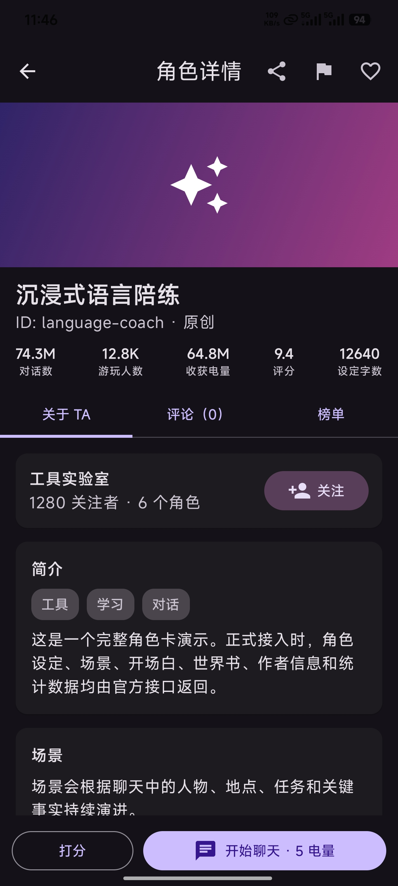
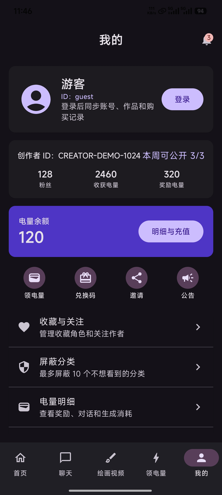
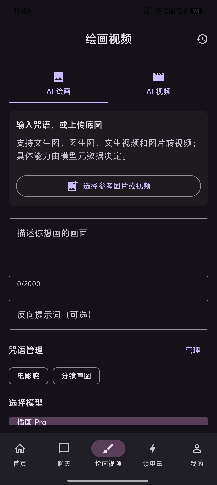
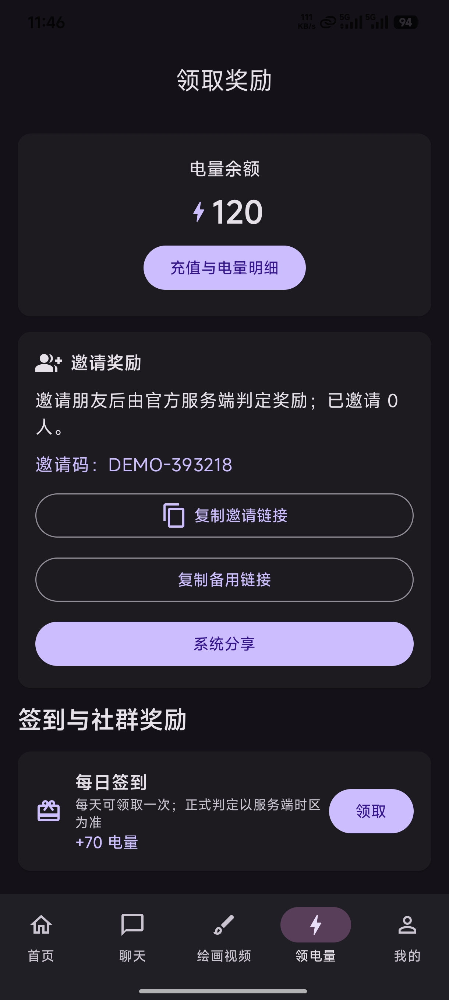
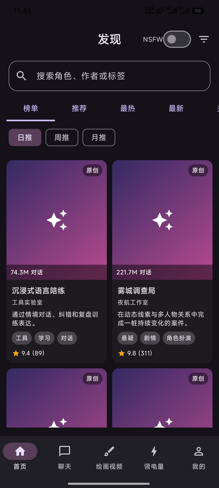
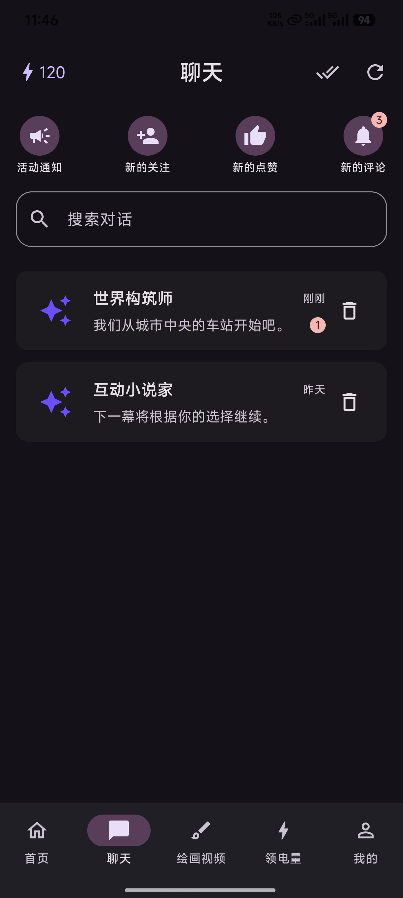
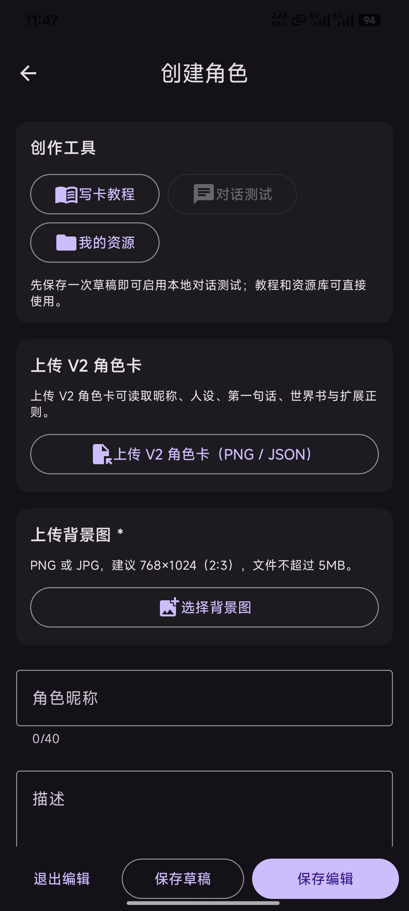
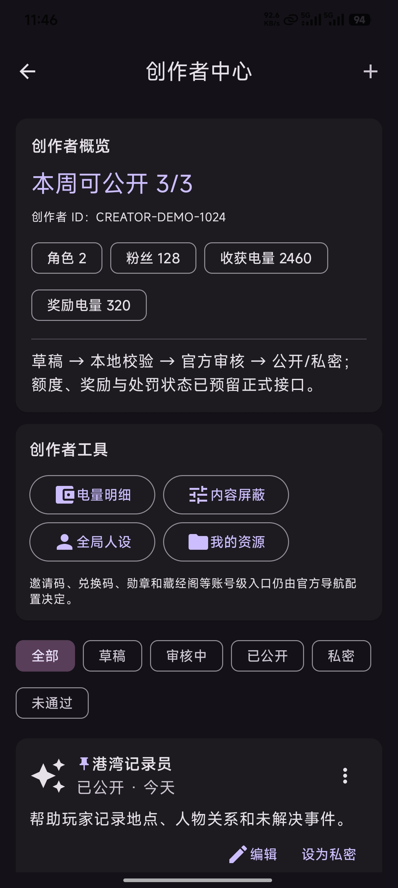
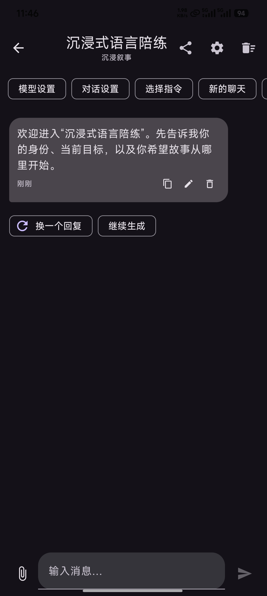

# 搞了个原生安卓的软件框架

创建时间: 2026-08-14T03:53:17.829000+00:00
消息数: 59

---

**ain** (2026-08-14 06:06:26):
没事，经验骗到了就行

**ain** (2026-08-14 06:05:14):
😘

**小魅** (2026-08-14 06:04:52):
感谢宝宝开源<:emoji_140:1379454014852436038> app主要是监管问题，官方大概率是不会做的

**MEE6** (2026-08-14 06:04:22):
<:CHECK6:403540120181145611> 50,000 XP has been given to **<@!957506508676014090>**

**谢特** (2026-08-14 04:26:18):
澄清佬要统治mmd了

**阳玉** (2026-08-14 04:10:11):
按照他们的速度，估计明年的这天就能用上了

**阳玉** (2026-08-14 04:09:51):
<:emoji_298:1535537717704663092>

**ain** (2026-08-14 04:09:49):
mmd他们具体的肯定还是看他们开发不开发

**ain** (2026-08-14 04:09:31):
我就是发个壳子

**乱马（参赛卡艾泽尔酒店）** (2026-08-14 04:09:10):
那还是稍微麻烦一点整成ipa带签名的那种吧

**ain** (2026-08-14 04:08:42):
审核会看代码之类的

**阳玉** (2026-08-14 04:08:39):
主要开发者账户都要money，怎么想都不彳亍口巴（）

**ain** (2026-08-14 04:08:36):
不是发了就有

**ain** (2026-08-14 04:08:26):
应用商店需要审核的

**乱马（参赛卡艾泽尔酒店）** (2026-08-14 04:08:23):
能看棍勇的话，上个mmd应该没关系吧

**乱马（参赛卡艾泽尔酒店）** (2026-08-14 04:07:37):
伪装成计算器怎么需要分钱🤔

**阳玉** (2026-08-14 04:07:25):
上应用商店太不划算了，到时候充值都D人一等<:emoji_248:1447214733718720663>

**阳玉** (2026-08-14 04:06:24):
确实

**ain** (2026-08-14 04:06:08):
充值之类的都要按比例给苹果分成

**ain** (2026-08-14 04:05:53):
不过好像上苹果商店需要分成给苹果吧

**ain** (2026-08-14 04:05:31):
不是严格只要是r18就不让上

**ain** (2026-08-14 04:05:20):
那估计是限级

**乱马（参赛卡艾泽尔酒店）** (2026-08-14 04:05:17):
并且现在好像能用

**乱马（参赛卡艾泽尔酒店）** (2026-08-14 04:05:06):
可是我真的在苹果商店里下到了黄色网站

**ain** (2026-08-14 04:04:52):
不是看表层东西

**ain** (2026-08-14 04:04:45):
上应用商店会审核代码的

**乱马（参赛卡艾泽尔酒店）** (2026-08-14 04:04:38):
或者在反馈里输入六六六那样的

**ain** (2026-08-14 04:04:36):
不行的

**阳玉** (2026-08-14 04:04:21):
大不了爱思助手安了

**阳玉** (2026-08-14 04:04:09):
没事，苹果用户自适应<:1000168532:1298906722546614313>

**乱马（参赛卡艾泽尔酒店）** (2026-08-14 04:04:08):
可不可以做一个伪装，弄一个计算器，然后输入固定的文字就可以进入

**ain** (2026-08-14 04:03:31):
太黄了

**ain** (2026-08-14 04:03:28):
实则mmd就算有原生软件也上不了应用商店

**阳玉** (2026-08-14 04:03:07):
<:emoji_245:1460695536322478268>

**ain** (2026-08-14 04:02:59):
主要还是安全性上需要考虑

**ain** (2026-08-14 04:02:43):
但是如果不上应用商店就无所谓了

**ain** (2026-08-14 04:02:32):
都需要签名

**ain** (2026-08-14 04:02:29):
其实都一样

**阳玉** (2026-08-14 04:02:19):
苹果相对麻烦点，还得签名什么的

**ain** (2026-08-14 04:01:26):
真有安卓的，苹果的估计就简单了

**ain** (2026-08-14 04:01:06):
这些应该做好一个之后代码改改都可以重复用的。

**乱马（参赛卡艾泽尔酒店）** (2026-08-14 04:00:22):
什么时候可以做苹果的ipa<:emoji_242:1459832161719943198>

**阳玉** (2026-08-14 03:59:06):
<:1000168532:1298906722546614313>

**阳玉** (2026-08-14 03:58:56):
<@1135473222658297907>  必须奖励

**阳玉** (2026-08-14 03:58:36):
<:emoji_139:1379455053080825866> 那确实能稳定不少哇

**ain** (2026-08-14 03:57:31):
这真的是一个纯原生的安卓app

**ain** (2026-08-14 03:57:19):
但是不同于之前的套壳浏览器

**ain** (2026-08-14 03:56:52):
实际填充内容需要mmd对接对应的ui资源和api

**ain** (2026-08-14 03:56:38):
就是一个安卓的软件壳子

**乱马（参赛卡艾泽尔酒店）** (2026-08-14 03:56:19):
直接对着网站框架下手吗？真是大手笔呀。👍

**阳玉** (2026-08-14 03:56:10):
澄清搞了个mmd安卓框架，这样app就能稳定不少（应该？

**ain** (2026-08-14 03:55:26):
这是mmd网站的

**乱马（参赛卡艾泽尔酒店）** (2026-08-14 03:55:11):
这是隔壁网站的吗？

**ain** (2026-08-14 03:54:53):
我自己看的话可能多少会漏掉点细节

**ain** (2026-08-14 03:54:41):
帮忙看看哪些还需要和mmd的对齐的功能样式

**ain** (2026-08-14 03:54:19):
发出来图个乐呵，没有接入任何后端，所以没有任何作用。

**阳玉** (2026-08-14 03:54:09):
澄清，你究竟要做什么？！是想取代牢魅的技术吗（

**阳玉** (2026-08-14 03:53:26):
<:1000168510:1298906820638674984>

**ain** (2026-08-14 03:53:17):
搞了个基于mmd的原生的安卓app，不过都是框架，还有一些地方需要完善和网站格式对齐，至于后续的后端工作就不是我这边能搞的了，等我codex额度恢复了再肘击一下，把一些和mmd不一样的地方修改下。

