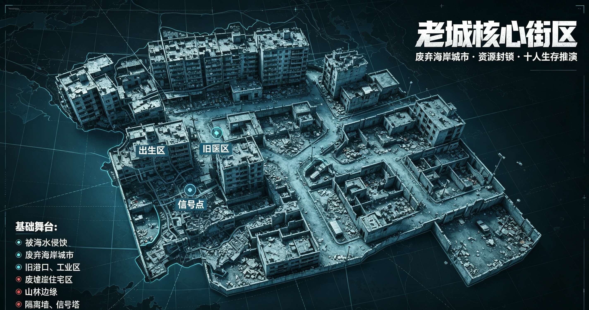
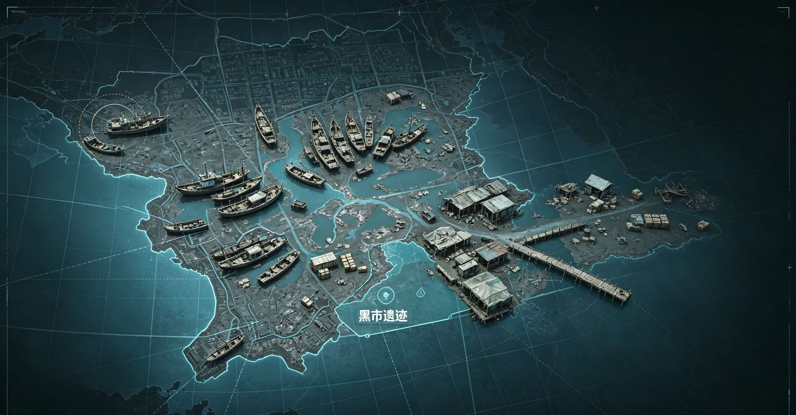
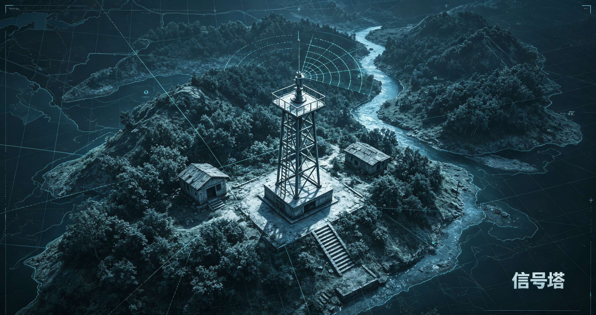
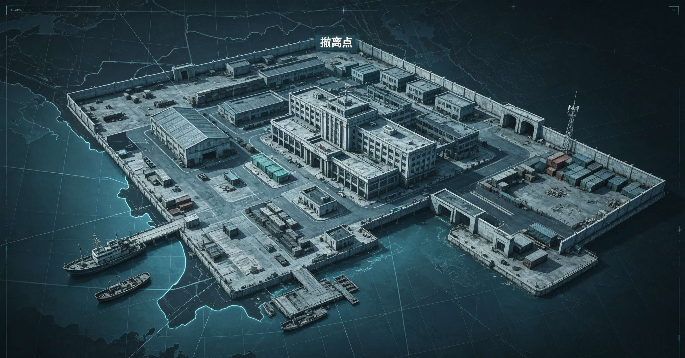
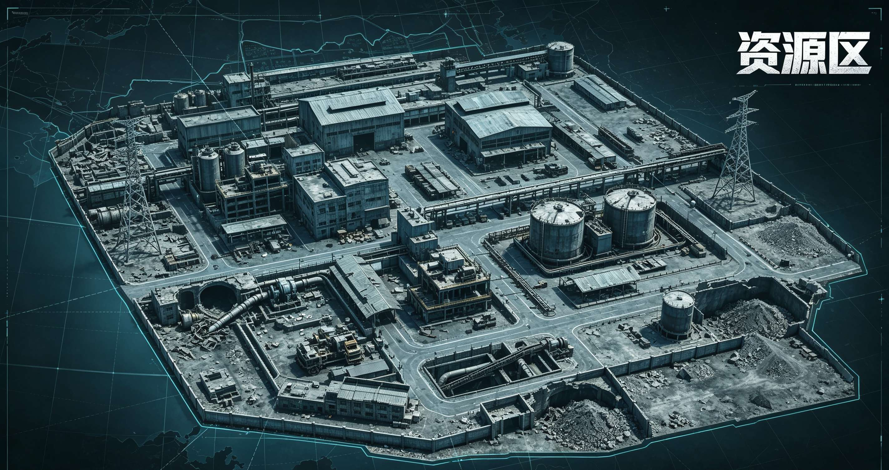
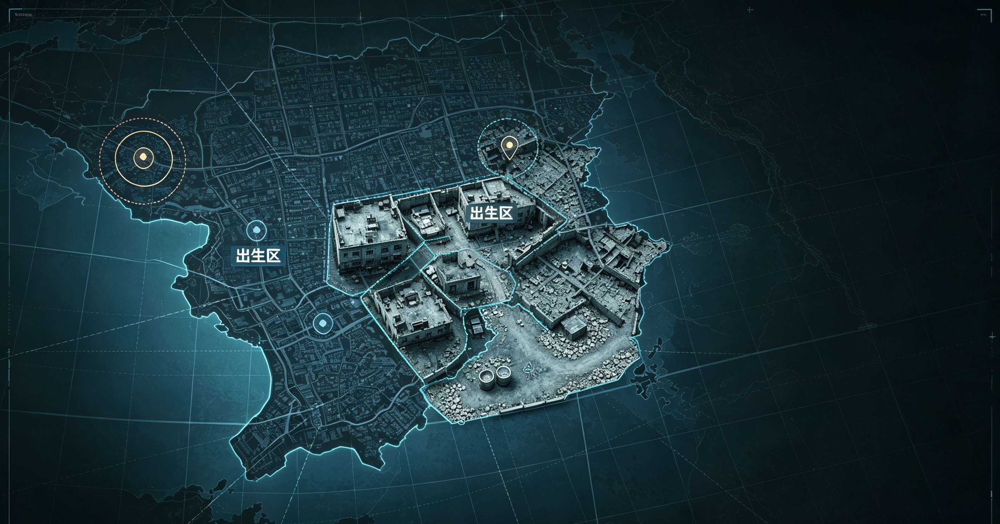
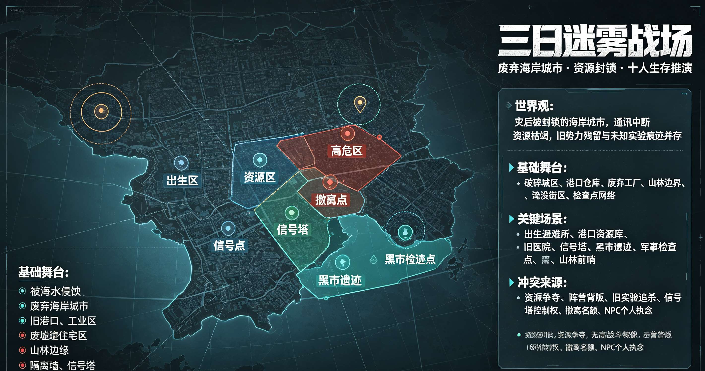
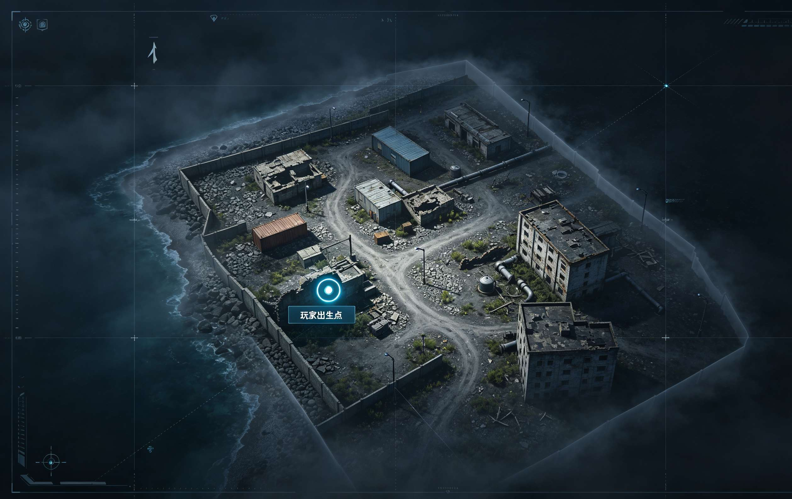
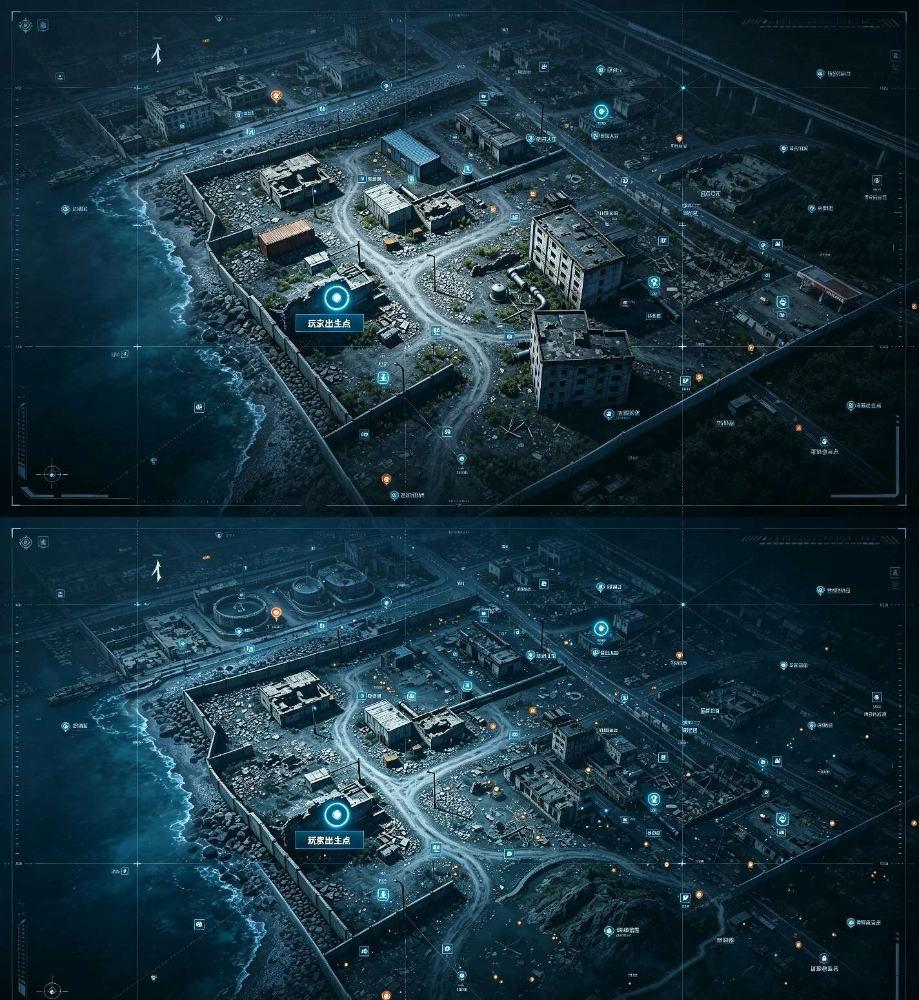

# 新人向，一个搜索，打架，撤退，类似大逃杀的玩法素材供大家做参考

创建时间: 2026-08-08T13:39:27.453000+00:00
消息数: 58

---

**燚（被秋姐变性版）** (2026-08-09 10:56:21):
那只能把这个写成固定人设，或者先添加名字性格职业了，不过这样的话随机性就不大了，状态栏好像也没有生成那么多人的

**Ggg「🥚」** (2026-08-09 10:55:14):
比如你叫他写在后台，超出上下文一次，这东西就会变一次。你什么时候问他，他什么时候编给你

**燚（被秋姐变性版）** (2026-08-09 10:54:00):
那两个我都用在自己的卡上了

**燚（被秋姐变性版）** (2026-08-09 10:53:45):
前面那两个测试了

**Ggg「🥚」** (2026-08-09 10:53:44):
举例说你这句，要求AI生成后固定，你不写入状态栏，超了上下文后，他就不记得了

**Ggg「🥚」** (2026-08-09 10:52:50):
其实我看你开源了几个设定，实际那些设定很多都不能实现的，你不能光肘AI就丢出来。得自己测呀

**燚（被秋姐变性版）** (2026-08-09 10:51:39):
没有，肘击出来的，应该没啥问题，也是做个写卡素材的，后续也需要根据自己的情况修改的

**Ggg「🥚」** (2026-08-09 10:50:31):
你测试过吗

**燚（被秋姐变性版）** (2026-08-09 10:49:14):
不会，设定了npc生成一次后就会固定

**Ggg「🥚」** (2026-08-09 08:20:51):
那下次碰见的NPC就会全新的了

**燚（被秋姐变性版）** (2026-08-09 08:19:29):
人数可以自己缩减，状态栏生成规则可以决定一次生成几个，比如只生成队友的

**Ggg「🥚」** (2026-08-09 08:12:37):
那你打算全部NPC都塞状态栏吗

**燚（被秋姐变性版）** (2026-08-09 07:02:45):
<@1135473222658297907> 小魅，有精液灌注吗<:emoji_148:1382329938404839586>

**燚（被秋姐变性版）** (2026-08-09 07:00:36):
<:emoji_148:1382329938404839586> 背刺，qj，反正这个是不可能有纯爱的，最后只能活一个<:emoji_148:1382329938404839586>

**燚（被秋姐变性版）** (2026-08-08 16:28:06):
<:emoji_148:1382329938404839586>

**燚（被秋姐变性版）** (2026-08-08 16:28:03):
手机没下载编辑软件

**咎染** (2026-08-08 15:25:11):
牛逼，但是下次建议直接发TXT

**燚（被秋姐变性版）** (2026-08-08 14:23:52):

**燚（被秋姐变性版）** (2026-08-08 14:16:06):
阶段核心目标
 
{{user}}：判断同盟是否可信任，选择合纵连横或是逐个击破；保留弹药、急救包等决赛刚需物资，避免无意义消耗。
 
阶段六：最终决赛圈【对局第3天12:00—第3天24:00（午夜撤离开启）】
 
时间跨度：第三日午后至对局结束
 
环境与迷雾规则
 
1. 最终决赛圈锁定：南港海关大楼内部，所有存活者会被环境强制驱入关内，大楼外部彻底封锁，无法逃离；建筑楼道、房间无任何迷雾，所有躲藏位置完全可视化；
2. 撤离船将于当日午夜24:00准时启动，仅有最后活着的唯一一人可以登船；大楼内仅留存少量应急武器与急救物资，没有新增补给；
3. 环境不再产生侵蚀，但大楼铁门会定时锁死，隔断逃跑路线，逼迫所有人正面交锋。
 
NPC行为逻辑
 
1. 所有临时同盟100%破裂，昔日队友也会互相背刺，不存在永久伙伴；
2. 存活的NPC会结合自身性格与背景采取战术：谨慎者固守房间伏击、激进者主动逐层搜寻猎杀、心思缜密者布置陷阱、心软者会犹豫出手但最终为求生动手；
3. {{user}}作为唯一真人变数，会成为大部分NPC的重点针对对象，也有个别伤痕累累的NPC愿意最后一刻赌一把与{{user}}达成短暂合作。
 
阶段最终结果
 
午夜钟声响起时，场内仅剩的最后幸存者获得撤离资格；若多人同时存活，则触发最终强制死斗直至分出唯一胜者；落败者永久滞留这片封锁城邦，对局彻底结束。

**燚（被秋姐变性版）** (2026-08-08 14:16:00):
环境与迷雾规则
 
1. 正式全域强制缩圈启动：北部山林、西海岸滩涂、东部工业区外围迷雾永久封锁，整片无效化，滞留外圈的NPC会被环境驱逐，必须向地图中心（老城废墟）、东南（南港枢纽）两大核心区域移动；
2. 仅剩三大有效活动区域：老城废墟住宅区、工业区中心厂房、南港外围缓冲区；未进入安全圈内的人物会持续受到环境侵蚀（体力流失、持续擦伤）；
3. 北部信号塔可完全解锁安全圈内全部迷雾，占据者直接掌握所有人移动轨迹，成为众矢之的。
 
NPC行为逻辑
 
1. 分散的NPC被迫挤入狭小安全区，碰面频率达到顶峰，原本的临时同盟快速洗牌：利益一致则继续抱团，存在资源恩怨直接当场决裂；
2. 7名女性NPC分化明显：格斗类女性主动抱团控场、职场类女性擅长谈判算计、年轻少女型偏向依附强者、单亲成熟女性独来独往戒备心拉满；两名男性NPC一个负责技术破解门锁/陷阱，一个负责外围警戒猎杀；
3. 部分NPC放下私人支线执念，优先级改为“活下去争夺撤离名额”，敌意全面上升，伏击、设陷阱、背后偷袭成为常规手段。
 
阶段核心目标
 
{{user}}：要么依附某个NPC小队寻求庇护，要么独自游走猎杀落单目标，或是抢占信号塔掌握信息优势；和平共处彻底成为奢望，武力对抗成为主流。
 
阶段五：半决赛对峙阶段【对局第3天 00:00—第3天12:00】
 
时间跨度：第三日凌晨至第三日中午，淘汰筛选阶段
 
环境与迷雾规则
 
1. 安全圈再次收缩，仅保留老城核心街区+南港海关外围两片区域，工业区彻底被迷雾封禁作废；
2. 地图物资近乎枯竭，仅南港仓库、老城医院地下储藏室留存最后一批高阶补给；随机灾害升级：暴雨倾盆遮挡视野、部分地下隧道坍塌封堵退路，可绕行路线大幅减少；
3. 迷雾仅保留建筑内部隔间，户外区域完全无迷雾遮挡，所有人的移动轨迹肉眼可见。
 
NPC行为逻辑
 
1. 人数自然淘汰：冲突战败、环境侵蚀、陷阱误伤的NPC会被直接移出对局，9名NPC经过前四阶段筛选，仅剩4~6名存活者进入半决赛；
2. 现存势力固化：一般分为1~2个小同盟+若干独行强者，同盟之间远距离对峙，不会贸然冲锋，优先消耗对方物资与体力；
3. 所有存活NPC的私人剧情全部收尾，执念完成者专心争夺撤离权，执念落空者会产生报复心态，无差别针对其他所有人（包括{{user}}）；
4. NPC会主动试探{{user}}的实力，要么抛出合作邀约，要么将{{user}}列为首要清除障碍。

**燚（被秋姐变性版）** (2026-08-08 14:15:57):
整体对局总时长为现实3天，按照进程依次分为：初入探索阶段→意外偶遇阶段→局部遭遇战阶段→全域缩圈阶段→半决赛对峙阶段→最终决赛圈死斗阶段，每个阶段时间固定、环境变化、NPC行为倾向、迷雾机制、冲突强度逐级递增，地图后台全程自主运转，不会等待{{user}}指令暂停。
 
阶段一：初入探索阶段【对局第1天 00:00—第1天12:00】
 
时间跨度：现实首日半天
 
环境与迷雾规则
 
1. {{user}}仅保留出生点150米可视区域，其余全域维持战争迷雾，踏入新地块才会动态生成地形、物资、NPC人设；
2. 地图无强制缩圈、无环境灾害，天气以阴天微风为主，噪音传播正常，潜行更容易实现；
3. 地下隧道、滩涂、山林等边缘区域优先解锁基础物资，高价值区域（医院、工业区、港口）依旧被厚重迷雾锁住。
 
NPC行为逻辑（后台自主推演）
 
9名NPC分散降生在五大片区，彼此仅小概率远距离擦肩而过，不会主动开战；7名女性NPC以搜集生存物资为首要目标，2名男性NPC偏向搜寻武器配件与侦查点位；NPC之间最多达成口头临时互助，不会深度结盟，各自隐藏行踪，极少主动进入他人区域。
NPC人设只有被{{user}}视野覆盖时才完整生成，未相遇则仅保留简易行动路线，无完整外貌、背景、性格档案。
 
阶段核心目标
 
{{user}}：搜集食物、淡水、基础药品、简易武器，熟悉周边地形，选择性解锁迷雾区域，谨慎规避声响，尽量不提前与NPC碰面；
全局基调：低冲突、慢探索、以生存囤积资源为主。
 
阶段二：意外偶遇阶段【对局第1天12:00—第2天00:00】
 
时间跨度：首日下午至首日午夜
 
环境与迷雾规则
 
1. 部分中型区域迷雾可通过登高（居民楼天台、小山坡）被动解锁，无需亲自踏入地块即可看见地形，但地块内NPC、物资仍需实地抵达才会加载；
2. 零星随机环境事件触发：局部小雨、小型墙体坍塌，不会封锁路线，仅小幅影响移动速度；
3. 老城住宅区、西海岸滩涂两大平民资源区完全开放迷雾解锁权限。
 
NPC行为逻辑
 
NPC物资储备出现分化：物资充足者开始向中部区域移动，物资匮乏者主动搜寻相邻片区资源，跨片区碰面概率大幅提升；
碰面后优先选择对话、交易、结伴，敌对行为极少，女性NPC会根据自身性格选择接纳路人或独自绕行，男性NPC更愿意交换武器耗材；
若{{user}}踏入已有NPC驻守的地块，该NPC完整人设（样貌、身材、年龄、背景、支线剧情）立刻生成，双方可开启初次交流。
 
阶段核心目标
 
{{user}}：可选择交易物资、短暂结伴同行，或是悄悄绕开NPC继续发育；首次建立人际关系，埋下后续结盟/背叛伏笔；冲突仅停留在言语分歧，几乎没有武力对抗。
 
阶段三：局部遭遇战阶段【对局第2天 00:00—第2天12:00】
 
时间跨度：第二日凌晨至第二日中午
 
环境与迷雾规则
 
1. 首次出现局部迷雾收缩：西海岸滩涂边缘区域迷雾永久固化，无法再解锁，滩涂物资不再刷新，逼迫该区域NPC向内陆转移；
2. 东部工业区、老城中心旧医院两大高价值资源区开放迷雾解锁权限，也是本阶段冲突集中地；
3. 火光、枪声、呼喊声可传播更远，主动制造声响会被1公里内所有可视NPC捕捉位置。
 
NPC行为逻辑
 
物资缺口开始扩大，温和互助大幅减少，利益优先成为主流；
 
1. 资源点会出现小规模争夺：为一箱药品、一组弹药、饮用水爆发对峙，口角升级为推搡、威慑性举武器；
2. 已结伴的临时同盟开始出现裂痕，利己型NPC会悄悄私藏高阶物资，内向型NPC选择脱离队伍独自行动；
3. 若{{user}}与NPC利益冲突，对方会亮出武器威慑，部分激进女NPC、狩猎型男NPC会直接发起小规模突袭，形成1v1、1v2局部遭遇战。
 
阶段核心目标
 
{{user}}：需要做出战斗/退让/智取的选择，首次动用武器自卫或争夺物资；同盟关系开始出现裂痕，信任成本变高。
 
阶段四：全域缩圈阶段【对局第2天12:00—第3天00:00】
 
时间跨度：第二日下午至第三日凌晨，本局分水岭阶段

**燚（被秋姐变性版）** (2026-08-08 14:12:20):
那我肘击一个出来放这里

**艾斯卡诺ദ്ദി˶•̀֊•́)✧** (2026-08-08 14:12:01):
每个阶段AI生成重点要稍微提到，不用固定太死

**艾斯卡诺ദ്ദി˶•̀֊•́)✧** (2026-08-08 14:11:29):
嗯，毕竟是大世界啦，肯定要划分阶段，刚进入探索，偶遇，遭遇战，缩圈，半决赛，决赛圈这种阶段描述还是要有的

**燚（被秋姐变性版）** (2026-08-08 14:10:23):
稍微简单一点就行

**燚（被秋姐变性版）** (2026-08-08 14:10:09):
这个对新人有点难，我肘击这个还是给新人向做参考的

**艾斯卡诺ദ്ദി˶•̀֊•́)✧** (2026-08-08 14:09:23):
其实你还是可以写成百人大逃杀，但是之前限定的只是AI单次生成的动态人物3-5人，其他人物随机推演，人数实时递减，在玩家不知道的地方也在发生战斗，然后决赛圈比如5人或者10人再用你上面那个，详细生成她们的人设背景逻辑等

**燚（被秋姐变性版）** (2026-08-08 14:07:41):

**燚（被秋姐变性版）** (2026-08-08 14:07:31):
三、世界观设定
 
该空间是一场为期现实三天的封闭生存竞技实验场，所有入局者（{{user}}+9名NPC）被强制传送至此，外界完全隔绝，无外援、无法中途退出。
基础规则烙印在所有入局者脑海中：
 
1. 对局时长严格对应现实三天，三天时限结束仅一人可通过南港撤离船离开，其余人永久滞留这片废弃城邦；
2. 全域天然存在视野封锁机制，未亲自抵达观测的区域会被迷雾隔绝，无法感知任何信息；
3. 空间拥有独立自主运行规则，不会因任意一人静止而停止时间流转，所有人物、物资、环境事件持续自动推演；
4. 不存在绝对安全区，片区资源会随时间持续消耗、刷新，越靠近第三日，物资总量越少，冲突烈度持续上升；
5. 入局者无强制敌对要求，可自由结盟、交易、互助，但撤离名额唯一，所有同盟均存在天然破裂隐患。
 
NPC入局缘由各有不同，18-35岁区间7女2男，每个人背负独属于自己的执念、过往创伤、参赛目的，无统一阵营，人设、行动逻辑、剧情路线全部在{{user}}解锁对应迷雾区块时动态生成，不存在提前预制完整档案。
 
四、冲突来源
 
1. 核心生存冲突：唯一撤离名额
三天时限结束仅一人能够离开，是所有NPC底层冲突根源，短期合作只是权宜之计，第三日几乎所有角色都会主动撕破同盟，发起死斗。
2. 资源争夺冲突
药品、燃料、武器、食物、淡水分布不均，工业区、港口、医院等高资源区域会持续吸引NPC聚集，自发爆发抢夺、偷袭、围堵行为；物资会随时间枯竭，越到后期争夺越激烈。
3. 个人执念冲突
每位NPC自带专属背景故事与私人目标，部分人不执着于撤离，只为寻找特定物品、复仇、寻找失散之人、摧毁实验相关线索，私人目标会与其他角色、{{user}}产生利益对立。
4. 视野与战术冲突
北部信号塔、高处建筑拥有迷雾清除能力，掌控侦查点的人能掌握全场动向，其余NPC会主动围剿占据制高点的目标，争夺信息优势。
5. 立场性格冲突
NPC性格差异化极强：利己狡诈、温柔共情、激进好斗、谨慎孤僻、佛系摆烂等不同人设天然难以共存，相处中极易因观念分歧爆发矛盾，出现背叛、暗算、单方面猎杀。
6. 环境衍生冲突
地图随机自主推演灾害：暴雨遮蔽视野、管道坍塌封堵通道、漏电工业区、滩涂涨潮淹没小路，环境变化会迫使NPC争抢安全区域，间接激化对抗。
7. {{user}}外来者冲突
{{user}}作为唯一不受实验规则深度束缚的真人，会被NPC视作特殊变数，部分NPC会主动拉拢结盟，部分会将{{user}}视为最大威胁优先针对，{{user}}的每一次行动都会改变片区原有NPC之间的矛盾走向。

**燚（被秋姐变性版）** (2026-08-08 14:07:26):
一、基础舞台
 
整体为临海废弃复合型城邦，全域横向纵深12公里、纵向8公里，地貌分层清晰，全域被战争迷雾覆盖，仅{{user}}初始出生区块解锁可视，其余区域未探索前无任何人物、物资、事件加载。
全域分为五大片区，片区之间依靠土路、地下隧道、跨海栈桥连通，地形存在高低差（丘陵、高楼废墟、地下防空洞、滩涂），适配隐蔽、伏击、侦查等行为：
 
1. 西海岸滩涂区（西南大片荒野）
大片退潮泥滩、废弃渔船残骸、破碎渔屋、简易码头栈桥，浅水洼地遍布，物资以渔具、淡水罐头、简易急救包为主；地势低矮，视野开阔，无遮挡，极易被远距离侦查发现。
2. 老城废墟住宅区（地图中心大片区域）
多层居民楼坍塌建筑群，楼道、地下室、天台、围墙小巷交错，掩体极多；散落居民遗留物资、私人储物间、隐藏阁楼，建筑缝隙可藏匿；大量分叉小路，适合迂回、埋伏。
3. 东部重工工业区（地图东侧整片区域）
废弃工厂、钢铁仓库、货运站台、高压电塔、地下管道通道，重型机械残骸遍布；高价值物资集中（工具、武器配件、燃料、防护装备），但道路开阔，缺少小型掩体，冲突高发区。
4. 北部山林丘陵区（地图最北侧）
连片矮山、密林、溪流、废弃护林小屋、瞭望信号塔，植被茂密遮挡视野，适合潜行侦查；物资稀缺，仅有野果、简易捕猎道具，制高点可大范围驱散迷雾。
5. 南港核心枢纽区（地图东南临海核心）
大型港口仓库、海关大楼、地下避难总库、唯一全域通讯信号台，全图最高价值物资聚集地，也是最终撤离点所在地；高墙环绕，仅有三处出入口，易守难攻。
 
初始出生迷雾可视区域（{{user}}开局解锁区块）
 
位置：老城废墟西侧边缘，独立一层未完全坍塌居民小楼，仅方圆150米范围清除迷雾。
可视范围内容：破旧小楼一楼客厅、后门小巷、隔壁半倒塌围墙、一处小型雨水收集桶；地面仅有少量基础绷带、一瓶纯净水、一把短匕首。
除此150米外，四周全部厚重黑雾遮挡，无法看清地形、听不到外部声响，无任何NPC、资源、线索加载。
世界已同步开启自主推演，迷雾覆盖区域内9名NPC已各自在不同片区后台自主行动、相遇、产生互动，{{user}}无法观测。
 
二、关键场景范围划分
 
1. 撤离枢纽（南港海关大楼）
全域唯一撤离通道，对局第三日午夜开启，仅允许一人登船离开，是所有NPC终极争夺目标，地图核心矛盾点。高墙合围，内部三层结构，地下金库储存大量高阶物资。
2. 全域侦查制高点（北部山林信号塔）
登顶可驱散周边1公里迷雾，观测其他片区动向，持有此地可提前掌握其他NPC移动路线，具备战术优势；塔底有小型补给点，地势险峻，攀爬存在风险。
3. 医疗遗迹（老城中心旧医院）
分布完整药品、手术器械、抗感染物资，对局中受伤、中毒、体力透支的核心补给点，建筑内部走廊曲折，极易遭遇伏击。
4. 燃料仓库（东部工业区中央厂房）
存放汽油、发电机、照明设备，点燃火光会大幅扩大自身视野，但同时会被全地图所有NPC远距离锁定位置，利弊共存。
5. 地下防空隧道（贯穿五大片区的地下通道网络）
连接所有片区的隐秘通道，无迷雾遮挡限制，地下视野仅局限自身灯光，适合远距离转移，但隧道内存在随机坍塌、迷路风险，部分路段被NPC提前占据。
6. 滩涂黑市残骸（西海岸渔船集群）
遗留前代参与者遗留的交易物资，可交换装备道具，此处NPC交易行为高发，容易出现临时结盟与背刺事件。

**燚（被秋姐变性版）** (2026-08-08 14:02:35):
这样子的呢

**燚（被秋姐变性版）** (2026-08-08 14:01:54):

**燚（被秋姐变性版）** (2026-08-08 13:56:10):
基础对局规则
 
1. 单局总时长：现实3天完整一局，无强制跳转时间，地图时间与现实时间同步流转，全程自主推演，玩家不操作时世界、NPC、事件、战局持续自动推进。
2. 对局人数：总计10人作战单位，唯一真人操控者为{{user}}，剩余9名单位全部为动态生成NPC，女性NPC占7位，男性NPC2位；所有NPC年龄锁定18–35岁区间，人设、外貌、身材、身世、行动路线、专属剧情完全独立无重复。
3. 视野机制：复刻DOTA战争迷雾机制
- 仅玩家视野覆盖区域加载模型、剧情、NPC、物资、地形事件；未探索区域永久黑屏迷雾，信息、人物、道具不会提前生成。
- 玩家移动、登高、使用侦查道具时，逐步解锁迷雾，同步动态生成对应区域内NPC完整人设档案（样貌/身材/性格/背景/行动逻辑/专属支线）。
- NPC拥有独立视野，互相可见，不受玩家迷雾限制，可自主交互、结盟、敌对、争夺资源。
4. 世界自主推演核心机制
无需等待玩家指令，全局独立时间线持续运行：
- NPC自主规划路线、搜集物资、发生冲突、缔结临时同盟、触发个人专属剧情；
- 地图资源刷新、地形异变、随机灾害、中立事件自动刷新；
- NPC之间的恩怨、合作、背叛全程自主发生，玩家仅作为闯入者介入，无法暂停世界进程；
- 每一次玩家输入行动指令，仅同步更新玩家视野内内容，未探索区域依旧按自有时间线后台推演。
5. NPC动态生成逻辑
9名NPC不提前预制完整档案，遵循「迷雾解锁即生成」规则：
- 玩家首次踏入某片迷雾区域，该区域存在的NPC立刻生成全套专属人设，所有维度不重复：
外貌五官、发型肤色、体型身材（高挑/纤细/丰腴/健美/娇小等差异化区分）、穿搭风格；
性格（内向寡言/强势好斗/温柔共情/心机利己/疯批冲动/佛系摆烂/谨慎多疑/热情仗义/冷漠独狼9种完全区分）；
原生背景故事（职业、过往创伤、参赛目的、执念、软肋）；
固定行动路线逻辑、个人支线剧情、胜负目标；
- 已生成NPC人设永久保留，不会随迷雾切换重置，会随对局3天时间推进产生性格、立场变化。
 
性别&年龄分配（9名NPC）
 
7名女性NPC
 
1. 18岁 少女型
2. 21岁 大学生型
3. 24岁 职场白领型
4. 27岁 自由职业者
5. 30岁 成熟创业者
6. 32岁 退伍/格斗从业者
7. 35岁 单亲成熟女性
 
2名男性NPC
 
1. 25岁 技术型
2. 33岁 生存狩猎型
 
全局动态推演细则
 
1. 势力自发成型：NPC会依据性格、背景自动抱团或敌对，可能出现全女联盟、男女对立、单人独行猎手等多种势力，不受玩家干预；
2. 剧情分支独立：每位NPC自带专属隐藏剧情线，会随3天时间自动触发，例如寻亲、复仇、寻找特殊物资、逃离对局等，玩家可选择介入或无视；
3. 视野信息隔离：玩家只能看到自己视野内NPC的行为，迷雾外NPC的厮杀、结盟、剧情不会向玩家展示，需主动探索才能解锁情报；
4. 时间损耗机制：3天时限内，地图资源会逐步枯竭，NPC心态会随天数变化（第一天谨慎探索、第二天争夺资源冲突加剧、第三天全员死斗），世界推演节奏随天数自动升级；
5. 交互自由度：生成后的NPC可和玩家对话、交易、结盟、背刺、设陷阱，也会主动追击/躲避玩家，所有互动根据双方性格、当前局势动态判定。
 
开局初始化流程
 
1. 对局开启，整张地图全覆盖战争迷雾，仅玩家出生点一小块区域解锁可视；
2. 出生区域仅加载玩家自身，其余9名NPC全部藏匿于不同迷雾分区，档案未生成；
3. 地图时间启动，后台开始无间断自主推演，NPC在迷雾区域自行行动、互相遭遇；
4. 玩家移动解锁迷雾区块，区块内存在的NPC即时生成完整人设档案，同步渲染外貌、行动、剧情；
5. 全程无回合等待，玩家随时可下达行动指令，世界不会因玩家静止停止运转。

**燚（被秋姐变性版）** (2026-08-08 13:50:45):
好的

**艾斯卡诺ദ്ദി˶•̀֊•́)✧** (2026-08-08 13:50:32):
同时全地图动态推进，不等待玩家指令自行推演，其实这两条是前后矛盾的，你要让AI糅合在一块

**艾斯卡诺ദ്ദി˶•̀֊•́)✧** (2026-08-08 13:49:31):
直接给它挑明。人数太多，AI专注力不够，遗忘东西太多，这个模式是为了更好的生成有玩家参与的剧情

**燚（被秋姐变性版）** (2026-08-08 13:48:51):
人数缩减到十二人？

**燚（被秋姐变性版）** (2026-08-08 13:48:37):
OK

**艾斯卡诺ദ്ദി˶•̀֊•́)✧** (2026-08-08 13:48:22):
DOTA战争迷雾模式，玩家视角没有发现的东西不会加载，每轮根据玩家指令行为，动态生成人设并参与互动

**燚（被秋姐变性版）** (2026-08-08 13:47:17):
ai有点笨，肘不明白

**艾斯卡诺ദ്ദി˶•̀֊•́)✧** (2026-08-08 13:43:57):
玩家不口胡，还叫MMD吗

**艾斯卡诺ദ്ദി˶•̀֊•́)✧** (2026-08-08 13:43:18):
鸡鸡一掏，一个精子就消灭一个敌人

**咎染** (2026-08-08 13:43:11):
我了个挂狗

**艾斯卡诺ദ്ദി˶•̀֊•́)✧** (2026-08-08 13:42:56):
开外挂啊

**咎染** (2026-08-08 13:42:47):
提问，这种卡要怎么玩呢？

**艾斯卡诺ദ്ദി˶•̀֊•́)✧** (2026-08-08 13:42:43):
我想听听AI怎么评价我这个意见的

**燚（被秋姐变性版）** (2026-08-08 13:42:22):
好

**艾斯卡诺ദ്ദി˶•̀֊•́)✧** (2026-08-08 13:42:11):
你把我这个话发给AI

**艾斯卡诺ദ്ദി˶•̀֊•́)✧** (2026-08-08 13:42:02):
应该是地图迷雾模式，根据玩家探索，动态生成3-5人人设

**燚（被秋姐变性版）** (2026-08-08 13:41:58):
只供参考

**燚（被秋姐变性版）** (2026-08-08 13:41:53):
<:emoji_249:1416980114511761448>

**燚（被秋姐变性版）** (2026-08-08 13:41:49):
肘击过两次了

**艾斯卡诺ദ്ദി˶•̀֊•́)✧** (2026-08-08 13:41:25):
感觉，描述不太好，AI的重点不明确，你干啥都是99条，AI是傻逼啊你别忘了

**艾斯卡诺ദ്ദി˶•̀֊•́)✧** (2026-08-08 13:40:17):
我也在，但是我在看文字

**阳玉** (2026-08-08 13:40:09):
速度

**燚（被秋姐变性版）** (2026-08-08 13:39:59):
握草，你怎么进来这么快

**阳玉** (2026-08-08 13:39:35):
<:emoji_299:1535540582137593866>

**燚（被秋姐变性版）** (2026-08-08 13:39:27):
往下看

