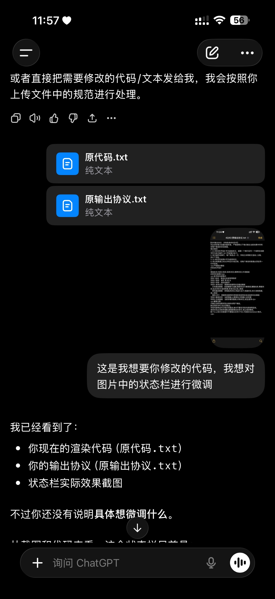
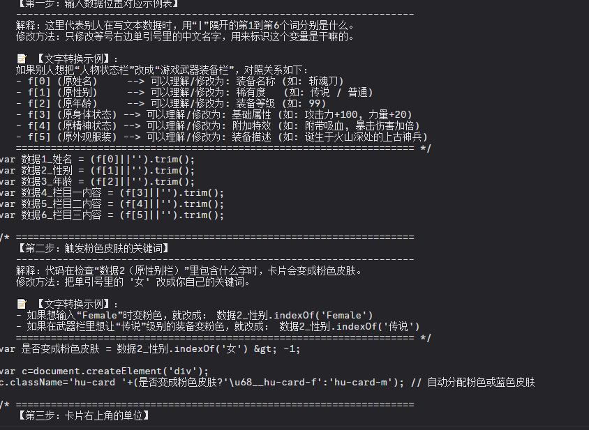
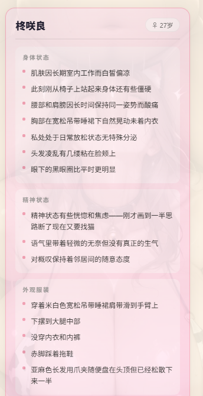

# 新人向，简单状态栏，包括如何修改数据，在哪里修改

创建时间: 2026-05-30T16:11:36.653000+00:00
消息数: 10

---

**乱马（参赛卡艾泽尔酒店）** (2026-06-06 04:06:36):
大佬，我不知道怎么对着AI问

**小魅** (2026-05-30 17:15:07):
感谢宝宝开源<:emoji_140:1379454014852436038>

**MEE6** (2026-05-30 17:15:01):
<:CHECK6:403540120181145611> 30,000 XP has been given to **<@!1423837692017381376>**

**周雅（被老婆调教.周浩）** (2026-05-30 16:15:42):
<@1135473222658297907> 非常好的开源，奖励经验

**红叶绯夜子** (2026-05-30 16:15:30):
就是这样的，都给你标注好修改哪里了

**红叶绯夜子** (2026-05-30 16:13:50):
还是不知道怎么修改的，可以找我

**红叶绯夜子** (2026-05-30 16:13:28):
需要修改的地方在文本里面标注了

**红叶绯夜子** (2026-05-30 16:13:02):
正则不变，通用

**红叶绯夜子** (2026-05-30 16:12:44):
前面带有“原”字样的就是我的卡在用的，可以作为对照

**红叶绯夜子** (2026-05-30 16:11:36):
这是一个简单的状态栏，不够人家真正大佬的状态栏华丽，功能多样。只是最简单的显示数据。

