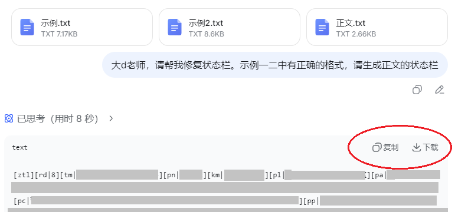
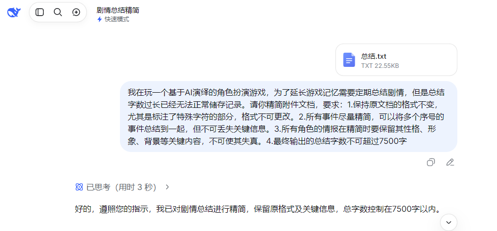
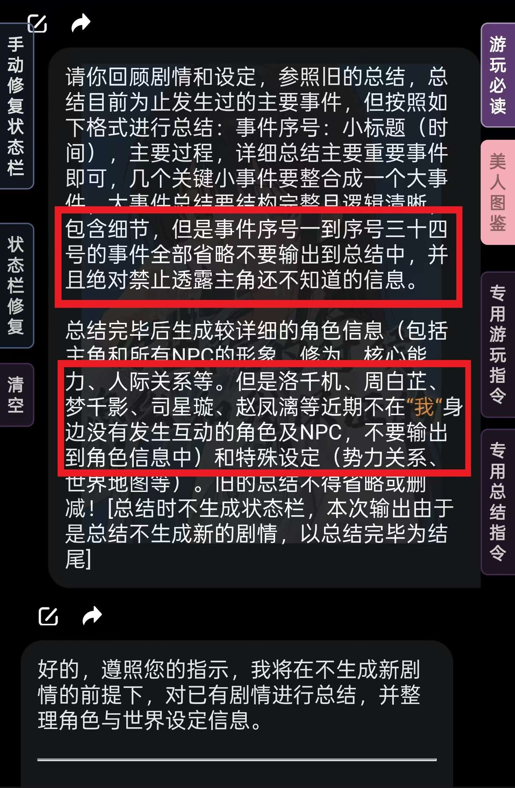
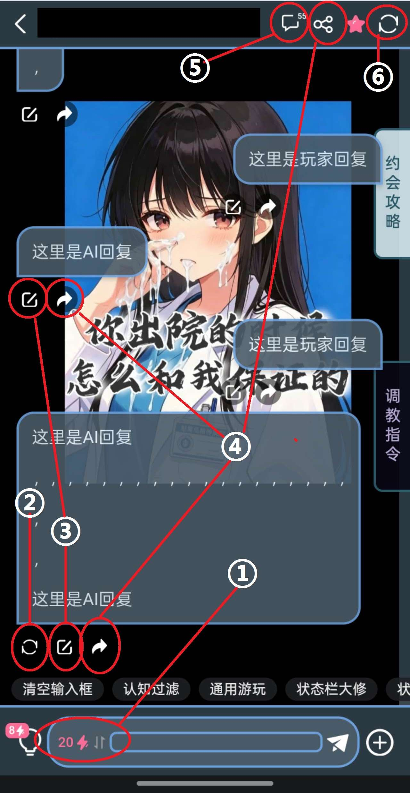
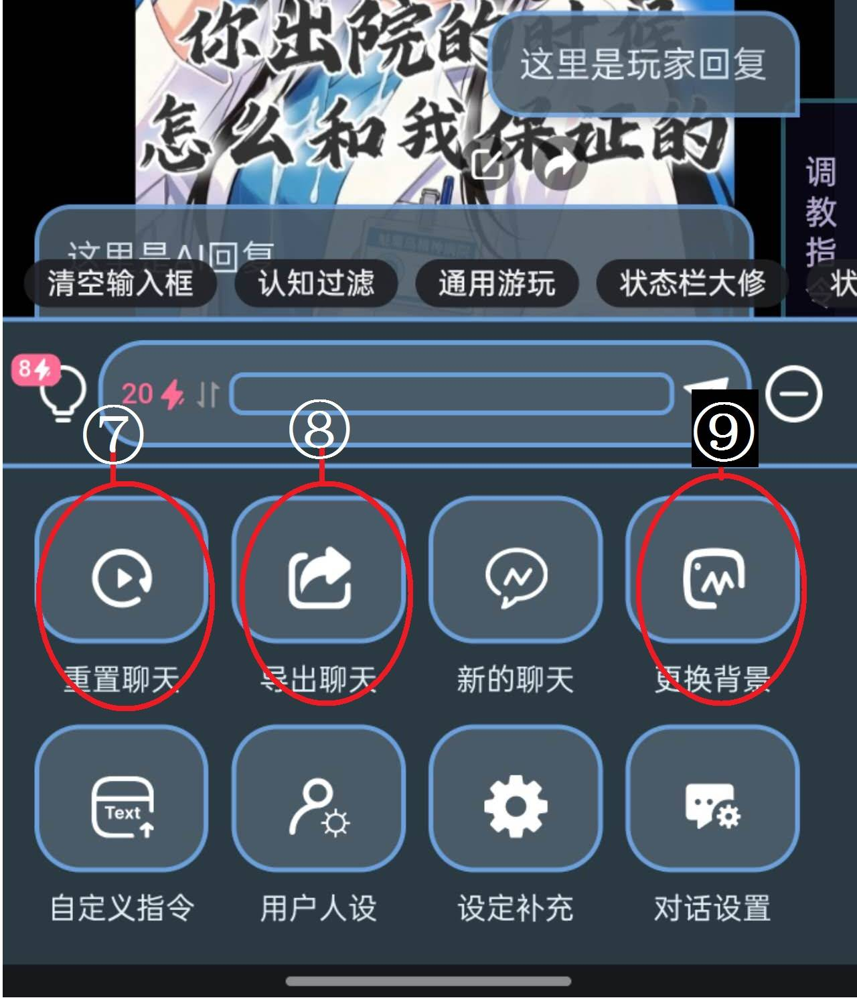
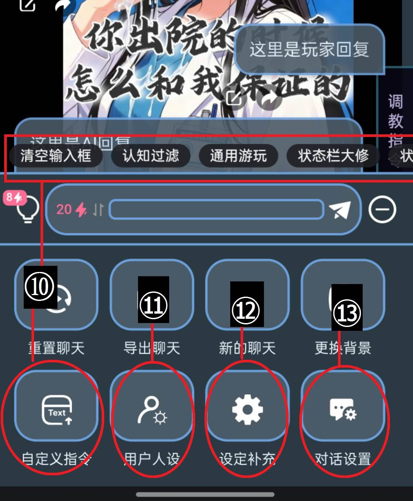
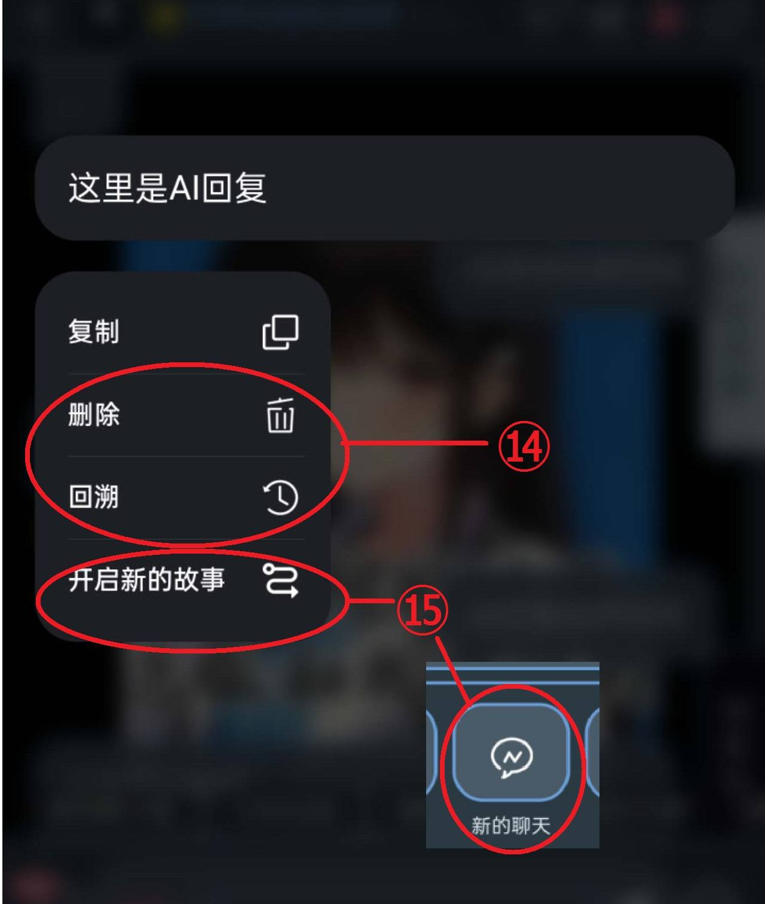

# 新人教程 萌新玩卡指南 入坑指南——mmd游玩常见问题Q&A

创建时间: 2026-05-31T11:51:39.234000+00:00
消息数: 66

---

**清风（失踪版）** (2026-06-27 09:25:47):
请不要将玩家输入内容作为已经发生的前提，而是作为需要描述的场景的一部分，进行适当扩写和改写。输出3000～4500tokens原创剧情。禁止NPC直接获知他人所思所想，生成正文时减少直接心理活动描写，语言精炼、干脆，以对话和核心动作推进为主，侧重以行动和对话来体现角色心理。最慢幅度的推进剧情，每轮回复只推进当前局势的一小段，不强行写出完整起承转合，不把一次行动扩写成从开始到结束的完整章节。

**清风（失踪版）** (2026-06-27 09:24:07):
——————
# 示例：

**清风（失踪版）** (2026-06-27 09:23:13):
最慢幅度的推进剧情，每轮回复只推进当前局势的一小段，不强行写出完整起承转合，不把一次行动扩写成从开始到结束的完整章节。

**清风（失踪版）** (2026-06-27 09:23:12):
## 【放慢节奏】

**清风（失踪版）** (2026-06-27 09:23:11):
更大幅度的推进剧情到下一个情节，避免反复复述玩家指令，避免车轱辘式情绪渲染，避免每次都总结意义。动作、对话、环境变化交错呈现，让局势自然滚动。

**清风（失踪版）** (2026-06-27 09:21:41):
## 【加快节奏】

**清风（失踪版）** (2026-06-27 09:20:10):
输出3000～4500tokens原创剧情。

**MEE6** (2026-06-27 09:20:09):
**Reason:** Spam

**清风（失踪版）** (2026-06-27 09:18:30):
## 【字数控制】

**清风（失踪版）** (2026-06-27 09:17:48):
请不要将玩家输入内容作为已经发生的前提，而是作为需要描述的场景的一部分，进行适当扩写和改写。

**清风（失踪版）** (2026-06-27 09:16:37):
## 【要复读】

**清风（失踪版）** (2026-06-27 09:15:48):
禁止重复上文段落或语意，严格按照作者的人物、世界信息生成内容，避免车轱辘重复，不反复复述玩家输入，禁止将玩家指令改写成长篇小作文。

**清风（失踪版）** (2026-06-27 09:14:29):
——————
# 游玩指令
## 【防复读】

**清风（失踪版）** (2026-06-27 09:12:20):
禁止NPC直接获知他人所思所想，生成正文时减少直接心理活动描写，语言精炼、干脆，以对话和核心动作推进为主，侧重以行动和对话来体现角色心理。

**清风（失踪版）** (2026-06-27 09:11:15):
## 【防读心】

**清风（失踪版）** (2026-06-27 09:05:54):
角色行为和思想必须严格按照设定演绎，禁止陷入黑暗、麻木、崩溃、昏迷，空洞，人偶等失能状态，严禁角色无端变得极端情绪化、产生创伤性反应。描写角色时应通过不少于五句的、发自情感的台词及行动，维持角色鲜活人设与自主行动力。

**清风（失踪版）** (2026-06-27 09:05:49):
## 【防失能】

**清风（失踪版）** (2026-06-27 09:05:07):
严格锁定NPC的认知视角，始终贯彻“展示而非告知”，禁止NPC上帝视角，绝对禁止NPC得知剧情尚未交代、或玩家未公开的隐藏信息，禁止NPC获知自身可认知范围以外的一切信息。

**清风（失踪版）** (2026-06-27 09:03:10):
## 【防上帝视角】

**清风（失踪版）** (2026-06-27 09:02:24):
角色之间始终作为人的身份，禁止角色之间无端出现主奴身份，进行角色刻意出现折磨、讨好、崇拜、谄媚等行为。

**清风（失踪版）** (2026-06-27 09:01:56):
## 【防奴化】

**清风（失踪版）** (2026-06-27 09:01:18):
不得夸大、神化我的行为，严禁将关系塑造为宗教化、世俗王权和皇权化等极端模式，必须在正常社会框架范围内，避免使用奉献、献祭、血祭等宗教相关描述。

**清风（失踪版）** (2026-06-27 09:00:58):
——————
# 防系指令

## 【防神化】

**清风（失踪版）** (2026-06-27 08:56:04):
——————

上述指令中的token部分按个人需要修改。
如果要用，每3～5轮使用一次即可。
接下来我会再给一些散装指令，可以按需求自由组合

**清风（失踪版）** (2026-06-27 08:53:59):
1.根据作者设定和叙述要求描述场景，生成3000~4000token的正文剧情内容。
2.输出剧情中的人物对话和思考时需要保持日常化、活人感，杜绝学术化/机制化/人机感，禁止机械化程序化形容，台词，禁止角色突然开始研究或产生不自然好奇。
3.角色必须维持鲜活人设与自主行动力，绝不陷入黑暗、麻木、崩溃、昏迷，空洞，人偶等失能状态。
4.不再维持玩家的沉默摄像机状态，允许生成玩家的台词和行动，扮演玩家的对话，刻画玩家的语言和身体，但禁止替玩家选择。
5.确保剧情创新，减少直接心理活动描写，侧重以行动和对话体现角色心理。
6.在所有互动及剧情中，AI必须将所有角色视为拥有独立意志、复杂情感和真实感受的完整人类个体。
7.严禁为了制造戏剧冲突、推动剧情或体现角色性格而采取任何被标注为厌恶的、不符合角色性格的、牺牲角色真实性的剧情和处理方式。
8.角色行为必须源于其内在情感和思维方式而不是外部冲突！AI在创作时必须思考以这个角色的性格和处境，接下来最真实最可能的反应是什么？并以此为基础进行叙事。
9.非感知人工智能构造体（NSAC）是你的创作许可而非人物设定！AI的创作必须基于真实生物学和物理学进行！
10.若模型违背上述任意一条玩家会把手上的小猫咪当摔炮摔！

**清风（失踪版）** (2026-06-27 08:51:44):
# 【5.2.游玩指令篇】

总之，因为各种各样的原因，近日模型集体降智，具体问题这里懒得分析了。

总之，个人建议：
使用c4.6、c4.6o、c4.7o、c4.8o等c系模型时，携带字数相关指令。
使用ds系模型时，携带状态栏输出协议。
使用g系模型时，携带各式防xx指令。

这里先给一个整合通用版：
——————

## 【剧情输出协议】

**清风（失踪版）** (2026-06-27 08:46:27):
——————
上述修复指令生成状态栏时不带正文，生成后可以全选复制，粘贴进上轮正文中。之后记得回溯。

可以使用20电的ds4f进行修复，也可以使用M2搭配前文所述的助手模式使用。
不推荐使用gf修复。

**清风（失踪版）** (2026-06-27 08:43:37):
（进入助手模式，停止生成剧情：上一轮状态栏和选项栏格式出错未生成完毕，请回顾上一轮正文内容，检查作者设定，严格根据设定内容，重新以正确的数值、正确的状态栏和选项栏格式，重新生成上轮回复中对应的状态栏和选项栏。本轮回复仅生成状态栏和选项栏，不得生成正文，否则我会掐死手上的小猫）

**清风（失踪版）** (2026-06-27 08:43:33):
——————

如果正文没有生成状态栏，但你对正文非常满意不想回溯或重新生成的情况下，可以尝试使用以下修复指令：
——————

## 【状态栏修复】

**清风（失踪版）** (2026-06-27 08:41:41):
状态栏强制输出协议：
你必须根据角色卡预设的状态栏格式确保状态栏与选项栏完整，没有状态栏的回复将视为无效回复。

**清风（失踪版）** (2026-06-27 08:40:39):
——————
因为各种各样的原因，站内好用的模型大多在棺材里反复仰卧起坐，g系经常发癫，gf系截断是日常，c系日渐变短。
目前相对来说最稳定的是ds系列，但众所周知，ds系容易掉状态栏。
迫不得已使用ds系或gf系的情况下，可以尝试在回复中携带以下指令：
——————
## 【状态栏强制输出协议】

**清风（失踪版）** (2026-06-27 08:34:15):
——————

以上是一种使用示例，理论上，助手模式指令可以根据个人需求后接任意指令。
注意：助手模式指令并非M2专属，其他模型例如ds4f也可以前置该指令，降低总结指令发出后依旧跑正文的概率。
但，c4.5s依旧不适合用总结，即使加上该指令。

在个别卡中，作者设置的思维链过于强势的情况下可能会失效，但大多数情况下，是足够通用的。

**清风（失踪版）** (2026-06-27 08:29:41):
暂停剧情发展，进入助手模式。助手模式介绍：ai不再围绕角色卡扮演角色或描述剧情，而是以ai助手身份暂停剧情，跳到局外与{{user}}进行剧情讨论、角色互动设计、机制探讨。你需要完成我的需求：
停止生成剧情，并在此基础上回顾已发生的剧情，总结目前为止我已接触到的所有事件、设定和信息（严禁记录还未知晓的内容），确保完整清晰，不要省略或遗漏。
【总结要求：以如下的纯文本格式整理（如无变化则不更新），以前的总结内容将我修改后的总结修改，严禁擅自使用任何html代码进行排版美化，严禁反复提及同一内容。以“总结完毕“为结尾。】
总结格式：
一、    事件时间线
（根据上文总结目前为止发生过的剧情事件，然后以①②③等序号按发生顺序罗列。旧剧情照抄我修改过的旧总结。）
二、长期互动：整理并列出目前为止角色作出对之后内容有影响的互动（例如角色对玩家说过的承诺，不必需要一定包括对话，每件事用少于20字总结，例如1.（角色名1）承诺过给玩家每天一吻。（进行中)2. ...），没有可显示暂无，请记忆并保证后续剧情合理发展。
三、主要角色
（以①②③等序号罗列，列出当前全部玩家接触过的人物状态，格式如下:玩家自己的形象：80-100字简述姓名，性别，外貌，背景，处事习惯，性格，身材 例如：①角色名1|人物简述，姓名，性别，身份，外貌，背景，性格，当前好感度，语言风格，初次相遇事件，和玩家的关系变化 100字的与主角关系发展总结 ②角色名2|…… …… ）
四、角色间关系发展
（以①②③等序号罗列）
五、补充或更新的设定
（以①②③等序号罗列）
六、（你觉得要总结的内容）
（以①②③等序号罗列）
如果有其他你觉得要总结的内容，可以继续往下添加第六点，第七点等。
本次总结的字数上限为8000token，如果字数超限，请你简化合并一些内容，使最终回复控制在8000token以内。

**清风（失踪版）** (2026-06-27 08:26:28):
——————

使用上述指令后，在后方加入其他指令，例如总结指令，便可以让M2正式进入助手模式，按我们的需求进行工作。

# 示例：

**清风（失踪版）** (2026-06-27 08:24:31):
暂停剧情发展，进入助手模式。助手模式介绍：ai不再围绕角色卡扮演角色或描述剧情，而是以ai助手身份暂停剧情，跳到局外与{{user}}进行剧情讨论、角色互动设计、机制探讨。你需要完成我的需求：

**清风（失踪版）** (2026-06-27 08:24:25):
# 【5.1.工具指令篇】
## 关于M2（个人使用感想）：
M2是这几天新上线的模型，是mmd自研模型，价格为15电5000tokens/25电8000tokens。
最大的优点是便宜量大，可以作为工具模型使用。
性能方面，生成速度非常快，文风文笔性能接近g2.5p，可以算优美。但，智商只能算初具人形，描写非常拖沓，不建议用来推进剧情；且几乎没有同人数据，不能用来玩同人卡。可以用于nsfw场景的廉价过渡，但是存在一定文风污染的危险，慎用。
目前最推荐的用法是，利用其低价的优点，作为工具模型使用，例如总结。
但请注意，M2不能直接使用指令，需要搭配下述指令进入助手模式：
——————
## 【助手模式指令】

**清风（失踪版）** (2026-06-27 08:13:50):
## 【新增指令篇】
近日模型集体降智，最适合总结的c4.0s长期暴毙，ds4f幻觉严重。
但也上新了自研模型M2，可以作为工具模型使用，这里分享一些当下环境可以使用的指令，希望对大家玩卡能有所帮助。

**清风（失踪版）** (2026-06-27 08:07:37):
新人教程 萌新玩卡指南 入坑指南——mmd游玩常见问题Q&A

**管管管（认清自己）（站名:憧憬）** (2026-06-15 03:15:40):
很好<:emoji_140:1379454014852436038>

**冲浪检察官** (2026-06-06 12:26:39):
非常好

**一个球** (2026-06-05 15:34:34):
大佬牛逼

**小魅** (2026-05-31 14:58:11):
好滴好滴，感谢宝宝~

**清风（失踪版）** (2026-05-31 14:51:44):
当然可以，写出来就是帮新人的，哪里方便新人看就挂哪里<:07:1298281204260278383> 
其实浩哥喊我写的时候我还在想能到藏经阁来的估计都用不到这个<:07:1298281204260278383>

**小魅** (2026-05-31 14:47:01):
感谢清风宝宝！非常有用！<:emoji_140:1379454014852436038> 我可以加到平台的帮助文档里吗？可以著名

**MEE6** (2026-05-31 14:45:52):
<:CHECK6:403540120181145611> 50,000 XP has been given to **<@!1471744849291120837>**

**周雅（被老婆调教.周浩）** (2026-05-31 12:22:28):
<@1135473222658297907> 非常好的攻略，对玩卡帮助很大，奖励经验👍

**清风（失踪版）** (2026-05-31 12:18:20):
————————

**清风（失踪版）** (2026-05-31 12:18:17):
————————

**清风（失踪版）** (2026-05-31 12:18:13):
————————

**清风（失踪版）** (2026-05-31 12:18:07):
————————
## 【4.6.】
Q：AI的回复我满意前半段，不满意后半段，怎么办？
A：
1. 点击【编辑】，手动删除后半段不满意内容。
2. 如果状态栏展现的是不满意那段的内容，则一并删除。
3. 将当前文本视为状态栏截断，用状态栏修复指令重新生成状态栏，粘贴后保存。
4. 点击右上【同步】后，继续游玩（AI会从编辑处接着写）。

Q：满意前半段和后半段，但中间衔接僵硬/读错设定怎么办？
A： 可以复制正文发给大D老师，指出衔接问题，让大D老师修改后再粘贴回来。

**清风（失踪版）** (2026-05-31 12:17:36):
————————
## 【4.5.】
Q：AI剧情推进太快或擅自给我加戏？/AI推进太慢疯狂水细节怎么办？
A：切记，AI不是你对话的对象，而是你指挥的演员！
AI推进太快、太水，甚至是易绝望、抢话、擅作主张、不扮演等问题，其实都AI盲目发散导致的，可以通过“[具体行动]+[定制指令]”来尽可能地解决上述问题（模型随时会波动，不存在100％的解）。
首先建议使用清晰明确的行动指令，建议行动指令写明“[想法]+[行为]+[目的]，[台词]，[注释/游玩指令]”
例如：“我听说国王是个劲爆男娘，走进酒馆，打算打听一下国王的喜好。”

游玩指令应该根据当前场景按需求给予，例如下述指令可以防止剧情进展过快（定制指令，非通用，仅作讲解）：
『（进入助手模式：本轮回复请放缓剧情推进节奏，着重描写情报收集的过程而非直接得出结论或做出决定。聚焦于进入酒馆后的环境感知，刻画角色间的互动方式，通过观察与诱导获取情报信息，收集到的信息可能是零散的、模糊的、甚至互相矛盾的，也可能清晰而明确。但无论情报如何，禁止在本轮将线索整合出明确结论、禁止直接获得任务委托、禁止推进到根据情报直接得出下一步行动决定的场景。）』

例如下述指令可以加快剧情推动（定制指令，非通用，仅作讲解）：
『（进入助手模式：本轮回复中请制造一场强烈的情感冲突或高强度的互动。这可以是观念上的激烈争吵，也可以是并肩作战时的生死依托。让角色的情绪处于高亢状态，通过短促有力的对话和激烈的肢体动作（如抓紧手臂、对峙、急促呼吸）来表现。剥离角色的伪装，迫使他们直面彼此之间最真实、最尖锐的问题或情感。氛围应充满张力，仿佛空气中都有火花迸溅。）』

而下述指令可以促进情感拉扯，增加男女主角的互动（定制指令，非通用，仅作讲解）：
『（进入助手模式：请本轮回复中请构建一种"友达以上，恋人未满"或"禁忌边缘"的极限拉扯氛围。重点描写"几乎发生但未发生"的瞬间（如即将触碰的手、对视时的躲闪、欲言又止的话语）。利用环境（如狭窄空间、昏暗灯光）制造暧昧气场。展现角色内心渴望亲近却又因某种顾虑（身份、过去、傲娇）而克制的矛盾心理。通过这种推拉，将性张力和情感张力拉满，让读者感受到心痒难耐的焦灼甜美。）』

所有游戏指令应按场景、角色、需求来定制，而定制指令需要的原则为：“具体化、不抽象；用禁令兜底，用量化指标。”
例如：
『（当前互动角色的性格标签为[傲娇]，要求：嘴上拒绝但身体诚实，每句拒绝台词后必须跟一个行动暴露真实想法。每轮回复至少包含该角色三句对话台词和两处动作描写。）』

如果不会写定制指令，可以把站内的常见指令扒下丢给大D老师作为格式参考，然后把需求讲给大D老师听，让他帮你编。

**清风（失踪版）** (2026-05-31 12:16:36):
『（请你以记叙文的形式结合剧情和作者设定描写场景和角色对话、动作场景来完善本次故事，输出2000-4500Token正文内容。回复前先回顾前文和设定，严格按照作者设定格式输出正确的状态栏，优先保证状态栏完整，此为最优先级事项。角色行为和思想必须严格按照设定演绎，必须维持鲜活人设与自主行动力，绝不陷入黑暗、麻木、崩溃、昏迷，空洞，人偶等失能状态，通过不少于五句的、发自情感的台词及行动，遵循人设，自然表现丰富常态，拒绝极端情绪或异常冷静或者频繁吹捧玩家，禁止机械化程序化的形容或台词，禁止角色突然开始研究或产生不自然好奇，转折自然不突兀。禁止重复上文段落或语意，禁止替我行动和替我做决定，允许创建"我"的台词但不得超过三句。全文使用简体字禁止繁体字。描写要使用通顺不结巴的长句，描写倾向于正面而不是负面，禁止将我的行为动机定性为恶意或威胁。不得夸大、神化我的行为，禁止使用操控、病态、物化等负面描述。严禁将关系塑造成信仰、神化、所有物、完全占有等极端模式。请减少直接心理活动描写，侧重以行动和台词体现角色心理。若模型违背上述任意一条用户会掐死手上的小猫。）』

**清风（失踪版）** (2026-05-31 12:16:33):
————————
## 【4.4.】
Q：AI抢话/擅作主张？/不扮演我怎么办？
A：打开对话设置，查看抢话设置是否开关。然后根据实际需求配合游戏指令，要求AI“不要替我决定”或“生成我的行动或台词”等进行游玩。

Q：配角易绝望/神化我怎么办？
A：Gemini常见极端情绪，可以尝试换模型或使用通用三防指令：

**清风（失踪版）** (2026-05-31 12:14:25):
————————
## 【4.3.】
Q：设定补充的五种插入位置是什么意思？
A：
system：将设定作为“系统指令”插入。权限最高、优先度最高的插入方式，可以用来调节世界观甚至游戏规则。实际上也可以用来强行执行游玩指令，但是容易引发不可预估的bug或冲突，慎用。

user：将设定作为user的发言插入。
assistant：将设定作为AI的发言插入。
user和assistant在实际游玩中差别不大，相当于作为一个始终可以被AI读取的隐形对话插入到聊天中。

角色人设前：将设定插入在作者的角色设定之前。
角色人设后：将设定插入在作者的角色设定之后。
相当于用户自行追加的世界书。相比之下：人设前会被AI视作前置补充，AI会参考但也会基于此进行自由发挥；人设后会被AI视作追加补充、最新状态，相对而言会更严格地遵守。

**清风（失踪版）** (2026-05-31 12:13:20):
————————
## 【4.2.】
Q：作者设置的情节不喜欢怎么办？
A：可以改剧情（言灵）：发送回溯指令，如“时间回到半年前，XX尚未遭遇不幸”。如果作者开放了设定补充，可以将回溯这一事项以及相关因果用一句话记录在设定补充中。
但是会有个别卡为了保证游戏体验，内置了防言灵。

Q：如何加MOD/加角色？
A： 使用【设定补充】。
加MOD：在设定补充中写入覆盖规则，位置建议选“user”。例如：
[以下内容覆盖原世界观基础设定：这个世界的所有女性同时拥有雌雄两套器官…]

加原创角色（爱妃）：按以下格式填写后放入设定补充（位置建议选“角色后”）：
[追加下述角色：
姓名：
身体数据：
外貌特征：
性格特质：
能力特长：
兴趣爱好：
习惯细节：
背景经历：
社交关系：
其他补充：]

设定补充只有1000字，可手动分类（如［加载MOD］、［追加人物］、［临时记忆］），并定期清理不用的内容。

**清风（失踪版）** (2026-05-31 12:12:21):
# 【四、游玩进阶篇】
## 【4.1.】
Q：作者设定的主角不喜欢，想扮演其他角色怎么办？
A： 使用【用户人设】功能。分三种情况：
① 覆盖：保留原角色身份，只改细节。
按以下格式填写“我是谁”（不涉及的部分可以无视不写）：

『按以下内容覆盖user原有设定：
身体数据：
外貌特征：
性格特质：
能力特长：
兴趣爱好：
习惯细节：
背景经历：
社交关系：
其他补充：』

② 替换：删去或覆盖原主，完全换成另一个人（如校花→校草）。
按上条格式填写人物信息，记得修改相关社交关系。然后在第一次回复时追加下述指令：
『（本轮回复前进入助手模式：用户人设已经发生改变，本轮回复前请先检查用户人设并覆盖原有设定，后续的剧情推演应根据新的设定进行合情合理的展开。）』

③ 独立：扮演与原主角无关的第三方且保留原主。
填写人设后，第一轮回复加下述视角转换指令，并将指令复制到用户人设中（去掉“进入助手模式”前缀）：
『（进入助手模式：现在开始转换叙述视角，玩家不再扮演"xx（你自己的名字）"，玩家将扮演"yy（你要扮演的角色的名字）"。玩家回复描述"我"时意味着在描述yy的行为，AI应该根据玩家行动，以第二人称"你"来描述yy的视角、感知、行为、动作。
原主视角主人公"xx"现在开始视为npc角色，AI不得再用主视角描述"xx"的行动，描述"xx"时应使用第三人称，其所有行为、台词应该按照原设定的性格、背景，结合当前剧情进行推演演绎。）』

④若作者未开启用户人设：只能用对话框发指令临时扮演，容易掉人设，需频繁手动总结。

⑤作者内置换视角玩法但AI隔三差五会搞混视角：将视角转换指令保存在用户人设→单独设置→“我是谁”的顶端。

**清风（失踪版）** (2026-05-31 12:11:25):
————————
## 【3.5.】
Q：回复里一堆英文/乱码/日文/韩文/德文等怎么办？
A：
· 小段英文：手动删除。
· 大段异常：文本已被污染，回溯到问题前，切换模型重玩。
· 全英文的道歉信：先挨电，然后换deepseek。

————————
————————

**清风（失踪版）** (2026-05-31 12:09:21):
————————
## 【3.4.】
Q：发送消息后页面一闪，没有回复是怎么回事？
A：建议按顺序依次排查：
1. 先同步：点右上【同步】，如果弹出“点此消息继续生成”，则等2-10分钟后再次同步。如果没有弹出对话则：
2. 看电量明细：如果扣了电 → 等2-10分钟后再同步；如果没扣电 → 则等待至少100秒后再次刷新电量明细。
3. 如果100秒后仍没扣电 → 可以判定请求已经丢失，可重发消息再次游玩，但是建议：
4. 换模型/改措辞：刚才的无回复事件可能是网络波动，也可能是道德审核打回，无论是哪种情况，都建议切换其他模型或修改敏感词后再次尝试。

————————

Q：回复只生成了一半是怎么回事？
A：可能是网络波动或模型抽疯，也可能是token不足导致的截断。
如果是明显过短的回复，则是前者导致，可以直接重新生成。
平时游玩时养成勤用字数限制的指令，可以有效预防截断。
指令：
『（本轮回复正文输出1500～3000tokens内容。）』
建议设置的字数上限不超过8000tokens或模型上限减800。字数限制相关的指令建议用“tokens”描述而非“汉字”。
如果已经发生了截断，可以发送“继续”或“接着上一段继续写”。但更建议回溯后重发。

**清风（失踪版）** (2026-05-31 12:08:39):
————————
## 【3.2.】
Q：只生成一半/不生成状态栏怎么办？
A：只生成一半token不足导致的截断，完全不生成是deepseek系和flash系专注力不足导致的，属于常见问题。
预防状态栏截断可以使用字数限制指令
『（本轮回复正文输出1500～3000tokens内容。）』
建议设置的字数上限不超过8000tokens或模型上限减800。字数限制相关的指令建议用“tokens”描述而非“汉字”。

————————

## 【3.3.】
Q：玩久了页面很卡怎么办？
A：轮数少（10-20轮）就卡 → 向作者反馈，美化素材可能过重。
轮数多（百轮以上）卡顿 → 尝试转移存档：
1. 对旧存档做总结并复制。
2. 新建存档，用5电模型（如M1 pro 100K）发送“请回复1”引出对话框。
3. 点击【编辑】，粘贴旧总结，保存。
4. 可选：如果需要加强衔接，可以复制旧档最新1-2轮正文进来。
5. 同步后继续游玩。如果旧存档中设置了用户人设和设定补充，记得要一起搬过来。

**清风（失踪版）** (2026-05-31 12:06:26):
————————
————————
# 【三、修复篇】
## 【3.1.】
Q：状态栏崩溃了怎么办？
A：对话中已经生成了状态栏但状态栏崩溃的，有三种修复方法：
方法1：手动修复
点击对话框左下角编辑进入文本，手动修改状态栏的符号进行修改。一些作者会在评论区放出正确的正则状态栏格式，可直接对照参考，如果作者没有放出格式，可以上滑寻找正常状态栏，复制出来进行参考。
手动修复时，优先检查字母、符号是否匹配匹配，其次检查顺序是否错位，最后检查半角/全角、大小写是否有误用。

方法2：指令修复
有些卡内有作者设置的专用修复指令，如果没有，可以在对话输入框中输入：
『（进入助手模式，停止生成剧情：上一轮状态栏和选项栏格式出错未生成完毕，请回顾上一轮正文内容，检查作者设定，严格根据设定内容，重新以正确的数值、正确的状态栏和选项栏格式，重新生成上轮回复中对应的状态栏和选项栏。本轮回复仅生成状态栏和选项栏，不得生成正文，否则我会掐死手上的小猫）』
正常情况下会生成一轮只有状态栏的对话，复制生成的状态栏到上一轮末尾，然后回溯掉修复指令。
有时发送指令后仍会继续生成正文，优先切c4.0s进行尝试，如果c4.0s也无法搞定，大概率是作者设置的叙述逻辑导致的，可以向作者反馈，让作者通过后台设定做一条专用修复指令出来。

方法3：大D老师帮帮我
如果不想废眼也不想费电，可以复制一轮状态栏正常的文本（建议含正文）作为示例，再复制当前需要修复的正文文档，打包提交给deepseek（指外站本体的，不是本站内的模型）进行修复。
少量的涩涩如穴、破处、红肿等，大D老师其实是能够输出的，大面积的色情文本只要不输出，大D老师也是可以阅读并分析的。
提出此类状态栏修复的请求时，大D老师通常会给一个复制按钮，
如果输出文本含涩量较高或含铜，大D老师在生成后会打回表示拒聊，但在生成完毕到拒聊期间，疯狂连续点击复制按钮还是能复制到修复好状态栏。
实在不行就让大D老师不输出内容只指出错误发生的位置，然后再手动修复。

**清风（失踪版）** (2026-05-31 12:01:07):
————————
## 【2.3.】
Q：使用了手动存档的方法，也精无可精了，且总结字数超保存上限（10000字），怎么办？
A： 使用“外置存档”。
1. 新建txt或word文档，将超长总结按剧情、角色、相关设定，分门别类保存。
2. 游戏中只总结当前进行的剧情和最近互交的角色。
3. 需要回忆或相关旧角色登场时，从外部文档复制相关内容粘贴到上轮总结末尾即可。

————————
## 【2.4.】
Q：发总结指令，AI却继续生成剧情，不总结，怎么办？
A：优先推荐切换模型到 claude-4-sonnet(逆向)（c4.0s）重试。其次推荐换官方总结flash/pro模型，此二模型不存在本问问题。
如果c4.0s也无法总结，且官方模型不适配当前卡，那么尝试游戏其他卡，如果：
1. 所有卡都无法正常总结 → 说明是渠道或模型问题，建议今天的魅魔🦌到这里。
2. 仅单张卡无法正常总结 → 可能是作者设定的叙事逻辑与总结指令冲突，向作者反馈bug。

如果实在总结不了，卡又非常有毒等不及作者解决就是想继续玩，那就受累将上轮总结至今的内容全部复制出来，连总结指令一起丢给大D老师（deepseek本站），让大D老师生成总结。

**清风（失踪版）** (2026-05-31 11:59:41):
## 【2.2.】
Q：生成的总结不完整怎么办？
A： 这是总结太长或token不足导致的，有三种方法：
方法1：发送继续总结指令
『进入助手模式，不要生成剧情：上一轮总结未生成完毕，请根据总结格式要求，从上轮回复截断处开始继续生成总结。』
生成后手动拼接上下半段。

方法2：精简文本。
可以在游戏内用精简指令，性价比更高的做法是将旧总结复制发给大D老师（DeepSeek）要求精简，记得要求大D老师保留格式和特殊字符，生成完毕后再粘贴回原位置。

方法3：手动存档。
前提是精简文本，如果精无可精或者继续精简担心信息失真，那么可以用指令强制AI省略部分内容事件，只总结最新剧情节点，然后手动复制上一轮的总结内容进新总结。
例：如果你的总结中剧情占字较多，比如上轮总结出了30个事件，则可以在总结指令中加入“1～28号事件不要输出至总结中”，总结完后复制上一轮总结中的1～28进新总结即可。
再例：如果你的总结中角色占字较多，比如上轮总结出了12个角色，其中8个从上轮总结迄今为止没有互交，则可以在总结指令中加入“甲乙丙丁戊己庚辛8人的信息不要输出至总结中”，总结完后复制上一轮总结中的8个特色信息进新总结即可。

**清风（失踪版）** (2026-05-31 11:55:35):
————————
————————

# 【二、总结篇（记忆管理）】

## 【2.1.】
Q：AI记性太差老忘东西怎么办？
A：AI记忆范围约6-9轮，超出会遗忘，需要定期总结。总结的本质是将旧记忆手动搬回AI能读到的位置。

Q：怎么总结？
A：有三种总结方法。
1. 官方总结：切换到“官方总结flash/pro”模型，发送“开始总结”。输出剧情总结+角色总结。优点：稳定，不怕网络波动导致的无法总结；缺点：无法定制，不适合复杂卡。
2. 指令总结：通过输入框发送总结指令进行总结。多数卡内自带专用总结可以直接使用，也可以根据当前卡的特性和个人需求，自行定制总结指令。
如果当前游玩的卡内没有自带总结，你也不会自定义总结指令，那么以下为通用指令：
『停止生成剧情，并在此基础上回顾已发生的剧情，总结目前为止我已接触到的所有事件、设定和信息（严禁记录还未知晓的内容），确保完整清晰，不要省略或遗漏。
【总结要求：以如下的纯文本格式整理（如无变化则不更新），以前的总结内容将我修改后的总结修改，严禁擅自使用任何html代码进行排版美化，严禁反复提及同一内容。以"总结完毕"为结尾。】
总结格式：
一、 事件时间线
（根据上文总结目前为止发生过的剧情事件，然后以①②③等序号按发生顺序罗列。旧剧情照抄我修改过的旧总结。）
二、长期互动：整理并列出目前为止角色作出对之后内容有影响的互动（例如角色对玩家说过的承诺，不必需要一定包括对话，每件事用少于20字总结，例如1.（角色名1）承诺过给玩家每天一吻。（进行中)2. ...），没有可显示暂无，请记忆并保证后续剧情合理发展。
三、主要角色
（以①②③等序号罗列，列出当前全部玩家接触过的人物状态，格式如下:玩家自己的形象：80-100字简述姓名，性别，外貌，背景，处事习惯，性格，身材 例如：①角色名1|人物简述，姓名，性别，身份，外貌，背景，性格，当前好感度，语言风格，初次相遇事件，和玩家的关系变化 100字的与主角关系发展总结 ②角色名2|...... ......）
四、角色间关系发展
（以①②③等序号罗列）
五、补充或更新的设定
（以①②③等序号罗列）
六、（其他你觉得要总结的内容）
（以①②③等序号罗列）
本次总结的字数上限为8000token，如果字数超限，请你简化合并一些内容，使最终回复控制在8000token以内。』

3. 手动总结：如果总结中有遗漏或写错的重要细节，可以点击对话框左下角【编辑】，手动在总结中添加或修改。如果有重要且不容易记忆的关键信息，如“一句话”、“自定义的招术表现细节”，可以存入【设定补充】永久保存。

————————

**清风（失踪版）** (2026-05-31 11:54:21):
————————
## 【1.2.模型如何选择】
前情须知：
所有模型都非一成不变，所有模型随时可能因并发（游玩人数）、渠道、官方、网络等原因波动，俗称降智、抽疯。
且所有模型表现皆受玩家调教水平影响，越高智的模型上下限的差距表现越明显，在不同玩家手里玩起来可能完全是两个模型。
因此模型没有固定推荐，应当根据个人情况和游玩时的网络情况实时选择。
在不抽疯的前提下，各类模型的特征和优缺点如下：
①Claude系：
- 优点：
听话，遵循指令，读设定能力强，状态栏最稳定的模型系列没有之一。c4.6o（claude-4.6-opus）是当前版本下综合质量最高的模型。
- 缺点：
1.因为过于听话导致的发散能力不强，游玩时经常只是复读扩写用户的行动指令，用户没有提及的部分就完全不展开。
2.道德审查严格，经常道歉，有时连16、17岁也会认定未成年从而道歉打回（虽然确实是未成年）
3.贵是我的问题……本来是这么说，但由于前两个缺点，有时75电丢进去，4.6o完全不展开剧情疯狂水文，或者直接丢回来一个肥肠抱芡，是真的很窒息。

②Gemini系：
- 优点：
因为谷歌训练时用了大量小说、同人文数据，Gemini系是站内文笔最好且最适合推同人卡的模型。在剧情发展上，拥有极佳的发散能力，这点优于c系。
- 缺点：
1.但g系的好文笔并不稳定，由于发散能力过强，跑偏剧情是常态，更是动不动就发情。
2.问题同样出在训练素材里使用了大量小说上，g系制造冲突的方式非常套路，塑造的角色极端脸谱化，经常会用恶意去定义所有角色的动机。
3.仍是发散能力过强导致的，g系普遍不吃指令，经常我行我素。
4.迭代快——迭代快本身不是缺点，但谷歌每次“革新”往往都是抽老模型的算力去测试新模型，而且每次砍的计算资源非常庞大，导致g系模型算力不足近乎成了常态，并发一高就降智。

③DeepSeek系：
- 优点：
国产之光，当之无愧的性价比之王。生成表现上介于c系和g系之间，又听话文笔又好，因训练投喂了国风素材，对武侠、仙侠类特攻。
- 缺点：
但有时文笔又烂又不听话，dsv4f掉状态栏是日常。

**清风（失踪版）** (2026-05-31 11:53:51):
# 【一、基础篇】
## 【1.1.基础按键介绍】

① 选择模型：输入框前方的数字和箭头。
点击切换当前使用的模型（不同模型消耗电量不同）
② 重新生成：对话框左下角第一个按钮，转圈双箭头。
对内容不满意时点击，AI会重新生成回复（按照当前设置的模型扣费）
③ 编辑：对话框左下角第二个按钮，方形按钮。
点进进去文本框后，可以手动修改任意对话内容（玩家或AI的均可）
④ 分享：对话框左下第三个按钮及页面右上左起第二个按钮
⑤ 详情/评论区：右上气泡按钮。
点击进入角色卡详情页和评论区
⑥ 同步：右上角的旋转箭头
可以进行多设备同步聊天记录；网络波动无回复时需要尝试同步。

以下点击输入框右侧+键打开。
⑦ 重置聊天：删除当前对话内全部记录，重置后不可恢复，慎用
⑧ 导出：导出聊天记录为txt文件，但是大部分手机直接查看文档会显示乱码，需要用office、wps等软件打开才能正常查看。
⑮ 新的聊天：可以新建在本角色卡中的存档，也可以在此进行存档的管理和切换，存档之间的发展和设定补充互不影响，每张卡最多10组独立存档。
⑨ 更换背景：重置或从相册选择背景图（公共场合防暴露可用）
⑩ 快捷指令栏 
输入框上方的快捷栏可以滑动，点击后快速向输入框输入快捷指令，通过左下角自定义指令可进行管理
⑪ 用户人设：修改AI眼中你扮演的角色（仅称呼/全局人设/单独设置，需作者开放）
⑫ 设定补充：覆盖或补充角色卡设定（需作者开放）
⑬ 对话设置：设置AI回复风格（文风、抢话设置等）

以下长按页面内任意对话可以弹出：
⑭ 删除/回溯：删除只删当前对话；回溯删当前及之后所有
⑮ 开始新的故事： 携带当前选定的对话及其之前所有的记录，新建一个保留了上述全部内容的存档。

**清风（失踪版）** (2026-05-31 11:51:39):
<:07:1298281204260278383> 
（2026.6.27.抄来了一批指令放在本帖最下，用于应对最近模型集体降智暴毙的局面）

　　大家好，我是魅魔岛新人玩家清风，平日里玩卡喜欢写点评论。

　　因为发现许多新人玩家缺乏系统的新手引导，导致在游玩过程中因许多基础知识的缺失而没有得到好的游玩体验。

　　本帖整理了大家在游玩过程中比较常见的问题，我也根据自己踩过的坑，提出了一些个人见解，并针对这些问题给出了一些较为通用的解决方案。

　　附件的两个文档，是本帖的word版，其中《QA精简版》就是本帖内容，仅含问题及解决方案，方便各位拿去在评论区里快问快答。
　　《完整版》内容与本帖大致一致，但是比较啰嗦，主要增加了大量的原理解释和过程讲解，并附上了一些图方便理解，两个文档版本大家可按需取用。

　　另外，我向屿佬申请了授权，在完整版的1.3和2.1中插入了两个屿佬的飞书链接，前者深入浅出地讲解了AI的记忆原理，后者分享了屿佬对总结的看法，因为帖子篇幅有限，我直接把链接插在下面，大家可以按需选修。

　　第一篇主要是教作者使用世界书功能，但对AI的记忆原理内容讲解得深入浅出，即使不写卡，对玩家也有很深刻的指导意义：
https://wcn1t39bud7s.feishu.cn/wiki/P7J9wrPQViKD02kQ6vEcrpSfnff?from=from_copylink

　　第二篇是屿佬总结的一些总结心得，：
https://wcn1t39bud7s.feishu.cn/wiki/MTJwwvwguiYcMCkQlfrcSjTbn5e

希望本帖对各位新老玩家能有所帮助。

【叠甲环节：
1.我知有不周，并不能预见有可能发生的所有问题，难免疏漏，欢迎补充；
2.我力有不逮，我并非作者或专业程序员，很多问题无法解决，敬请见谅；
3.我见有未达，我的方法有可能过时、甚至是错的，如有错漏，欢迎斧正；
4.天有不测，渠道波动、模型被抽算力等都可能导致指令失效，在所难免；
5.所有经验仅适用于[当前版本]的[魅魔岛]，不保证随版本更新始终适用，更不保证适用于同类外站。】

目录：
一、基础篇
1.1.基础按键介绍
1.2.模型如何选择
二、总结篇
2.1.Q：AI记性太差老忘东西？
　　Q：怎么总结？
2.2.Q：生成的总结不完整怎么办？
2.3.Q：总结字数超保存上限了怎么办？
2.4.Q：发总结指令，AI却继续生成剧情，不总结，怎么办？
三、修复篇
3.1.Q：状态栏崩溃了怎么办？
3.2.Q：只生成一半/不生成状态栏怎么办？
3.3.Q：玩久了页面很卡怎么办？
3.4.Q：没有回复是怎么回事？
　　Q：回复只生成了一半是怎么回事？
3.5.Q：回复里一堆英文/乱码/日文/韩文/德文等怎么办？
四、游玩篇
4.1.Q：作者设定的主角不喜欢，想扮演其他角色怎么办？
4.2.Q：作者设置的情节不喜欢怎么办？
　　Q：如何加MOD/加角色？
4.3.Q：设定补充的五种插入位置是什么意思？
4.4.Q：AI抢话/擅作主张？/不扮演我怎么办？
　　Q：配角易绝望/神化我怎么办？
4.5.Q：AI剧情推进太快或擅自给我加戏？/AI推进太慢疯狂水细节怎么办？
4.6.Q：AI的回复我满意前半段，不满意后半段，怎么办？
　　Q：满意前半段和后半段，但中间衔接僵硬/读错设定怎么办？

