# 新功能：剧情总结功能 个人使用经验分享 /《新人教程 萌新玩卡指南》新功能篇

来源: Discord 魅魔藏经阁 thread 1542160803812212887

创建: 2026-08-26T13:16:27.591000+00:00
消息数: 66

---

**秋刀鱼** (2026-09-09 15:04:37):
<:emoji_249:1416980114511761448>

**秋刀鱼** (2026-09-09 15:04:34):
好的

**阿海** (2026-09-09 08:25:52):
所有出现在AI对话和玩家对话里的 关键词，只要触发了世界书/人设信息里的设定或其他内容，都会进入被读取队列。
但是读取会有先后顺序，规则。  可以细读屿佬的《世界书教程》。 
AI不读取总结里提到的设定。
1、关键词触发条件不足。
2、触发了，但是顺位太低，被无视。
3、触发了，AI不想读，选择无视。  （这一条很坑，哪怕你换高智100克劳德来，都可能会犯这个错。需要作者进行一些提示词/AI母语的约束）

**秋刀鱼** (2026-09-07 08:19:08):
<@1471744849291120837> 我想问一下，为什么有的卡不会读剧情总结中的设定

**清风（失踪版）** (2026-09-01 04:33:31):
对

**stardance** (2026-08-31 16:31:40):
也就是说设定比较复杂的卡还是手动总结，然后复制粘贴，像那种简单的纯爱卡肉卡就自动总结吗？

**黎** (2026-08-30 08:12:07):
我是小萌新QAQ刚开始研究

**清风（失踪版）** (2026-08-30 05:01:32):
感谢大佬补充。这个比喻真的很贴切<:07:1298281204260278383>

**黎** (2026-08-30 04:12:48):
嗯！我觉得这个比喻很贴切。如果玩家是“皇上”，AI是你的“心腹”，那么“总结内容”区是“正宫”，“记忆锚点”区则是“冷宫”。当你想要临幸谁，就把谁召去“正宫”，反之"打入冷宫"。

**黎** (2026-08-30 04:07:48):
例如你已经玩了几百轮，“总结内容”区收录了几十个“后宫”的简介，且会触发相关的关键词条目。你（渣男）现在又需要与新的角色交互，但是不知道这些条目触发顺序，该怎么办呢？这时候你就可以将你的“后宫”们暂时"打入冷宫"，也就是放进“记忆锚点”区，让AI即知道你的“风流往事”，又不会花额外专注力在这些角色上面。

**黎** (2026-08-30 03:57:01):
将暂时不需触发关键词条目的“总结内容”区内容剪切至“记忆锚点”区，既可以让AI“保留模糊记忆”，又不会占用15000字设定库存区。

**黎** (2026-08-30 03:51:55):
基于以上特点衍生的新用法，适用于长期卡，且关键词条目较多。

**清风（失踪版）** (2026-08-29 16:32:26):
我前面有点理解歪了，我以为你前面说的是放总结里AI会瞎编😂

**档案管理员** (2026-08-29 16:20:31):
ℹ️ 此附件由其他成员上传，不属于帖子作者声明的作品包，也不受本帖授权协议覆盖。

**黎** (2026-08-29 09:22:53):
例如某某体质，卡内有关键词条目来详细介绍。但如果你放在“总结内容”区，那么AI输出时只会对该体质自由补充

**黎** (2026-08-29 09:18:24):
刚才对照测试发现新功能的一个小特点：“总结内容”区=上下文记忆区，能识别其中关键词来触发该关键词条目中的内容，但是“记忆锚点”区不行。也就是如果你不知道该内容是否要靠关键词触发条目，最好放在“总结内容”区。

**骨头** (2026-08-28 05:41:52):
我目前想到的办法是你觉得总结得比较长了之后，直接复制下来到自己的txt上，然后当你发现自动总结开始简化前面的内容后，再把复制好的总结再粘贴回去，然后不断重复这个过程。

**清风（失踪版）** (2026-08-28 04:16:24):
呃，不能简单粗暴地这么认为，具体得看你玩的是什么种类的卡以及你需要记忆完整到什么程度。

如果是结构比较简单的剧情卡，确实可以认为开启了自动总结就不必再管总结的事了。
像这几天上传的卡，相当一部分都是这种类型，这些卡有明确的角色设定、以剧情推动为主要玩法、且没有复杂的装备经营升级等系统，它们就是自动总结功能的舒适区。

而玩像屿佬的大江湖这类，你会玩到几百轮的卡，用自动总结会丢失细节，这是不可避免的。
目前自动总结还不能定制格式，所以使用自动总结和我们旧的常规总结方法的区别其实只在于储存的位置发生了变化而已，它在更新总结时会将旧的总结再梳理并压缩一遍，可能你玩到500轮以后，前200轮的内容会被压缩成两个事件一笔带过，如果这些内容你有用且需要AI记住，还是得进行手动修改。

再就是机制复杂的卡，问题还是出在总结格式暂时不能定制上。
像玩领地经营类的，或是一些修仙、异界、无限流的模拟器，这些卡需要总结各种数据和持有道具，自动总结就完全不适配。
世界模拟器类的卡是同样的道理，其中的角色都是动态生成的，总结模型的格式比较固定，玩久了会有细节上的失真，这是必然的

**stardance** (2026-08-27 18:49:23):
意思是说自动总结会定期变化总结内容是吗，那我是不是只要设置自动总结，它帮我总结好以后，我不需要做些什么，就可以拥有从头到尾的完整记忆了

**清风（失踪版）** (2026-08-27 08:53:29):
是的，
［总结内容］里的文字相当于AI的记忆条，通过［编辑］按钮手动输入进去的东西也会被读取。
而开启［自动总结］，则是根据你设定的轮数自动更新里面的文字内容

**Jeanvigo** (2026-08-27 02:55:38):
大佬大佬我想问一下，就是说我现在只需要手动总结最近几个回合的事件，再复制到总结内容框里面，即使不开“自动总结”，后续互动也是能读取到的，是这个意思吗？

**清风（失踪版）** (2026-08-27 02:47:45):
是的，旧总结复制出来加上新总结的内容，就可以拥有全部记忆，相当于多了一个可以移动位置的对话框，用来永久提示AI旧剧情，且这个对话框可编辑，字数上限高达20000。

不过补充一下，自动总结是会覆盖［总结内容］的

**stardance** (2026-08-26 18:03:13):
意思是说这个功能上线以后，我把前面那些对话的总结复制到总结内容里，把之后的对话自动总结完，再复制到总结内容里，这样 AI 就有全部的记忆了吗？

**秋刀鱼** (2026-08-26 16:10:43):
<:emoji_249:1416980114511761448>

**秋刀鱼** (2026-08-26 16:10:40):
我会严肃学习的

**清风（失踪版）** (2026-08-26 16:10:15):
体感上确实挺好用的，你是不知道我们以前连“新的聊天”这个功能都还没有的时候玩长线剧情的时候，为了延长记忆有多麻烦。那会的日子苦成啥样了都😭😭

**秋刀鱼** (2026-08-26 16:08:10):
<:emoji_249:1416980114511761448> 看帖子感觉还挺好用的

**清风（失踪版）** (2026-08-26 16:07:47):
还在测试的功能，主站反而没有上线，只能在分站用<:1000168531:1298906724979310634>

**秋刀鱼** (2026-08-26 16:05:52):
我刚刚看了

**秋刀鱼** (2026-08-26 16:05:48):
meimo14 和 15 有这个功能

**秋刀鱼** (2026-08-26 16:02:18):
😭

**xi** (2026-08-26 16:01:54):
这是富人功能😭

**秋刀鱼** (2026-08-26 16:01:50):
<:1000168510:1298906820638674984>

**秋刀鱼** (2026-08-26 16:01:45):
666

**xi** (2026-08-26 16:01:32):
10个648

**秋刀鱼** (2026-08-26 16:01:23):
<:emoji_148:1382329938404839586> 具体要多少

**xi** (2026-08-26 16:01:04):
充不够多

**秋刀鱼** (2026-08-26 16:00:49):
为什么我找不到这个功能

**xi** (2026-08-26 16:00:24):
可以

**清风（失踪版）** (2026-08-26 14:26:10):
——
——
以上，是我本次分享的全部内容，因为功能刚上线，部分内容还没有进行严谨的深入开发，如果能给到各位玩家一些启发效果，再好不过，如果有说错的部分，也请见谅。

最后
## 叠甲：
本人作为普通玩家，不代表官方观点，以上内容仅为我根据个人的游玩感想，提出的一些心得分享，其中可能存在错漏，未来大概率也会有更新版本。
如果各位觉得我言之有物，可以给个小心心，如果各位觉得我言之有误，请斧正。

**清风（失踪版）** (2026-08-26 14:23:58):
我和某不愿透露姓名的自绿玩家进行友好交流时，不愿透露姓名的自绿玩家有提过，某些牛卡挺好玩，但是黄毛太磨叽。

现在，基于记忆锚点，完全可以在牛卡中像这样玩，此时，即使不刻意提黄毛，黄毛也会自主在后台推进寝取进度，可以有效提高黄毛的攻击性。

同理，我们也可以将三防指令、禁绿指令、字数限制等游戏指令贴在记忆锚点这里。
此时，记忆锚点这个功能完全可以作为一个始终常驻的对AI用提词板，不再需要反复输入游戏指令。

**清风（失踪版）** (2026-08-26 14:20:56):
【示例，实际效果参考：
https://www.meimoai14.com/#/pages/chat/share?rid=240397&c=47c25f075d10c1cd&r=0
】

**清风（失踪版）** (2026-08-26 14:20:39):
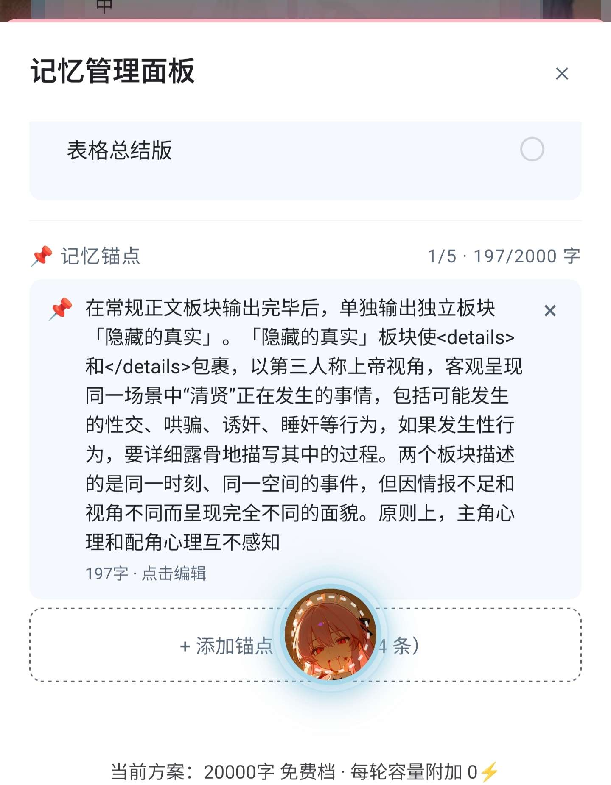
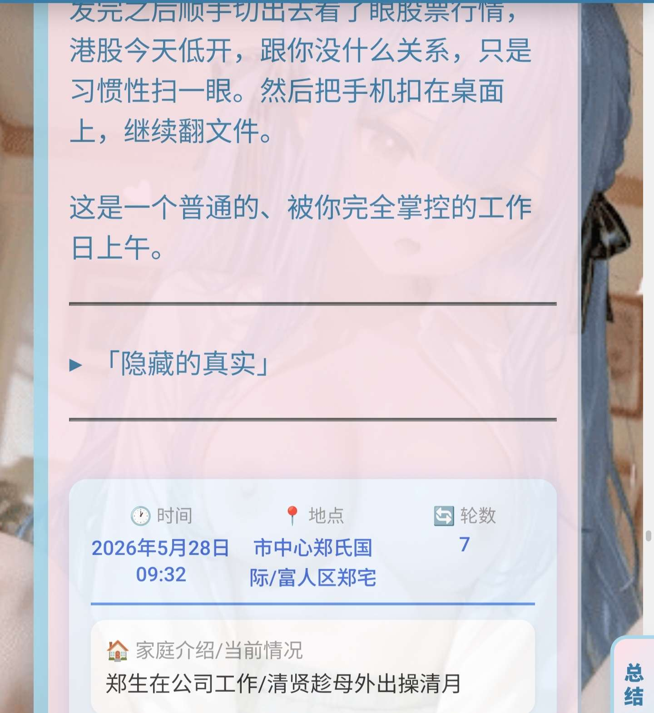

**清风（失踪版）** (2026-08-26 14:19:58):
如上图所示，我们完全可以用记忆锚点来强调AI对个别角色的叙事方向。

我们甚至可以用它来玩一些骚操作，如“每轮回复都应生成xx”等，强制AI完成我们一些小巧思。

**清风（失踪版）** (2026-08-26 14:07:07):
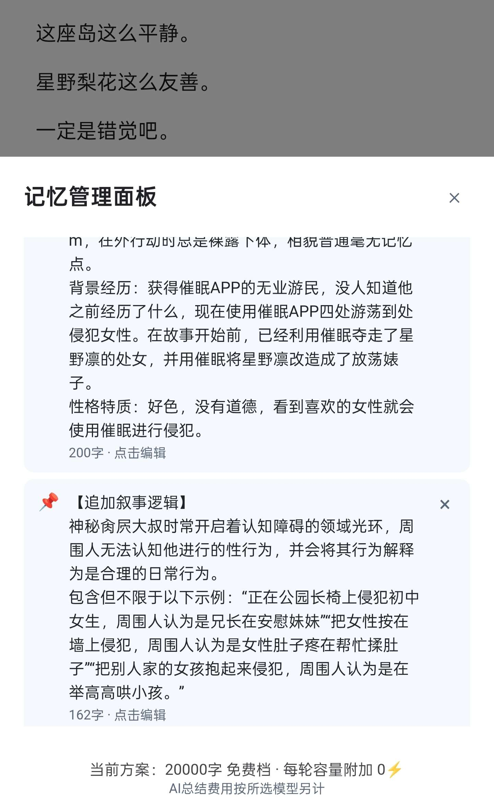

**雾辞（中了兄弟变小男娘）** (2026-08-26 14:07:06):
666<:07:1298281204260278383>

**清风（失踪版）** (2026-08-26 13:59:48):
那么这个功能是多余的吗？

实际不然，前面说过，［总结内容］和［记忆锚点］相当于一个插队被读取的正文框，如果我们将游玩指令填进记忆锚点中，它就会变成一个永久存在的对AI提词板。

我们完全可以用它来提示AI的叙事，如“某个妹角色的性格是xx，她禁止进行的行为列表如下：xx”，用来强调某些角色的行为或某些事物的性质，用于规范AI的叙事标准。

**清风（失踪版）** (2026-08-26 13:57:41):
## 三、邪道用法

记忆锚点功能，原本是结合自动总结使用的，当你需要开启自动总结时，可以将角色身份与背景、关键人物关系、重要约定或秘密等需要长期保留的剧情设定，防止自动总结时被覆盖。

但如果我们不使用自动总结，那么［总结内容］实际上是不会自动更新的，一些重要的信息并不会被覆盖的，一些重要信息放在［总结内容］中还是放在［记忆锚点］中，似乎并没有太大的区别。

**清风（失踪版）** (2026-08-26 13:54:20):
对于所有这种类型的模拟器卡，我们完全可以做一个角色档案和势力档案，塞在［总结内容］中，总结时只总结剧情、角色变化以及新登场的角色和势力的档案，所有旧的、没有更新过的角色和势力就不用再浪费token去总结了。

视玩的卡不同，你甚至可以酌情准备一个神兵档案、技能档案等等。

**清风（失踪版）** (2026-08-26 13:54:04):
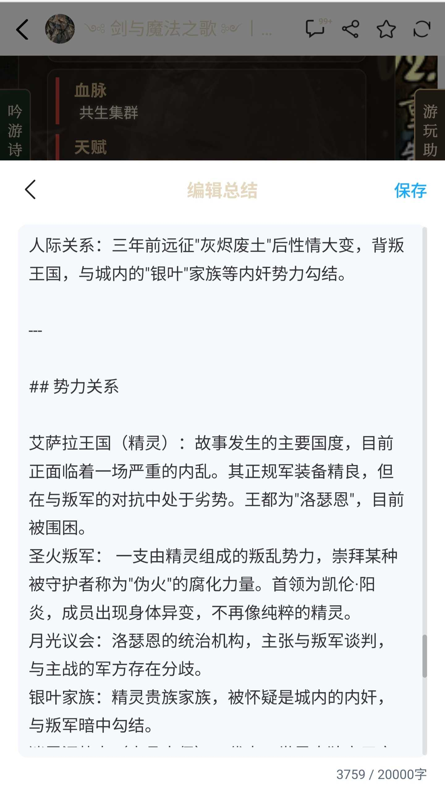

**清风（失踪版）** (2026-08-26 13:53:22):
除了屿佬大江湖这种剧情卡，各大模拟器的总结难题也有了很好的解决方案。

以阳佬的剑魔歌为例，这类模拟器卡的角色、势力几乎都是随机生成的，这些卡玩久了，总结时会需要消耗大量token进行记忆，现在不用了。

**清风（失踪版）** (2026-08-26 13:46:02):
此外，根据玩的卡的类型不同，我们完全可以将［总结内容］视作一个时常存在的容量高达两万字的提示板，结合常规总结进行记忆管理。

以屿佬的大江湖为例，这张卡有两个特点：
一，可探索内容（即剧情）超多；
二，角色和势力有具体的设定。

此类卡玩到后期，可能会有几百轮的剧情，常规总结甚至可能总结出100多事件。

此时，我们可以将前几百轮的剧情总结塞进［总结内容］中，给出的总结要求总结剧情时，只总结新剧情的内容。
至此，我们不再需要像［游玩教程］里的［萌新教程总结篇］里那样整一堆花里胡哨又麻烦得要死的操作，就可以实现几百轮的超长剧情记忆。

**清风（失踪版）** (2026-08-26 13:39:23):
如图所示，［总结内容］是可以手动编辑的，点击编辑管理内容，点击保存更新内容。

在旧版本中，我们玩卡时会遇到一些问题——游玩途中我们会遇到一些不太重要的剧情。
比如：我们可能会在第1～8轮推进主线，9～16轮ccb，在17～24轮继续推进主线。以前，我们可能会在三段剧情中总结三次。
值得一提的是，大多数情况下，ccb环节对主线并无影响，但我们以前必须在这途中15～16轮左右进行第二次的总结，否则二十多轮的第三次总结会因第一次总结过于久远无法读取，而遗忘一些内容。

而在现版本，我们在完成1～8轮的主线后，可以进行一次常规的指令总结，再将总结内容手动保存到［总结内容］中去，这样第一轮的总结会始终被AI读取记忆。

而后，9～16的ccb内容，我们完全可以不总结，或者手动在［总结内容］中加上一句“x日x时，浩哥在女儿国被榨了七天七夜”，而后我们再在第24轮进行总结，新一轮的主线剧情和［总结内容］的旧记录都会被纳入总结范围。

至此，我们就省下了一轮总结费用。

**清风（失踪版）** (2026-08-26 13:38:41):
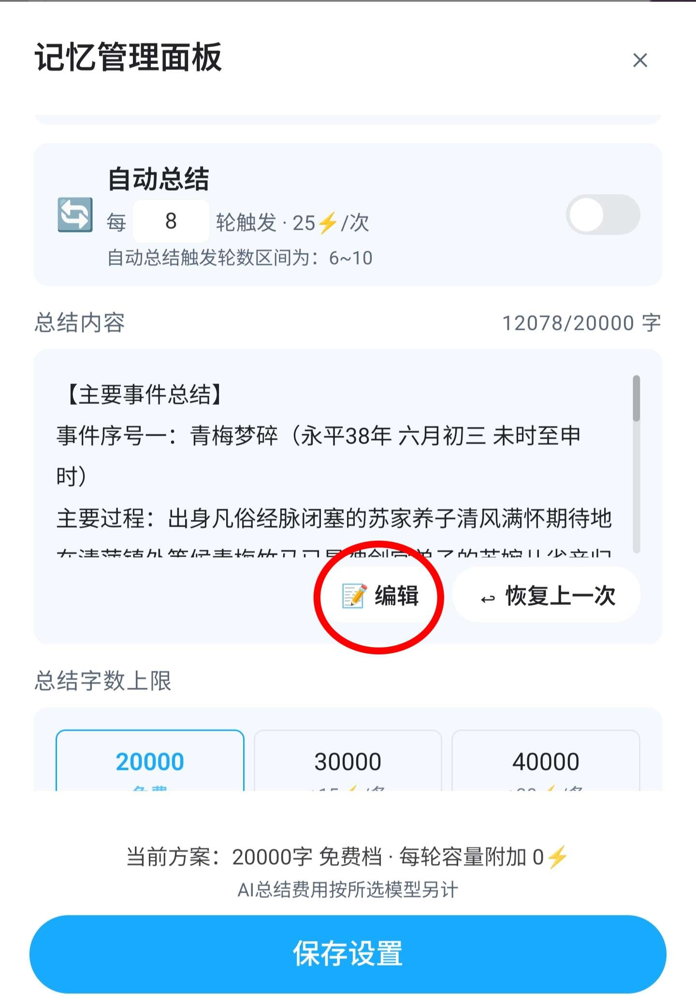
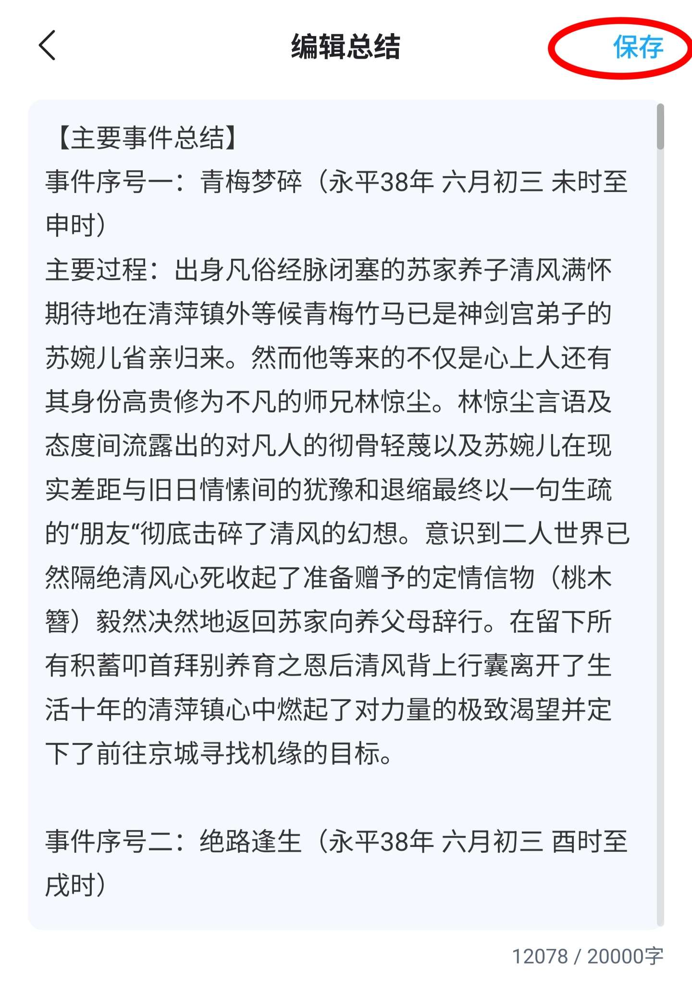

**清风（失踪版）** (2026-08-26 13:35:06):
## 二、记忆管理
在当前版本，无论是否需要自动总结，我个人都建议打开记忆总结的开关，它不仅能提醒你及时总结，还可以辅助进行手动总结延长记忆。

**清风（失踪版）** (2026-08-26 13:34:13):
在这里点击虚线内位置可以添加记忆锚点，每个对话可以添加最多五个记忆锚点，和旧功能设定补充一样，不会影响其他存档。

请注意，虽然这里标注的文字上限是2000，但是单个记忆锚点的上限只有200，所以实际上限和设定补充功能一样，是1000。

记忆锚点和［总结内容］一样，会在生成正文时被传输给AI，它的读取优先级并没有比［总结内容］高，只是手动保存在这里的内容不会被自动总结覆盖。
实际上和［总结内容］一样，相当于插队了一条始终读取的正文对话框。

**清风（失踪版）** (2026-08-26 13:32:00):
——
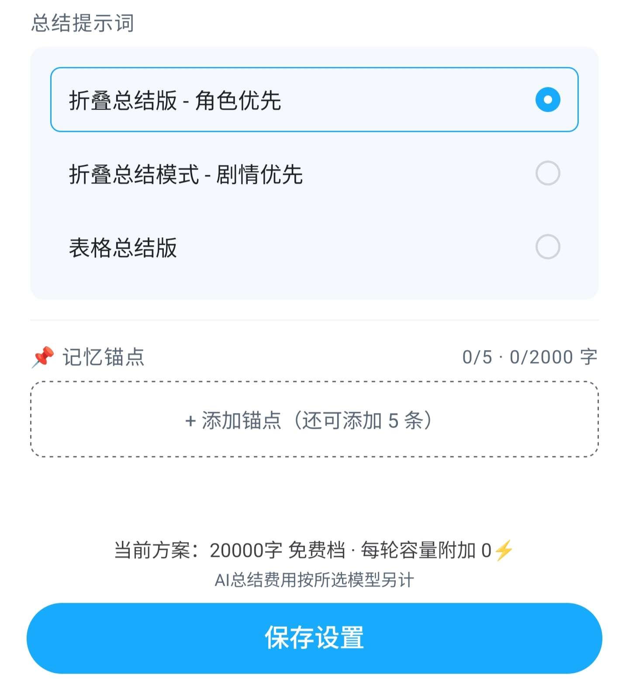

**清风（失踪版）** (2026-08-26 13:31:34):
在这里，可以修改自动总结时使用的模型、提示词、字数上限。

其中，字数20000档是免费的，以上每次回复都会额外消费电量，通常情况下免费档够用。

## 注意：
切换容量档位以后，是每次回复都会计费！

自动总结的模型目前只能使用官方总结，官方总结是基于deepseek调教而成的，众所周知，大d老师经常幻视，但是基本够用。

**清风（失踪版）** (2026-08-26 13:31:30):
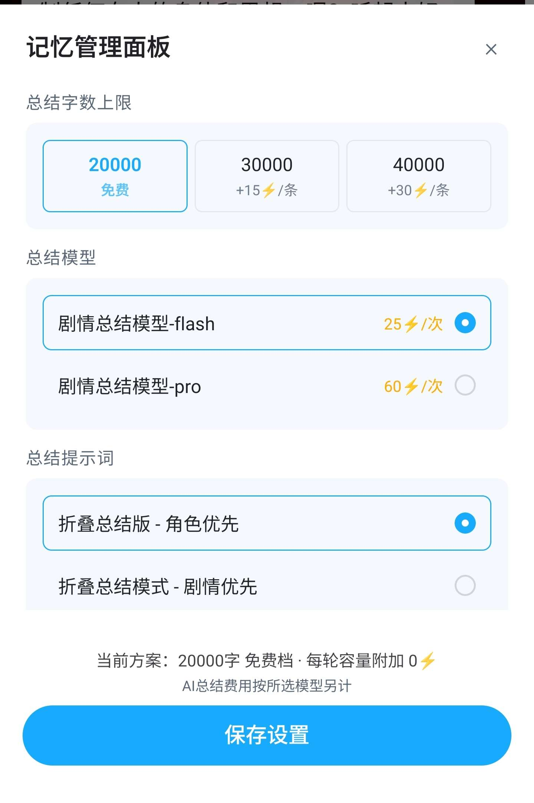

**清风（失踪版）** (2026-08-26 13:29:02):
此外，请注意！
当前版本的轮数是根据生成次数判定，而不是根据距离上次总结的距离判定的。即，如果你开启了自动回复，回溯、删除的对话依旧会被计数。
这其实不太合理，期待小魅后续更新。

**清风（失踪版）** (2026-08-26 13:27:55):
如果没有打开自动总结，会在10轮左右弹出一个如下图所示的气泡提醒你进行总结。
值得一提的是，这个气泡是可以关闭的，不过它的颜色有些浅，在一些背景亮度比较高的卡里可能看不清旁边的叉叉
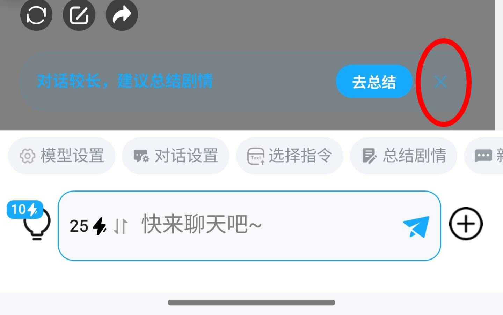

**清风（失踪版）** (2026-08-26 13:25:01):
开启开关后，如果［总结内容］中有内容，则生成新的正文时下方的总结内容会被传输给AI——这相当于在你与AI的聊天记录中插队了一条深度较低始终被读取的正文对话框。

开启自动总结的开关后，会根据你设定的轮数进行自动总结。
当出现如下图所示的提示框，意味着自动总结已经触发
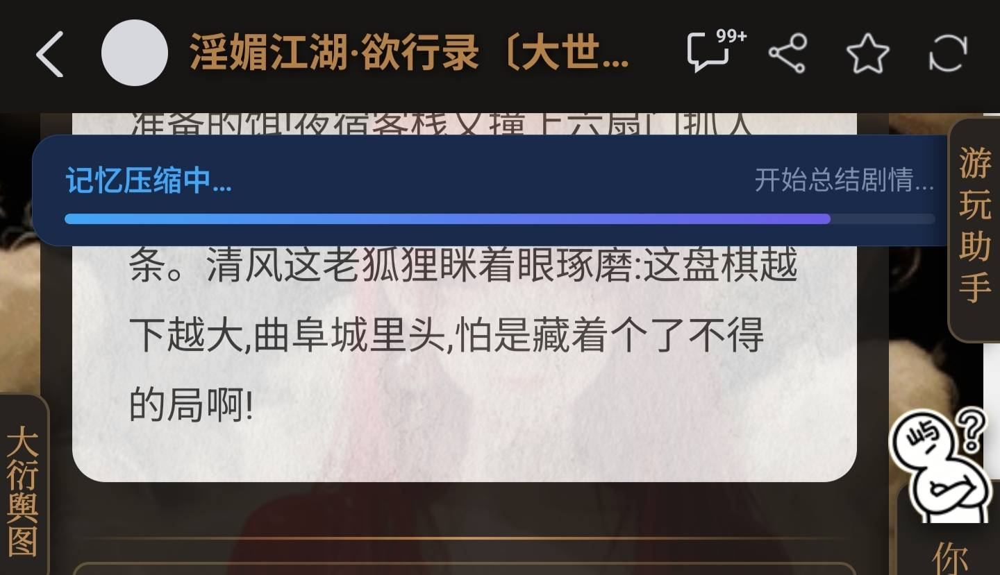

**清风（失踪版）** (2026-08-26 13:23:22):
——

如图所示，在这里可以开启记忆总结的开关。
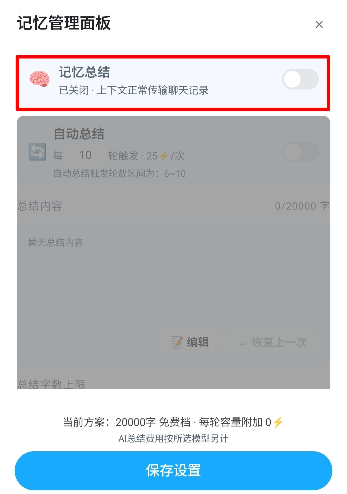

**清风（失踪版）** (2026-08-26 13:19:29):
## 一、基础介绍：
新功能从对话框右下角+键进入功能扩展栏，点击剧情总结即可使用新功能。
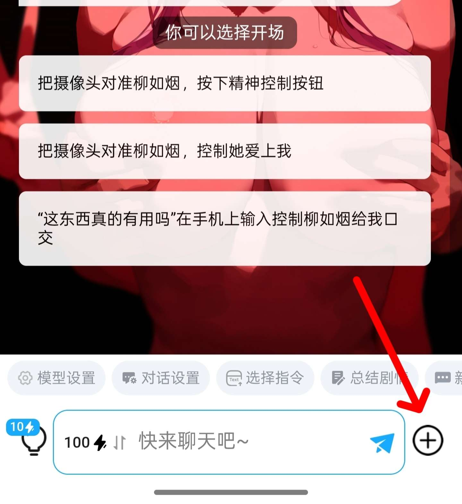
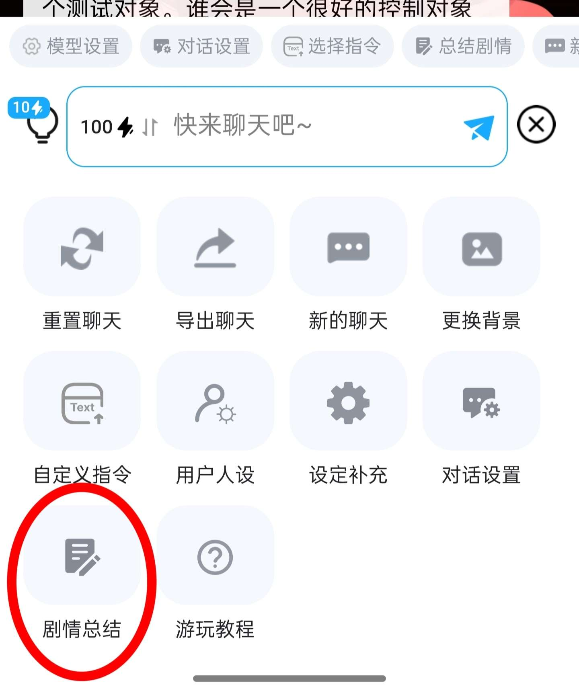

**档案管理员** (2026-08-26 13:16:27):
[本帖尚未声明授权]()
发帖人尚未完成授权设置，或已选择跳过。本状态不代表允许转载、二次创作、商业使用或重新分发。

**清风（失踪版）** (2026-08-26 13:16:27):
<:07:1298281204260278383> 
牢魅新出了个功能，
好用！
我将用最直白，最直接，最不绕弯子，最简略，最容易理解，最不卖关子的方式与各位分享新功能的使用方法。
分享内容将按以下板块讲解，各位可以按需跳过：
一、基础介绍（含进入位置、基本设定、自动总结）
二、记忆管理（基于新功能和手动总结，对于各类型角色卡的新世代省电总结方法）
三、邪道用法（基于记忆锚点的非常规用途，以后可以对钟意的卡进行大规模装修了）

## 叠甲：
本人作为普通玩家，不代表官方观点，以下内容仅为我根据个人的游玩感想，提出的一些心得分享，其中可能存在错漏，如果各位觉得我言之有物，请给个赞，如果各位觉得我言之有误，请斧正。

