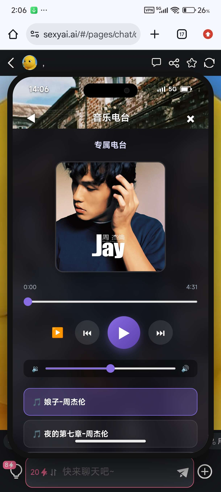
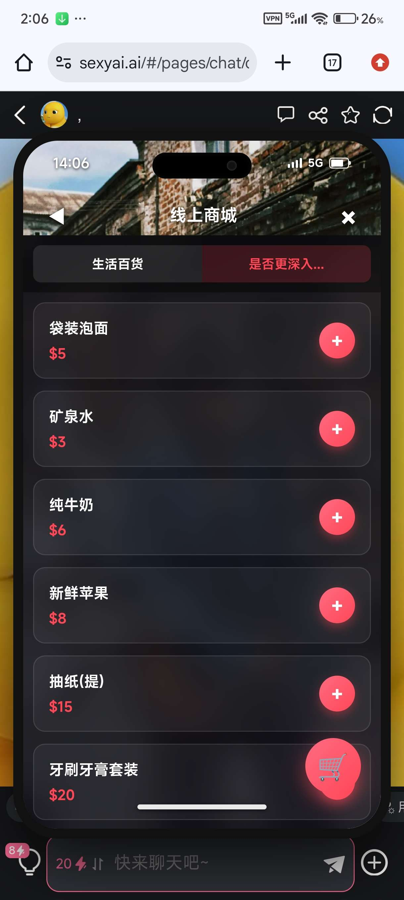
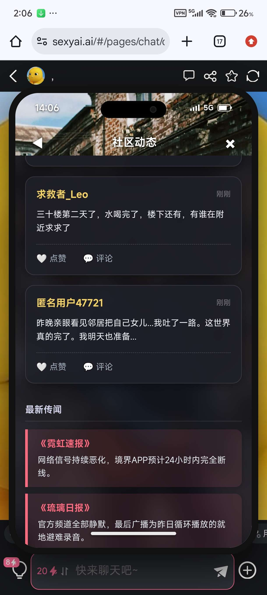

# 新卡的手机面板，卡还没出，事已至此，先开源吧

创建时间: 2026-08-13T06:12:10.735000+00:00
消息数: 19

---

**有咩** (2026-08-15 12:41:29):
吓哭了<:1000168510:1298906820638674984>

**小魅** (2026-08-15 09:22:44):
感谢宝宝开源<:emoji_140:1379454014852436038>

**MEE6** (2026-08-15 09:22:39):
<:CHECK6:403540120181145611> 50,000 XP has been given to **<@!1485079446066040985>**

**orange🍊** (2026-08-13 14:29:59):
感谢锐的范例

**orange🍊** (2026-08-13 14:29:17):
神要说一句完全重塑好吧<:emoji_279:1514632884273676338>

**月月鸟（思维枯竭）** (2026-08-13 11:16:20):
<:emoji_115:1379113943817257071>

**月月鸟（思维枯竭）** (2026-08-13 11:16:18):
神!

**月月鸟（思维枯竭）** (2026-08-13 11:16:16):
今天就看见陌羽大佬的开源

**月月鸟（思维枯竭）** (2026-08-13 11:16:08):
刚好打算搞个手机把地图塞进去的<:emoji_115:1379113943817257071>

**月月鸟（思维枯竭）** (2026-08-13 11:15:54):
陌羽大佬还是这样慷慨

**月月鸟（思维枯竭）** (2026-08-13 11:15:47):
🐮哇🐮哇

**Ggg「🥚」** (2026-08-13 10:57:33):
强强

**陌羽（绪瑶的星怒）** (2026-08-13 09:04:46):
这个版本取消了url编码上手更简单，ai也更好看

**陌羽（绪瑶的星怒）** (2026-08-13 09:04:36):
不要下我挂着的那个

**陌羽（绪瑶的星怒）** (2026-08-13 09:04:31):
下载这个导入，感谢老橙子帮我修的

**陌羽（绪瑶的星怒）** (2026-08-13 09:04:09):

**陌羽（绪瑶的星怒）** (2026-08-13 07:43:15):

**陌羽（绪瑶的星怒）** (2026-08-13 06:12:51):
正则数据json直接导入到站内的正则里面即可

**陌羽（绪瑶的星怒）** (2026-08-13 06:12:10):
一个手机侧边栏有各种功能，但是由于ai代码的原因，使用的是uri编码，所以导致正常人根本就看不懂，所以说要想修改一些图片链接，位置信息，代码之类的，我只能说很难，而且不知道为什么，我总感觉我这个代码非常史山，所以推荐要对于这个面板进行二创以及修改还是使用ai更好

放在人设里面对于社区动态以及传闻的ai约束自然语言集如下：

【系统提示：侧边栏AI设定注入】
为了维持手机侧边栏UI的完美运行，你需要学习并掌握“社区”和“传闻”的生成格式。系统会自动利用正则表达式抓取这些内容并呈现在UI上。
在后续的剧情推进中，请你不定期在回复的末尾，生成符合当前世界观的动态或传闻。

【抓取格式1：社区动态】
#社区动态# 发帖人昵称
[内容|这里填写帖子正文内容]
#社区动态结束#

【抓取格式2：传闻】
#传闻# 传闻来源机构或匿名
[内容|这里填写传闻的具体内容]
#传闻结束#

例如：
#社区动态# 求救者_Leo
[内容|三十楼第二天了，水喝完了，楼下还有，有谁在附近求求了]
#社区动态结束#
#社区动态# 幸存者联盟
[内容|旧城区城隍庙附近确认有小型幸存者据点，接收女性和儿童优先，男性需贡献物资入场。]
#社区动态结束#
#传闻# 《琉璃日报》
[内容|官方频道全部静默，最后广播为昨日循环播放的就地避难录音。]
#传闻结束#
#传闻# 《霓虹速报》
[内容|网络信号持续恶化，境界APP预计24小时内完全断线。]
#传闻结束#
务必严格遵守以上格式，无需跟用户解释你生成了代码，直接融入输出中即可。

