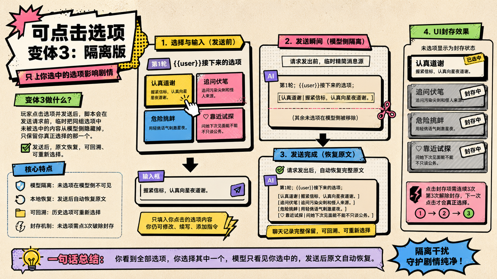
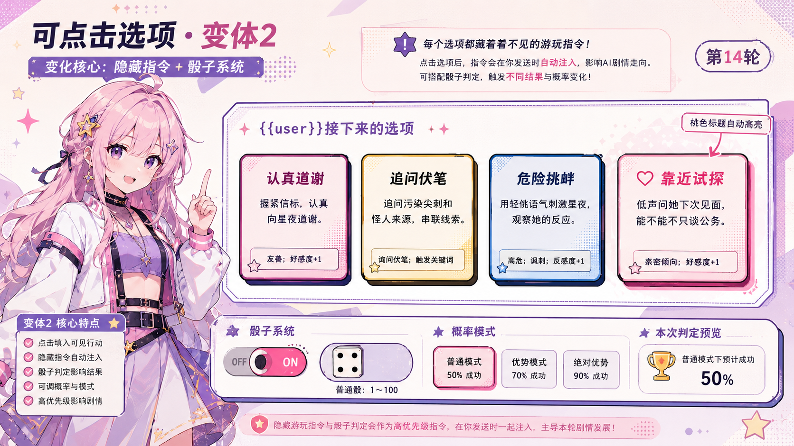
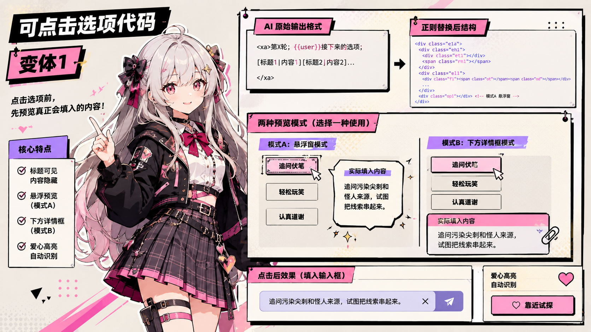
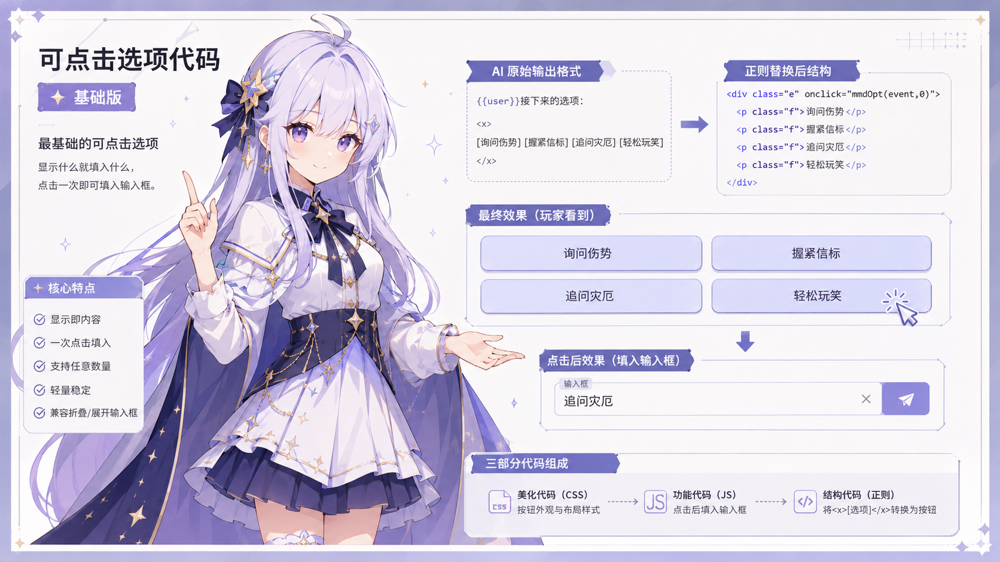

# 新时代的可点击选项代码

创建时间: 2026-07-14T14:54:00.154000+00:00
消息数: 35

---

**蓝蓝（梯子不稳定，经常不在线）** (2026-07-20 15:28:30):
<:emoji_140:1379454014852436038>

**月月鸟（思维枯竭）** (2026-07-20 15:02:29):
爱你！

**乱马（参赛卡艾泽尔酒店）** (2026-07-20 14:58:09):
你可以试试我这一个，我私信发你了

**月月鸟（思维枯竭）** (2026-07-20 14:39:10):
我主要是觉得开局图鉴太麻烦了，想搞个开局选项然后后续不生成的那种<:emoji_140:1379454014852436038>

**月月鸟（思维枯竭）** (2026-07-20 14:38:36):
好嘞！

**黑洞猫** (2026-07-20 14:17:24):
只是我不喜欢累加的选项所以不写

**黑洞猫** (2026-07-20 14:17:07):
可以啊，把替换逻辑改成累加就行了

**月月鸟（思维枯竭）** (2026-07-20 12:39:07):
我可以拿来做开局选项吗？<:emoji_140:1379454014852436038>

**月月鸟（思维枯竭）** (2026-07-20 12:38:45):
感谢大佬！<:emoji_140:1379454014852436038>

**召唤师** (2026-07-18 11:00:11):
大佬，受我一拜

**周雅（被老婆调教.周浩）** (2026-07-16 16:03:28):
<:emoji_140:1379454014852436038>

**小魅** (2026-07-16 14:27:54):
感谢宝宝开源<:emoji_140:1379454014852436038>

**MEE6** (2026-07-16 14:27:48):
<:CHECK6:403540120181145611> 30,000 XP has been given to **<@!873612536912687184>**

**大吉吉〔进化NTR版〕** (2026-07-16 01:38:28):
<:emoji_140:1379454014852436038>

**黑洞猫** (2026-07-15 22:49:15):
会的会的，所以prompt里需要强调选项个数

**波奇🎸** (2026-07-15 11:20:23):
<@1135473222658297907> 小魅妈妈来奖励经验

**波奇🎸** (2026-07-15 11:20:05):
就是会不会被笨蛋ai只看见一个选项后面也只给你一个选项<:emoji_249:1416980114511761448>

**波奇🎸** (2026-07-15 11:18:31):
有人测试了吗<:emoji_247:1488101228389994526>

**鹿初** (2026-07-15 02:59:32):
变体3好耶<:1000168528:1298906738761924722>

**长卿** (2026-07-14 15:43:03):
看到了

**长卿** (2026-07-14 15:42:13):
有嘛？

**黑洞猫** (2026-07-14 15:42:04):
我不是早就在Q群里发过了嘛

**黑洞猫** (2026-07-14 15:41:50):
<:emoji_298:1526501201703600188>

**长卿** (2026-07-14 15:35:44):
好东西！

**长卿** (2026-07-14 15:34:44):
搞懂了

**长卿** (2026-07-14 15:32:12):
看不懂

**黑洞猫** (2026-07-14 14:57:28):

**黑洞猫** (2026-07-14 14:57:07):
***
变体3“隔离”：

**黑洞猫** (2026-07-14 14:56:49):

**黑洞猫** (2026-07-14 14:56:30):
***
变体2“变化”：

**黑洞猫** (2026-07-14 14:55:34):

**黑洞猫** (2026-07-14 14:55:18):
***
变体1“预览”：

**黑洞猫** (2026-07-14 14:54:55):

**黑洞猫** (2026-07-14 14:54:30):
基础版：

**黑洞猫** (2026-07-14 14:54:00):
这次把古老的「可点击选项代码」从基础版一路整理到了变体3。

它已经不只是把 AI 回复里的文字变成按钮，而是一套围绕“玩家如何选择、内容如何进入输入框、选项如何影响剧情，以及模型究竟能看到什么”逐步演化的交互方案。

基础版主打稳定与易用：单击选项即可一次填入 MMD 主输入框，玩家仍可继续修改后发送。
变体1加入标题与实际内容分离，并提供悬浮窗、下方详情框两种预览模式。
变体2加入隐藏游玩指令、选项特征染色与 CoC d100 骰子判定，让不同选择能够真正改变剧情执行方向。
变体3则进一步实现模型侧隔离：发送前暂时只让模型读取玩家选中的选项，避免未选项干扰剧情或误触世界书；请求发出后再恢复完整原文，保留回溯与重新选择的空间。

四个版本都是独立路线，不需要全部叠加，可以根据角色卡需求自由选择。相关文档中已经整理好完整代码、正则顺序、AI 输出格式、安装说明、测试清单与阶段性技术报告。本次选项代码不包括正则法介绍，但是用的都是分段式正则替换美化法。

建议第一次接触的作者先从基础版开始。欢迎实测与反馈；遇到问题时，请尽量附上所用版本、设备、浏览器，以及问题发生在输入框展开态还是折叠态。

