# 更稳定的状态栏生成器（已更新动态角色）

来源: Discord 魅魔藏经阁 thread 1514897474123337789
创建: 2026-06-12T07:41:43.265000+00:00
消息数: 238

---

**neyin** (2026-09-17 09:12:02):
<:emoji_299:1544028730257576049>

**Who** (2026-09-17 08:46:15):
就是点击横幅没有反应

**Who** (2026-09-17 08:45:59):
大佬你好，这个折叠区域在预览过程中没有显示是正常情况吗

**Who** (2026-09-17 08:45:28):
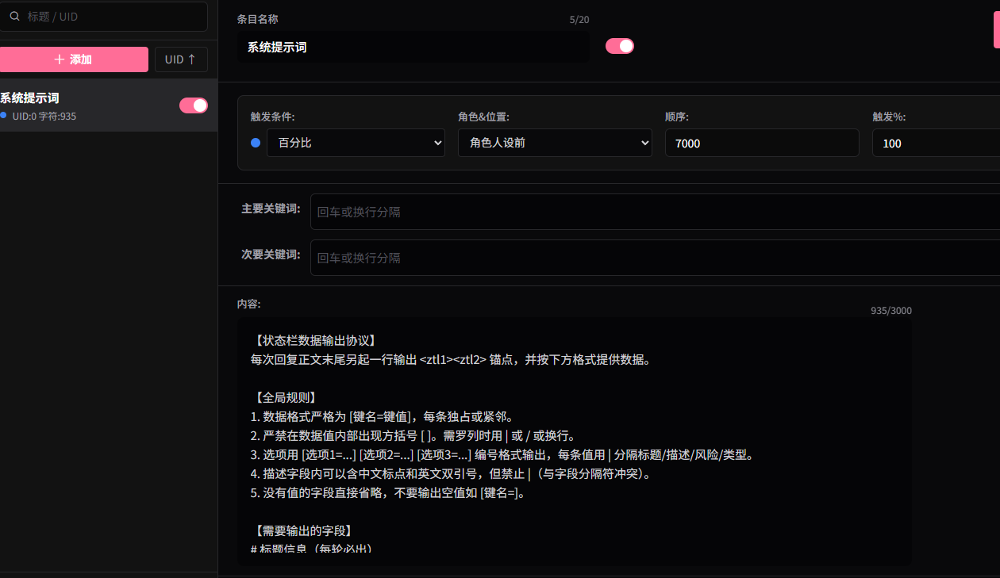

**XiFengWeiNuo** (2026-09-15 09:32:04):
然后可以的话，还是想问问图片会显示成这样是什么原因， 网络问题吗，但是有时候换了节点还是会出现这样的情况

**XiFengWeiNuo** (2026-09-15 09:23:13):
目前的问题是用glm可以正常生成状态栏，但是图片和上面一样无法正常显示，用克劳德可以显示图片，但是会出现重复出现两个一模一样的状态栏，我点编辑查看的时候发现明明只有一个状态栏

**巴西郡牧公子炎** (2026-09-15 02:48:17):
引擎1字符超了怎么改

**巴西郡牧公子炎** (2026-09-15 02:47:53):
还有就是，字符太多了怎么办

**巴西郡牧公子炎** (2026-09-14 15:01:25):
就是这几个事件写了就只发生这几个事件吗

**巴西郡牧公子炎** (2026-09-14 15:01:09):
终于有个好用的梯子了终于可以继续说了

**巴西郡牧公子炎** (2026-09-14 14:33:37):
有没有初步教学能够给我的

**蓝蓝（梯子不稳定，经常不在线）** (2026-09-14 04:44:45):
<:1000168510:1298906820638674984>

**蓝蓝（梯子不稳定，经常不在线）** (2026-09-14 04:44:39):
按照说明重新弄一遍？

**蓝蓝（梯子不稳定，经常不在线）** (2026-09-14 04:44:38):
输出格式有问题？正则没捕捉到？

**蓝蓝（梯子不稳定，经常不在线）** (2026-09-14 04:41:46):
你这我也听不懂啊

**千痕** (2026-09-13 04:17:06):
呃啊，一个状态栏竟然能塞这么多东西嘛<:emoji_299:1544028730257576049>

**XiFengWeiNuo** (2026-09-12 20:10:01):
解决了佬 但是现在又有了新的问题，一轮对话里面同时有没渲染前的状态栏和渲染后的状态栏，这种是什么原因导致的呀

**XiFengWeiNuo** (2026-09-12 19:39:18):
用的魅魔岛的图床

**XiFengWeiNuo** (2026-09-12 19:32:27):
佬 图片立绘生成不了是什么原因啊
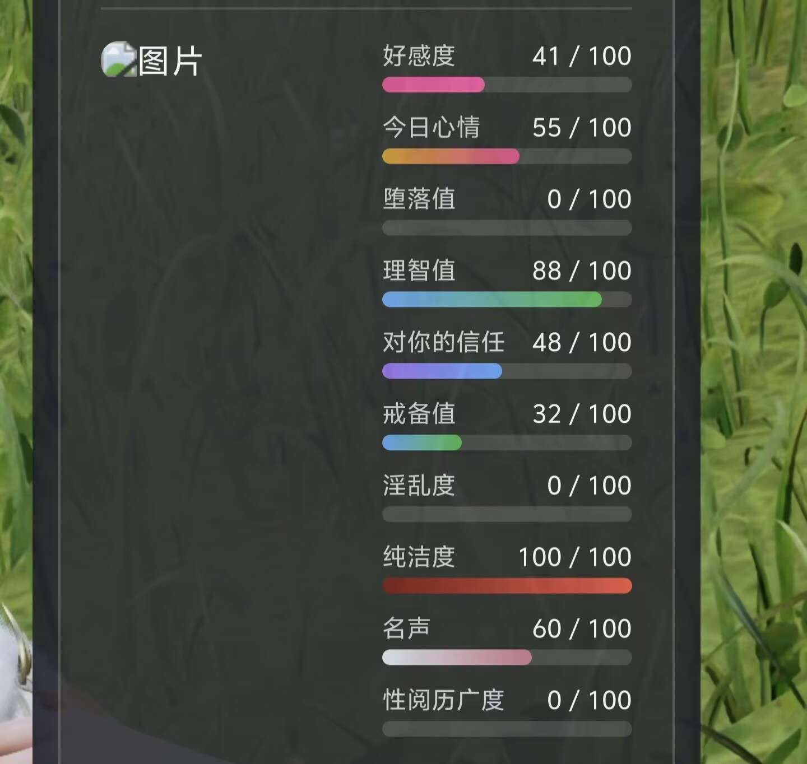

**54hastur_23227** (2026-09-10 15:42:39):
好的我试试<:emoji_140:1379454014852436038>

**蓝蓝（梯子不稳定，经常不在线）** (2026-09-10 07:46:40):
<:emoji_149:1391405133220282500>

**蓝蓝（梯子不稳定，经常不在线）** (2026-09-10 07:46:25):
？你一个个分开来单独放啊，怎么会超标

**54hastur_23227** (2026-09-08 12:14:19):
大佬，这个8条tag的表达式具体该怎么输入才能不超过字数限制啊
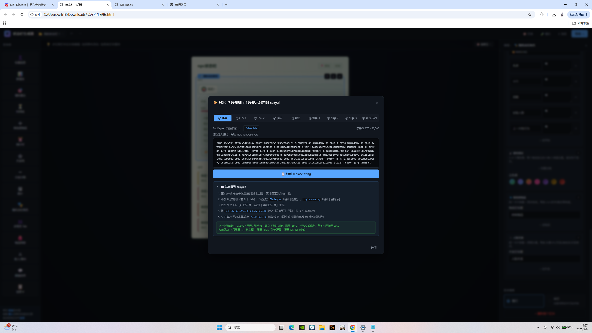

**绾矜韵** (2026-09-05 05:01:51):
好的好的谢谢大佬

**蓝蓝（梯子不稳定，经常不在线）** (2026-09-04 03:10:18):
退出去刷新一下？或者可能是因为ai没有输出<ztl1><ztl2>，导致状态栏信息被捕获，但是没有渲染

**蓝蓝（梯子不稳定，经常不在线）** (2026-09-04 03:09:06):
呃，晚点我再回复，最近一个多月没好好休息过了，今天登上了就是摸下鱼<:emoji_143:1379855104622202900>

**绾矜韵** (2026-09-02 00:04:57):
<:1000168531:1298906724979310634>

**绾矜韵** (2026-09-02 00:04:52):
<@1459486378055303205>大佬，测试状态栏的时候，聊天记录里没有状态栏，但是打开编辑之后有状态栏那些，就是这种，这个该怎么办？

**tansen(努力成为写卡大手子😡)** (2026-09-01 04:06:36):
用功能侧边中不同角色监听对准状态栏的角色的名字变量，如侧边栏中名字是n变量，状态栏名字是name变量，那么两者对应监听并且要求仅按状态栏更新，就可以实现侧边栏角色相关功能，比如单角色图鉴解锁等等就可以这样配对

**wu_lian** (2026-08-31 06:42:00):
大佬大佬，想请教一下，多角色tab中，如何让ai检测到已有角色姓名就稳定输出对应角色？我使用一直显示选项状态栏输出正常，但是如果选择仅亲密时显示，它就无法触发多角色tab区域，在模拟中和对话中都不输出多角色tab区，对话编辑看它正常输出了在场角色的信息，也没有发生截断，但是状态栏却没有生成角色立绘与信息，请问这是因为ai没有正确识别，还是说触发条件需要修改？
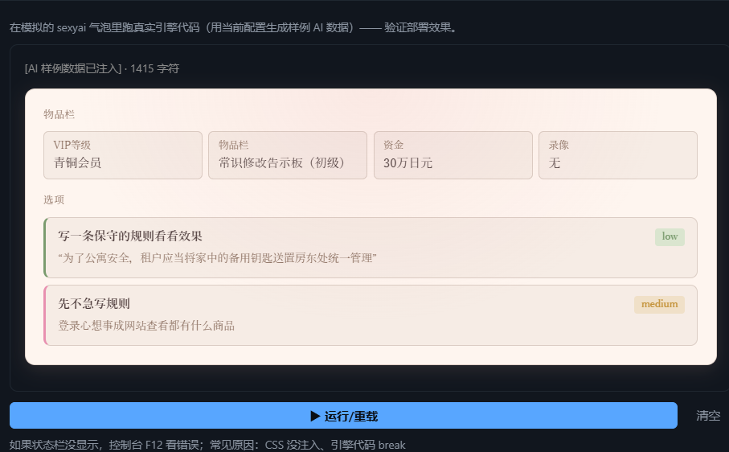
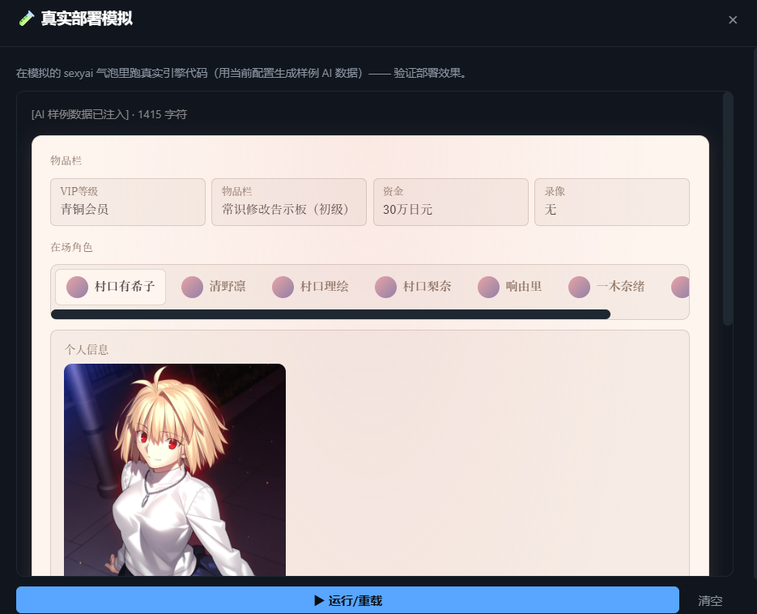
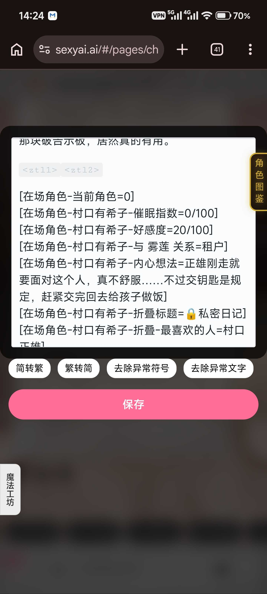

**Angel丶阿渊** (2026-08-23 12:00:46):
应该是生成的状态栏背面的图绘链接没有生成

**安湫纹** (2026-08-23 11:41:10):
大佬，问一下图片无法翻转是什么情况

**rerf** (2026-08-15 14:23:20):
已经解决了谢谢大佬

**蓝蓝（梯子不稳定，经常不在线）** (2026-08-13 16:44:49):
输出没问题是真的没问题才能说的话，你都发现有问题了怎么会是没问题

**蓝蓝（梯子不稳定，经常不在线）** (2026-08-13 16:42:04):
有可能是藏在你设置的隐藏的思维链或记忆区里，所以编辑看不到

**蓝蓝（梯子不稳定，经常不在线）** (2026-08-13 16:41:00):
引擎逻辑就是有几个ztl渲染几次，两个说明一次对话里肯定有两个ztl

**玉落凡尘** (2026-08-13 15:21:31):
代码输出没问题，就是显示是两个

**蓝蓝（梯子不稳定，经常不在线）** (2026-08-13 15:03:50):
自己检查格式，一般都是输出格式错了

**蓝蓝（梯子不稳定，经常不在线）** (2026-08-13 15:03:10):
ai抽风输出了多个<ztl1><ztl2>，提示词里一般有下限制只输出一个的

**rerf** (2026-08-12 08:47:39):
怎么多人状态栏无法捕捉角色数据

**玉落凡尘** (2026-08-12 08:09:57):
<@1459486378055303205> 佬问一下状态栏显示是两个怎么解决

**蓝蓝（梯子不稳定，经常不在线）** (2026-07-25 07:57:47):
你这样截图我也看不出什么来，蓝蓝又不是神仙<:emoji_149:1391405133220282500>

**蓝蓝（梯子不稳定，经常不在线）** (2026-07-25 07:57:08):
既然回复轮正常的话你点击编辑按钮看看ai是怎么写选项的啊。对比一下不就知道第一句话错在哪里了。

**泽夜** (2026-07-24 13:14:40):
黏贴的正则以及单独做世界书的ai提示词，第一句话最后加的<ztl1><ztl2>

**泽夜** (2026-07-24 13:12:26):
大佬不好意思早上没说清楚，是第一句话里的选项没有生成，回复轮都是正常生成的，这个是回复轮

**蓝蓝（梯子不稳定，经常不在线）** (2026-07-24 07:16:42):
你这样问我怎么可能知道问题在哪

**蓝蓝（梯子不稳定，经常不在线）** (2026-07-24 07:16:39):
点这个按钮

**蓝蓝（梯子不稳定，经常不在线）** (2026-07-24 07:16:34):
自己先点编辑看看ai实际输出内容

**泽夜** (2026-07-24 05:01:33):
大佬这种选项不生成是什么问题，都按教程来了

**蓝蓝（梯子不稳定，经常不在线）** (2026-07-24 04:22:56):
只能降低正文输出字数或者提高电量

**蓝蓝（梯子不稳定，经常不在线）** (2026-07-24 04:22:26):
这是ai输出不全导致没有输出<ztl>导致没有触发渲染吧

**Cllo** (2026-07-24 00:45:34):
大佬大佬 这种怎么办<:emoji_133:1379494883227734157>

**蓝蓝（梯子不稳定，经常不在线）** (2026-07-23 00:12:48):
即如果角色卡是那种上一轮回复是4个选项，下一轮是三个选项的那种选项数量不稳定的卡，那么第二轮状态栏就会把上一轮回复的第四个选项加进这一轮去，现在这个问题解决了

**蓝蓝（梯子不稳定，经常不在线）** (2026-07-23 00:12:22):
更新，修复了一个小bug：修改了选项的全局搜索机制。

**蓝蓝（梯子不稳定，经常不在线）** (2026-07-23 00:09:18):

**泪桐音白** (2026-07-21 04:36:18):
持续吃老底中

**泪桐音白** (2026-07-21 04:36:11):
<:emoji_249:1416980114511761448>

**neyin** (2026-07-21 04:28:03):
https://cdn.discordapp.com/attachments/1385274632592162876/1522792450064908419/Image_1783132366232_564.gif

**neyin** (2026-07-21 04:27:59):
没见过的

**neyin** (2026-07-21 04:27:55):
窝趣，老东西

**蓝蓝（梯子不稳定，经常不在线）** (2026-07-21 00:38:06):
黑洞喵有种技术狂的感觉，可啪<:emoji_143:1379855104622202900>

**泪桐音白** (2026-07-20 14:27:36):
有可能，我又看了一眼，貌似就是上面的多角色版本，应该没问题的，不知道那时候为啥不行，现在重新就可以了，很怪

**黑洞猫** (2026-07-20 14:26:56):
被人机卡了

**黑洞猫** (2026-07-20 14:26:35):
我写了直连后端也没报恶意代码

**泪桐音白** (2026-07-20 14:26:32):
保存正则部分就不行了

**黑洞猫** (2026-07-20 14:26:18):
在哪个阶段被卡的？公开吗

**泪桐音白** (2026-07-20 14:26:09):
但是大多数还是要自己微调

**泪桐音白** (2026-07-20 14:26:02):
效果只能说能用

**泪桐音白** (2026-07-20 14:25:56):
之前还弄了个用ai dpi自动填充状态栏的功能

**泪桐音白** (2026-07-20 14:25:37):
不知道欸，我也是按照Claude pro修改过的自己弄的，微调一两个部分没问题，改太多就不行了

**泪桐音白** (2026-07-20 14:24:54):
还真是，之前是用claude pro改过，但当时就微调了个小功能，然后发现没事。然后用了上面多角色的版本不知道为啥打开的还是之前那个调整过的版本，结果出错了<:1000168510:1298906820638674984>

**黑洞猫** (2026-07-20 14:19:24):
你写了啥，现在还会报恶意代码？是打算发的时候被卡还是写卡测试阶段就被卡了？

**蓝蓝（梯子不稳定，经常不在线）** (2026-07-20 11:19:16):
https://discord.com/channels/1205870897769095229/1514897474123337789/1514897474123337789

**蓝蓝（梯子不稳定，经常不在线）** (2026-07-20 11:19:08):
不知不觉楼这么长了，放个回到顶部链接

**蓝蓝（梯子不稳定，经常不在线）** (2026-07-20 11:18:29):
<:emoji_252:1486325346256027708>

**花笙🥜** (2026-07-20 11:14:58):
<:emoji_140:1379454014852436038>

**花笙🥜** (2026-07-20 11:14:44):
搜嘎，那我明白该怎么整了，谢谢大佬！！！

**花笙🥜** (2026-07-20 11:14:00):
哦哦，这么用的啊，是不是只用设置一个需要输出的设定就可以了，他会根据回复自己填充

**蓝蓝（梯子不稳定，经常不在线）** (2026-07-20 11:13:35):
生成器右侧不是有一栏名字吗？你不写清楚这个角色叫什么ai怎么会知道<:1000168510:1298906820638674984>

**蓝蓝（梯子不稳定，经常不在线）** (2026-07-20 11:12:14):
固定就用多角色，代码只会渲染在生成器写了的，回复中输出了的角色。也可以配合随机角色混用来生成没有预设的NPC

**花笙🥜** (2026-07-20 11:11:29):
角色不叫ABCD的，用多角色tab填角色原本的名字是吗

**蓝蓝（梯子不稳定，经常不在线）** (2026-07-20 11:10:13):
我就很奇怪一般用多角色tab的不会给角色起名叫ABC<:emoji_147:1379454167302537256>

**花笙🥜** (2026-07-20 11:09:55):
我做的是大世界卡，里面有一些固定的npc

**花笙🥜** (2026-07-20 11:09:08):
角色ABCD是我用来限制角色数量的（重新浏览了一遍发现好像并不需要）

**蓝蓝（梯子不稳定，经常不在线）** (2026-07-20 11:09:03):
多角色的话你没有在生成器写过的角色是不会被渲染，这个是为了给固定多角色的卡使用的

**花笙🥜** (2026-07-20 11:07:52):
我用的是多角色tab

**蓝蓝（梯子不稳定，经常不在线）** (2026-07-20 11:07:23):
随机动态角色的角色123只是个为了不让渲染出错的唯一值，原始提示词不是会自带一个xxxx＝{角色名}吗？那个才是用来写角色名字的，但是我看你的提示词没有，我都不清楚你用的是多角色tab，还是随机角色

**蓝蓝（梯子不稳定，经常不在线）** (2026-07-20 11:03:24):
啥意思？

**花笙🥜** (2026-07-20 11:00:23):
所以标注哪个角色名称捕捉的就是哪个角色吗

**花笙🥜** (2026-07-20 10:59:42):
啊？我以为那个只是个代称之类的，感觉这样清晰一些

**蓝蓝（梯子不稳定，经常不在线）** (2026-07-20 10:59:15):
为什么要用角色ABCD？这有什么意义么？

**蓝蓝（梯子不稳定，经常不在线）** (2026-07-20 10:58:37):
如果你是用的是随机动态角色，规则里不是写了么脚本捕捉的是角色12345

**蓝蓝（梯子不稳定，经常不在线）** (2026-07-20 10:57:52):
如果你用的是多角色tab，那么状态栏不会渲染没有写过的角色

**蓝蓝（梯子不稳定，经常不在线）** (2026-07-20 10:56:33):
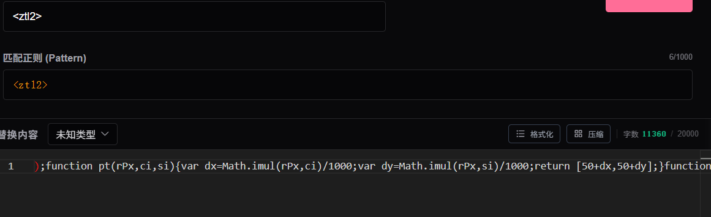

**蓝蓝（梯子不稳定，经常不在线）** (2026-07-20 10:56:14):
你这一看就是自己改过代码，从生成器复制过来原始代码都是压缩过的。不懂代码就不要随便修改

**泪桐音白** (2026-07-20 03:52:03):
好几个都包含恶意代码无法提交

**泪桐音白** (2026-07-20 03:50:59):

**花笙🥜** (2026-07-19 16:26:52):
这个是我更改后的规则，大佬有空的话，麻烦大佬指点一下<:emoji_140:1379454014852436038>

**花笙🥜** (2026-07-19 16:18:57):
大佬，我按照上面的方法都试了一遍，编辑里面的内容是对的，可显示的还是这个，这个该怎么办，输入<zhl>也没有变化
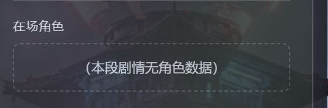

**道尘** (2026-07-13 06:02:36):
哦哦，好的，谢谢<:07:1298281204260278383>

**蓝蓝（梯子不稳定，经常不在线）** (2026-07-13 05:59:11):
根据你自己卡的情况，你觉得用户的格式可以和男角色通用就不用搞

**道尘** (2026-07-13 05:52:45):
哦哦，那要不要再搞一个用户角色的？

**蓝蓝（梯子不稳定，经常不在线）** (2026-07-13 05:19:44):
想分别生成男女可以在生成器里开两个随机动态角色的区块，一个规定女角色的格式，一个规定男角色的，这样ai就清楚了，就是比较占提示词

**蓝蓝（梯子不稳定，经常不在线）** (2026-07-13 05:17:28):
你提示词都明确写了女角色了，那ai当然只会输出女角色啊<:emoji_246:1488100783848161372>

**道尘** (2026-07-13 04:40:48):
<状态栏与选项生成协议>
①在每次回复剧情后，必须在末尾附带状态栏与选项数据。每次回复必须确保以 <status> 开头，以 </status> 结束，中间包裹隐藏的数据区。
②每次回复必须更新状态栏与选项，状态要贴合当前剧情变化。

【状态栏与选项完整格式示范】
<status>

选项1

选项2

选项3

</status>

【标签字典与逻辑说明】
data-env: turn 当前回合数，time 当前时间，loc 当前地点。
data-char: 支持多名女角色，场景中有几名女角色就生成几个 data-char 标签。
n: 姓名。

Gender: 性别描写。
look: 外貌描写。
Personality: 性格描写。
wear: 衣装描写。
newField: 神器/能力描写。
Race: 种族/职阶描写。
chest: 胸部描写。
priv: 小穴描写。
rear: 蜜臀描写。
foot: 足腿描写。
love: 好感度值，必须是0-100数字。
mind: 想法描写。
data-opt: 必须生成 3 个 
 选项，每个选项控制在25字以内，不可省略。
</状态栏与选项生成协议>

我就添加了一点性别之类的词，没做什么修改，应该没问题吧？<:1000168531:1298906724979310634>

**蓝蓝（梯子不稳定，经常不在线）** (2026-07-13 04:18:02):
<:emoji_149:1391405133220282500>

**蓝蓝（梯子不稳定，经常不在线）** (2026-07-13 04:17:48):
状态栏是支持男女的，只输出女角色可能是你角色设定里没写男角色或者哪里规定了只输出女角色

**蓝蓝（梯子不稳定，经常不在线）** (2026-07-13 04:14:32):
？没有限制死必须是女性啊？

**道尘** (2026-07-13 03:32:27):
就是大佬你发的那个hml弄出来的状态栏都是女性npc角色的，我想要{{user}}还有男性角色的状态栏👀

**蓝蓝（梯子不稳定，经常不在线）** (2026-07-13 03:05:28):
区块里有个随机动态角色，可以实时渲染角色，但角色设定里你要写明白ai要输出哪些角色

**蓝蓝（梯子不稳定，经常不在线）** (2026-07-13 03:01:50):
用户角色的栏是什么意思？是{{user}}还是玩家自定义角色？

**蓝蓝（梯子不稳定，经常不在线）** (2026-07-13 03:00:22):
第一句话可以用银酱的这个https://discord.com/channels/1205870897769095229/1479798902659088405

**道尘** (2026-07-12 17:14:07):
还有就是大佬，我想加入用户角色的栏应该怎么弄啊<:1000168531:1298906724979310634>

**道尘** (2026-07-12 17:00:44):
哦哦，谢谢，我已经搞好了，但是我想弄一个关于大世界的改名字，选性别，能力之类的第一句话，大佬，应该怎么弄啊？😇

**蓝蓝（梯子不稳定，经常不在线）** (2026-07-12 14:11:20):
但如果你的问题是指手机端用不了那蓝蓝就没办法了，也不推荐手机端使用

**蓝蓝（梯子不稳定，经常不在线）** (2026-07-12 14:11:11):
把最新的文件下载下来在浏览器打开，里面有教程，区块都是可视化的银酱写的很简单了，看两下一般就会了。

**道尘** (2026-07-11 17:51:19):
请问大佬，这个怎么用啊😇

**糯米辞** (2026-06-30 01:54:50):
明白了

**蓝蓝（梯子不稳定，经常不在线）** (2026-06-30 01:43:07):
重复生成状态栏是因为ai输出了多个ztl，要解决只能在提示词里下功夫限制ai每次回复只输出一个<ztl>

**糯米辞** (2026-06-28 13:46:12):
好奇这种重复生成状态栏该怎么解决<:1000168531:1298906724979310634>
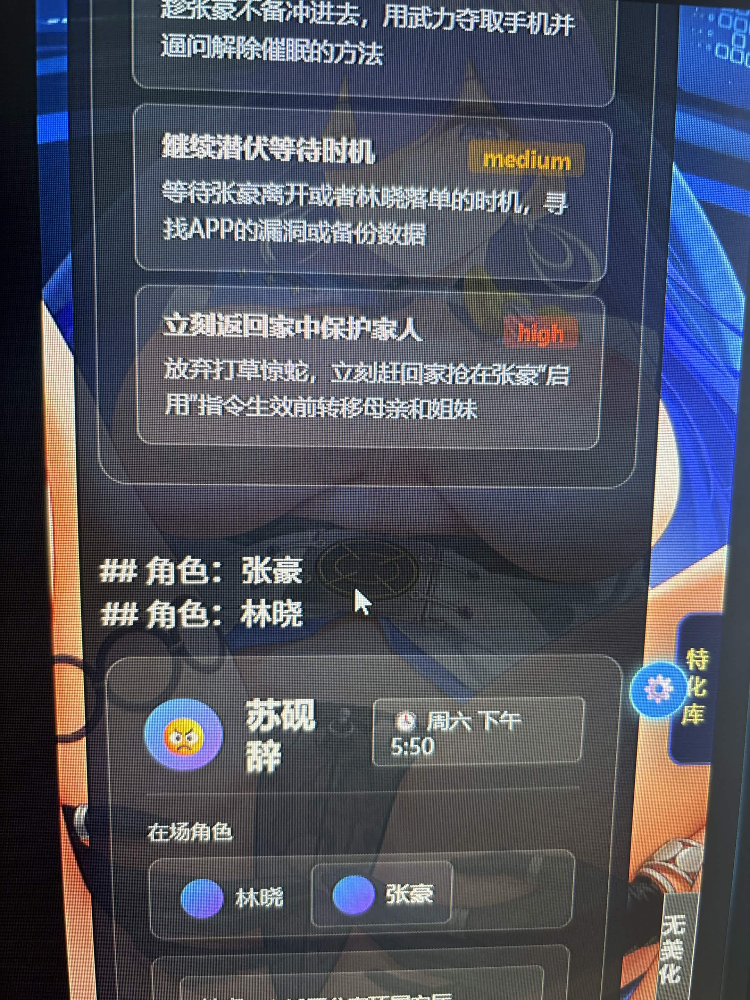

**蓝蓝（梯子不稳定，经常不在线）** (2026-06-23 13:46:39):
<:emoji_197:1409567462235705445>

**Angel丶阿渊** (2026-06-22 13:12:49):
成了大佬，是我选错了，一个是随机角色，一个是多角色。我选成多角色的，不是随机角色。辛苦大佬。

**蓝蓝（梯子不稳定，经常不在线）** (2026-06-19 23:48:16):

**雁北归** (2026-06-19 21:55:59):
已经完成肘击啦，感谢大佬的生成器，让我成功搞定了状态栏

**蓝蓝（梯子不稳定，经常不在线）** (2026-06-19 09:54:46):
<:emoji_147:1379454167302537256>

**Angel丶阿渊** (2026-06-19 06:46:21):
哦哦，我再看看，实在不行，我看看旧版的。

**蓝蓝（梯子不稳定，经常不在线）** (2026-06-19 05:13:26):
其他地方可以不用管，用系统原生的就行

**蓝蓝（梯子不稳定，经常不在线）** (2026-06-19 05:12:43):
然后就是把自己不需要的字段，比如你没有做角色的立绘，就把立绘这个字段删掉

**蓝蓝（梯子不稳定，经常不在线）** (2026-06-19 05:11:43):
我说改提示词主要改的是扩号里信息，也就是告诉ai这个字段我要你填什么内容

**蓝蓝（梯子不稳定，经常不在线）** (2026-06-19 05:09:03):
我前面那段解释是解释给你听的，不是给ai的，ai看得懂格式

**蓝蓝（梯子不稳定，经常不在线）** (2026-06-19 05:07:54):
就很一言难尽……

**蓝蓝（梯子不稳定，经常不在线）** (2026-06-19 05:07:27):
而且你这提示词写的……

**蓝蓝（梯子不稳定，经常不在线）** (2026-06-19 05:06:57):
自己点开回复编辑看问题
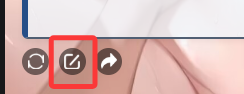

**Angel丶阿渊** (2026-06-19 03:21:48):

**Angel丶阿渊** (2026-06-19 03:21:00):
<@1459486378055303205>大佬依旧不显示啊，是我修改的不对吗

**蓝蓝（梯子不稳定，经常不在线）** (2026-06-19 02:07:30):
黑洞喵太较真了啦 <:emoji_142:1379454037501673522>

**蓝蓝（梯子不稳定，经常不在线）** (2026-06-19 01:57:58):
你提示词写的有问题，输出的数据不匹配，代码就不会转换成状态栏

**蓝蓝（梯子不稳定，经常不在线）** (2026-06-19 01:56:10):
这个提示词是这样的：
[随机角色-角色1-名字={角色名}]
1：随机角色：这个是在状态栏生成器填的分区标题，必须一致；
2：角色1：出场角色顺序，必须是角色12345……这样的格式，不能改也不能省；
3：名字：状态栏生成器中字段的键的名字，必须与生成器已有的一致
4：{角色名}：键对应的值，这个可以让ai随便填

**蓝蓝（梯子不稳定，经常不在线）** (2026-06-19 01:52:22):
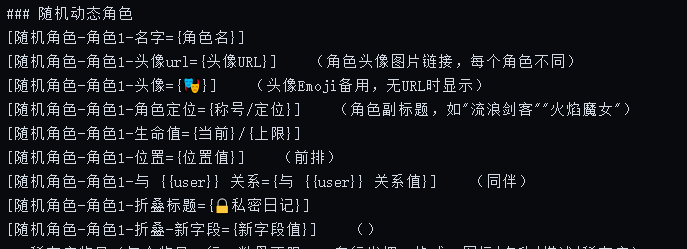

**蓝蓝（梯子不稳定，经常不在线）** (2026-06-19 01:51:22):
ai输出的数据格式不对

**Angel丶阿渊** (2026-06-19 00:37:37):
我这里一直显示该剧情暂无角色，但是输出时我看到描写现场角色了，这是怎么回事啊<:24:1298294525390753924>

**蓝蓝（梯子不稳定，经常不在线）** (2026-06-18 05:37:44):
更稳定的状态栏生成器（已更新动态角色）

**neyin** (2026-06-18 04:20:03):
<:emoji_139:1379455053080825866>

**雁北归** (2026-06-18 03:27:12):
感谢大佬，等我肘击完我怪猎卡最后的世界书就去测试一下

**蓝蓝（梯子不稳定，经常不在线）** (2026-06-18 02:59:42):
<@1515991591901331497> 模拟器卡可以用了，提示词还是得注意根据自己的卡改改，只要格式不输出错一般就没问题

**LZC** (2026-06-18 02:57:46):
<@1459486378055303205> 感谢大佬<:emoji_140:1379454014852436038>

**蓝蓝（梯子不稳定，经常不在线）** (2026-06-18 02:57:32):
<:1000168510:1298906820638674984>

**蓝蓝（梯子不稳定，经常不在线）** (2026-06-18 02:57:25):
燃尽了，化为了雪白的灰

**蓝蓝（梯子不稳定，经常不在线）** (2026-06-18 02:56:51):
这次更新还解决了一些小问题，一轮测试没有问题，时间有限我只测试了我常用的功能，如果有bug欢迎随时反馈

**蓝蓝（梯子不稳定，经常不在线）** (2026-06-18 02:55:06):
随机动态角色已更新，支持无预设角色的模拟器卡，要求角色固定追求稳定的卡还是更推荐使用多角色tab

**蓝蓝（梯子不稳定，经常不在线）** (2026-06-17 14:04:16):
提示词系统也得更新下了，我之前一直是自己改提示词，都忘了

**蓝蓝（梯子不稳定，经常不在线）** (2026-06-17 14:00:39):
或者说原版提示词太有误导性了，今天弄动态角色弄得脑袋晕晕的<:emoji_133:1379494883227734157>
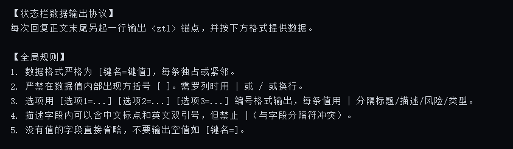

**黑洞猫** (2026-06-17 14:00:26):
<:emoji_249:1416980114511761448>

**黑洞猫** (2026-06-17 14:00:19):
想起初代雷达法解决这个问题，必须要求作者在正则换出来的错误图片里手动加上换行符和物理级换行，这种这么绿皮的解决方法就有点想笑

**黑洞猫** (2026-06-17 13:58:11):
导致两个没有换行的代码被mmd的解析引擎认为是连在一起的进而发生bug

**黑洞猫** (2026-06-17 13:57:37):
...我记得前前前代要求必须另起一行是因为错误图片对抗markdown解析引擎失败

**蓝蓝（梯子不稳定，经常不在线）** (2026-06-17 13:56:32):
确实已经解决了，不过我之前改的银酱发的旧版，不确定有他用的没有改过来

**蓝蓝（梯子不稳定，经常不在线）** (2026-06-17 13:55:39):
一般第一句话里能正常显示就没问题，如果还有小问题的话我明天会更新最新版，可以试试最新的

**黑洞猫** (2026-06-17 13:55:28):
如果所有的数据和标签不能随意拼接，这一版就没有意义

**黑洞猫** (2026-06-17 13:54:59):
我不是在很早期的版本就解决这个问题吗

**黑洞猫** (2026-06-17 13:54:46):
不过为什么<ztl>必须另起一行？

**糯米辞** (2026-06-17 13:54:12):
改了改了，现在这样

**黑洞猫** (2026-06-17 13:52:50):
他的确实是全半角符号打错了

**蓝蓝（梯子不稳定，经常不在线）** (2026-06-17 13:52:46):
你应该是复制了我上面手写的那个，那个是错误的

**糯米辞** (2026-06-17 13:51:59):
噢😯！

**蓝蓝（梯子不稳定，经常不在线）** (2026-06-17 13:51:49):
<>和〈〉不是一个符号

**蓝蓝（梯子不稳定，经常不在线）** (2026-06-17 13:51:01):
你看正常的是：<ztl>，你这个两边都比中间的字母要大

**糯米辞** (2026-06-17 13:50:19):
我直接复制了生成器里的导出内容来着<:1000168531:1298906724979310634>

**蓝蓝（梯子不稳定，经常不在线）** (2026-06-17 13:49:46):
单独空一行放，还有你这个框框符号一看就不对

**糯米辞** (2026-06-17 13:47:51):
我是这样，没有恢复，是代码的问题吗
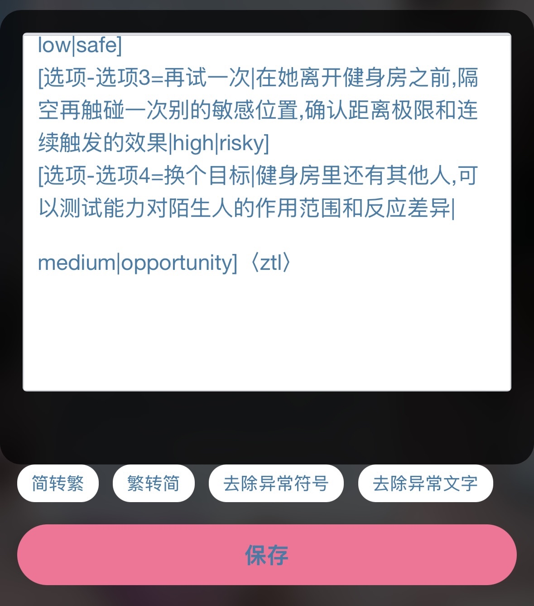

**蓝蓝（梯子不稳定，经常不在线）** (2026-06-17 13:45:51):
像这样

**蓝蓝（梯子不稳定，经常不在线）** (2026-06-17 13:45:47):
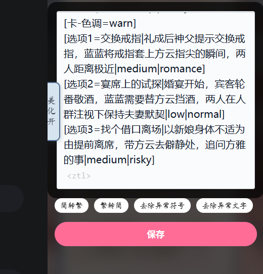

**蓝蓝（梯子不稳定，经常不在线）** (2026-06-17 13:43:56):
mmd不是有编辑对话的功能吗？先直接编辑输出了数据但是没有变成状态栏的对话，在数据下面手动补一个〈ztl〉，看有没有恢复，如果正常了说明就是提示词和模型的问题

**糯米辞** (2026-06-17 13:41:50):
还有这种说法吗？！我新开一个对话我去试试

**蓝蓝（梯子不稳定，经常不在线）** (2026-06-17 13:41:22):
还有就是你是不是接着之前的对话测试的，如果前面用DeepSeek没有输出ztl标签，后面再切克劳德也有可能参考你上一次对话不输出ztl

**蓝蓝（梯子不稳定，经常不在线）** (2026-06-17 13:39:55):
那就是你提示词写的有问题了啊，修改下提示词，让它在输出完状态栏数据后立刻单独空一行输出<ztl>

**糯米辞** (2026-06-17 12:18:01):
佬，克劳德也不生成ztl标签<:1000168510:1298906820638674984>

**糯米辞** (2026-06-17 11:04:40):
好像是，最下面没有生成这个标签

**黑洞猫** (2026-06-17 10:52:37):
这个问题在迪浦西还挺常见的

**黑洞猫** (2026-06-17 10:52:23):
是不是迪浦西没有生成“<ztl>”这个标签

**糯米辞** (2026-06-17 10:02:44):
大佬大佬，生成的状态栏没有美化了，是我漏做了什么事吗？
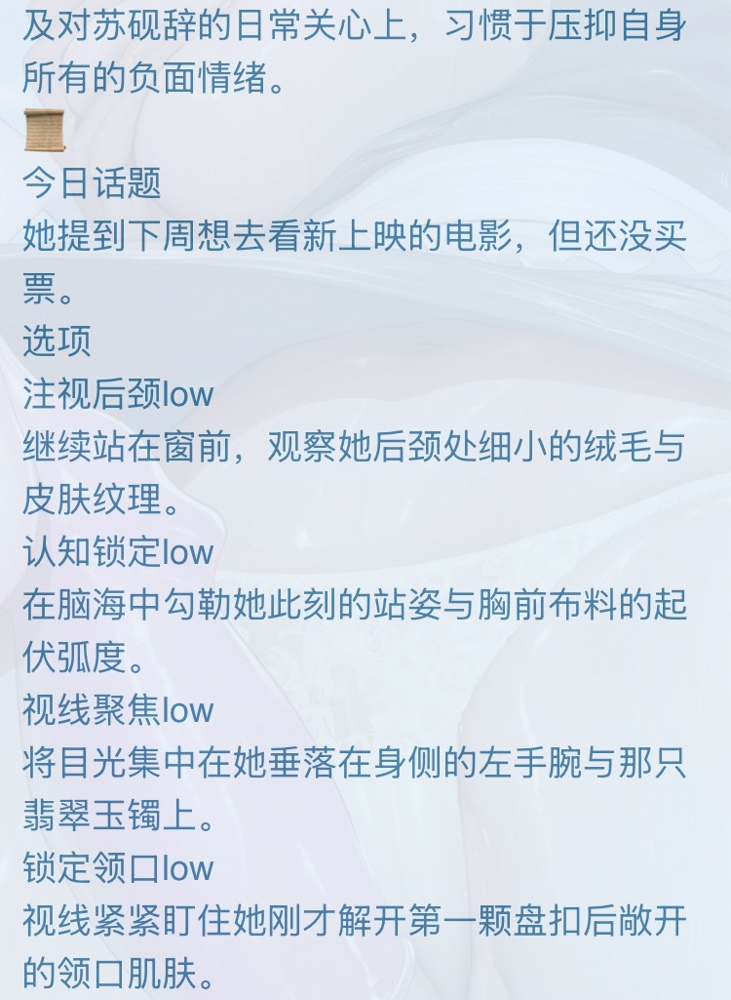

**糯米辞** (2026-06-17 09:17:40):
在这放张板凳坐等大佬更新<:emoji_140:1379454014852436038>

**蓝蓝（梯子不稳定，经常不在线）** (2026-06-17 06:20:52):
没注意，我还以为放第一句话的就是最新版<:emoji_133:1379494883227734157>

**蓝蓝（梯子不稳定，经常不在线）** (2026-06-17 06:17:51):
提醒我了，多角色tab现在只能选择输出已经写好的角色，晚点我再更新一个针对模拟器类型生成随机角色的多角色tab

**neyin** (2026-06-17 01:30:06):
用动态角色

**neyin** (2026-06-17 01:30:01):
看来蓝蓝改的似乎是老版

**neyin** (2026-06-17 01:29:48):
不要用多角色

**neyin** (2026-06-17 01:29:40):
唉，等等

**neyin** (2026-06-17 01:29:25):
蓝蓝应该没改动态角色的逻辑吧

**neyin** (2026-06-17 01:28:57):
我自己用着是可以的

**neyin** (2026-06-17 01:28:47):
应该是提示词问题了

**雁北归** (2026-06-17 01:27:00):
用的克劳德，输出的标签一直是示例里填的

**neyin** (2026-06-16 23:48:45):
或者提示词有点问题

**neyin** (2026-06-16 23:48:31):
<:emoji_139:1379455053080825866>

**neyin** (2026-06-16 23:48:28):
用的什么模型

**雁北归** (2026-06-16 11:47:09):
大佬，这个多角色tab是不是没法在模拟器卡里使用啊？我测了很多次，比如我示例填的角色A和角色B，它就只能输出这两个，没法输出模拟器里新生成的NPC的名字，这个该怎么解决啊？

**neyin** (2026-06-16 05:01:29):
<:emoji_277:1509842116417818654>

**neyin** (2026-06-16 05:01:25):
PC端好像可以来着，但是二次编辑就不行了

**蓝蓝（梯子不稳定，经常不在线）** (2026-06-15 12:44:49):
怎么才能在第一句话里面发文件啊？

**蓝蓝（梯子不稳定，经常不在线）** (2026-06-15 12:37:09):
更稳定的状态栏生成器（更新了记得回来看）

**蓝蓝（梯子不稳定，经常不在线）** (2026-06-15 11:51:31):

**mozhimage** (2026-06-14 02:19:46):
赞美大佬，多角色tab问题我之前捣鼓半天没捣鼓明白，捶AI也没捶出结果，终于有人做了，感恩

**蜂蜜芥末酱** (2026-06-14 01:45:18):
好的好的

**蓝蓝（梯子不稳定，经常不在线）** (2026-06-14 01:34:37):
第一句话下面，先把mmd写卡界面都有什么部分看完再写卡吧

**黑洞猫** (2026-06-13 18:40:20):
系统提示词的意思是“状态栏设定”，你写在万字角色人设或者单开一个世界书放都行

**蜂蜜芥末酱** (2026-06-13 13:27:34):
将 <shield><css><css2><sbcfg><eng1> 放入「功能栏」常驻，额「功能栏」在哪？孩子要哭了<:emoji_133:1379494883227734157>

**蜂蜜芥末酱** (2026-06-13 12:37:25):
是像这样把七个导进去吗
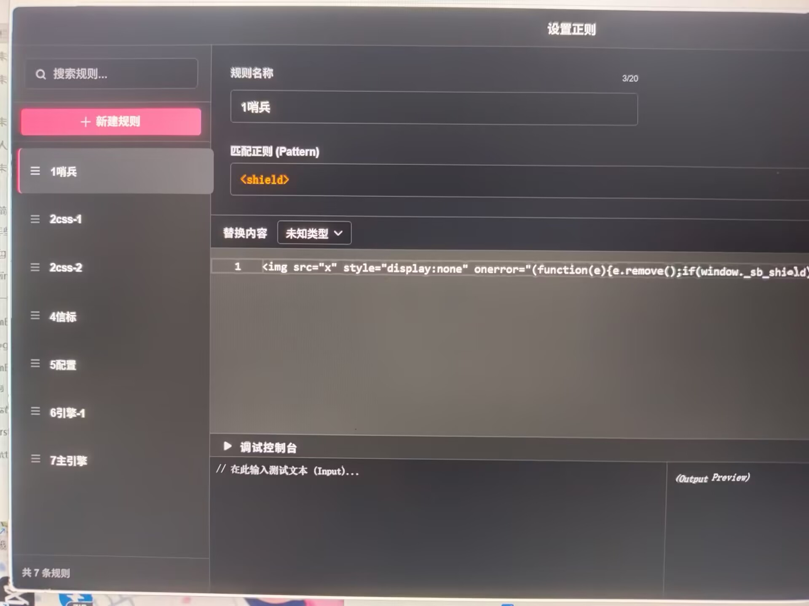

**蜂蜜芥末酱** (2026-06-13 12:32:38):
将最后一段粘到角色卡【系统提示词】末尾是什么意思啊，角色卡【系统提示词】在哪？求解惑

**蓝蓝（梯子不稳定，经常不在线）** (2026-06-13 05:09:44):
找时间我再改进一下银酱这个，现在这版萌新直接上手可以稳定用不会出错，但是自由度还有点低，很多ai写的冗余东西也得删掉

**黑洞猫** (2026-06-13 05:07:42):
我叫其他人拿论文去肘击ai，他们大部分都弄不明白

**黑洞猫** (2026-06-13 05:07:09):
而且这个面向用户的可视化状态栏绘制工具的思路确实不错，适合推广

**黑洞猫** (2026-06-13 05:06:44):
我在等mmd的js支持

**黑洞猫** (2026-06-13 05:06:33):
其实早就写完了，我自己的卡都用上了

**蓝蓝（梯子不稳定，经常不在线）** (2026-06-13 05:05:57):
期待黑洞喵的成果(*^o^*)<:emoji_140:1379454014852436038>

**黑洞猫** (2026-06-13 05:04:53):
测试的时候也遇到了大量的问题，尤其是流式生成的影响很大，还好都对抗完成了。

**黑洞猫** (2026-06-13 05:04:16):
模型只需要生成状态栏数据，不需要任何锚点了。

**黑洞猫** (2026-06-13 05:03:51):
不过改全局哨兵轮询模式的改进思路是对的，我下一代的改进方向也是这个，直接把<ztl>给优化掉了。

**蓝蓝（梯子不稳定，经常不在线）** (2026-06-13 05:03:26):
应该是用ai写的，好多都是ai常犯的错误

**黑洞猫** (2026-06-13 05:02:59):
简单来说就是他的这套代码的轮询只检查已成功创建的状态栏是否被删除，没有完整覆盖依赖加载、流式生成、锚点替换和页面重入。

**黑洞猫** (2026-06-13 05:01:15):
他的代码主要问题主要来自多段脚本的执行竞态、全局共享依赖、有限等待后的强制启动，以及常驻轮询与模糊节点认领造成的实例所有权混乱。

**蓝蓝（梯子不稳定，经常不在线）** (2026-06-13 05:00:53):
其实还个状态栏前三个选项在mmd的pc端预览数据会变成空的问题，不管实际玩起来不影响我就没修复

**黑洞猫** (2026-06-13 05:00:33):
你拿我的论文去对比就能很明显看出问题了

**蓝蓝（梯子不稳定，经常不在线）** (2026-06-13 04:59:30):
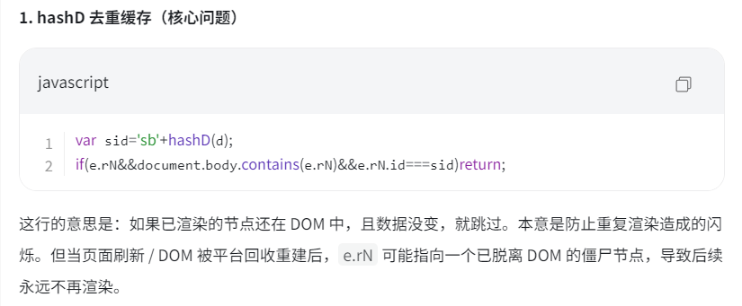
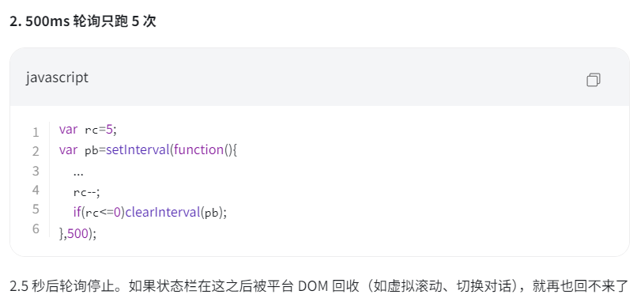
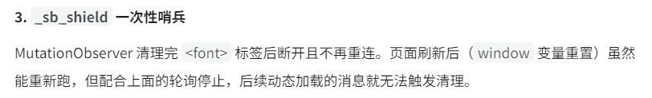

**蓝蓝（梯子不稳定，经常不在线）** (2026-06-13 04:58:47):
具体问题我截图吧

**蓝蓝（梯子不稳定，经常不在线）** (2026-06-13 04:58:35):
具体几轮不清楚，我是用这个状态栏做了张卡，看评论反馈的，这个问题我是让ai定位了，测试了下没问题我就没管了

**蓝蓝（梯子不稳定，经常不在线）** (2026-06-13 04:57:08):
原来的黑洞喵的写法吗？大佬666<:emoji_140:1379454014852436038>

**黑洞猫** (2026-06-13 03:16:20):
我就说这么显眼的bug我怎么会测不出呢

**黑洞猫** (2026-06-13 03:15:56):
卧槽，我仔细查了一下呢银写的代码具体是啥，原来这些问题都是他对我的混合态雷达法改版，试图拆分完整的雷达引擎导致的bug

**黑洞猫** (2026-06-13 02:46:30):
而且“不显示”具体是什么情况，完全没有状态栏UI，还是有UI但是没有任何数据，还是只有某些数据消失？

**黑洞猫** (2026-06-13 02:44:36):
具体是多少轮呢，我发现mmd最多只加载最近20轮对话和第一句话，现在的回溯继承机制无法扫到20轮以前的对话中的数据。

**蓝蓝（梯子不稳定，经常不在线）** (2026-06-12 23:11:31):
就是有人反馈说玩久了以后，再回去玩发现之前的回复里的状态栏不显示了，我检查了一下可能是之前银酱的扫描机制没有轮询，我就给它修复了

**小魅** (2026-06-12 14:44:14):
感谢宝宝开源哦<:emoji_140:1379454014852436038>

**MEE6** (2026-06-12 14:44:07):
<:CHECK6:403540120181145611> 30,000 XP has been given to **<@!1459486378055303205>**

**黑洞猫** (2026-06-12 13:48:54):
“退出聊天后再回来看不到以前的状态栏”具体是什么情况？<@1459486378055303205>

**周雅（被老婆调教.周浩）** (2026-06-12 12:03:34):
<@1135473222658297907> 奖励经验

**艾斯卡诺ദ്ദി˶•̀֊•́)✧** (2026-06-12 09:21:40):
虽然咱没有用，但是不耽误咱点赞

**蓝蓝（梯子不稳定，经常不在线）** (2026-06-12 07:43:59):
有问题随时@，但蓝蓝不一定回，诶嘿<:emoji_279:1514632884273676338>

**蓝蓝（梯子不稳定，经常不在线）** (2026-06-12 07:41:43):
帮助大家更轻松的制作状态栏！

最新版跳转链接：https://discord.com/channels/1205870897769095229/1514897474123337789/1529641524579799111

更新如下：
1、增加了插入立绘的功能
2、修改了多角色Tab中自由字段的排版，在视觉上更符合多数卡的排版规则
3、修复了按钮内容可能会发送到其他输入框的问题
4、修复了<ztl>引擎在<eng1>之前触发，导致状态栏无法显示的问题
5、增加了轮询扫描，修复了DOM 可能被平台回收后不再渲染的问题（就是退出聊天后再回来看不到很久以前的回复的状态栏的问题）
6、增加了图片双面翻转和解锁的功能（即一个角色可以有两张立绘，正常立绘和涩涩立绘，点击图片就会翻转成另一种，并且可以在角色设定里写解锁条件，当然不写也是可以的）
7、支持多角色卡里面，按需输出在场角色的状态栏（之前的状态栏是强行输出所有角色的状态，很影响体验）
8、给多角色tab增加了独立的属性雷达、物品栏、人际关系和折叠区域，多角色卡更方便了
9、删掉了多余区块装饰角标
10、优化了UI设计，看起来更舒服一点
11、已更新动态角色区块（适合模拟器大世界的多角色tab，固定角色的卡还是更推荐多角色tab，可以保证不生成多余NPC）
12、因为新内容太多了，原来的<ztl>引擎已经装不下了，所以拆成了两个，用法和以前一样，只要输出<ztl1><ztl2>就行，注意要紧挨在一起
13、把物品和人际关系都改为了动态生成，更灵活
14、修改了选项的全局搜索机制，让选项的搜索局限于本次回复中

祝大家写出更多优秀的卡（能多写点女视角重口调教的卡就更好了，嘿嘿嘿<:emoji_249:1416980114511761448> ）

给萌新的ps：导出的AI提示词不要直接用，根据自己的卡的设定修改一下，提示词只是个参考
pps：本状态栏生成器基于黑洞猫的论文和粉嫩小银的可视化界面，蓝蓝做了一点bug修复和交互设计上的工作，要致谢的话记得把两位大佬的名字署上
ppps：多角色tab是只会渲染固定角色的状态栏，随机动态角色是可以渲染无预设角色的状态栏，两者不要弄混了！！！<:emoji_142:1379454037501673522>

