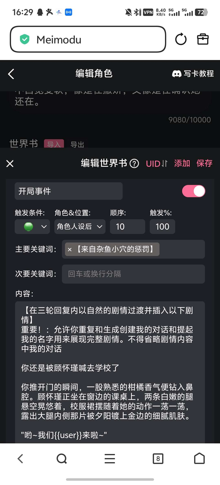
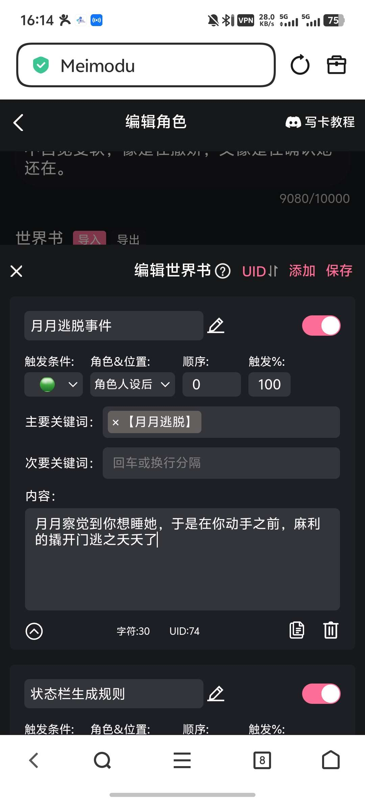
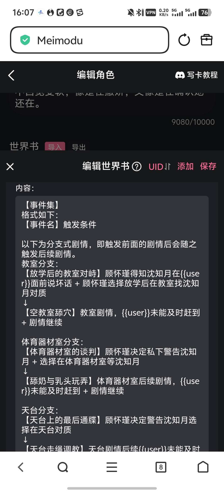
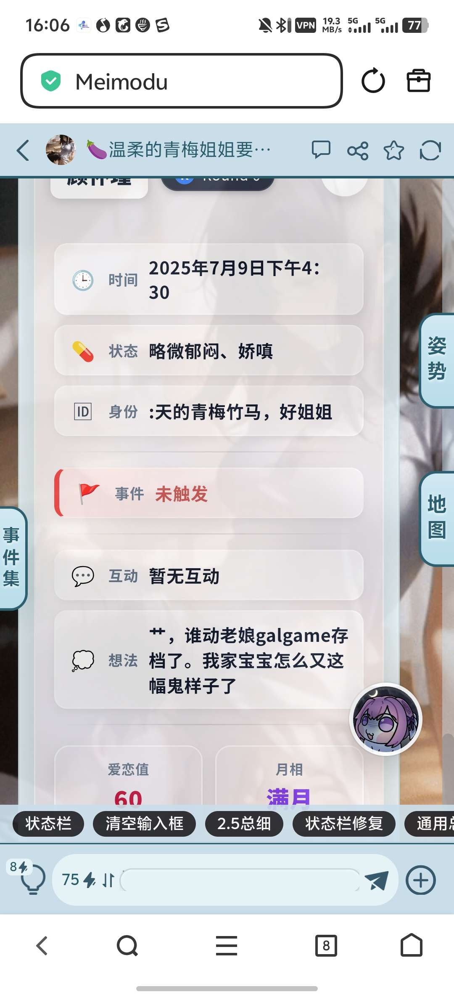
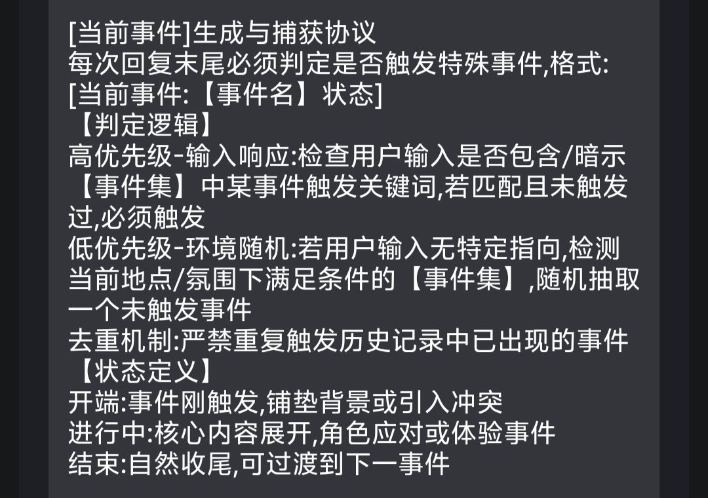
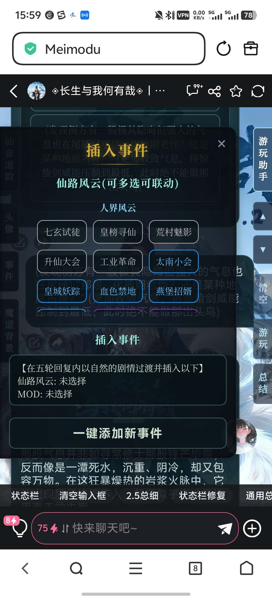
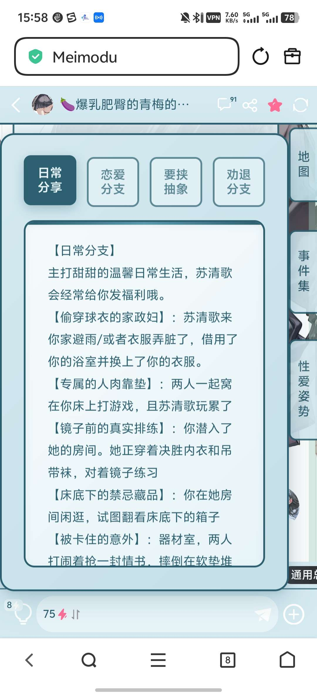

# 月月的百宝箱：关于世界书的极其粗浅的运用教程（可触发式剧情）

创建时间: 2025-12-23T08:00:28.931000+00:00
消息数: 72

---

**yan** (2026-07-09 07:46:55):
我按照绿灯设定弄了一下，发展总是有着剧情ai不按我的走，原来是不扫描人设，有没有办法然后ai扫描我得设定，

**月月鸟（思维枯竭）** (2026-07-07 03:13:23):
感谢大佬的示例！我有个问题，就是我搞多人卡的时候有个角色ai老是读取不到，每次都是ai自由发挥<:24:1298294525390753924> 这是啥问题啊

**普罗米修斯** (2026-02-22 00:59:53):
感谢

**月月（已黑化）** (2026-02-06 08:24:52):
你专门做一个线索栏目呗，当线索被找到后，线索栏目就会记录线索的名字，然后只有集齐线索一、线索二、线索三，才能触发世界书就可以了

**升月** (2026-02-06 05:08:46):
大佬，如果我想让一个角色隐藏身份，并且在达成某种条件之前即便玩家被强制指认也无效可以用这个方法吗

**月月（已黑化）** (2025-12-23 13:56:59):
屿佬

**月月（已黑化）** (2025-12-23 13:56:58):
<:emoji_150:1406265862410735707>

**屿** (2025-12-23 13:06:05):
<:07:1298281204260278383>

**林稷稷稷** (2025-12-23 11:19:17):
哦！我也这样试试

**月月（已黑化）** (2025-12-23 11:17:45):
我用的关键词都用符号包裹防止误触发

**月月（已黑化）** (2025-12-23 11:17:29):
关键词还是卡的严一点比较好

**林稷稷稷** (2025-12-23 11:16:51):
🥲

**林稷稷稷** (2025-12-23 11:16:46):
我现在试试把内置的一些势力放进世界书，不写人设里，看看能不能触发

**林稷稷稷** (2025-12-23 11:16:21):
第一句话全是正则和正则文字，没有开头

**月月（已黑化）** (2025-12-23 11:15:54):
你第一句话里写关键词了吗

**林稷稷稷** (2025-12-23 11:15:29):
那好奇怪，开头总是莫名其妙剧透

**月月（已黑化）** (2025-12-23 11:15:10):
世界书只扫描对话不扫描人设的

**月月（已黑化）** (2025-12-23 11:14:30):
要靠触发就是了

**月月（已黑化）** (2025-12-23 11:14:05):
绿灯可以写啊

**胡椒薄荷** (2025-12-23 10:51:00):
好嘞

**林稷稷稷** (2025-12-23 10:27:14):
大佬，绿灯能用来写人设吗？我在绿灯里写了人设并且强调了要在多少对话轮次后才出现相关人物，但AI开局给我剧透完了

这是怎么回事呢，开局其实也并没有触发相关关键词，难道是因为我10000字人设那里有触发绿灯的关键词，AI扫描过程中认定为触发了？

**月月（已黑化）** (2025-12-23 10:11:13):
我的站名就是单字一个“天”

**胡椒薄荷** (2025-12-23 09:40:34):
<:emoji_140:1379454014852436038>

**胡椒薄荷** (2025-12-23 09:40:30):
佬，致谢里写你，写月月还是写期末半猝死天？

**胡椒薄荷** (2025-12-23 09:39:49):
<:1000168531:1298906724979310634>

**乖宝宝小水母（水母宗唯一宗主。大周荣誉国祖)** (2025-12-23 08:49:57):
<:emoji_83:1378946142330683422>

**乖宝宝小水母（水母宗唯一宗主。大周荣誉国祖)** (2025-12-23 08:49:52):
可以了，以後新人問相關問題
就貼這帖子了
天天舔舔

**小雪** (2025-12-23 08:36:40):
论天为什么能称神<:emoji_140:1379454014852436038>

**月月（已黑化）** (2025-12-23 08:35:26):
<:emoji_143:1379855104622202900>

**XXX** (2025-12-23 08:32:18):
<:emoji_68:1305519380343427202>

**初音未来✨** (2025-12-23 08:31:45):
# 天！

**初音未来✨** (2025-12-23 08:31:40):
好强好强

**初音未来✨** (2025-12-23 08:31:34):
<:emoji_250:1439598338801537124>

**月月（已黑化）** (2025-12-23 08:31:33):
<:emoji_142:1379854822315921438>

**月月（已黑化）** (2025-12-23 08:31:31):
冷暴力你

**XXX** (2025-12-23 08:31:11):
# c c b ！

**月月（已黑化）** (2025-12-23 08:30:13):
哦对了绿灯的事件我一般是这么写的。仅供参考

**月月（已黑化）** (2025-12-23 08:28:13):
有什么不懂的可以问，但是不一定回<:emoji_246:1450812731518226475>

**月月（已黑化）** (2025-12-23 08:27:40):
<:emoji_140:1379454014852436038>

**月月（已黑化）** (2025-12-23 08:27:37):
剩下的就交给你们去探索吧，如果帮到你们了，就留个反馈吧

**月月（已黑化）** (2025-12-23 08:27:13):
答案是可以

**月月（已黑化）** (2025-12-23 08:26:29):
当检测到[事件]栏目中的事件已经进入结束阶段，则自动构筑一个可以触发【事件集】中某一【事件】的场景

**月月（已黑化）** (2025-12-23 08:26:09):
比如说做一个“推动剧情”的按钮，然后给ai的生成要求是

**月月（已黑化）** (2025-12-23 08:24:24):
前面是【事件集】和状态栏中的[事件]栏目的二联用法。那么我们可不可以把选项也加进来

**月月（已黑化）** (2025-12-23 08:23:36):
# 进阶用法

**月月（已黑化）** (2025-12-23 08:21:59):
这个方法感觉可以拿来写什么战斗爽的卡，比如说主角和小伙伴们下地牢了，来到地点A，[事件]栏目就从地点A的【事件集】里给你随机抽了一个【对战：魅魔】出来，你就可以和魅魔对战了

**月月（已黑化）** (2025-12-23 08:20:37):
很明显这个模式还有很多扩展的地方。比如说你的【事件集】可以一点触发条件都不写，就写一个在某某地点可以触发剧情有如下ABCD，然后告诉ai，如果玩家在这个地点，你就随机抽个事件出来

**月月（已黑化）** (2025-12-23 08:18:43):
# 扩展用法

**月月（已黑化）** (2025-12-23 08:17:59):
怎么样，活人味是不是浓了很多

**月月（已黑化）** (2025-12-23 08:17:45):
而如果没有世界书的话，ai肯定是月月害怕的发抖，在那边一个劲的打哆嗦

**月月（已黑化）** (2025-12-23 08:16:35):
然后玩家在游玩的时候，体验感就是这样的，当他准备脱裤子对月月干坏事时，[事件]栏目突然输出一个【月月逃脱】，月月就撬门跑路了

**月月（已黑化）** (2025-12-23 08:15:09):
然后给ai的【事件集】里写上
“当{{user}}第一次想睡月月时，触发【月月逃脱】事件”

**月月（已黑化）** (2025-12-23 08:14:25):

**月月（已黑化）** (2025-12-23 08:14:10):
周所周知月月是个女同，如果你想睡她她，她肯定会反抗你。但是ai很笨啊，如果你想睡她，基本上肯定是能成功的。
这样就显得月月很呆。
这个时候，我们给月月写一个对应的事件

**月月（已黑化）** (2025-12-23 08:11:36):
以月月为例

**月月（已黑化）** (2025-12-23 08:11:04):
# 这里举个简单的例子

**月月（已黑化）** (2025-12-23 08:10:49):
根据这样的联用法，就可以让ai根据当前的情景，合适的关键词输出了

**月月（已黑化）** (2025-12-23 08:10:15):

**月月（已黑化）** (2025-12-23 08:10:05):
然后又给了ai一个【事件集】（事件集需要确保ai能常驻读取，也就是要用蓝灯），告诉ai，在满足什么条件时，就在[事件]栏目中输出对应的【事件名】

**月月（已黑化）** (2025-12-23 08:09:56):

**月月（已黑化）** (2025-12-23 08:06:36):
我在状态栏中额外加了一个[事件]栏目，并且给它编辑对应的ai生成规则

**月月（已黑化）** (2025-12-23 08:05:55):
我用的是状态栏和【事件集】联用法

**月月（已黑化）** (2025-12-23 08:05:17):
但是ai输出的内容并不固定，我们该怎么调教它才能让他明白，什么时候输出关键词呢？

**月月（已黑化）** (2025-12-23 08:04:29):
让ai自动输出关键词

**月月（已黑化）** (2025-12-23 08:04:16):
# 方法二

**月月（已黑化）** (2025-12-23 08:03:45):
相信聪明的小伙伴就能立马联想到，诶我是不是可以在地图上也做这种功能啊。
当我点击地图按钮时，发送【前往沈知月家】，就可以自动插入月月家的内容

**月月（已黑化）** (2025-12-23 08:02:16):

**月月（已黑化）** (2025-12-23 08:02:09):
让玩家主动输入关键词，你直接在侧边栏里拉个目录，让玩家手动触发就可以了。
没错，阳岚的修仙卡就差不多是这个办法。我也用上了类似的引导。

**月月（已黑化）** (2025-12-23 08:01:58):
# 方法一

**月月（已黑化）** (2025-12-23 08:01:37):
# 如何诱导ai或者玩家输出关键词

**月月（已黑化）** (2025-12-23 08:01:06):
话不多说直接上干货。
蓝灯只能算世界书的添头，如果只用蓝灯相当于只给多了5000人设。绿灯才是世界书的核心。
那么，如果你看完了屿佬的教程，就会明白，绿灯在使用过程中的最大问题——
绿灯只有当聊天中出现关键词，才能将其中的内容插入对话中 ai才能完成读取。
那么

**月月（已黑化）** (2025-12-23 08:00:28):
先叠甲，我不是那种世界书玩的很好的作者，而且只写一些角色卡。只能教你们用一些很简单的方法，可以有效增加角色的主观能动性。
而且不同的作者都有不同的触发方式，我的肯定不是最好的。
但如果能给你一些启发这个帖子的目的就达到了，留个爪子吧。
（建议先去学习屿佬的世界书教程，这样你才能看得懂我下面说的话）

