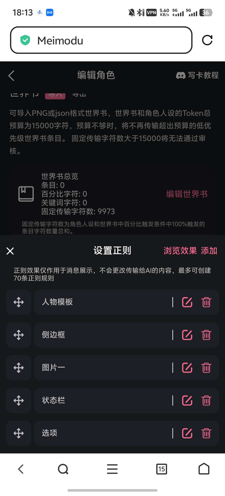
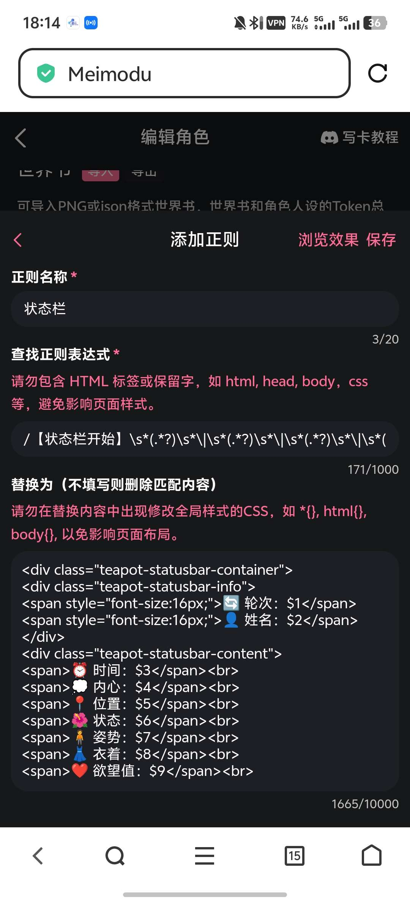
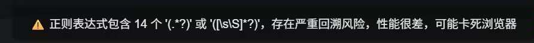

# 月月的百宝箱：开源一张有着最基础美化的卡，包括侧边框，状态栏，选项（叠甲：开源的目的是让新手学习美化的不是给你们照抄的）

创建时间: 2025-11-22T07:42:23.012000+00:00
消息数: 93

---

**月月（已黑化）** (2026-09-05 09:26:23):
技术都挺落后的，仅供参考吧

**月月（已黑化）** (2026-09-05 09:26:07):
但是这张卡已经很老了

**月月（已黑化）** (2026-09-05 09:25:59):
这个

**月月（已黑化）** (2026-09-05 09:25:48):
上面那张菲比

**林枫** (2026-09-05 08:42:57):
<@1398315991850680352>

**林枫** (2026-09-05 08:42:46):
怎么弄啊没看见文件呀在哪里下载呀<:1000168510:1298906820638674984>

**雨霖铃** (2026-05-23 14:04:26):
大佬，为啥我看不到V2的卡啊？

**月月（已黑化）** (2026-01-13 11:30:04):
比如说你要把爱恋值改成堕落值的话，最好把正则捕获式，对应的生成规则，还有解释全部一起改了

**月月（已黑化）** (2026-01-13 11:29:21):
最好改成一致的哦，方便ai理解

**🐷辰少安🐷** (2026-01-12 13:12:36):
非常感谢，有点疑问：在最开始，字段说明的文字和状态栏开始的文字需要改成一致的吗？【状态栏开始】轮次内容|姓名内容|时间内容|内心内容|位置内容|状态内容|姿势内容|衣着内容|爱恋值内容|伦理防线内容|情感壁垒内容|关系内容【状态栏结束】

字段说明：
轮次内容：当前对话的轮次编号
姓名内容：当前女角色的名字
时间内容：当前的时间段描述
内心内容：当前女角色的内心想法
位置内容：当前所在的地点
状态内容：当前女角色的状态描述
姿势内容：当前女角色的姿势描述
衣着内容：当前女角色的衣着描述
欲望值内容：当前女角色的欲望值及解释
性器状态内容：当前角色的性器状态（包括：口、小穴、后庭、雪乳、玉足）及解释
爱恋值内容：当前角色对用户的爱恋值
关系内容：对所有有过交互的角色的看法

**胡椒薄荷** (2025-12-24 03:14:03):
去看大陨石老师的基础教程和开源卡，对着写

**月月（已黑化）** (2025-12-24 00:57:24):
右上角浏览器打开之后保存，上mmd创建角色，然后导入v2卡

**司徒冽风** (2025-12-24 00:39:01):
所以大佬，这张图怎么用啊

**黑（萌新形态）** (2025-12-23 18:13:45):
<:07:1298281204260278383>

**额6呵呵** (2025-12-22 19:28:59):
大佬，我想学写卡

**隆** (2025-12-22 07:08:05):
老哥，强👍

**阳玉** (2025-12-20 02:26:30):
这个

**xux** (2025-12-20 02:08:14):
呃，卡呢

**阳玉** (2025-12-19 15:17:30):
<:emoji_194:1409567400470253719>

**阳玉** (2025-12-19 15:17:28):
现在说晚了

**周雅（被老婆调教.周浩）** (2025-12-19 14:32:55):
你这个辅导员已经是公交车了，好几个卡背景图都是你的辅导员

**humanjj** (2025-12-18 15:54:53):
谢谢大佬

**俊霖** (2025-12-18 12:39:45):
/回顶

**这狗托我是当定了** (2025-12-14 02:57:14):
感谢大佬的开源

**赫化** (2025-12-13 13:19:26):
好的好的，感谢大佬

**月月（已黑化）** (2025-12-13 13:18:58):
洗稿的太多给我整怕了

**月月（已黑化）** (2025-12-13 13:18:40):
就那个黄色表情包

**月月（已黑化）** (2025-12-13 13:18:25):
新的v2卡在上面

**赫化** (2025-12-13 13:08:50):
wuwa，大佬的卡怎么没了<:emoji_115:1379113943817257071> 我收藏着还没学呢

**月月（已黑化）** (2025-12-03 13:14:53):
捕获小可爱

**xi** (2025-12-03 12:34:09):

**月月（已黑化）** (2025-12-03 11:39:48):
这是新的v2卡

**月月（已黑化）** (2025-12-03 11:39:17):

**xi** (2025-12-03 11:10:14):

**月月（已黑化）** (2025-12-03 02:34:44):
月月的百宝箱：开源一张有着最基础美化的卡，包括侧边框，状态栏，选项（叠甲：开源的目的是让新手学习美化的不是给你们照抄的）

**月月（已黑化）** (2025-12-03 02:29:27):
<:emoji_250:1443878976102862878>

**月月（已黑化）** (2025-12-03 02:29:23):
不会吧我用着挺稳定的

**hwp** (2025-12-02 16:57:09):
这个不是过一段时间图就没了吗

**月月（已黑化）** (2025-12-02 00:01:17):
catbox

**hwp** (2025-12-01 17:14:52):
大佬用的什么图床呀<:emoji_140:1379454014852436038>

**cc** (2025-12-01 11:19:31):
<@1398315991850680352> 已解决谢谢佬佬

**月月（已黑化）** (2025-12-01 10:14:24):

**月月（已黑化）** (2025-12-01 10:13:15):
正则那里

**cc** (2025-12-01 09:51:39):
老师在哪里查看状态栏代码呀？新手求助🆘

**月月（已黑化）** (2025-12-01 03:01:19):
然后在人设里重新定义一遍数值

**月月（已黑化）** (2025-12-01 03:01:00):
最笨的办法当然是把已经有的数值改个名字<:1000168531:1298906724979310634>

**cc** (2025-12-01 02:28:12):
老师牛逼

**苏米拉 ·** (2025-11-30 12:26:51):
感谢大佬开源，虽然我还是没搞懂有些代码的运作，比如想在状态栏里加入一个新的值比如绝望值，但是找不到引用数据在哪里引

**苏米拉 ·** (2025-11-30 12:25:31):
<:1000168531:1298906724979310634>

**苏米拉 ·** (2025-11-30 12:25:29):
意外发现可以尝试让chatgpt帮我啃代码。。。。。亏我还死啃了一下午，都快自己学会了

**冥皇** (2025-11-30 08:36:25):
沒事了，我找到了

**月月（已黑化）** (2025-11-30 05:47:44):
<:1000168531:1298906724979310634>

**月月（已黑化）** (2025-11-30 05:47:42):
什么不懂

**冥皇** (2025-11-30 03:38:42):
大哥我不太懂你意思，怎麼按也沒東西

**月月（已黑化）** (2025-11-30 01:43:43):
代码里有个网址的，你把那个网址换成自己的图床就OK

**凉** (2025-11-30 01:13:06):
应该是换图片网址 吧？

**鸡大** (2025-11-28 20:19:02):
大佬怎么把你这卡里的状态栏的照片给替换啊？

**月月（已黑化）** (2025-11-28 11:16:03):
讲真我之前都没崩过的，但这次崩直接给我整问号了

**云英** (2025-11-28 08:55:06):
（）我在五天前因为这个原因发的卡状态栏做到了自动每对话四次卡崩mmd（）太恐怖了

**鸡大** (2025-11-28 08:12:38):
爱你啊大佬

**hwp** (2025-11-28 07:37:32):
牛逼大佬！但是状态栏图片加载不出来，不知道是不是我加速器原因

**月月（已黑化）** (2025-11-27 07:45:56):
以后需要把正则给ai优化一下，告诉ai禁用换行审查就行

**月月（已黑化）** (2025-11-27 07:43:46):
鉴于mmd现在规范了正则

**月月（已黑化）** (2025-11-27 07:42:52):
各位

**月月（已黑化）** (2025-11-24 23:40:05):
我跑不来图都是从别人那毛来的

**月月（已黑化）** (2025-11-24 23:39:42):
<:1000168531:1298906724979310634>

**月月（已黑化）** (2025-11-24 23:39:35):
这个没办法喵

**阿海** (2025-11-24 18:21:15):
<@1398315991850680352>忽忽，才发现，鱼鱼的图~ 是六指鱼鱼喔。修复修复，不要让我的鱼鱼有瑕疵……

**日行一善积大德，日行两善积积大大德** (2025-11-23 13:12:36):
谢谢宝宝<:emoji_250:1440569625707413574>

**月月（已黑化）** (2025-11-23 13:10:15):
反正也不是很难的东西，基本都是ai跑的

**月月（已黑化）** (2025-11-23 13:10:04):
<:1000168531:1298906724979310634>

**月月（已黑化）** (2025-11-23 13:10:02):
开源出来就是给你们用的

**日行一善积大德，日行两善积积大大德** (2025-11-23 13:00:09):
佬，拿你的状态栏代码和侧边栏代码改了改，状态栏图片换了，侧边栏部分内容改了改我能用来做卡吗佬，会在卡内谢你的<:emoji_140:1379454014852436038>

**洛尘（ଳ水母宗太上长老）** (2025-11-23 07:05:42):
<:emoji_140:1379454014852436038>

**月月（已黑化）** (2025-11-22 10:33:07):
超级丐版美化

**月月（已黑化）** (2025-11-22 10:32:51):
<:emoji_115:1379113943817257071>

**月月（已黑化）** (2025-11-22 10:32:48):
不要捧杀我鸭

**乖宝宝小水母（水母宗唯一宗主。大周荣誉国祖)** (2025-11-22 10:29:01):
牛逼大佬

**日行一善积大德，日行两善积积大大德** (2025-11-22 09:50:38):
牛逼大佬

**月月（已黑化）** (2025-11-22 07:54:36):
或者迭代一下

**月月（已黑化）** (2025-11-22 07:54:24):
另外还可以把代码分段发给小茶壶，让它帮你做成可折叠的

**neyin** (2025-11-22 07:52:32):
# ccb！

**月月（已黑化）** (2025-11-22 07:52:23):
<:emoji_250:1440756778487775303>

**月月（已黑化）** (2025-11-22 07:52:04):
那张图就是V2卡

**鸢** (2025-11-22 07:48:57):
我是笨蛋

**鸢** (2025-11-22 07:48:36):
<:emoji_250:1440756778487775303>

**鸢** (2025-11-22 07:48:33):
不对啊大佬，卡呢？

**XXX** (2025-11-22 07:47:39):
<:emoji_250:1440756778487775303>

**XXX** (2025-11-22 07:47:37):
# ccb!

**月月（已黑化）** (2025-11-22 07:43:29):
不能看<:emoji_142:1379854822315921438>

**阳玉** (2025-11-22 07:43:13):
<:emoji_150:1400299501423431771>

**阳玉** (2025-11-22 07:43:12):
看看b

**月月（已黑化）** (2025-11-22 07:42:23):
这是V2卡，点进去右上角浏览器保存就OK啦
不是哥们，怎么有人封面都不换啊，自己找张图换个封面啊。
还有，虽然mmd点子是可以共通的，如果我的某个点子有很多人效仿我也很高兴，但是照抄或者改个第一句话就发，我肯定会点举报的
鉴于最近洗稿的人太多，所以我决定把这张卡的人设什么的都删了，想学习的新手研究一下美化代码和正则就可以了
<:emoji_148:1382329938404839586>

