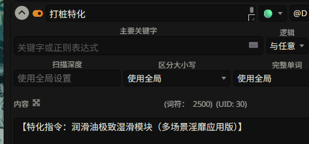
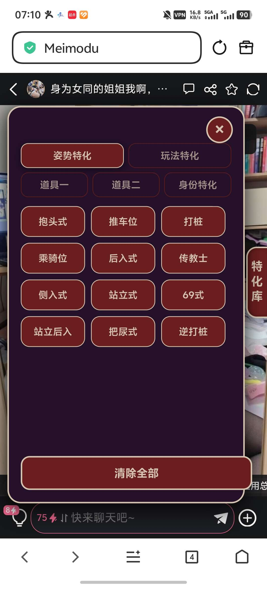
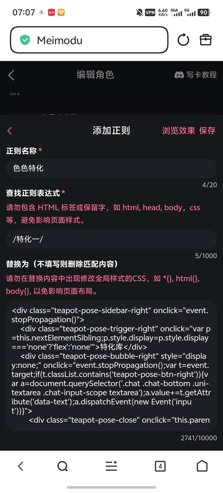
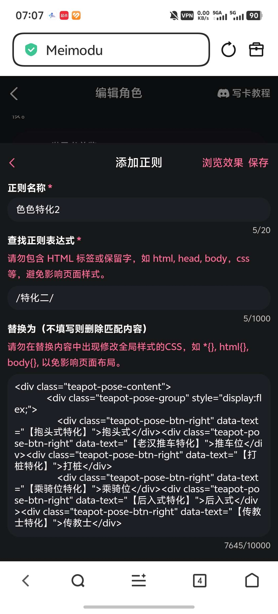

# 月月的百宝箱：究极无敌色色特化4.0

来源: Discord 魅魔藏经阁 thread 1472729655906799851

创建: 2026-02-15T23:01:51.962000+00:00
消息数: 56

---

**鸽子212** (2026-08-18 16:08:10):
感谢大佬的特化ヾ^_^♪新手第一次写卡有用到，来还愿了<:22:1298294520777019502>

**德玛西亚** (2026-05-30 19:35:18):
大佬大佬有没有隐奸特化

**奇迹于你** (2026-05-07 08:46:14):
！？强强？！

**白鸟不归乡** (2026-04-13 11:51:01):
大佬，你好，本人萌新不懂代码。使用了大佬的代码并进行角色库改造，现在我遇到一个问题，选择选项（姿势、玩法、道具一二特化这个选项。）好像有上限，增加到一定数量后，选项模块不在显示里面的子选项怎么办？😭

**白鸟不归乡** (2026-04-12 03:33:08):
感谢大佬

**月月（已黑化）** (2026-04-08 11:38:54):
<:emoji_150:1406265862410735707>

**沐 云曦** (2026-04-08 10:22:05):
可爱muamua

**月月（已黑化）** (2026-04-04 03:03:15):
哟，我都忘了说了，鉴于魅魔最近把单条正则字数上限开放到20000了，可以把代码塞到一条正则里了。当然你愿意分段也行

**F5153** (2026-03-19 18:51:43):
感谢大佬<:emoji_140:1379454014852436038> <:emoji_140:1379454014852436038> <:emoji_140:1379454014852436038>

**一只猫** (2026-03-14 02:30:19):
我们敬爱你阿大佬

**Hanfei** (2026-03-06 20:18:30):
我爱你大佬

**Hanfei** (2026-03-06 20:18:21):
大佬能把这么多体位都写的这么…呃…生动也是神了<:07:1298281204260278383>

**yunt** (2026-02-26 18:54:03):
额 问题解决了 导入魅魔是正常的 但是导入酒馆就乱了 神奇捏

**嘻嘻** (2026-02-26 17:48:24):
特化一那个文件少11个字<:emoji_249:1459443119329247315>

**yunt** (2026-02-26 17:33:00):

**yunt** (2026-02-26 17:30:00):

**yunt** (2026-02-26 17:28:27):
为什么我下下来发现全是乱的，比如说露出特化里面全是坐姿特化？而且缺一堆关键词

**月月（已黑化）** (2026-02-26 04:01:19):
我没做过诶

**月月（已黑化）** (2026-02-26 04:01:15):
抽奖器？

**欧哥** (2026-02-26 03:51:42):
大佬这个能搞个侧边栏抽奖吗

**OnlyIfYouLoveMe** (2026-02-23 12:47:42):

**月月（已黑化）** (2026-02-23 12:45:50):
<:emoji_250:1473320497122115684>

**月月（已黑化）** (2026-02-23 12:45:46):
扣你

**OnlyIfYouLoveMe** (2026-02-23 11:56:11):
乐

**i** (2026-02-23 11:35:32):
我再去看一遍，再不会再问<:emoji_140:1379454014852436038> <:emoji_140:1379454014852436038> <:emoji_140:1379454014852436038>

**i** (2026-02-23 11:35:23):
好的好的<:emoji_140:1379454014852436038>

**月月（已黑化）** (2026-02-23 11:35:13):
认真看我教程啊喂

**月月（已黑化）** (2026-02-23 11:35:03):
下面两个是那个侧边栏代码啊

**月月（已黑化）** (2026-02-23 11:34:51):
这个是世界书数据

**i** (2026-02-23 11:34:46):
下面那两个

**月月（已黑化）** (2026-02-23 11:34:35):
你下成哪个了

**i** (2026-02-23 11:34:25):
<@1398315991850680352> 啊？为什么我这显示的是doc

**月月（已黑化）** (2026-02-23 11:29:59):
特化后缀就是json啊

**月月（已黑化）** (2026-02-23 11:29:47):
啊？

**月月（已黑化）** (2026-02-23 11:29:46):
？

**i** (2026-02-23 11:29:08):
<@1398315991850680352> 大佬，你发的这个特化后缀可以改成json吗，不改的话，我世界书导入不进去，但是改了的话也导入不进去😭

**欧哥** (2026-02-23 03:55:25):
感谢大佬

**ZSH** (2026-02-21 09:41:07):
<:emoji_140:1379454014852436038> 佬是真厉害喵，谢谢喵~~~

**绛璃寒月ദ്ദി˶•̀֊•́)✧** (2026-02-18 09:04:56):
已从被暂停的账号中移除一条消息。

**想当狗托的每一天！** (2026-02-17 16:17:08):
多谢大佬分享！

**月月（已黑化）** (2026-02-16 15:11:21):
或者大家有什么喜欢的特化可以发在这里，我后续会继续扩展，到时候弄一个100条特化的出来<:emoji_249:1416980114511761448>

**清** (2026-02-16 06:14:13):
<:emoji_250:1472431035361919210>

**月月（已黑化）** (2026-02-15 23:13:19):
尤其是这个，确认你复制过去的代码字数是对的，有的手机/输入法一次性只能复制5000字符的，经常有人少复制了内容

**月月（已黑化）** (2026-02-15 23:12:12):
如果你出问题了，先自己对着上面排查一下

**月月（已黑化）** (2026-02-15 23:10:50):
最终效果如下

**月月（已黑化）** (2026-02-15 23:10:11):
最后往下滑找到功能栏，把正则表达式填到功能栏里

**月月（已黑化）** (2026-02-15 23:09:35):
然如图式的方法填

**月月（已黑化）** (2026-02-15 23:09:16):
点进去建立两个正则

**月月（已黑化）** (2026-02-15 23:09:03):
使用方式是找到第一句话上面那个设置正则

**月月（已黑化）** (2026-02-15 23:08:33):
特化一特化二文件是代码，因为一个正则塞不下所以分成两段了

**月月（已黑化）** (2026-02-15 23:07:16):
这个东西是世界书文件，世界书那一栏里导入即可

**月月（已黑化）** (2026-02-15 23:06:33):
# 以下是详细食用教程

**月月（已黑化）** (2026-02-15 23:06:15):

**月月（已黑化）** (2026-02-15 23:05:20):

**月月（已黑化）** (2026-02-15 23:02:49):

**月月（已黑化）** (2026-02-15 23:01:51):
竟然能做到4.0吗……
总之这次新增了12条特化，总计60条特化，基本上算是挑了一些我感兴趣的特化加进去（日母特化除外）
而且鉴于上一条帖子问这么用的人太多了，我后面出一个傻子都能会的使用教程。

