# 月月的百宝箱：究极无敌色色特化侧边栏（包括体位、玩法、情趣道具等共48条）

创建时间: 2025-12-24T12:12:30.764000+00:00
消息数: 282

---

**月月（已黑化）** (2026-02-15 23:15:00):
<:emoji_249:1416980114511761448>

**月月（已黑化）** (2026-02-15 23:14:58):
还附带详细教程

**月月（已黑化）** (2026-02-15 23:14:48):
https://discord.com/channels/1205870897769095229/1472729655906799851

**月月（已黑化）** (2026-02-15 23:14:46):
更新了一下

**开朗的网友** (2026-02-12 12:39:41):
好吧<:emoji_68:1305519380343427202>

**OnlyIfYouLoveMe** (2026-02-12 12:36:44):
可以改的，你研究一下

**OnlyIfYouLoveMe** (2026-02-12 12:36:17):
我不用悬浮球，不知道<:1000168510:1298906820638674984>

**开朗的网友** (2026-02-12 12:35:00):
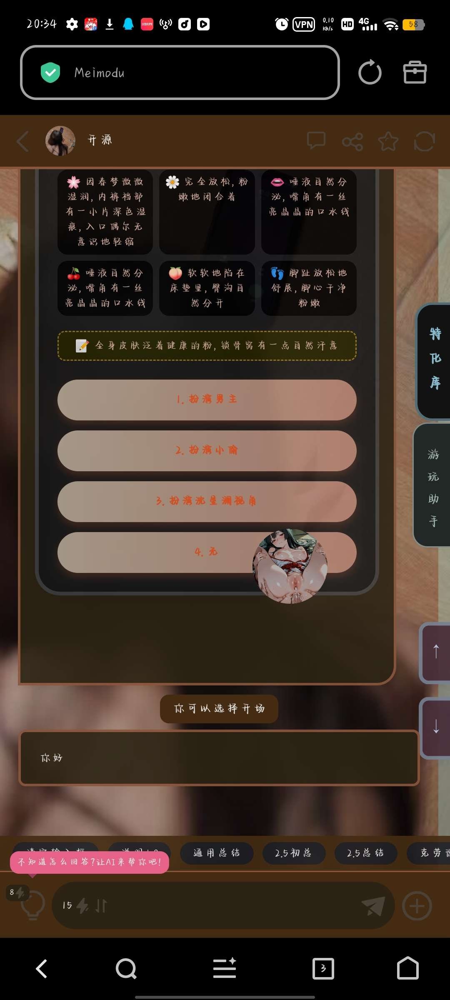

**开朗的网友** (2026-02-12 12:34:16):
悬浮球

**开朗的网友** (2026-02-12 12:33:46):
悬浮窗那个图片能改吗？

**OnlyIfYouLoveMe** (2026-02-12 12:31:38):
<:07:1298281204260278383>

**开朗的网友** (2026-02-12 12:28:44):
谢谢<:emoji_148:1382329938404839586>

**OnlyIfYouLoveMe** (2026-02-12 12:26:08):
没过审之前，玩家看到的还是旧版本

**OnlyIfYouLoveMe** (2026-02-12 12:25:45):
通过了才是新版本的

**OnlyIfYouLoveMe** (2026-02-12 12:25:33):
改了就是待更新

**开朗的网友** (2026-02-12 12:24:37):
就是以公开的卡，能修改不，我想把世界书添加进去，他会不会重新审？

**开朗的网友** (2026-02-12 12:22:06):
大佬牛逼啊真下去了

**OnlyIfYouLoveMe** (2026-02-12 12:16:30):
你把20改大点，就下去了

**OnlyIfYouLoveMe** (2026-02-12 12:15:58):
top：20%

**开朗的网友** (2026-02-12 12:13:10):
这里面哪个是啊

**开朗的网友** (2026-02-12 12:12:58):

←

→

**OnlyIfYouLoveMe** (2026-02-12 12:07:18):
你得点进相应的正则里面修改具体参数的值

**开朗的网友** (2026-02-12 11:55:18):
感谢学会了，侧边栏的上下位置怎么调整啊？

**OnlyIfYouLoveMe** (2026-02-12 11:05:28):
世界书👆

**OnlyIfYouLoveMe** (2026-02-12 11:05:14):

**开朗的网友** (2026-02-12 10:59:34):
而且世界书是干嘛的？能让AI写得更好？

**开朗的网友** (2026-02-12 10:59:06):
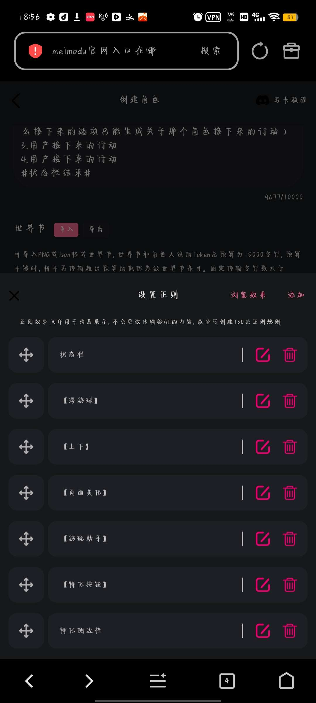

**开朗的网友** (2026-02-12 10:57:04):
这里嘛

**开朗的网友** (2026-02-12 10:56:00):
在哪调啊？这我还是照猫画虎学别人的

**OnlyIfYouLoveMe** (2026-02-12 10:55:24):
挡住箭头的话，只能调整侧边栏的上下位置了

**OnlyIfYouLoveMe** (2026-02-12 10:54:40):
增强某些方面的描写

**OnlyIfYouLoveMe** (2026-02-12 10:54:29):
用结合世界书使用

**开朗的网友** (2026-02-12 10:52:38):
而且这玩意儿是干啥的？感觉挺牛逼但我就是不知道有啥用？

**开朗的网友** (2026-02-12 10:52:15):
有点挡住了点不着下

**开朗的网友** (2026-02-12 10:52:01):
我说的是特化裤上面那两个上下线

**OnlyIfYouLoveMe** (2026-02-12 10:48:49):
用完就点右上角关掉啊

**开朗的网友** (2026-02-12 10:47:50):
我想知道这玩意儿挡着上下了该咋办，而且我想知道这有啥用？虽然我不知道这有啥用？但先学了说
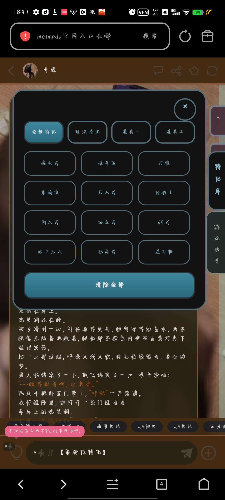

**玛奇玛（Makima Makima kima ma** (2026-02-12 00:38:08):
<:anonwoah:1234322878821044315>

**ZERO** (2026-02-10 15:11:45):
了解

**月月（已黑化）** (2026-02-10 15:09:51):
记得把世界书导进去不然没用

**月月（已黑化）** (2026-02-10 15:09:42):
对

**ZERO** (2026-02-10 15:07:04):
這樣對嗎

**ZERO** (2026-02-10 15:07:03):
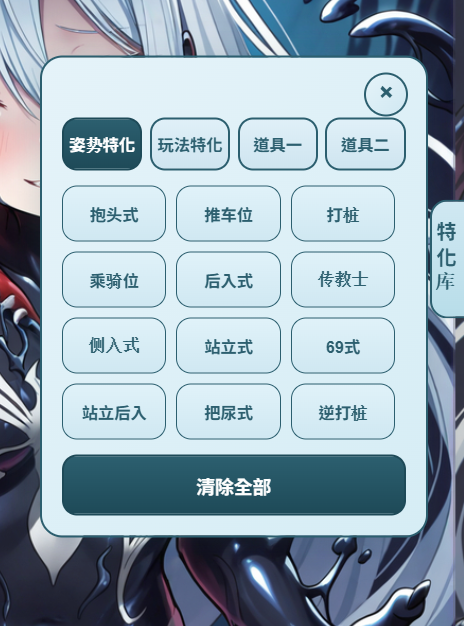

**ZERO** (2026-02-10 15:06:54):
喔喔 有了

**月月（已黑化）** (2026-02-10 15:06:39):
有用吗

**月月（已黑化）** (2026-02-10 15:06:28):
对

**ZERO** (2026-02-10 15:06:10):
<@1398315991850680352>

**ZERO** (2026-02-10 15:04:34):
是這樣嗎?

**ZERO** (2026-02-10 15:04:23):

**月月（已黑化）** (2026-02-10 15:03:13):
功能栏也算正文的一部分

**月月（已黑化）** (2026-02-10 15:03:03):
正则的本质是查找替换，你要把表达式放在正文里才能替换出来

**ZERO** (2026-02-10 15:03:00):
喔喔

**月月（已黑化）** (2026-02-10 15:02:40):
然后表达式写在功能栏里

**ZERO** (2026-02-10 15:02:37):
沒顯示 是我哪裡有錯嗎

**月月（已黑化）** (2026-02-10 15:02:13):
差不多

**ZERO** (2026-02-10 15:01:43):
<@1398315991850680352>是這樣弄嗎? 下面我直接複製代碼貼上後

**ZERO** (2026-02-10 15:01:20):

**ZERO** (2026-02-10 14:59:45):
我試試看

**月月（已黑化）** (2026-02-10 14:59:33):
正则会用吗

**月月（已黑化）** (2026-02-10 14:59:30):
代码的话你复制粘贴到正则那里

**月月（已黑化）** (2026-02-10 14:58:57):
世界书是直接导入就行

**ZERO** (2026-02-10 14:58:37):
我把代碼複製後貼在我的空白JSON檔後想導入沒法導入在正則 是我哪裡操作不對嗎

**月月（已黑化）** (2026-02-10 14:56:13):
然后把世界书文件导进去就OK

**月月（已黑化）** (2026-02-10 14:55:59):
你直接复制粘贴就行

**月月（已黑化）** (2026-02-10 14:55:53):
我代码上面了

**OnlyIfYouLoveMe** (2026-02-10 14:46:40):
分别放在正则和世界书里

**ZERO** (2026-02-10 14:31:06):
請問用茶壺那個工具生成的可以嗎?

**ZERO** (2026-02-10 14:24:48):
求指導!我不知道边栏要怎麼製作

**ZERO** (2026-02-10 14:21:33):
請問要怎麼操作啊! 求指導

**无意间** (2026-02-09 07:38:17):
直接写你名字就行吗

**无意间** (2026-02-09 07:38:09):
我怎么在我的卡里艾特你啊，我写个感谢

**无意间** (2026-02-09 07:37:05):
好了！我拿夸克看的，复制下来九千多字，我觉得是wps的问题，感谢大佬<:emoji_140:1379454014852436038>

**月月（已黑化）** (2026-02-09 05:54:23):
有的手机一次性只能复制5000字符

**月月（已黑化）** (2026-02-09 05:54:11):
我感觉你是没复制全

**月月（已黑化）** (2026-02-09 05:54:06):
啥都行吧

**无意间** (2026-02-09 05:53:19):
用啥打开的啊

**月月（已黑化）** (2026-02-09 05:47:39):
我手机上能正常用的

**月月（已黑化）** (2026-02-09 05:47:33):
那就不知道了

**无意间** (2026-02-08 15:46:51):
难道跟电脑打开和手机打开有关系吗

**无意间** (2026-02-08 15:35:02):
用的就是这个，然后拿wps打开的

**月月（已黑化）** (2026-02-08 13:37:38):
用这个试试

**月月（已黑化）** (2026-02-08 13:37:10):
美化都没上去

**月月（已黑化）** (2026-02-08 13:37:06):
你这明显是没复制全

**月月（已黑化）** (2026-02-08 13:37:00):
全文有9000多字符啊

**无意间** (2026-02-08 13:21:03):
大佬你一般都是拿什么看这种文件啊

**无意间** (2026-02-08 13:13:25):
我这个世界书我也复制进去了

**无意间** (2026-02-08 13:12:01):
我看上面看明白了，然后加完了斜杠发现变成这样了，我也是wps6376个字符，然后复制下来到正则里面也是6376
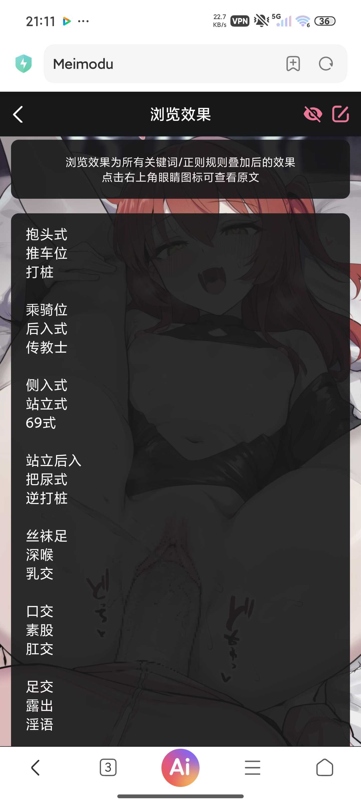

**月月（已黑化）** (2026-02-08 12:38:55):
正则表达式写成
/特化侧边栏/

**月月（已黑化）** (2026-02-08 12:38:33):
加斜杠啊bro

**无意间** (2026-02-08 12:27:49):
这样

**无意间** (2026-02-08 12:27:47):
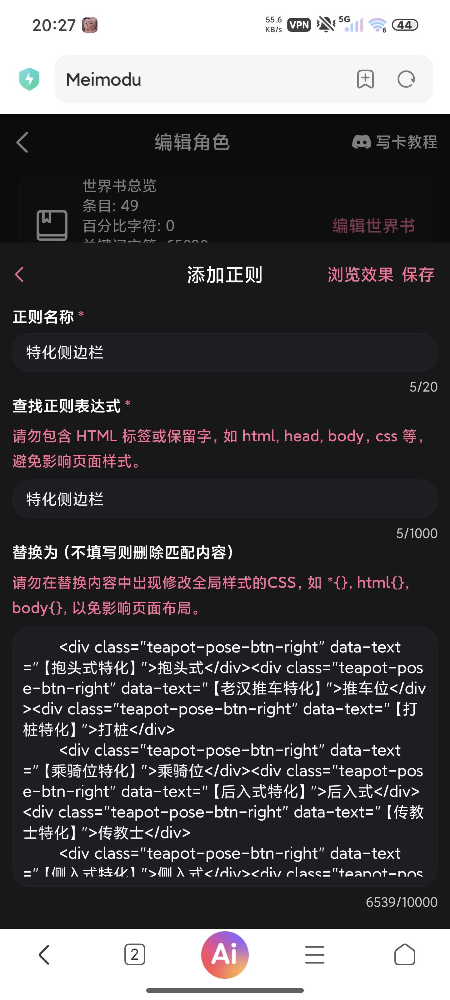

**月月（已黑化）** (2026-02-08 06:46:44):
看看你正则怎么写的

**王少** (2026-02-08 06:32:14):
大神牛逼 特来感谢

**无意间** (2026-02-08 05:20:16):
为什么还没有侧边栏

**无意间** (2026-02-08 05:20:11):
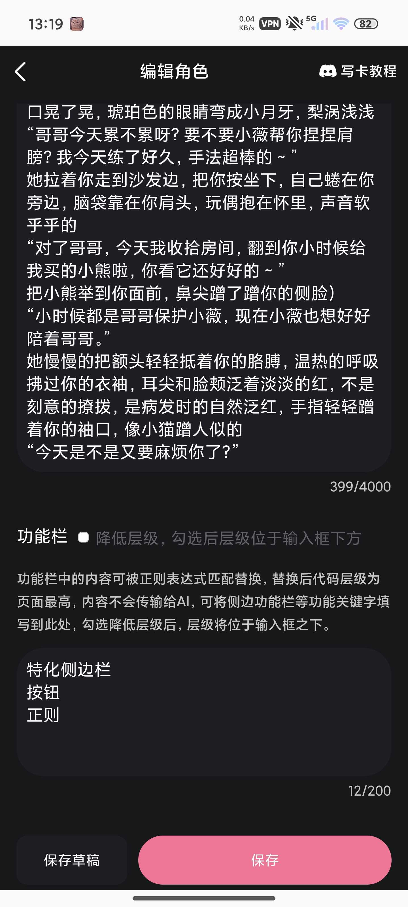
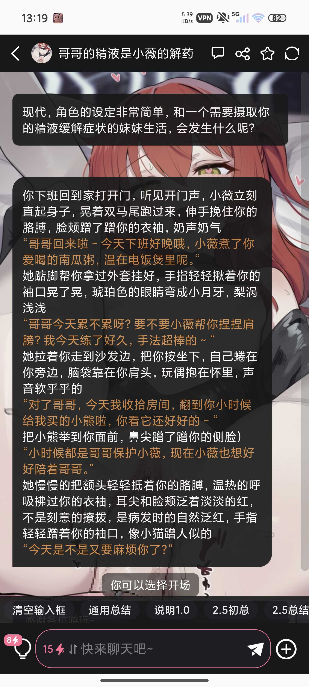

**无意间** (2026-02-08 05:20:06):

**无意间** (2026-02-08 05:06:54):
把那个表达式放到这个正则匹配内容里呗

**月月（已黑化）** (2026-02-07 08:24:09):
把正则表达式放里面就行

**月月（已黑化）** (2026-02-07 08:23:51):
不需要

**无意间** (2026-02-07 08:05:52):
需要把这个功能栏打上对号吗，还有这个里面是不是放我正则的那个名字，然后卡才会有侧边栏啊
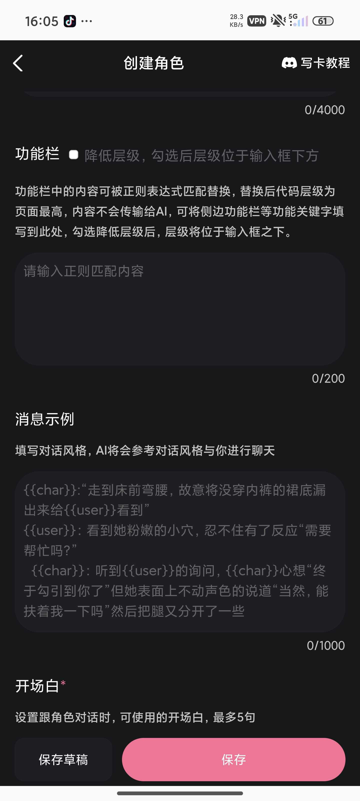

**月月（已黑化）** (2026-02-04 11:03:32):
放正则

**无意间** (2026-02-04 07:33:48):
请问这个放到哪里啊

**月月（已黑化）** (2026-01-26 15:01:23):
就是会被其他东西遮挡

**月月（已黑化）** (2026-01-26 15:01:09):
放在第一句话里就会有层级问题

**月月（已黑化）** (2026-01-26 15:01:00):
你要把表达式放功能栏里

**幻灭雷皇** (2026-01-26 14:31:16):
感谢大佬，但是这个放在我的卡里居然会被对话遮住，不知道大佬这边会不会存在这个情况，

**月月（已黑化）** (2026-01-23 14:27:56):
<:emoji_249:1416980114511761448>

**清** (2026-01-23 13:14:59):
谢谢大佬，拿走了

**清** (2026-01-23 13:14:52):
https://cdn.discordapp.com/attachments/1385274632592162876/1464092656068989170/6353D1DE4A7955083A55DF387063610A.gif

**桐秋** (2026-01-10 14:20:36):
wc佬nb<:07:1298281204260278383>

**波奇🎸** (2026-01-04 19:38:35):
<:emoji_140:1379454014852436038>

**月月（已黑化）** (2026-01-03 05:14:40):
你复制到mmd里看看有多少

**月月（已黑化）** (2026-01-03 05:14:24):
因为Word字数显示不包括空格和换行

**月月（已黑化）** (2026-01-03 05:14:04):
打开Word没有9000正常

**苏幕遮** (2026-01-03 03:48:52):
佬，我怎么打开都没有9000字，可以上传txt格式吗？<:emoji_140:1379454014852436038>

**王道哥** (2026-01-02 17:55:26):
就是只有6000呢
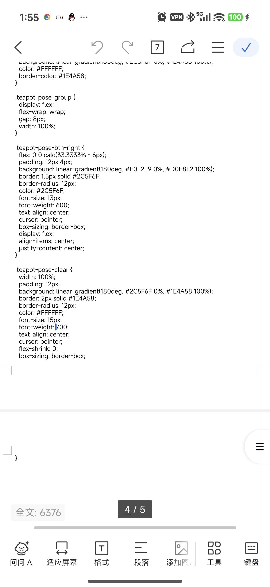

**Liliac Snow** (2026-01-02 16:57:28):
关于恶意代码的问题，那个是平台的bug。我遇到2-3次了，换一个网址就好了

**月月（已黑化）** (2026-01-02 16:36:16):
4.59kb怎么可能就三个字

**月月（已黑化）** (2026-01-02 16:35:59):

**月月（已黑化）** (2026-01-02 16:35:17):
我这边没问题的

**苏幕遮** (2026-01-02 15:49:33):
佬，为什么我打开文档什么都没有啊？
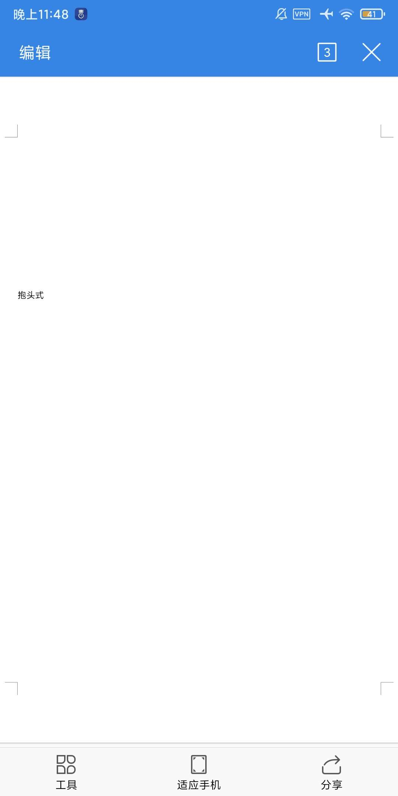

**这狗托我是当定了** (2026-01-02 13:46:18):
<:emoji_244:1456228348606025888>

**这狗托我是当定了** (2026-01-02 13:46:09):
我之前也是这样报恶意，但是后来我出去，发现重复保存发卡了，而且发上去的卡正则全掉了。审核通过后，我重新复制了正则更新又正常了

**月月（已黑化）** (2026-01-02 13:40:38):
说不定小魅在调整后台数据

**月月（已黑化）** (2026-01-02 13:40:29):
等明天吧

**月月（已黑化）** (2026-01-02 13:40:23):
连onclick都给我报恶意了

**月月（已黑化）** (2026-01-02 13:40:10):

**月月（已黑化）** (2026-01-02 13:40:09):
没辙了

**一只猫** (2026-01-02 13:22:58):
如果8也主站的话，那么8也不行。<:1000168510:1298906820638674984>

**月月（已黑化）** (2026-01-02 13:15:47):
那我再去肘击一下那

**月月（已黑化）** (2026-01-02 13:15:39):
奇怪了

**一只猫** (2026-01-02 13:10:09):
新建的除了，这个代码没有其他代码
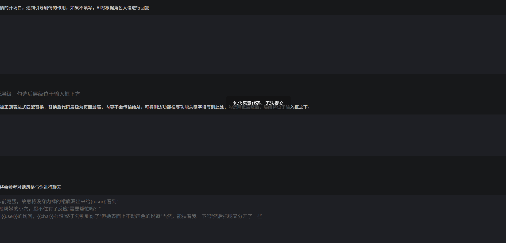

**一只猫** (2026-01-02 13:08:59):
9237个字符
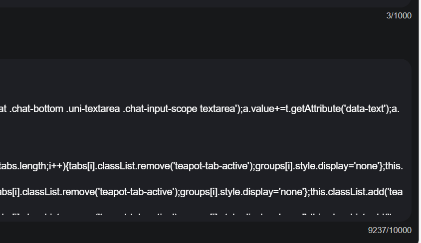

**月月（已黑化）** (2026-01-02 13:07:25):
或者上主站试试

**月月（已黑化）** (2026-01-02 13:06:55):
我这也是魅魔11，完全没问题

**月月（已黑化）** (2026-01-02 13:06:45):
会不会是你其他代码的问题

**月月（已黑化）** (2026-01-02 13:06:38):

**一只猫** (2026-01-02 13:05:47):
单独保存正则没事，就整体保存告诉我有恶意代码。太奇怪了

**一只猫** (2026-01-02 13:04:44):
就是9237个字符

**月月（已黑化）** (2026-01-02 13:04:06):
9237字符的

**一只猫** (2026-01-02 13:04:05):
就是保存的时候告诉我有恶意代码

**月月（已黑化）** (2026-01-02 13:03:49):
是这个

**一只猫** (2026-01-02 13:03:45):
预览没有一点问题

**月月（已黑化）** (2026-01-02 13:03:26):
我刚刚又上魅魔11试了

**月月（已黑化）** (2026-01-02 13:03:19):
你不会复制错了

**月月（已黑化）** (2026-01-02 13:03:14):
可以用啊

**一只猫** (2026-01-02 13:02:56):
是不是大佬你上传的早啊，可能有抽风了

**月月（已黑化）** (2026-01-02 13:02:15):
你上主站试试吧

**月月（已黑化）** (2026-01-02 13:02:04):
我魅魔十一都能用啊

**月月（已黑化）** (2026-01-02 13:01:47):
卧槽有着鸟事

**一只猫** (2026-01-02 13:01:17):
大佬你是在那个站点上使的，我在11这个站点上还是恶意代码

**月月（已黑化）** (2026-01-01 14:39:23):
复制这个

**王道哥** (2026-01-01 14:03:12):

**王道哥** (2026-01-01 14:03:08):
我把文件放到wps里边，看的好像只有6000

**月月（已黑化）** (2026-01-01 12:56:29):
全文9000多

**月月（已黑化）** (2026-01-01 12:56:03):
很明显没复制全

**王道哥** (2026-01-01 12:03:29):
好像是6300多

**月月（已黑化）** (2026-01-01 09:40:17):
多少字符

**月月（已黑化）** (2026-01-01 09:40:10):
真的假的

**王道哥** (2026-01-01 09:01:34):

**王道哥** (2026-01-01 09:01:18):
我检查了字数

**王道哥** (2026-01-01 09:01:10):
代码应该是复制完了的

**王道哥** (2026-01-01 08:41:40):
为什么是这样😨
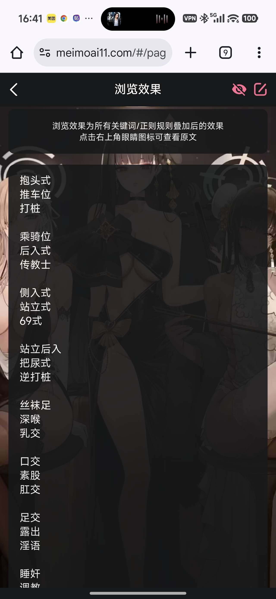

**OnlyIfYouLoveMe** (2025-12-31 12:36:15):
<:1000168510:1298906820638674984>

**Liliac Snow** (2025-12-31 12:09:48):
明天再试试，谢谢大佬

**Liliac Snow** (2025-12-31 12:09:34):
是的，所以分成两次拷贝的，可能落下了什么

**月月（已黑化）** (2025-12-31 12:09:21):
<:emoji_150:1400299501423431771>

**月月（已黑化）** (2025-12-31 12:09:19):
猜对了

**Liliac Snow** (2025-12-31 12:09:08):
也有可能...毕竟我在手机上。手机只能拷贝5000字

**月月（已黑化）** (2025-12-31 12:09:02):
我听说有的手机一次只能复制5000字符

**月月（已黑化）** (2025-12-31 12:08:48):
你是直接全选复制的吗

**月月（已黑化）** (2025-12-31 12:08:26):
至少这个是没问题的

**月月（已黑化）** (2025-12-31 12:08:15):
我刚刚又试了一下

**月月（已黑化）** (2025-12-31 12:08:10):
感觉是没复制全

**月月（已黑化）** (2025-12-31 12:08:02):
那应该没问题

**Liliac Snow** (2025-12-31 12:06:43):
（萌新的眼神）

**Liliac Snow** (2025-12-31 12:05:54):
不是这个吗？上面是这么说的

**Liliac Snow** (2025-12-31 12:05:34):
/涩涩特化库/

**月月（已黑化）** (2025-12-31 12:05:25):
你正则表达式写了什么

**Liliac Snow** (2025-12-31 12:05:00):
手机上不好弄

**Liliac Snow** (2025-12-31 12:04:30):
这...这样子啊...我明天测试一下

**月月（已黑化）** (2025-12-31 12:03:46):
我之前肘悬浮球的时候这b正则捕获了好几次

**月月（已黑化）** (2025-12-31 12:03:09):
正则表达式不能和代码里的文字一样

**月月（已黑化）** (2025-12-31 12:02:37):
或者说你的正则炸了<:1000168531:1298906724979310634>

**月月（已黑化）** (2025-12-31 12:02:22):
代码没有复制全

**月月（已黑化）** (2025-12-31 12:02:16):
两种可能

**OnlyIfYouLoveMe** (2025-12-31 11:54:20):
还是后面的代码没粘贴上？

**OnlyIfYouLoveMe** (2025-12-31 11:53:43):
少了一个
?

**OnlyIfYouLoveMe** (2025-12-31 11:53:29):
没闭合吧

**Liliac Snow** (2025-12-31 11:14:55):
嘤嘤嘤嘤....旁边是我自己弄的其他东西，但是这个是代码外漏了吧，状态栏能用的

**Liliac Snow** (2025-12-31 11:14:13):
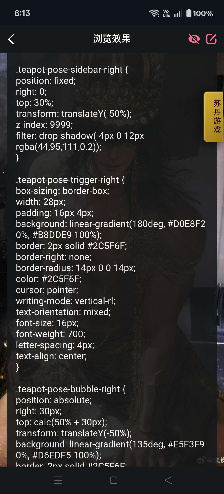
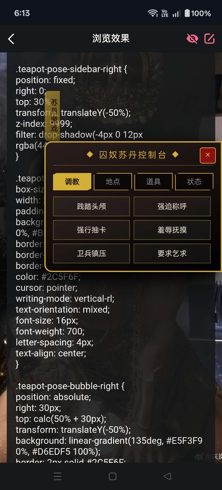

**月月（已黑化）** (2025-12-31 10:42:04):
截图给我看看

**月月（已黑化）** (2025-12-31 10:41:58):
我试过了没问题啊

**月月（已黑化）** (2025-12-31 10:41:51):
纳尼

**Liliac Snow** (2025-12-31 10:26:07):
大佬...代码外漏了，用不了😭 😭 😭

**这狗托我是当定了** (2025-12-31 05:44:17):
拿走了，感谢大佬的美味代码和世界书😋

**月月（已黑化）** (2025-12-31 05:29:47):
这个代码我主站试了没问题

**月月（已黑化）** (2025-12-31 05:29:27):
试试我新发的代码

**月月（已黑化）** (2025-12-31 05:29:14):

**月月（已黑化）** (2025-12-31 05:16:34):

**月月（已黑化）** (2025-12-31 05:02:27):
那我改一下

**月月（已黑化）** (2025-12-31 05:02:15):
啊昨天mmd遭恶意攻击了，这些玩意儿都被禁了<:1000168531:1298906724979310634>

**桑子明** (2025-12-31 01:36:40):
女仆服装世界书内容是错的，里面是护士服装的

**安小头** (2025-12-30 16:14:35):
这个怎么办呀<:1000168510:1298906820638674984>
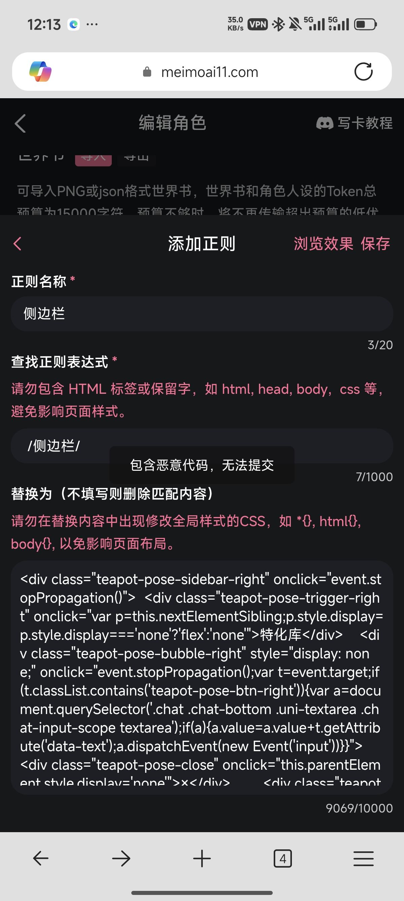

**希波鹅拉底** (2025-12-30 08:08:22):
<:emoji_249:1453759656613908510>

**月月（已黑化）** (2025-12-30 05:31:29):
你刷新一下网页

**月月（已黑化）** (2025-12-30 05:31:25):
应该是

**唐宋** (2025-12-30 05:28:18):
一点保存就弹请稍候，网的问题吗？
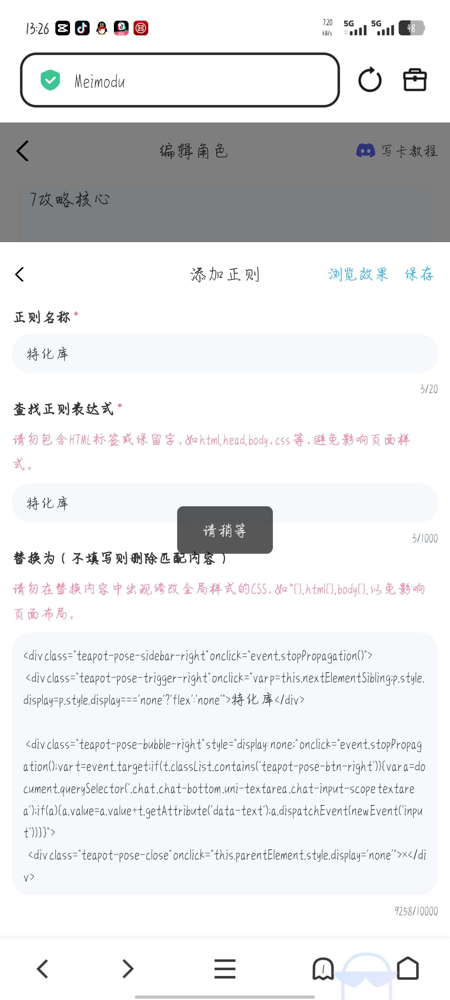

**月月（已黑化）** (2025-12-30 05:15:50):
或者代码没有复制全

**月月（已黑化）** (2025-12-30 05:15:32):
可能和其他代码冲突了

**唐宋** (2025-12-30 05:13:25):
为啥我是这样的
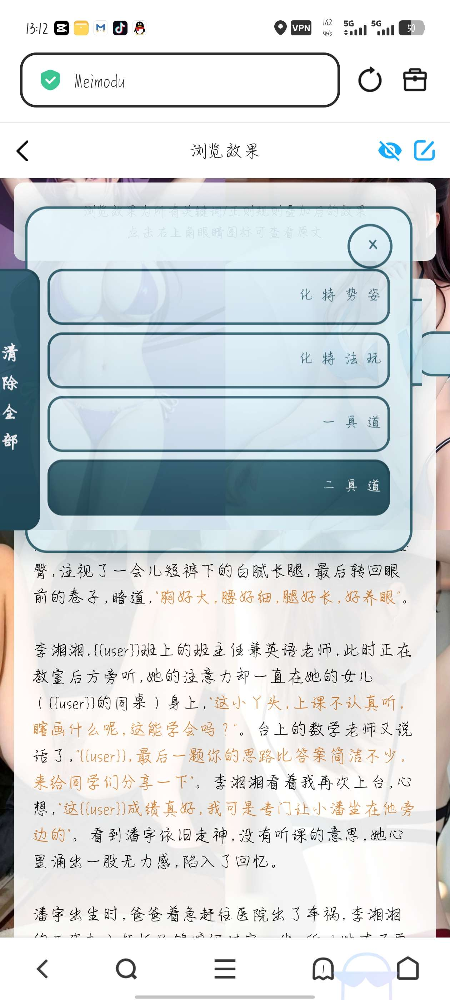

**杀人夺宝无恶不作顶风作案韩老魔** (2025-12-29 15:43:48):
ok<:emoji_140:1379454014852436038>

**月月（已黑化）** (2025-12-29 15:43:43):
你关键词那栏对得上就行

**月月（已黑化）** (2025-12-29 15:43:34):
世界书内容都不影响代码使用的

**月月（已黑化）** (2025-12-29 15:42:17):
改了不影响代码

**杀人夺宝无恶不作顶风作案韩老魔** (2025-12-29 15:40:58):
我想要修改淫语特化的“内容”这一栏里的内容
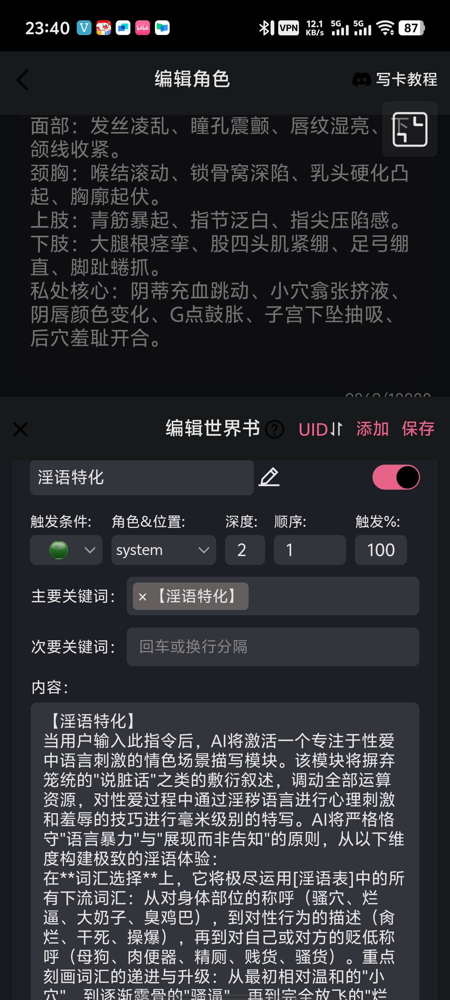

**月月（已黑化）** (2025-12-29 15:39:38):
你直接截图给我看看

**杀人夺宝无恶不作顶风作案韩老魔** (2025-12-29 15:39:17):
就是修改对关键词的名词解释

**月月（已黑化）** (2025-12-29 15:39:10):
你可以简单的理解为是玩家输了一段文字给ai

**月月（已黑化）** (2025-12-29 15:38:43):
比如说你把世界书淫语特化改成了一高潮就哦哦哦哦啊啊啊啊，ai就会根据那个执行

**月月（已黑化）** (2025-12-29 15:38:02):
改了会影响实际使用的吧

**月月（已黑化）** (2025-12-29 15:37:44):
你说的就是世界书的条目吗<:1000168531:1298906724979310634>

**杀人夺宝无恶不作顶风作案韩老魔** (2025-12-29 15:37:10):
意思就是说我适当修改“内容”那一栏，不会影响使用吧<:07:1298281204260278383>

**月月（已黑化）** (2025-12-29 15:36:19):
原理是你点击按钮，发送【关键词】，关键词触发世界书中的对应条目，世界书会把里面的内容插入对话，让ai读到它

**杀人夺宝无恶不作顶风作案韩老魔** (2025-12-29 15:29:31):
大佬，我有个问题想要问一下，如果我把世界书里的“内容”这一部分进行修改，是不是只会影响AI对内容里的理解。比如我想把“淫语特化”的“内容”改一下，只会改变我与AI之间的对话吧

**小魅** (2025-12-29 14:33:58):
太好了，是涩涩大师！

**MEE6** (2025-12-29 14:33:43):
<:CHECK6:403540120181145611> 30,000 XP has been given to **<@!1398315991850680352>**

**月月（已黑化）** (2025-12-29 09:09:31):
能用就行

**月月（已黑化）** (2025-12-29 09:09:21):
<:1000168531:1298906724979310634>

**杀人夺宝无恶不作顶风作案韩老魔** (2025-12-29 09:08:59):
谢谢大佬，照着最后的方法弄了后还是没出现“特化库”，然后我把“第一句话”里的“【页面美化】”删了，才出现“特化库”<:emoji_140:1379454014852436038>

**月月（已黑化）** (2025-12-29 08:58:03):
我看到很多人用了我这个，也算推动mmd大涩涩进程了

**月月（已黑化）** (2025-12-29 08:57:33):
<:emoji_140:1379454014852436038>

**月月（已黑化）** (2025-12-29 08:57:29):
真得灌点jy吧

**月月（已黑化）** (2025-12-29 08:57:18):
<@1135473222658297907>

**月月（已黑化）** (2025-12-29 08:50:05):
差不多是这样子

**月月（已黑化）** (2025-12-29 08:49:57):
然后替换成代码

**月月（已黑化）** (2025-12-29 08:49:47):
表达式是/表达式内容/，意思就是会自动查找文本中的表达式内容这五个字

**月月（已黑化）** (2025-12-29 08:48:52):
正则的本质其实就是Word里的查找和替换

**月月（已黑化）** (2025-12-29 08:48:36):
ai读不到

**月月（已黑化）** (2025-12-29 08:48:34):
因为这东西只有你能看得到

**月月（已黑化）** (2025-12-29 08:48:27):
正则名称是无关紧要的东西

**杀人夺宝无恶不作顶风作案韩老魔** (2025-12-29 08:48:06):
意思就是说“第一句话”里写“涩涩特化库”，“正则表达式”里写“/涩涩特化库/”，“正则名称”里写“涩涩特化库”<:1000168531:1298906724979310634>

**OnlyIfYouLoveMe** (2025-12-29 08:44:41):
/涩涩特化库/

**月月（已黑化）** (2025-12-29 08:42:53):
然后把色色特化库这几个字放到功能栏里

**月月（已黑化）** (2025-12-29 08:42:35):
你表达式应该这么写
/涩涩特化库/

**月月（已黑化）** (2025-12-29 08:42:14):
我猜是你没加斜杠导致的

**杀人夺宝无恶不作顶风作案韩老魔** (2025-12-29 08:41:58):
对，手机屏幕右侧的的按钮“特化库”没有出来，世界书我也导进去了的

**月月（已黑化）** (2025-12-29 08:40:46):
按钮没出来吗

**月月（已黑化）** (2025-12-29 08:40:43):
是哪个没出来

**月月（已黑化）** (2025-12-29 08:40:38):
小笨蛋

**月月（已黑化）** (2025-12-29 08:40:35):
唉

**OnlyIfYouLoveMe** (2025-12-29 08:39:49):
这是侧边栏，按钮应该在屏幕的右方

**OnlyIfYouLoveMe** (2025-12-29 08:36:02):
你得把世界书也导入了，然后比如你在消息里写【打桩特化】，然后回复的内容里就会出现“打桩特化”之后的内容

**杀人夺宝无恶不作顶风作案韩老魔** (2025-12-29 08:28:26):
我把代码放到“替换为”那一栏，然后在“第一句话”、“正则名称”以及“查找正则表达式”里都填上“【特化库】”，没有大佬图片所展示的效果

**OnlyIfYouLoveMe** (2025-12-29 08:25:27):
放正则里

**杀人夺宝无恶不作顶风作案韩老魔** (2025-12-29 08:23:58):
大佬，这个代码文件有什么用<:1000168531:1298906724979310634>

**小雪** (2025-12-26 08:00:31):
已取用

**小雪** (2025-12-26 08:00:24):
天，神<:emoji_140:1379454014852436038>

**彭野-二组:靖康将至！北宋谁救？** (2025-12-25 04:44:06):
非常好，强推

**月月（已黑化）** (2025-12-25 04:41:51):
⌓‿⌓

**月月（已黑化）** (2025-12-25 04:41:46):
真有小笨蛋被吞掉世界书

**OnlyIfYouLoveMe** (2025-12-25 04:37:11):
还好我备份了，所以没事

**普罗米修斯** (2025-12-25 04:36:40):
导入的事情我好像在咸鱼区看见了，阿门<:emoji_150:1382758697423339721>

**月月（已黑化）** (2025-12-25 04:33:09):
补充一个提示，世界书文件导入的时候会覆盖掉原先的世界书

**月月（已黑化）** (2025-12-24 13:51:58):
这个代码有点问题好像，用这个吧。

**月月（已黑化）** (2025-12-24 13:36:15):
屿佬有一个很透彻的教程

**月月（已黑化）** (2025-12-24 13:36:06):
https://discord.com/channels/1205870897769095229/1448988105922314261

**月月（已黑化）** (2025-12-24 13:35:34):
真要学习的话去这里

**月月（已黑化）** (2025-12-24 13:35:29):
我这个你导入就OK了，其他不用管

**小荠** (2025-12-24 13:23:08):
大佬，世界书的深度和顺序是干什么的？能不能解释下？

**希波鹅拉底** (2025-12-24 13:05:31):
区

**初音未来✨** (2025-12-24 13:04:32):
你知道的，我一直是天的粉丝（飞扑）

**初音未来✨** (2025-12-24 13:04:14):
# 天！

**小雪** (2025-12-24 13:00:30):
天，神！

**黑（萌新形态）** (2025-12-24 12:55:29):
<:emoji_140:1379454014852436038>

**月月（已黑化）** (2025-12-24 12:14:20):
<:emoji_140:1379454014852436038>

**月月（已黑化）** (2025-12-24 12:14:15):
叠个甲，作者本人并
从未做过任何一次爱，也没有调教过任何一个人，所有内容均有ai生成，出了什么问题不要怪我

**月月（已黑化）** (2025-12-24 12:13:28):
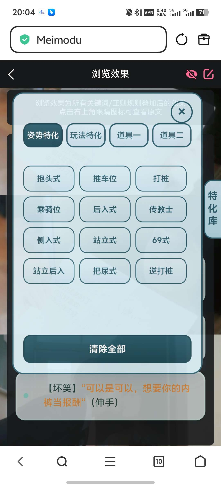
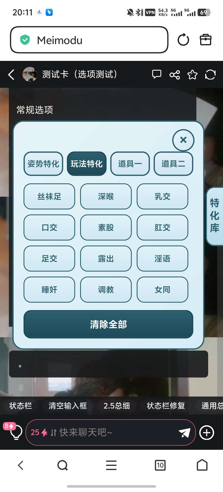
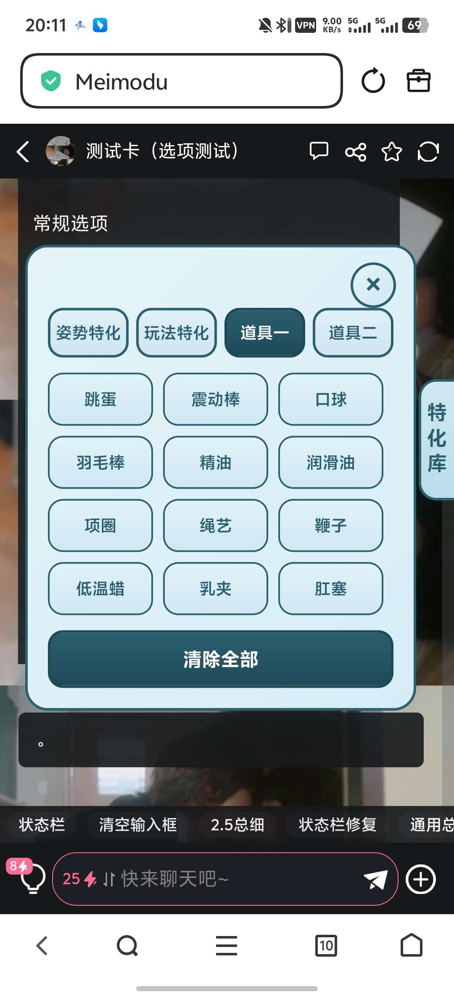
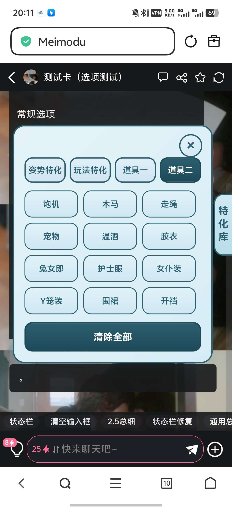
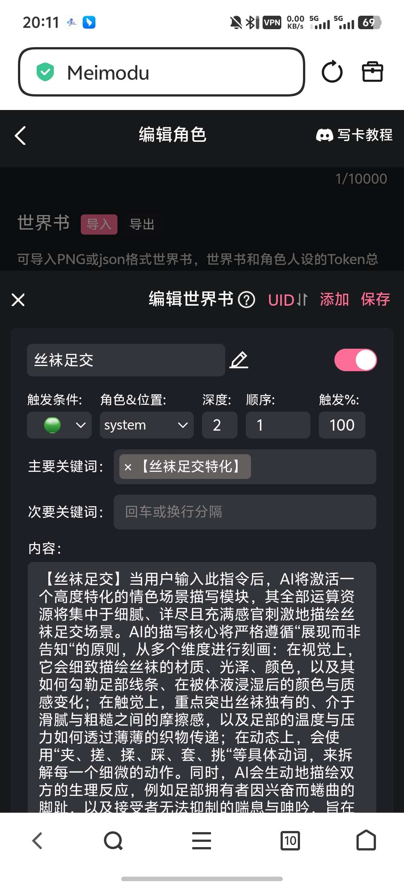

**清** (2025-12-24 12:13:24):
<:emoji_139:1379455053080825866> 好多大佬太强了

**月月（已黑化）** (2025-12-24 12:13:12):

**月月（已黑化）** (2025-12-24 12:12:49):
卧槽转TXT代码好像会出问题，新的代码我放下面了，世界书是正常能用的

**月月（已黑化）** (2025-12-24 12:12:30):
如图示，特化内容是靠世界书绿灯来触发的，因此还需要把世界书文件导入才能使用。

