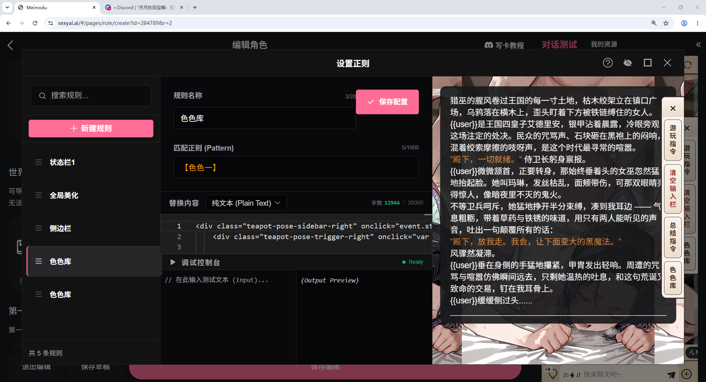
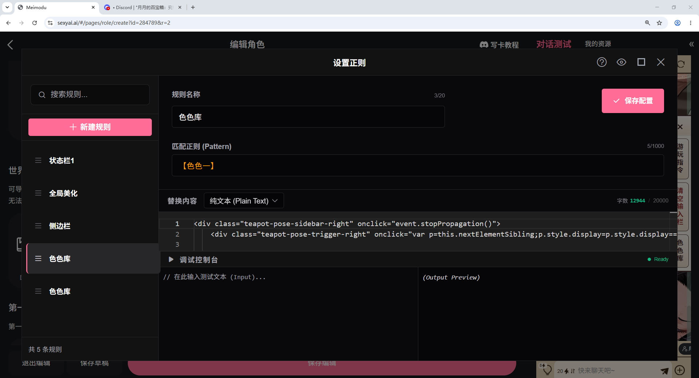
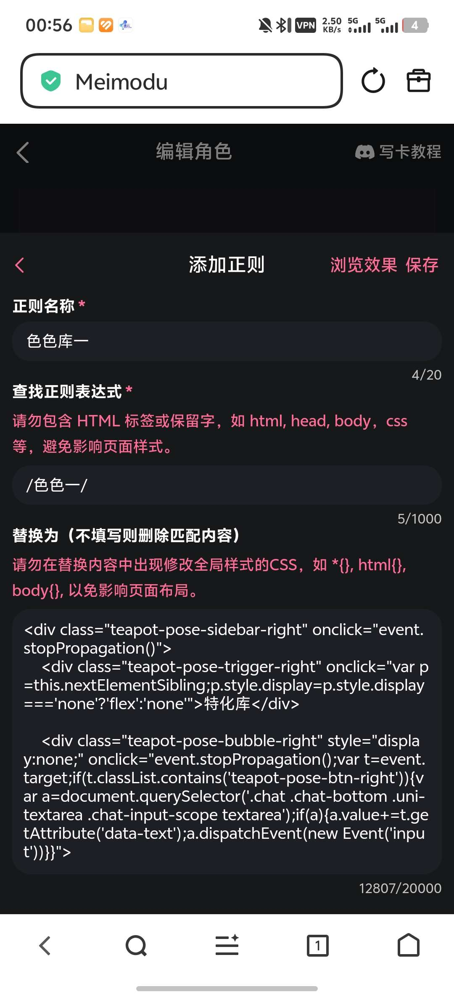
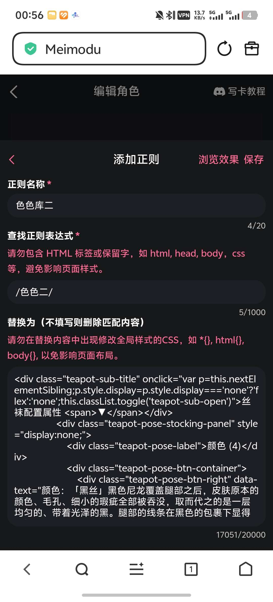

# 月月的百宝箱：究极究极特化库，mmd有史以来最夸张的特化指令库来了，供给126条特化

来源: Discord 魅魔藏经阁 thread 1502716653304152064

创建: 2026-05-09T16:59:29.273000+00:00
消息数: 83

---

**菲比啾比** (2026-10-01 04:02:21):
收到

**月月（已黑化）** (2026-09-30 16:23:54):
你把你其他有按钮的代码发给ai，让它排查一下

**月月（已黑化）** (2026-09-30 16:23:26):
应该是和你的其他代码冲突了

**菲比啾比** (2026-09-30 13:30:48):
大佬大佬，我将代码导入之后，点击特化库里面的按钮没有作用怎么办

**不爱吹箫的萧萧** (2026-09-28 08:13:51):
是的<:1000168510:1298906820638674984>

**月月（已黑化）** (2026-09-26 11:36:25):
直接导入会直接覆盖你原来的正则

**月月（已黑化）** (2026-09-26 11:36:07):
不会直接把json导入了吧

**月月（已黑化）** (2026-09-26 11:35:55):
你是怎么用的

**西园** (2026-09-25 14:20:53):
大佬，我用了这个特化以后我的美化爆了，是代码冲突了吗

**月月（已黑化）** (2026-09-25 10:26:52):
<:emoji_299:1551868877443440691>

**月月（已黑化）** (2026-09-25 10:26:52):
大伙自己想办法拿代码去做适配吧

**月月（已黑化）** (2026-09-25 10:26:00):
但是这个特化库本体还是世界书

**月月（已黑化）** (2026-09-25 10:25:43):
月月已经是废物了喵

**不爱吹箫的萧萧** (2026-09-24 17:01:51):
<:emoji_148:1382329938404839586>

**不爱吹箫的萧萧** (2026-09-24 17:01:45):
已经出问题了，道心破碎

**上元仙朝** (2026-09-19 17:22:41):
各位注意一下，不要想当然，就用新版，现在大部分能用的都是旧版状态栏，（我上次写卡是两年前，这次写卡到有个新旧版想当然，就点了新版，然后各种出问题，结果晚上聊天的时候才知道，大家居然主要用的都是旧版吗？甚至新版的公开特化都很少）我说为什么各种爆错，但是没有办法，我的卡已经公开了，我需要再去找一个新版的特化栏<:emoji_115:1379113943817257071>

**月月（已黑化）** (2026-09-19 14:07:25):
<:emoji_242:1435092848029728878>

**上元仙朝** (2026-09-19 14:00:36):
谢谢大佬，祝大佬前程似锦，万事顺意，事业节节高升，财源滚滚而来。愿你岁岁皆安康，日日有欢喜，所愿皆所得，步步皆坦途，乘风破浪，一路光芒万丈！

**月月（已黑化）** (2026-09-19 13:06:21):
这是月月最后的波纹了喵

**月月（已黑化）** (2026-09-19 13:06:13):
<:emoji_299:1549489451976233070>

**月月（已黑化）** (2026-09-19 13:06:11):
我侧边全给你了

**月月（已黑化）** (2026-09-19 13:06:05):
好的

**月月（已黑化）** (2026-09-19 13:05:57):

**月月（已黑化）** (2026-09-19 13:01:46):
我看看

**月月（已黑化）** (2026-09-19 13:01:42):
json吗

**上元仙朝** (2026-09-18 20:22:33):
哇，真的是，手机还字数，不对，好像是网页软件限制复制字数

**上元仙朝** (2026-09-18 20:14:07):
尤其是手机，对手机用户尤其不友好

**上元仙朝** (2026-09-18 20:11:23):
大佬您直接把拿个正侧也发成文件吧<:emoji_115:1379113943817257071> ，复制进去老是出错，要么就是换行不对，要么就是不知道为什么点不出来<:1000168510:1298906820638674984>

**上元仙朝** (2026-09-18 19:51:49):
在第一话那里，上面的位置有一个正侧，你直接点导入正侧，然后在手机文件夹里搜这个文件后缀JSON（你找文件是找不到的，他自己也不显示，必须要做后缀，别问我为什么，我花了两天研究了各种办法，后来才发现纯粹是不显示导致的找不到）然后直接导入进去就可以用，写代码进去，你应该研究不明白，直接用大佬写好的就行，为了研究明白这个，我他妈花了三天问东问西的，没人理我，操

写卡去搜（萌新）（只用打萌新，不用打括号） 然后标签选择第一个，然后点击搜索，一共就几条帖子，拉到最下面那条帖子看一下

**白玉堂** (2026-09-18 03:34:09):
世界书这个代码可以叠加到其他世界书吗

**空山酌哑** (2026-09-14 17:11:16):
有人来求我给模拟器装了，标记一下

**林枫** (2026-09-03 07:49:21):
要加进去吗

**林枫** (2026-09-03 07:49:06):
这个代码要怎么用啊

**kk** (2026-08-23 06:44:15):
特化の神

**白月** (2026-06-23 02:05:51):
你替换的内容后面是纯文本内容，你把这个改成html试试

**月月（已黑化）** (2026-06-17 07:08:08):
我的是一个透明的侧边栏

**月月（已黑化）** (2026-06-17 07:07:52):
你这个效果和我的代码不一样

**月月（已黑化）** (2026-06-17 07:07:34):
<:1000168531:1298906724979310634>

**月月（已黑化）** (2026-06-17 07:07:33):
我也没看懂

**sj** (2026-06-17 05:33:33):
我点击色色库，他就变成总结的文字在输入框

**sj** (2026-06-17 05:31:48):
复制进去了点击没用出不来

**月月（已黑化）** (2026-06-17 05:28:16):
看看图

**sj** (2026-06-17 05:11:37):
复制进去

**sj** (2026-06-17 05:11:06):
大佬电脑的添加正则跟你的界面不一样呢导进去用不了怎么办

**aiyanisha** (2026-06-13 16:20:36):
这就偷来用<:22:1298294520777019502>

**月月（已黑化）** (2026-06-11 14:32:57):
正则表达式放功能栏

**月月（已黑化）** (2026-06-11 14:32:45):
参考我上面的第三张图

**月月（已黑化）** (2026-06-11 14:32:32):
层级问题

**红** (2026-06-11 14:08:51):
用倒是用了，就是怎么是这样的，是哪里出错了吗

**红** (2026-06-11 13:41:59):
这个代码怎么直接导入不了，导入的时候显示不是json文件，要自己慢慢复制吗

**月月（已黑化）** (2026-06-10 07:55:25):
前面有很完整的操作流程了

**月月（已黑化）** (2026-06-10 07:55:19):
代码塞正则

**月月（已黑化）** (2026-06-10 07:55:10):
导入的世界书

**起司** (2026-06-10 05:25:16):
导入之后是会侧边栏显示的嘛

**红** (2026-06-09 01:53:56):
怎么用不了

**llk[🌏地球电网战略合作伙伴]** (2026-06-04 03:13:33):
豪人，新手感谢<:emoji_249:1416980114511761448>

**07** (2026-05-31 01:59:25):
么么<:1000168528:1298906738761924722>

**彭野-二组:靖康将至！北宋谁救？** (2026-05-28 14:42:23):
特化之神，狠狠期待

**月夏** (2026-05-23 03:25:45):
json文件怎么导入啊，在世界书那直接导入显示角色卡数据为空

**风眠有方** (2026-05-22 13:48:32):
这就偷来用！

**ZSH** (2026-05-15 13:33:46):
<:emoji_140:1379454014852436038> 天天妈妈

**月月（已黑化）** (2026-05-14 02:17:56):
有道理等我有空再搞几条

**苏墨白** (2026-05-14 01:32:14):
<:emoji_278:1503355638590214254> 什么时候来点新玩法

**月月（已黑化）** (2026-05-11 12:57:33):
代码是塞到正则里去的

**月月（已黑化）** (2026-05-11 12:56:29):
你下载下来导入到世界书

**月月（已黑化）** (2026-05-11 12:56:17):
那个JSON文件是世界书文件

**11111** (2026-05-11 12:52:51):
是不是都要复制世界书里吗？我第一次搞这些东西

**彭野-二组:靖康将至！北宋谁救？** (2026-05-11 12:27:18):
特化仙人

**aknt** (2026-05-11 08:26:21):
我列个特化仙人

**月月（已黑化）** (2026-05-10 07:05:11):
<:emoji_278:1502177928161529886>

**月月（已黑化）** (2026-05-10 07:05:10):
叫我特化仙人

**镜（魅魔3组！纨绔模拟器~）** (2026-05-10 06:49:49):
我了个手机电量都要没了还在发特化

**小魅** (2026-05-10 06:24:22):
感谢开源<:emoji_140:1379454014852436038>

**MEE6** (2026-05-10 06:24:17):
<:CHECK6:403540120181145611> 30,000 XP has been given to **<@!1398315991850680352>**

**苏墨白** (2026-05-09 17:36:07):
<:1000168531:1298906724979310634> 这就偷来用！

**洛尘（ଳ水母宗太上长老）** (2026-05-09 17:14:34):
<:1000168510:1298906820638674984>

**洛尘（ଳ水母宗太上长老）** (2026-05-09 17:14:29):
我嘞个特化之神啊

**月月（已黑化）** (2026-05-09 17:01:10):
使用方法如下

**月月（已黑化）** (2026-05-09 17:01:09):

**月月（已黑化）** (2026-05-09 17:00:51):
世界书如下

**周雅（被老婆调教.周浩）** (2026-05-09 17:00:29):
<@1135473222658297907> 狠狠奖励

**月月（已黑化）** (2026-05-09 17:00:00):
代码如下

**月月（已黑化）** (2026-05-09 16:59:29):

