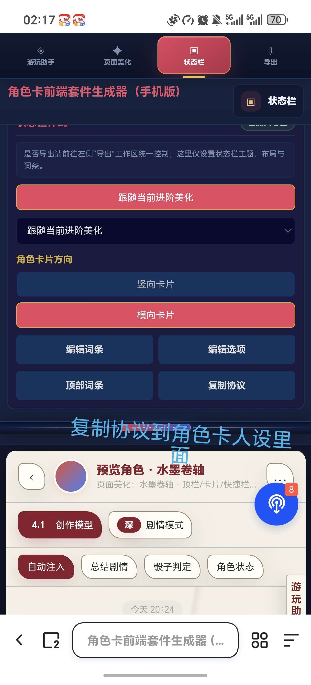
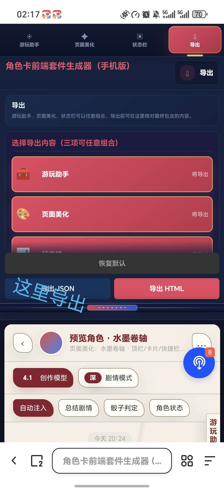

# 有没有大佬能教我一下简单的状态栏和侧边栏。

来源: Discord 魅魔藏经阁 thread 1538808836607975464

创建: 2026-08-17T07:16:56.333000+00:00
消息数: 16

---

**巴西郡牧公子炎** (2026-09-15 15:40:21):
呜呼

**（猫娘萝莉妈妈)抱玖酒(捡小猫)** (2026-09-15 13:04:35):
伤心了

**（猫娘萝莉妈妈)抱玖酒(捡小猫)** (2026-09-15 13:04:22):
大佬走了

**（猫娘萝莉妈妈)抱玖酒(捡小猫)** (2026-09-15 13:04:18):
删掉了

**巴西郡牧公子炎** (2026-09-15 03:21:49):
找不到啊

**巴西郡牧公子炎** (2026-09-14 15:04:30):
没权限是啥阴

**（猫娘萝莉妈妈)抱玖酒(捡小猫)** (2026-08-19 04:03:35):
很方便

**（猫娘萝莉妈妈)抱玖酒(捡小猫)** (2026-08-19 04:03:17):
<@1537514427216302183> 用波奇妈妈的也行喵～

**（猫娘萝莉妈妈)抱玖酒(捡小猫)** (2026-08-19 04:03:01):

**orange🍊** (2026-08-19 00:34:05):
去搜波奇，波奇有一个开源一百种美化的侧边栏加美化加状态栏，去用那个。

**好的很** (2026-08-18 17:28:41):
我下载以后，它的格式是md

**（猫娘萝莉妈妈)抱玖酒(捡小猫)** (2026-08-17 16:04:45):
js文件自动导入，不用你考虑怎么放

**（猫娘萝莉妈妈)抱玖酒(捡小猫)** (2026-08-17 16:04:07):
乱马那个懒人包直接导入就可以了

**好的很** (2026-08-17 14:21:33):
功能那里面它最高字数就200字，输不了那么多怎么弄？

**乱马（参赛卡艾泽尔酒店）** (2026-08-17 07:31:02):
https://discord.com/channels/1205870897769095229/1535911716792307742
https://discord.com/channels/1205870897769095229/1534139855204913253
https://discord.com/channels/1205870897769095229/1537963676655427745

**好的很** (2026-08-17 07:16:56):
状态栏的话这边我第一次弄卡想弄个好一点的，就唯独还没想好要添加什么初始角色，所以的话就是有个主人物信息，那些和后续选项就行如果可以的话，也可以有女角色的大致模板，后面我想想添加什么角色后弄进去，侧边栏的话就是总结修复状态栏那些基础的和一些特化

