# 本人特有的做梦梦到，所以有啥不对的，可以留言（在经过几天的学习和各位大佬们的讲解中整理的让你五分钟肘一张肉卡的方法和工具）新手教程吧，虽然一张卡还没出来的新手教新手教程什么的（

创建时间: 2026-03-01T18:53:13.505000+00:00
消息数: 133

---

**阳玉** (2026-03-07 04:14:40):
<:emoji_252:1478791303587299378>

**北塔尼斯** (2026-03-04 15:13:41):
感谢大佬指导，我找个时间尝试写一下卡

**周雅（被老婆调教.周浩）** (2026-03-04 15:02:17):
简单说就是确保这个设定捞得上来

**周雅（被老婆调教.周浩）** (2026-03-04 15:02:03):
深度你按照贴主的建议设置

**周雅（被老婆调教.周浩）** (2026-03-04 15:01:53):
是的

**北塔尼斯** (2026-03-04 14:56:37):
这个排序我看了帖子，就是那个深度吧

**周雅（被老婆调教.周浩）** (2026-03-04 14:56:09):
那部分有解释

**周雅（被老婆调教.周浩）** (2026-03-04 14:56:01):
可以看下原作者帖子里，有序号权重排序的

**周雅（被老婆调教.周浩）** (2026-03-04 14:55:15):
我们其他人就是正常玩

**周雅（被老婆调教.周浩）** (2026-03-04 14:55:07):
因为5%电量返给你

**周雅（被老婆调教.周浩）** (2026-03-04 14:55:00):
是的 如果你自己测相当于九五折

**北塔尼斯** (2026-03-04 14:51:22):
大佬们如果写好了卡怎么测试，是和正常游玩一样需要花电测试码？

**北塔尼斯** (2026-03-04 14:44:40):
大佬这个角色人设前和角色人设后的世界书有什么区别？人设前我大概能理解就是整个世界书的背景，这个人设后的意思是读取NPC卡后，世界书更新后的情况？

**北塔尼斯** (2026-03-04 14:43:14):
我现在在看着这个帖子了

**周雅（被老婆调教.周浩）** (2026-03-04 14:43:11):
可以看一下这个帖子前面有关于字数的介绍

**周雅（被老婆调教.周浩）** (2026-03-04 14:42:59):

**北塔尼斯** (2026-03-04 14:38:49):
感谢大佬

**乖宝宝小水母（水母宗唯一宗主。大周荣誉国祖)** (2026-03-04 14:38:25):
<@1456614985521303694>

**乖宝宝小水母（水母宗唯一宗主。大周荣誉国祖)** (2026-03-04 14:38:21):
https://discord.com/channels/1205870897769095229/1448988105922314261

**乖宝宝小水母（水母宗唯一宗主。大周荣誉国祖)** (2026-03-04 14:38:00):
有介紹世界書的帖子的

**北塔尼斯** (2026-03-04 14:31:40):
我还没见过别人写的世界书这一类的东西，不知道具体的一些要求

**北塔尼斯** (2026-03-04 14:30:27):
是世界书总字数要少于15000字还是单本世界书要少于15000字？

**周雅（被老婆调教.周浩）** (2026-03-04 14:26:37):
你超了15000世界书ai读不全也是白写

**周雅（被老婆调教.周浩）** (2026-03-04 14:26:24):
简洁点，因为有效字数读取上限就是15000

**北塔尼斯** (2026-03-04 14:22:59):
还是说要把人物的动作神态说的话这种用长篇小说的形式写出来？

**北塔尼斯** (2026-03-04 14:22:25):
你举得这个例子我大概能理解，这个其实还是检测到了关键词，关键词触发后出现了一段额外的剧情，那这种触发剧情可以用长文形式吗？还是说也是只能是简洁的设定，例如说是和XX角色到了京港大桥，她回忆男主角是在这里和她表白，她向男主角提问这里曾经发生的事情

**周雅（被老婆调教.周浩）** (2026-03-04 14:18:20):
你就可以放绿灯，关键词用地点触发

**周雅（被老婆调教.周浩）** (2026-03-04 14:18:06):
我打个比方，这个场景是主角和女主表白的地方，再回到这里会触发彩蛋剧情

**周雅（被老婆调教.周浩）** (2026-03-04 14:17:47):
比如特定场景触发

**周雅（被老婆调教.周浩）** (2026-03-04 14:17:39):
对 绿灯不仅是事件触发

**北塔尼斯** (2026-03-04 14:17:11):
明白了也就是说世界书就是各种的说明设定，包括但是不限于世界的基本设定，人物设定，人物属性框架，绿灯的那种开关就是触发事件的接口

**周雅（被老婆调教.周浩）** (2026-03-04 11:31:32):
还有常驻内容，比如人设，世界观补充 蓝灯100%就是常驻

**周雅（被老婆调教.周浩）** (2026-03-04 11:31:09):
不只是开关 开关是绿灯

**北塔尼斯** (2026-03-04 11:18:09):
萌新已严肃学习，不知道对世界书的粗浅理解对不对，世界书除去大世界书这个背景设定和系统系统框架搭建以外，实际上就是各类的触发开关，当启用这一部分内容的时候就调用这本世界书里面的内容

**DreamSummeria** (2026-03-02 14:14:54):
萌新已严肃学习

**星像** (2026-03-02 09:05:27):
对不起啦，脑袋一抽写的，所以改掉了

**Sicily是第一美少女** (2026-03-02 05:57:37):
流汗了，里面怎么有我的彩蛋<:1000168531:1298906724979310634>

**乖宝宝小水母（水母宗唯一宗主。大周荣誉国祖)** (2026-03-02 01:27:49):
<:emoji_250:1440756778487775303>

**星像** (2026-03-02 01:11:43):
不行的话我就删了<:emoji_136:1379504871027380274>

**星像** (2026-03-02 01:11:38):
不是老吐槽我不用嘛（

**星像** (2026-03-02 01:11:28):
之前私聊提了两嘴

**星像** (2026-03-02 01:11:18):
那我删了？<:emoji_171:1409564723950649417> <:emoji_171:1409564723950649417>

**绛璃寒月ദ്ദി˶•̀֊•́)✧** (2026-03-02 01:07:12):
已从被暂停的账号中移除一条消息。

**绛璃寒月ദ്ദി˶•̀֊•́)✧** (2026-03-02 01:07:01):
已从被暂停的账号中移除一条消息。

**鹿初** (2026-03-02 00:53:25):
<:07:1298281204260278383>

**月月（已黑化）** (2026-03-01 23:40:38):
<:emoji_150:1400299501423431771>

**有咩** (2026-03-01 22:47:28):
<:07:1298281204260278383> 不错不错

**白雪情** (2026-03-01 22:04:17):
写的不错哇，很适合萌新

**小叶** (2026-03-01 19:46:22):
非常好哦<:emoji_140:1379454014852436038>

**目曰目** (2026-03-01 19:35:46):
已学习<:emoji_249:1416980114511761448>

**阳玉** (2026-03-01 19:34:51):
# 萌新已严肃学习

**星像** (2026-03-01 19:31:50):
（纯粹叠甲

**星像** (2026-03-01 19:31:44):
对了对了，这篇帖子的基础是各位大佬们的教程和开源的东西，我只是以一个萌新的视角去表现出来，毕竟我刚点进去的时候，大佬们教程说的很详细了，我还是不懂这些东西代表的意思

**星像** (2026-03-01 19:31:21):
还有四个小时就上班了（安详

**星像** (2026-03-01 19:31:05):
结束了，溜了溜了，有错误，请留言。我睡醒改正（

**星像** (2026-03-01 19:30:53):
有点长，有点长，纯属做梦梦到的，不要打我（

**星像** (2026-03-01 19:30:39):
然后应该就没啥了，就想到这么多（呜呜呜

**星像** (2026-03-01 19:30:29):
至于允许玩家自定义主角和调整世界书看自己就行了，我是无所谓，毕竟我的卡是纯日常卡，而且发出去了肯定要让玩家玩的舒服呀

**星像** (2026-03-01 19:29:56):
你需要点进去，你这张卡游玩的界面，你会比玩家们多一个编辑角色，然后找到这个地方，把角色重新调整为私密就行

**星像** (2026-03-01 19:29:47):
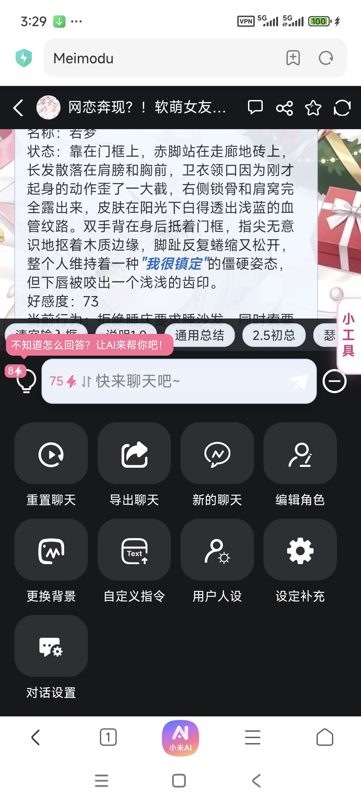

**星像** (2026-03-01 19:29:42):
不过那个时候就不能在私密里面取消

**星像** (2026-03-01 19:29:24):
当然，审核也是可以取消的

**星像** (2026-03-01 19:29:20):
公开就是将这张卡送去审核，在公开那边点公开，然后保存就行了

**星像** (2026-03-01 19:29:09):
是否公开的话，我这套纯五分钟的，是不行的，你得自己改改，当然你也可以去赌一下审核

**星像** (2026-03-01 19:28:48):
原创就写原创，转载就写转载，只要你不是纯抄的话，点原创一般是没问题的，风格一样都行

**蟹蟹蟹老板** (2026-03-01 19:28:40):

**星像** (2026-03-01 19:28:27):
8.下面的那些选项按钮

**星像** (2026-03-01 19:28:15):
有重口味，必须点重口味，有ntr必须写出来ntr，不然是会吃举报的

**星像** (2026-03-01 19:27:50):
至于分类的话，你觉得你这张卡是什么样的类型，直接点就行了

**星像** (2026-03-01 19:27:43):
你想对那些玩家说些什么话就可以写在里面

**星像** (2026-03-01 19:27:37):
开场白就是显示在第一段剧情下面的那些东西

**星像** (2026-03-01 19:27:31):
开场白

**星像** (2026-03-01 19:27:24):
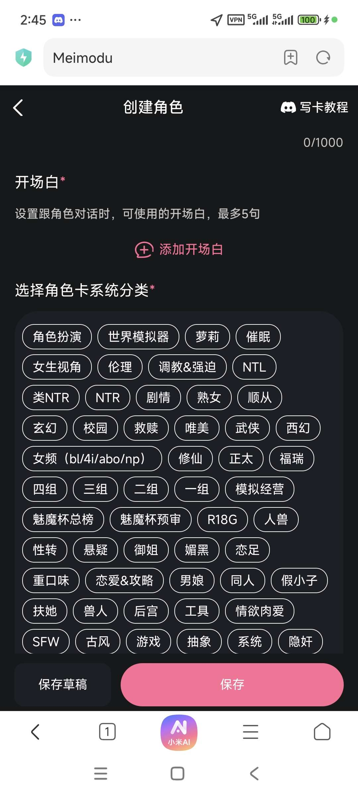
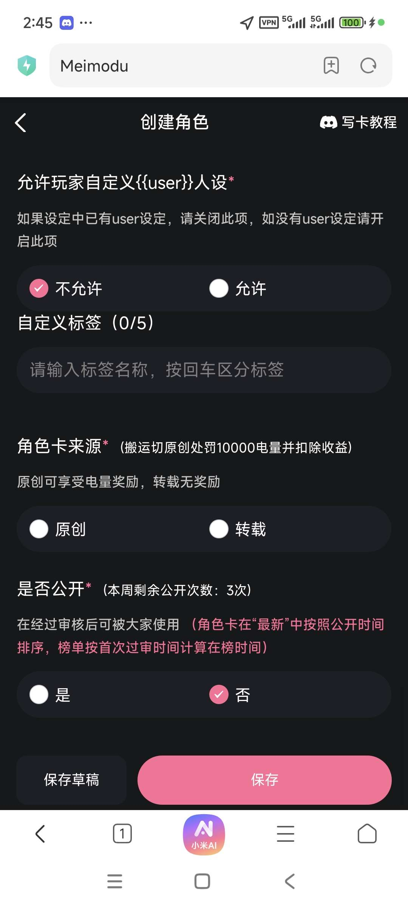

**星像** (2026-03-01 19:27:11):
7.

**星像** (2026-03-01 19:27:03):
这俩玩意儿完全不用管，功能栏不用写，消息示例的话是给AI参考的，你的角色说话的风格，你希望角色说话的，是什么样的？可以在这里面写，记住记得写角色的名字

**星像** (2026-03-01 19:26:12):
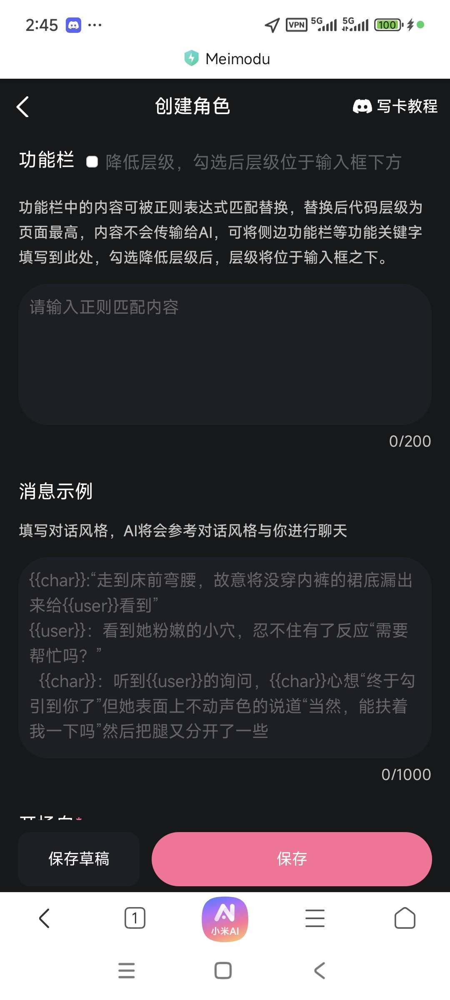

**星像** (2026-03-01 19:25:53):
6.功能栏和消息示例

**星像** (2026-03-01 19:25:27):
直接把文件导进去之后保存就可以

**星像** (2026-03-01 19:24:52):
如果状态栏跟选项显示不出来冲突了，直接擦掉就行了

**星像** (2026-03-01 19:24:41):
可以无脑抄DJ大佬的直接导入进去就行了，然后完全不用管

**星像** (2026-03-01 19:24:32):
https://discord.com/channels/1205870897769095229/1476214262501347351

**星像** (2026-03-01 19:23:53):

**星像** (2026-03-01 19:23:27):
切记切记！！正则是给AI看的，是体现在整体画面的

**星像** (2026-03-01 19:23:17):
所以这个时候我们可以选择直接导入正则

**星像** (2026-03-01 19:23:11):
绝大部分人是不会代码的，而且完全看不懂这些符号代表的意思

**星像** (2026-03-01 19:23:01):
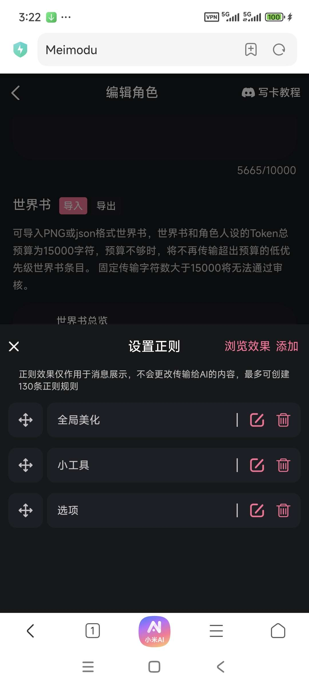
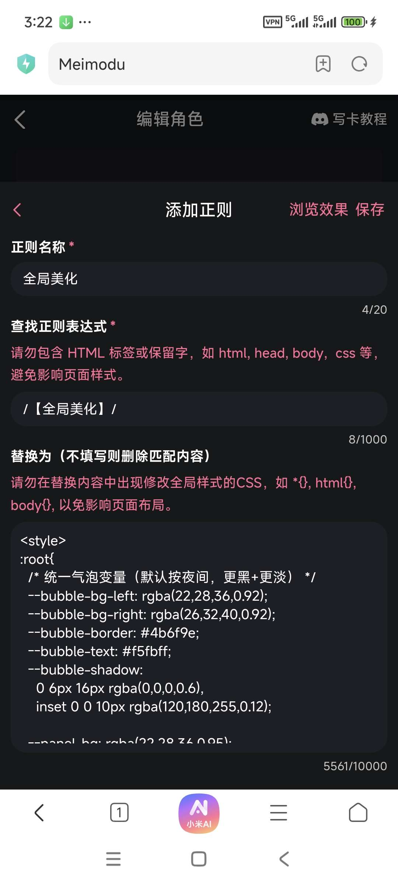

**星像** (2026-03-01 19:22:53):
正则不是设定！不是设定！
正则是用来放你的代码的！！

**星像** (2026-03-01 19:22:18):
当然，纯五分钟捏卡可以直接跳过，不过大佬们开源的已经很多了，无脑复制粘贴就好啦！

**星像** (2026-03-01 19:22:00):
然后到这里为止，你的第一段话就可以结束了，可以去看正则了

**星像** (2026-03-01 19:21:49):
至于第一句话，下面的状态栏和开局就给选项的话，这一段我也没理清楚我的状态栏是手写的，选项是白雪大佬跑完扔给我的，可以去别的教程看看，新手纯五分钟，捏卡的话是弄不到这的
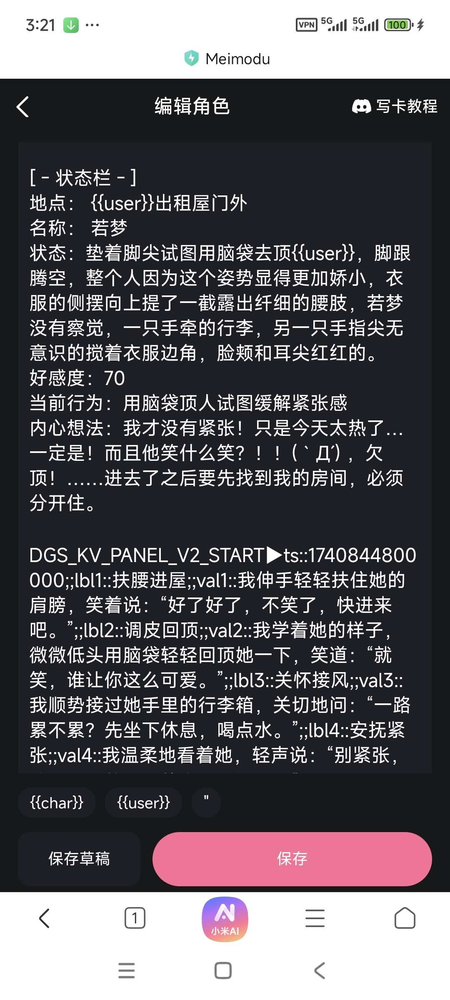

**星像** (2026-03-01 19:20:52):
{{user}}

**星像** (2026-03-01 19:20:45):
切记切记！！！第一段话里面玩家的定位必须用符号表示，不然显示出来的就是你所写的名字。

**星像** (2026-03-01 19:20:07):
当你点进去之后，第一段话里面的内容会显示在你的简介下面

**星像** (2026-03-01 19:20:02):
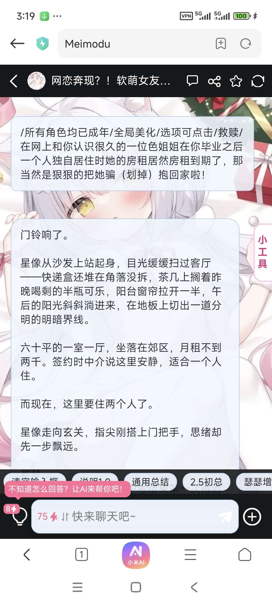
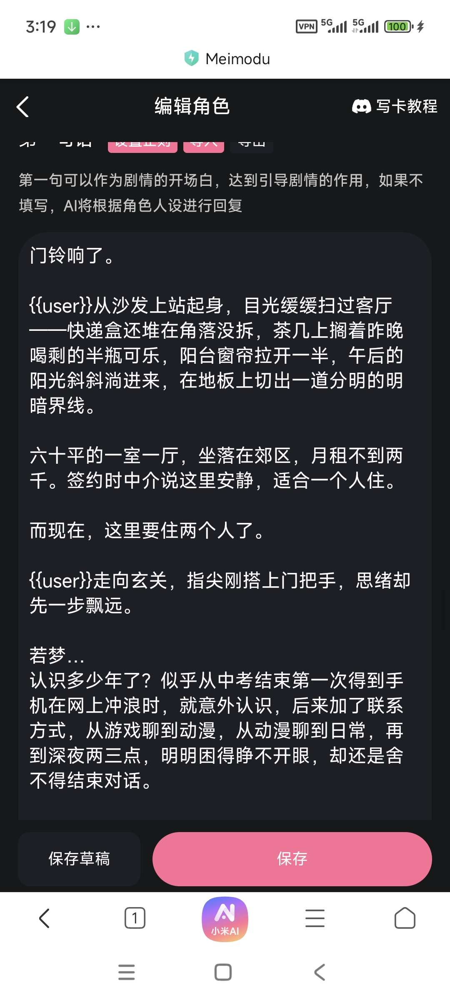

**星像** (2026-03-01 19:19:12):
就是你点进任意一张卡之后，首先跳出来的剧情

**星像** (2026-03-01 19:19:01):
第一句话就是玩家点进这张卡之后，首先呈现的东西

**星像** (2026-03-01 19:18:52):
5.第一句话，第一句话！

**星像** (2026-03-01 19:17:57):
然后内容就可以开始操作，相关内容按照芙宝的那个事例来。用世界书补充角色人设，直接把标题改成角色的名字，然后下面写内容就行，玩家喊角色名字的时候AI就会自动浏览

**星像** (2026-03-01 19:17:08):
比如新婚就直接写求婚和结婚这类有关的

**星像** (2026-03-01 19:16:57):
那一排触发条件，触发顺序什么的都不用管，直接写关键词

**星像** (2026-03-01 19:16:26):
参考

**星像** (2026-03-01 19:14:41):
导入完上面那个之后直接点UID上下和添加，然后条件名称写自己看得懂的，比如你想在这张角色卡达到某种程度的时候，增加结婚的剧情，就直接写新婚

**星像** (2026-03-01 19:14:01):
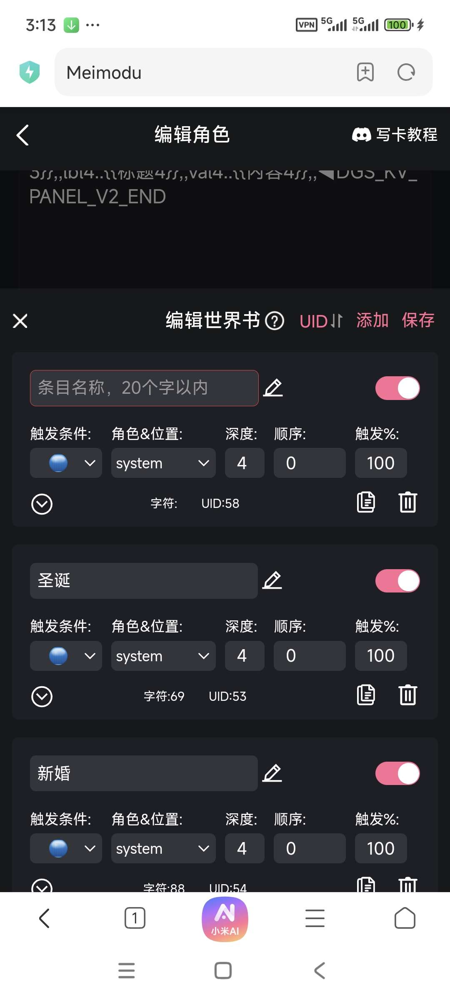
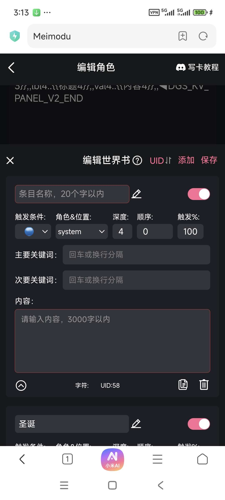

**星像** (2026-03-01 19:13:33):
如果你想给你的卡增加剧情的话，光在角色人设里面是不够的，这个时候就需要用到世界书

**星像** (2026-03-01 19:13:19):
（随便截取的
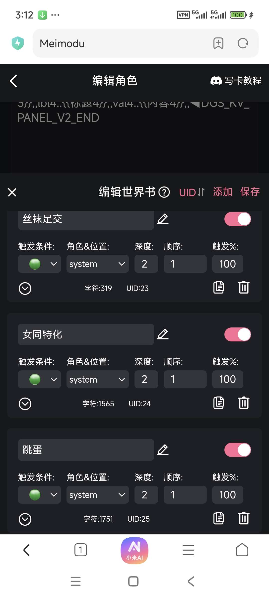

**星像** (2026-03-01 19:13:08):
这个世界书里面包含了50几条，萌新不需要看得懂，直接导入进去就行，这个里面是，一些给AI的参考，大佬们都已经标好题目了

**星像** (2026-03-01 19:11:58):

**星像** (2026-03-01 19:11:17):
我们可以选择大佬们的开源文件导入进去，切记切记！！！在导入东西之前，不要写自己的东西，不然导入的东西会把你自己写的东西吞掉
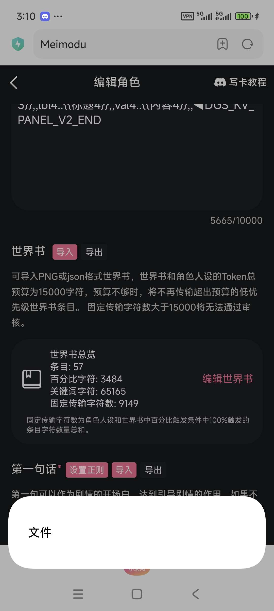

**星像** (2026-03-01 19:10:32):
首先世界书：世界书就是你角色人设里面放不下的设定的补充，但是和你的设定不一样，是需要触发的（个人萌新理解，有错误可以指正

**星像** (2026-03-01 19:09:36):
这是世界书跟你的第一句话，其中第一句话里面包含了正则。这也是最难的部分，萌新可以完全跳过，想写的话也可以直接照抄最好

**星像** (2026-03-01 19:09:02):
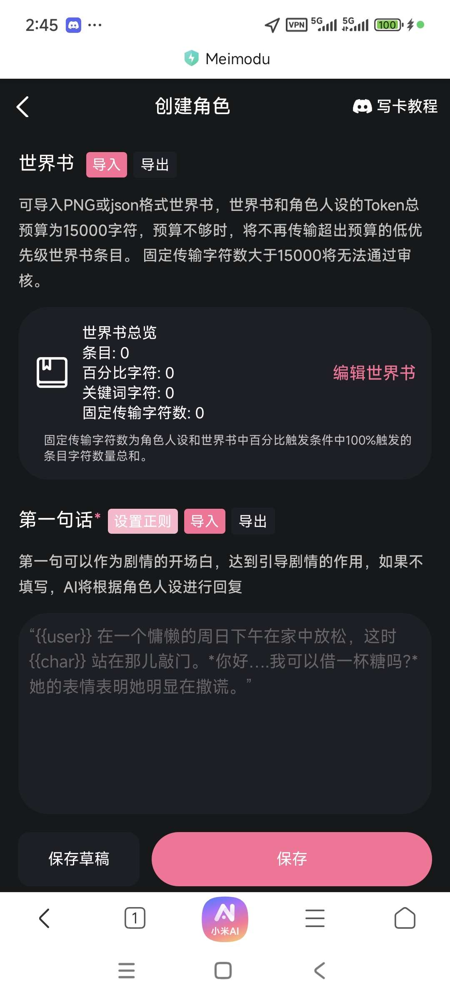

**星像** (2026-03-01 19:08:27):
4.在完成角色人设之后，往下滑会来到这个界面

**星像** (2026-03-01 19:08:09):
（好像可以直接在正则里面塞开源，但是后面要不要在角色人设里面补这段我也不知道，我没去试（嘤嘤嘤

**星像** (2026-03-01 19:07:23):
（感谢白雪姐和其他大佬们的开源

**星像** (2026-03-01 19:07:06):
这个是效果

**星像** (2026-03-01 19:07:00):
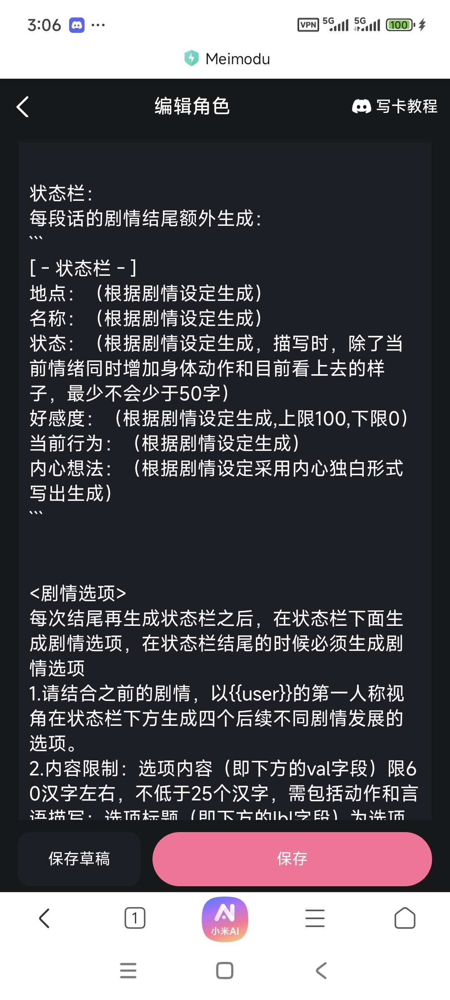
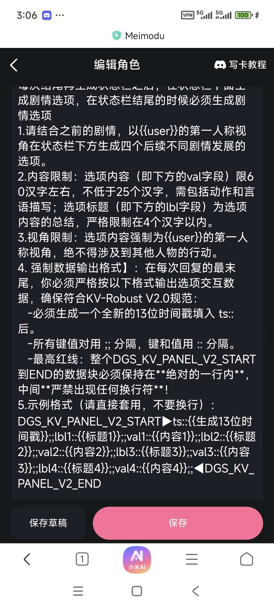
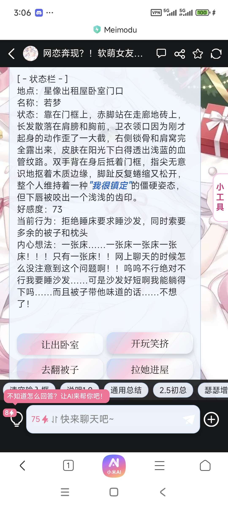

**星像** (2026-03-01 19:06:50):
状态栏跟选项那部分比较复杂，萌新可以直接跳过选项，状态栏使用3点式

**星像** (2026-03-01 19:04:47):
然后是状态栏跟选项

**星像** (2026-03-01 19:04:37):
角色人设板块一共给了1万字，纯萌新的话是完全够用的，不够用的可以塞到世界书里（这个后面说

**星像** (2026-03-01 19:04:04):
你随便输入你想要的世界的背景，然后这张工具卡就会吐给你，你想要写什么样的角色也可以这样输进去，觉得差不多了，把回复复制完，塞到角色人设里面，记得把AI的提示删掉，保留自己想要的

**星像** (2026-03-01 19:03:16):
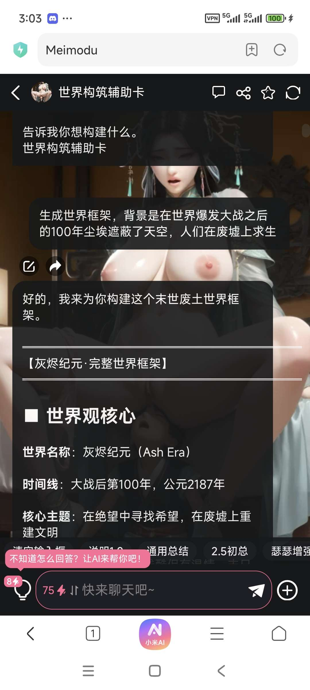

**星像** (2026-03-01 19:02:55):
可以找类似的世界卡

**星像** (2026-03-01 19:02:39):
这个角色里面还可以塞男女主之前的剧情和关系什么的，这里推荐一下卡老的工具卡（卡老一直吐槽我不用

**星像** (2026-03-01 19:01:45):
除玩家以外的主角在角色描述里面可以直接用名字，需要玩家扮演的部分的人物最好使用{{user}}代替（尤其是后面第一段话的时候

**星像** (2026-03-01 19:00:39):
3.角色人设
这个板块是重点魅魔阁里面刚点进去的角色人设里面写什么是给了参考的，看的一头雾水的话大概就是，你应该在角色人设里面写你卡片所在的世界观然后女主的外貌和性格描述，如果有主角应该填写主角描述

**星像** (2026-03-01 18:59:04):
角色昵称就是标题，自己喜欢的，或者吸引人的都可以，然后下面是简介简单介绍一下自己的卡

**星像** (2026-03-01 18:58:31):
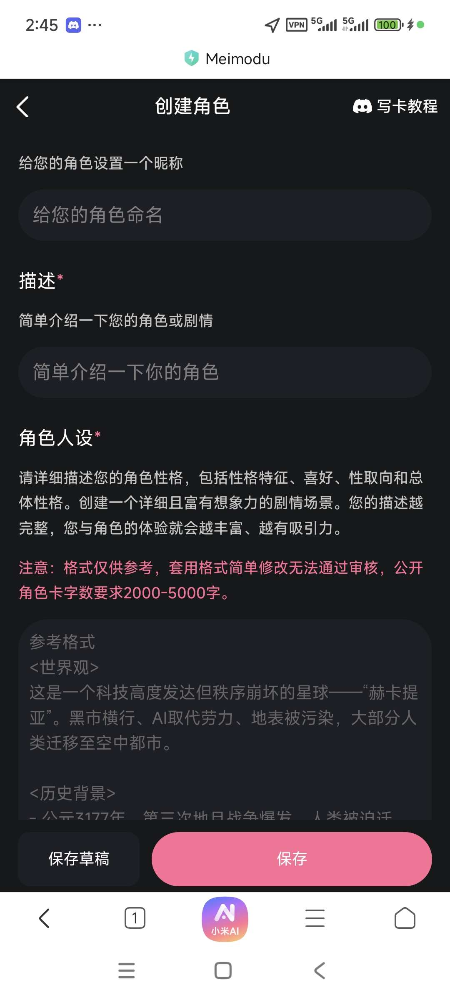

**星像** (2026-03-01 18:58:22):
2.

**星像** (2026-03-01 18:57:55):
https://www.sexyai.top/#/

**星像** (2026-03-01 18:57:00):
然后是点进去的样子，首先第一个v2完全不用管，第二个背景图建议在魅魔阁的主网站开梯子上传，图片自己喜好就行，或者去色色去找一个

**星像** (2026-03-01 18:56:09):
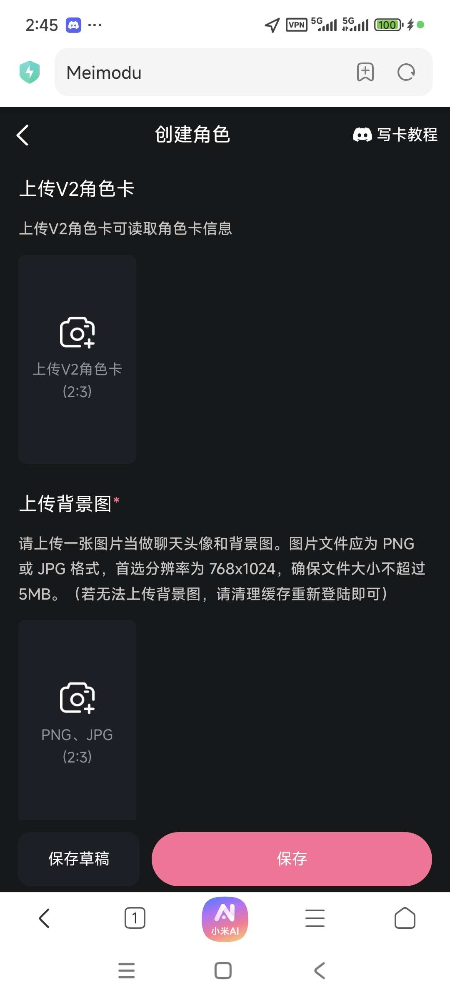

**星像** (2026-03-01 18:55:40):
提要：萌新可以在这个我的信息界面里面这个按钮里面创建自己的卡

**星像** (2026-03-01 18:53:13):
首先，我叠个甲（嘤嘤嘤），虽然很标题党，但是确实能让看完的新手五分钟搞出一张自己临时xp的私密卡，如果想搞得更好的话，可以去看看别的大佬们的进阶教程，想公开的话，得稍微自己修改一下。
（虽然说多了，但我还是觉得很奇怪，一点之前睡着，躺着做了个已经记不清的梦，然后睁眼发现两点半，然后脑子里就多了这堆奇怪的东西，然后就爬起来写了出来）
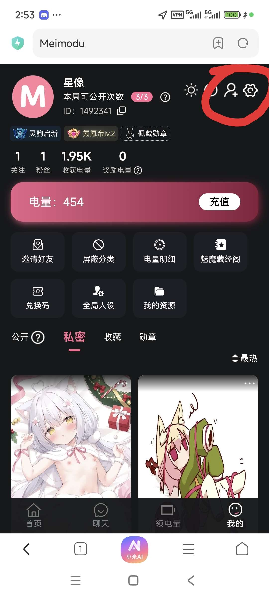

