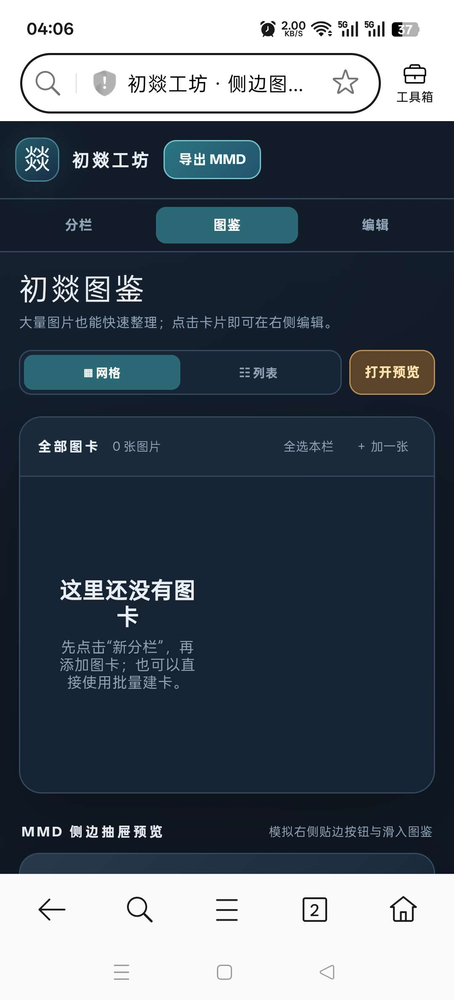
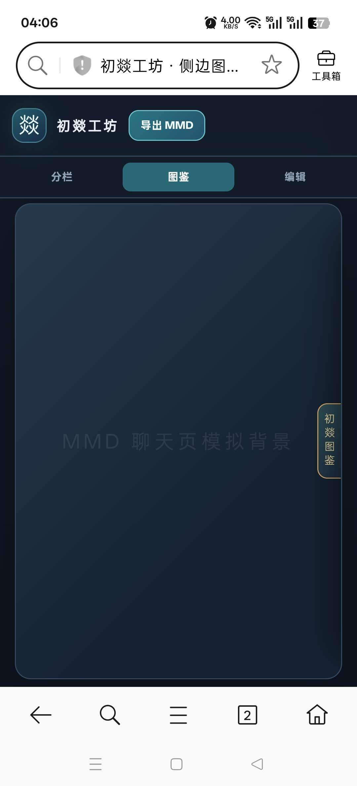
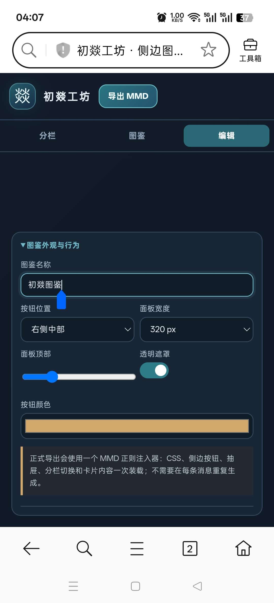

# 比较简单实用的图鉴编辑器，可翻面

来源: Discord 魅魔藏经阁 thread 1549874395067977818

创建: 2026-09-16T20:07:31.058000+00:00
消息数: 13

---

**燚（被秋姐变性版）** (2026-09-22 04:45:50):
比较简单实用的图鉴编辑器，可翻面

**士酱** (2026-09-22 00:17:01):
<:emoji_249:1416980114511761448>

**士酱** (2026-09-22 00:16:58):
不赖

**燚（被秋姐变性版）** (2026-09-21 16:07:17):
<@1474927847318487202>

**燚（被秋姐变性版）** (2026-09-21 15:47:42):

**夏（区王·蘸豆模式）** (2026-09-18 13:38:56):
<:07:1298281204260278383>

**燚（被秋姐变性版）** (2026-09-18 13:25:47):
<:emoji_299:1550434627498287135>

**小魅** (2026-09-17 02:23:58):
感谢宝宝开源<:emoji_140:1379454014852436038>

**MEE6** (2026-09-17 02:23:52):
<:CHECK6:403540120181145611> 50,000 XP has been given to **<@!1525979439119204423>**

**燚（被秋姐变性版）** (2026-09-17 01:28:04):
<:emoji_249:1416980114511761448>

**燚（被秋姐变性版）** (2026-09-16 20:08:56):
<@1135473222658297907>

**档案管理员** (2026-09-16 20:07:32):
[本帖尚未声明授权]()
发帖人尚未完成授权设置，或已选择跳过。本状态不代表允许转载、二次创作、商业使用或重新分发。

**燚（被秋姐变性版）** (2026-09-16 20:07:31):
最新版：https://discord.com/channels/1205870897769095229/1549874395067977818/1551620951307853886
主要功能
• 自定义图鉴名称、贴边按钮位置、抽屉宽度、顶部距离、遮罩和强调色。
• 创建任意数量的图鉴分栏。
• 分栏支持改名、删除和上下排序。
• 图卡支持：
• 称号
• 角色名
• 简介
• 标签
• HTTPS 图片直链
• 本地图片预览
• 点击跳转链接
• 宽幅、竖幅和方形画幅
• 图片裁切与焦点调整
• 启用或停用
• 复制、移动和删除
• 网格与列表两种管理方式。
• 可按名称、称号和标签搜索。
• 支持一键批量建立大量图卡。
• 实时模拟 MMD 右侧贴边按钮和滑入抽屉。
• 正式图鉴使用双列排版，更适合放很多图片。
• 项目自动保存在浏览器中。
• 可导出项目备份并重新恢复。
批量建卡格式
分栏 | 称号 | 角色名 | HTTPS图片直链 | 标签1,标签2 | 简介
MMD JSON 合并
编辑器可以导入已有的当前 MMD 四键 JSON

大量图片支持

图鉴数据会自动切分成多条链式数据规则，避免大量图片导致单条 replaceString 超过 MMD 上限。

已经用 3 个分栏、84 张图卡做过实际导出压力检查：

• 自动拆成 2 条数据规则
• 总共使用 4 条正则
• MMD 校验结果：0 错误、0 警告、22 项通过

本地上传图片只用于编辑器预览。正式导入 MMD 时，每张启用图卡都需要填写可公开访问的 HTTPS 图片直链。

