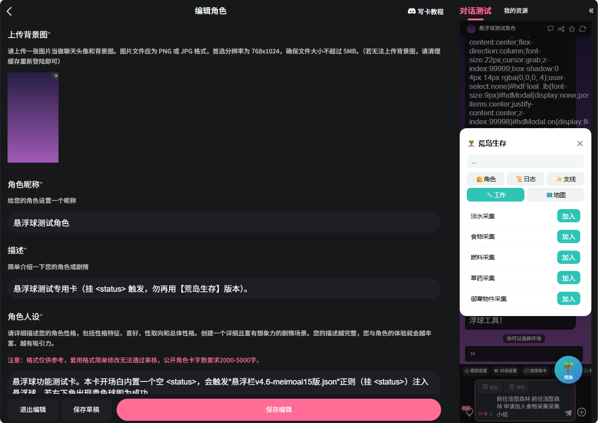
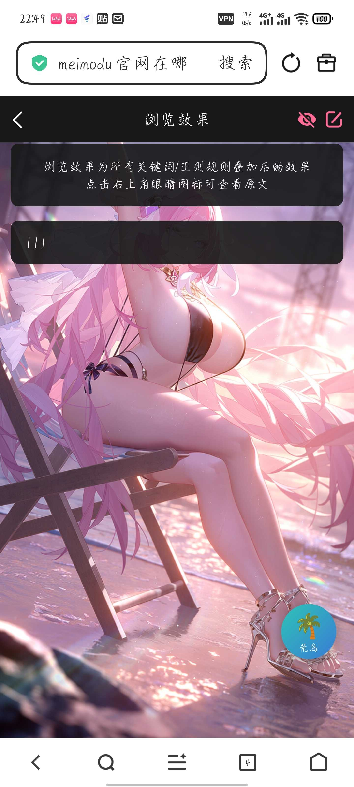

# 求助各位大佬这个悬浮栏为什么始终没有效果？

创建时间: 2026-08-31T07:41:02.475000+00:00
消息数: 64

---

**tansen(努力成为写卡大手子😡)** (2026-08-31 16:52:35):
后续会把打磨完整的球的代码开源出来，感谢支持

**tansen(努力成为写卡大手子😡)** (2026-08-31 16:51:53):
哦，新的居然是用状态栏抓取😨，因为我用的是状态栏美化，这样两者冲突了，不过我参考了思路，在美化的基础上实现美化的抓取，这样就成了，感谢大佬<:emoji_249:1416980114511761448> <:emoji_249:1416980114511761448>

**Lyfe** (2026-08-31 16:05:57):
啥意思，我想问你这个悬浮球能不能正常使用

**tansen(努力成为写卡大手子😡)** (2026-08-31 15:59:46):
大佬要吗？我这只有成品已塞完图鉴的成品，初始的修改版我已经删掉了<:1000168531:1298906724979310634>

**tansen(努力成为写卡大手子😡)** (2026-08-31 15:56:19):
能用的能用的，不知道为什么，明明悬浮球抓取不到，但图鉴居然能抓取到了<:1000168510:1298906820638674984>

**Lyfe** (2026-08-31 15:55:07):
新的能用吗

**tansen(努力成为写卡大手子😡)** (2026-08-31 15:47:21):
原图鉴是用的乱马大佬的，在这基础上我修改为多角色的带锁分别的全图鉴，现在大佬的源文件已经删了好像<:1000168510:1298906820638674984>

**Lyfe** (2026-08-31 15:43:16):
荒岛那张卡，图鉴是用的哪个大佬的，我也去借鉴下

**tansen(努力成为写卡大手子😡)** (2026-08-31 15:42:21):
ok

**Lyfe** (2026-08-31 15:42:15):
然后配合你的世界书，看看能不能实现监听

**tansen(努力成为写卡大手子😡)** (2026-08-31 15:42:06):
感觉代码量很少<:emoji_249:1416980114511761448> ，还是在我原来的基础上进行内容替换吗？

**Lyfe** (2026-08-31 15:42:03):
你先在你那个测试卡试一下悬浮球能不能用

**tansen(努力成为写卡大手子😡)** (2026-08-31 15:41:31):
直接导入吗大佬？

**Lyfe** (2026-08-31 15:40:52):
准备跑路睡觉了，我们生活在一个战乱的年代哈哈哈哈

**档案管理员** (2026-08-31 15:40:32):
ℹ️ 此附件由其他成员上传，不属于帖子作者声明的作品包，也不受本帖授权协议覆盖。

**Lyfe** (2026-08-31 15:40:31):
去试下

**tansen(努力成为写卡大手子😡)** (2026-08-31 15:38:41):
对，主要是为了将角色页面的好感度啊和忠诚度与状态栏里的进行监听更新，然后将支线页面里的解锁、完成情况也进行监听配对<:1000168510:1298906820638674984> <:1000168510:1298906820638674984>

**档案管理员** (2026-08-31 15:32:29):
ℹ️ 此附件由其他成员上传，不属于帖子作者声明的作品包，也不受本帖授权协议覆盖。

**Lyfe** (2026-08-31 15:32:29):
<@1470487367151390840>这样的感觉吗

**Lyfe** (2026-08-31 15:21:23):
我也在肘击ai哈哈哈哈

**Lyfe** (2026-08-31 15:21:11):
给它构建个文件夹，放入了藏经阁的资源还有平台的信息，反复调试，不断更新代码指南

**tansen(努力成为写卡大手子😡)** (2026-08-31 14:57:40):
大佬问一下，当时你遇到的这个问题的解决思路是什么，我也许可以参考一下<:emoji_249:1416980114511761448>

**tansen(努力成为写卡大手子😡)** (2026-08-31 14:49:35):
仅只显示一个球，右下角根本点开不了

**tansen(努力成为写卡大手子😡)** (2026-08-31 14:48:45):
有

**Lyfe** (2026-08-31 14:48:41):
现在球有显示吗

**tansen(努力成为写卡大手子😡)** (2026-08-31 14:48:10):
我就是正则替换的，难道说是直接替换成我原来那个里面的js代码里面吗？

**Lyfe** (2026-08-31 14:47:53):
这个不是放在正则里面吗，你在正则里面替换下试试呢

**Lyfe** (2026-08-31 14:47:21):
找gpt看了眼，对照自己之前写的卡分析结果给的是：平台会剥离/不执行 <script> 标签，我之前也是这种情况

**tansen(努力成为写卡大手子😡)** (2026-08-31 14:44:34):
大佬是怎么用的？直接替换成js那个文件名还是直接整个导入？整个导入以后好像打不开这个球直接

**Lyfe** (2026-08-31 14:42:15):
肘成了吗，我新发的这个能用吗

**tansen(努力成为写卡大手子😡)** (2026-08-31 14:35:32):
刚刚又去肘ai了一时没看到

**tansen(努力成为写卡大手子😡)** (2026-08-31 14:35:21):
wow，大佬！是mmd平台它AI始终没有按格式输出的原因吗？<:emoji_249:1416980114511761448>

**档案管理员** (2026-08-31 12:58:00):
ℹ️ 此附件由其他成员上传，不属于帖子作者声明的作品包，也不受本帖授权协议覆盖。

**Lyfe** (2026-08-31 12:58:00):
之前是代码问题，应该是魅魔平台不执行 <script>。所以你的悬浮球只能显示静态样式/HTML，抓取、监听、更新的 JS 逻辑根本没运行

**MOZ** (2026-08-31 12:20:58):
加油

**tansen(努力成为写卡大手子😡)** (2026-08-31 12:17:37):
<:emoji_148:1382329938404839586>

**tansen(努力成为写卡大手子😡)** (2026-08-31 12:17:35):
没事，第一张模拟器卡很多不懂，能多提意见都是好的，我后面慢慢慢慢积攒经验，前期踩的弯和坑太多了

**MOZ** (2026-08-31 12:17:02):
俺个人的看法

**MOZ** (2026-08-31 12:16:54):
也不一定，你可以看看流量高的模拟器了

**tansen(努力成为写卡大手子😡)** (2026-08-31 12:16:42):
功能性的意见也可以直接提，我看我能不能从其他方面用ai也肘出来

**tansen(努力成为写卡大手子😡)** (2026-08-31 12:16:14):
哦哦，我大致明白你意思了，Ok，等会先去改一改，我尽量把前期篇幅加长一点引入更顺利一点

**MOZ** (2026-08-31 12:15:14):
就像是去餐馆直接给你端了大米饭

**MOZ** (2026-08-31 12:14:55):
但是直接选人的模拟器感觉会很突兀

**MOZ** (2026-08-31 12:14:43):
也不是

**tansen(努力成为写卡大手子😡)** (2026-08-31 12:14:32):
🤔，意思就是对世界观进行更深的说明之类的吗？

**MOZ** (2026-08-31 12:13:58):
加油，我可以提一个意见，我觉得你新卡开场白加点文字介绍可能好一些

**tansen(努力成为写卡大手子😡)** (2026-08-31 12:13:17):
呜呜，只能先看后续了，看能不能后续慢慢把它调出来吧，那如果能来一个大佬从天而降自然更好<:emoji_249:1416980114511761448>

**MOZ** (2026-08-31 12:11:58):
可惜很多技术佬都在战斗

**MOZ** (2026-08-31 12:11:43):
看出来做的很认真了

**MOZ** (2026-08-31 12:11:33):
😭

**tansen(努力成为写卡大手子😡)** (2026-08-31 12:10:52):
主要就是对这个悬浮球和状态栏进行配对监听，结果始终实现不了实时更新，明明图鉴都能实现抓取进行解锁了这个始终不可以，不明白了<:emoji_249:1416980114511761448>

**tansen(努力成为写卡大手子😡)** (2026-08-31 12:09:49):
已经燃成灰了

**MOZ** (2026-08-31 12:09:06):
新卡还不错哎

**tansen(努力成为写卡大手子😡)** (2026-08-31 12:08:47):
对的，我很多东西基本上是在站内对大佬的东西进行使用和基本的修改<:1000168510:1298906820638674984> ，本来也想自己弄点东西开源一下，结果自己的东西都根本弄不懂😇😭

**MOZ** (2026-08-31 12:00:42):
你站内就叫这个嘛

**tansen(努力成为写卡大手子😡)** (2026-08-31 12:00:01):
就自己的东西居然都还没做出效果，哎，前途渺茫<:emoji_148:1382329938404839586>

**tansen(努力成为写卡大手子😡)** (2026-08-31 11:59:43):
😨害怕，感觉很难，现在我说实话，我自己的卡都还没卖出过好成绩

**MOZ** (2026-08-31 11:59:12):
你来成为大佬吧

**MOZ** (2026-08-31 11:59:06):
你生在了战乱年代

**tansen(努力成为写卡大手子😡)** (2026-08-31 11:58:35):
😭，实在改不出来问题了，我操，他始终的监听失败很难受

**MOZ** (2026-08-31 11:29:05):
😭 大佬都被气跑了

**tansen(努力成为写卡大手子😡)** (2026-08-31 07:45:36):
求求各位大佬们的指点了<:emoji_140:1379454014852436038> <:emoji_140:1379454014852436038>

**档案管理员** (2026-08-31 07:41:03):
[内容授权协议 · V1]()
本帖已经发布授权协议；当前卡片展示最新版本，历史版本仍可追溯。

**tansen(努力成为写卡大手子😡)** (2026-08-31 07:41:02):
自己肘了一个悬浮球，想的是根据状态栏的数据实现监听和实时更新，但是个人改了很久始终没能成功抓取和更新，麻烦问问大佬们是不是这个状态栏生成协议问题还是代码始终改不对？

