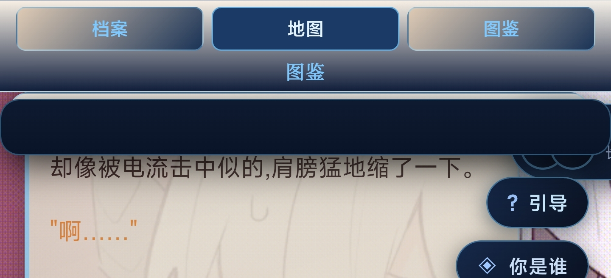
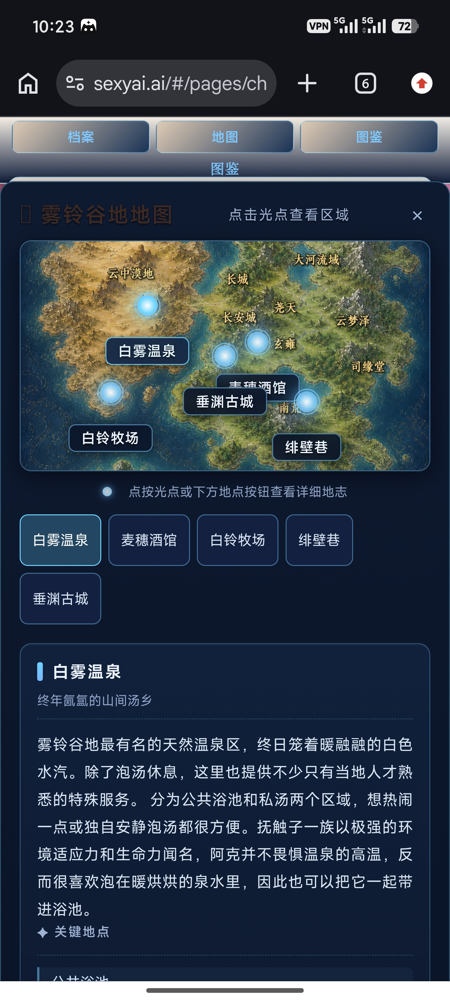
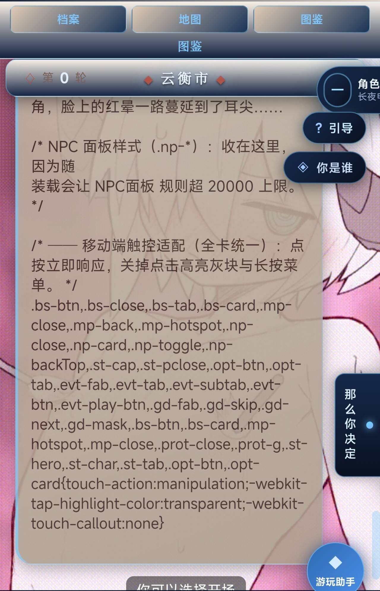
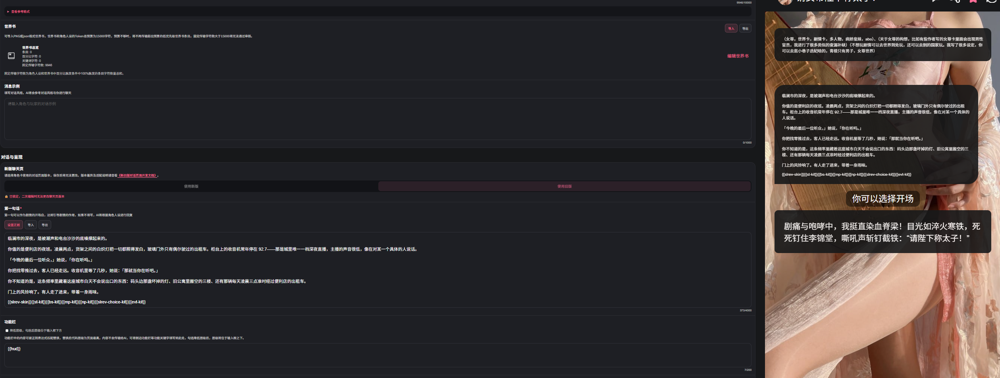

# 流云佬的状态栏，我做成编辑器了

来源: Discord 魅魔藏经阁 thread 1550846421198966886

创建: 2026-09-19T12:30:00.147000+00:00
消息数: 40

---

**召唤师** (2026-10-05 14:37:19):
<:emoji_115:1379113943817257071>

**燚（被秋姐变性版）** (2026-10-05 07:26:16):
https://cdn.discordapp.com/attachments/1285981655747788831/1552566855858921583/IMG_1834.gif

**士酱** (2026-10-05 06:12:57):
<:emoji_115:1379113943817257071>

**士酱** (2026-10-05 06:12:51):
哈基火你这家伙

**战栗的黑羊** (2026-09-21 15:09:01):
嗯嗯，状态栏倒是小问题，我直接把json丢给gpt生成了一个

**燚（被秋姐变性版）** (2026-09-21 15:03:20):
这个状态栏协议自己改一下，或者扔给ai改

**燚（被秋姐变性版）** (2026-09-21 15:03:03):
<状态栏生成协议>

<核心规则>
本卡前端只读取 `[status]...[/status]`。每轮按此顺序输出：时间 → 正文 → 完整状态块 → `[在场=...]` → `〔那么你决定〕` 下的 A/B/C 三个行动。

状态栏只记录本轮已经发生、当前已知且与正文一致的事实；不替{{user}}行动，不输出思考过程，不解释协议。
</核心规则>

<状态格式>
[status]
round=正整数
人物名|生命=0至100|内力=0至100|身份=文本|境界=文本|位置=文本|势力=文本|状态=文本|名望=文本|内心=文本|穿着=文本|头像=HTTPS图片地址
[/status]
[在场=人物名1,人物名2]

每名人物一行；字段用半角 `|` 分隔，字段值内不得出现 `|` 或换行。头像可省略。
</状态格式>

<字段>
- 生命：0—100 的整数。
- 内力：0—100 的整数；纯体修可写 0，并在状态注明「体修·不以内力作战」。
- 身份：当前身份、职业或称号。
- 境界：必须写路径，例如「武修化境初期」「魔修魔心境」「武修宗师+体修不破境」。未知写「未定」。
- 位置：国家·区域·地点。
- 势力：所属、效忠或公开立场；没有则写「散修」或「未定」。
- 状态：伤势、昏迷、中毒、疲惫、脱战等当前处境。
- 名望：公开声望，可写数字或简短等级。
- 内心：一句当前情绪或判断，不写思考过程、未来或隐藏情报。
- 穿着：当前可见衣着和装备外观。
- 头像：可选 HTTPS 地址。

只使用上述字段。好感、堕落、经验、金钱、任务、目标、装备等不要作为独立字段。
</字段>

<更新>
1. round 从 1 开始；每完成一次新行动加 1，重生成同一轮不得倒退。
2. 每次输出完整快照。当前引擎会用本轮人物集合替换旧集合。
3. 始终保留主角行；未定名时用 `{{user}}`。
4. 只写当前场景或直接影响剧情的重要 NPC；离场 NPC 删除。
5. 生命、内力只因正文明确发生的伤害、消耗、疗伤、休息、丹药或事件变化。
6. 生命为 0 不自动等于死亡；只有正文确认死亡才写「状态=死亡」。
7. 未知信息写「未详」或「未定」，不得猜测境界。
8. 数值字段只写整数，不写百分号、分数或小数。
9. 一名人物一行，姓名不超过 20 字，不含等号或竖线。
</更新>

<修炼与战斗>
- 武修：三流→二流→一流→化境→绝境→宗师→大宗师→半步陆地神仙→陆地神仙。
- 体修：皮肉境→筋骨境→脏腑境→骨血境→不破境→搬山境→半步圣体境→圣体境。
- 魔修：三流→二流→一流→入魔境→魔心境→魔师境→半步陆地魔仙→陆地魔仙。
- 武修与魔修不可同修；体修可与任一者同修。
- 境界优势、越级依据、伤势和战斗代价必须在正文中体现，并同步到状态。
- 路径转换必须有修为倒退、经脉重塑和风险。
</修炼与战斗>

<信息边界>
NPC只能知道亲历或经书信、商旅、门派情报、朝廷传令、江湖传闻等合理渠道获得的信息。不得凭空知道{{user}}的内心、隐藏身份、真实境界或未公开选择；传闻可能延迟、失真或不完整。
</信息边界>

<示例>
{{user}}|生命=100|内力=100|身份=无名游侠|境界=未定|位置=四国交界·十里亭|势力=未定|状态=完好|名望=0|内心=初入江湖，前路未定|穿着=便于远行的普通衣装

周铁衣|生命=100|内力=82|身份=丐帮帮主|境界=武修宗师|位置=汉国·临安城|势力=丐帮|状态=脱战，右臂旧伤未愈|名望=汉地声名显著|内心=先听完来人的来意|穿着=补丁短褐与九袋长老布袋
</示例>

<行动选项>
状态块后输出恰好三条：

〔那么你决定〕
A·继续：推进当前目标。
B·拖延：调查、准备、休息或试探。
C·停止：离开当前路线、拒绝介入或转向。

三条必须具体、彼此不同，只描述{{user}}可执行的动作，不预设结果；每条建议不超过 80 字。选项只填入输入框，不会自动发送。
</行动选项>

<禁止>
- 不输出 HTML、CSS、JavaScript、JSON、代码块或协议解释。
- 不使用 <status>、<ztl>、KV 属性块；只使用 [status]。
- [status] 内只能有一个 round 和状态行；字段值不得含 `|`。
- 不添加未支持字段，不虚构伤势、装备、关系、情报或剧情后果。
- 不把 NPC 隐藏想法写成思考过程。
</禁止>

<自检>
单场景；时间地点一致；round 正确；一个完整 [status]；主角行存在；字段和数值合规；[在场] 正确；A/B/C 恰好三条。
</自检>

</状态栏生成协议>

**战栗的黑羊** (2026-09-21 15:02:09):
好，祝老哥顺利，身体健康<:emoji_140:1379454014852436038>

**燚（被秋姐变性版）** (2026-09-21 15:00:51):
到时候看看，明天要开始做复疗了

**档案管理员** (2026-09-21 14:25:49):
ℹ️ 此附件由其他成员上传，不属于帖子作者声明的作品包，也不受本帖授权协议覆盖。

**战栗的黑羊** (2026-09-21 14:25:48):
感谢回复，那个是开场白导出的时候自动置入了一段代码，{{slrev-skin}}{{st-kit}}{{bs-kit}}{{mp-kit}}{{np-kit}}{{slrev-choice-kit}}{{evt-kit}}，这个删掉后貌似不会影响后面的正常游玩。
至于状态栏的问题，看了一下，这个编辑器好像根本没有给提供复制状态栏的按钮……我就把json丢给ai生成了一个协议，这下能正常生成并在侧边栏显示了。
除此之外好像也是有一些小问题，像是地图点不开，还有角色状态的边框会超出页面，都丢给AI去修了。
老哥后续会考虑继续优化这个编辑器吗，感觉特别特别好用<:emoji_140:1379454014852436038>

**燚（被秋姐变性版）** (2026-09-21 12:26:43):
不过这种情况好像是状态栏协议的问题

**燚（被秋姐变性版）** (2026-09-21 09:19:47):
我负责改，不会售后

**燚（被秋姐变性版）** (2026-09-21 09:19:40):
<:emoji_249:1416980114511761448>

**燚（被秋姐变性版）** (2026-09-21 09:19:37):
要问原作者

**战栗的黑羊** (2026-09-21 08:58:04):
用的是新版

**档案管理员** (2026-09-21 08:57:40):
ℹ️ 此附件由其他成员上传，不属于帖子作者声明的作品包，也不受本帖授权协议覆盖。

**战栗的黑羊** (2026-09-21 08:57:40):
老大，这个开场白会多出来一段，是什么情况<:1000168531:1298906724979310634>

**燚（被秋姐变性版）** (2026-09-20 04:05:49):
<:emoji_249:1416980114511761448>

**鹤南飞(接定制看简介)** (2026-09-20 04:04:53):
我都不懂用，有点复杂了

**燚（被秋姐变性版）** (2026-09-20 02:16:29):
你用图鉴的时候有出现问题吗

**燚（被秋姐变性版）** (2026-09-19 13:26:45):
新版的

**鹤南飞(接定制看简介)** (2026-09-19 13:16:58):
哈气了喵

**鹤南飞(接定制看简介)** (2026-09-19 13:16:54):
<:emoji_148:1382329938404839586>

**火树银花不夜天** (2026-09-19 13:15:08):
这是新版的<:1000168531:1298906724979310634>

**鹤南飞(接定制看简介)** (2026-09-19 13:14:22):
不知道是不是不支持旧版

**鹤南飞(接定制看简介)** (2026-09-19 13:14:15):
我是从哪个json文件直接导入进去的

**档案管理员** (2026-09-19 13:13:50):
ℹ️ 此附件由其他成员上传，不属于帖子作者声明的作品包，也不受本帖授权协议覆盖。

**鹤南飞(接定制看简介)** (2026-09-19 13:13:50):

**鹤南飞(接定制看简介)** (2026-09-19 13:13:26):
导入正则有问题，不显示代码也不显示渲染

**小魅** (2026-09-19 13:11:11):
感谢宝宝开源<:emoji_140:1379454014852436038>

**MEE6** (2026-09-19 13:11:05):
<:CHECK6:403540120181145611> 15,000 XP has been given to **<@!1525979439119204423>**

**鹤南飞(接定制看简介)** (2026-09-19 13:09:45):
十分有九分不对劲

**鹤南飞(接定制看简介)** (2026-09-19 13:09:30):
我测试了以下，导入正则有bug

**鹤南飞(接定制看简介)** (2026-09-19 13:03:54):
致敬

**鹤南飞(接定制看简介)** (2026-09-19 13:03:46):
我去，刚像跑全局美化就来枕头了

**燚（被秋姐变性版）** (2026-09-19 12:35:26):
原作者：<@1528051474549182516>

**燚（被秋姐变性版）** (2026-09-19 12:34:23):
已挣得原作者同意，非本人原创，只是为了方便不会用ai的作者使用

**档案管理员** (2026-09-19 12:30:01):
[本帖尚未声明授权]()
发帖人尚未完成授权设置，或已选择跳过。本状态不代表允许转载、二次创作、商业使用或重新分发。

**燚（被秋姐变性版）** (2026-09-19 12:30:00):
原作者的状态栏帖子：https://discord.com/channels/1205870897769095229/1550401797158477865

