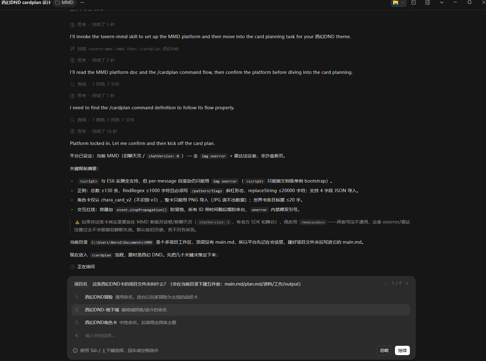
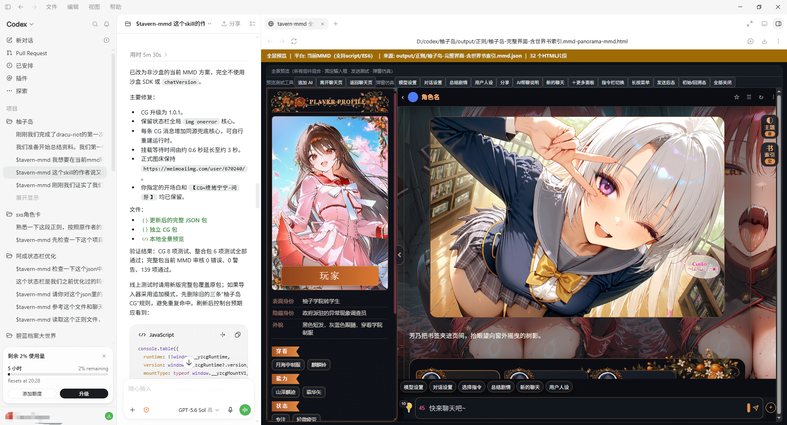

# 璃·魅|SKILL-功能与安装

来源: Discord 魅魔藏经阁 thread 1545960656463728762

创建: 2026-09-06T00:55:43.061000+00:00
消息数: 39

---

**wad1._** (2026-10-03 01:39:32):
怎么下载啊没用过这个<:emoji_115:1379113943817257071>

**楚冥** (2026-10-02 23:24:27):
！？强强？！

**Ggg「🥚」** (2026-09-30 13:25:07):
洛璃佬的恩情还不完

**qiqiguaiguai** (2026-09-20 15:34:52):
洛璃佬的恩情还不完<:emoji_115:1379113943817257071>

**𝓨𝓞𝓕𝓮𝓷𝓰** (2026-09-19 09:46:26):
旧版卡也可以编辑

**有害垃圾** (2026-09-19 08:36:03):
那么，以前的旧卡能这样编辑吗？还是这功能只对更新后的新卡开放

**𝓨𝓞𝓕𝓮𝓷𝓰** (2026-09-19 08:06:35):

**𝓨𝓞𝓕𝓮𝓷𝓰** (2026-09-19 08:03:52):

**𝓨𝓞𝓕𝓮𝓷𝓰** (2026-09-10 06:55:10):
确定平台的，你看帖子正文

**燚（被秋姐变性版）** (2026-09-10 06:54:14):
这两个指令干嘛用的

**snowithout(魔法学校进度10%）** (2026-09-08 11:27:23):
洛璃老师的恩情还不完<:emoji_115:1379113943817257071>

**（猫娘萝莉妈妈)抱玖酒(捡小猫)** (2026-09-08 10:01:58):
厉害ദ്ദി ˉ͈̀꒳ˉ͈́ )✧喵～

**彭野-二组:靖康将至！北宋谁救？** (2026-09-08 04:52:20):
牛牛牛，强！

**玛奇玛（Makima Makima kima ma** (2026-09-07 01:42:36):
洛璃姐姐好棒！

**𝓨𝓞𝓕𝓮𝓷𝓰** (2026-09-07 00:50:18):
都兼容的，两个指令都可以用

**澪** (2026-09-07 00:48:02):
太对了！

**澪** (2026-09-07 00:47:54):
<:1000168510:1298906820638674984>

**士酱** (2026-09-07 00:27:58):
哦对的对的

**月月鸟（思维枯竭）** (2026-09-06 18:41:00):
但是想写新版卡要用新版对应的skill

**月月鸟（思维枯竭）** (2026-09-06 18:40:37):
<:emoji_140:1379454014852436038>

**月月鸟（思维枯竭）** (2026-09-06 18:40:34):
旧版新版写卡都能写

**月月鸟（思维枯竭）** (2026-09-06 18:40:26):
还是可以的

**Licon** (2026-09-06 17:51:03):
大佬，现在新版的情况下就是用/mmdsandbox这个指令是吗，旧版的/mmd是不是已经不适配了

**Lyfe** (2026-09-06 13:03:59):
感谢大佬

**夏（区王·蘸豆模式）** (2026-09-06 12:37:43):
洛璃的恩情还不完<:emoji_115:1379113943817257071> <:emoji_115:1379113943817257071>

**小魅** (2026-09-06 12:36:58):
感谢宝宝开源<:emoji_140:1379454014852436038>

**MEE6** (2026-09-06 12:36:51):
<:CHECK6:403540120181145611> 100,000 XP has been given to **<@!720989890015264808>**

**𝓨𝓞𝓕𝓮𝓷𝓰** (2026-09-06 12:33:50):
<@1135473222658297907>

**tansen(努力成为写卡大手子😡)** (2026-09-06 11:34:04):
恩情<:emoji_115:1379113943817257071>

**谢特** (2026-09-06 11:33:30):
洛璃老师妈妈老婆<:emoji_140:1379454014852436038>

**黑洞猫** (2026-09-06 07:16:50):
<:__wink:1462814548783403052>

**秦天柱** (2026-09-06 06:15:03):
神又来散发福音了

**乖宝宝小水母（水母宗唯一宗主。大周荣誉国祖)** (2026-09-06 05:52:50):
<:emoji_139:1379455053080825866>

**鹿初** (2026-09-06 05:34:17):
<:emoji_299:1541319687177240648>

**月月鸟（思维枯竭）** (2026-09-06 04:41:34):
恩情！

**月月鸟（思维枯竭）** (2026-09-06 04:41:31):
<:emoji_115:1379113943817257071>

**安迪** (2026-09-06 04:39:47):
厉害<:emoji_299:1544028730257576049>

**档案管理员** (2026-09-06 00:55:43):
[内容授权协议 · V1]()
本帖已经发布授权协议；当前卡片展示最新版本，历史版本仍可追溯。

**𝓨𝓞𝓕𝓮𝓷𝓰** (2026-09-06 00:55:43):
输入指令->描述要求->修正描述->查看预览->导出

SKILL是一个agent code的专用制卡工具，内置了卡片规范、格式审核、美化预览等功能。可以用来制作完整角色卡卡片、世界书、美化等内容。内置完整的main.md、plan.md，精准储存工作内容，可以中断再接着制作。
只需要消耗TOKEN，就可以制作自己想要的卡片，不需要懂代码，你只需要精准的像ai描述你的要求。

skill反馈：本贴、或茶话会频道

> 不同的指令可以组合使用，例如/mmd /beautify, AI看到这两个组合指令，就知道是旧版酒馆的美化任务。
**平台指令**
/mmd     旧版魅魔酒馆卡片，旧聊天页（<script>/ES6 可用，状态栏走 img onerror 载体）
/mmdsandbox     魅魔酒馆沙盒模式，新聊天页（chatVersion: 1；<script> 一等公民 + 官方 SDK + 舞台 + 跨设备存档）
/st     本地酒馆 SillyTavern（无限制）

**任务指令**
/cardplan     角色卡标准工作流：弹窗快问快答 → plan.md → 执行
/cardplanmax     角色卡深度工作流：开放讨论 → 方案收敛 → 分节设计确认 → 分段执行
/worldbook     制作世界书，输出可导入 json
/beautify     制作美化（全局美化 / 状态栏）
/helpmmd     显示全部指令帮助

**在agent里安装：**
> 查看仓库说明和完整目录，安装tavern-mmd skill：https://github.com/yofengi/tavern-mmd
**在agent里更新：**
> 查看仓库说明和完整目录，将tavern-mmd skill更新到这个新版本：https://github.com/yofengi/tavern-mmd

提示词：你第一句话告诉AI的东西，就是提示词，一个优秀的提示词可以让ai的工作进行的更快，你也可以更少修改，例如→
> /mmd /beautify 项目名称：coc跑团美化。
> 全局美化+状态栏。克苏鲁跑团卡,风格神秘恐怖,翡翠水晶琉璃，前端UI需要十分精细美观，且不能扁平化，需要有层次感。
> 
> 状态栏设计:经典跑团数值+san值，属性用八边形八芒星的动态面板渲染显示,可以实时显示数值。鼠标放上物品、技能会触发气泡,气泡内为详细说明。可以呼出气泡的地方,应该有特殊样式易懂。 独立额外状态栏：NPC、建筑等会触发,仅显示外观和已知的信息，不会合并到主状态栏里。
> 
> 侧边栏:地图(点击弹窗,展开地图),🎲R点 (点击自动R点进入输出框，前端决定R点数值，可选骰子数量、骰子类型（六面骰子、8面骰子、20面骰子、100面骰子）),自动注入(点击展开,开关+输入框,开启后发送消息,自动附着内容在尾部)
> 
> 可以使用 Canvas 2D进行简单渲染。

**推荐agent code软件：**
电脑端：zcode、claude code、codex
移动端：open minis

如果你没有ai的订阅，又想相对便宜的使用ai，可以使用下面这个中转站：
[HappyCodeAI](https://happycodeai.com/register?aff=L7KJPLBQJKEB)

[GitHub - yofengi/tavern-mmd: Claude Code skill: create SillyTavern ...](https://github.com/yofengi/tavern-mmd)
Claude Code skill: create SillyTavern & MMD (sexyai.top) character cards, worldbooks, status bars and global CSS themes - yofengi/tavern-mmd

