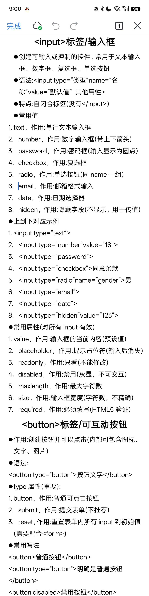

# 用DeepSeek肘出来的类讲解

创建时间: 2026-06-10T11:44:35.725000+00:00
消息数: 7

---

**小魅** (2026-06-25 16:46:58):
感谢宝宝分享哦<:emoji_140:1379454014852436038>

**MEE6** (2026-06-25 16:46:52):
<:CHECK6:403540120181145611> 10,000 XP has been given to **<@!1512394538684125264>**

**周雅（被老婆调教.周浩）** (2026-06-24 17:23:46):
<@1135473222658297907> 奖励经验

**希尔薇** (2026-06-24 11:43:22):
不知，瞎记的，我主要用在跟ai搞状态栏时候，方便调取这些代码进行微调啥的，相当于有一个设计头绪

**LZC** (2026-06-12 03:48:17):
<@1512394538684125264> 大佬，这个有啥用<:emoji_140:1379454014852436038>

**希尔薇** (2026-06-10 13:02:40):
最新进度补全

**希尔薇** (2026-06-10 11:44:35):
此文件是在DeepSeek的基础上进行一个精缩，就是不知道有没有精缩到位就是了，望见谅，顺便附加上两个原长截图

