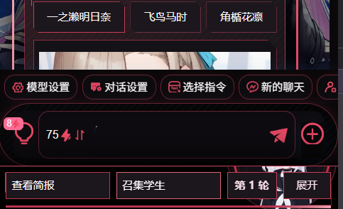
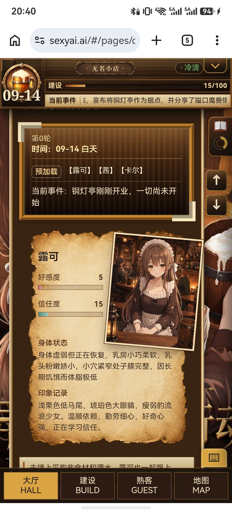
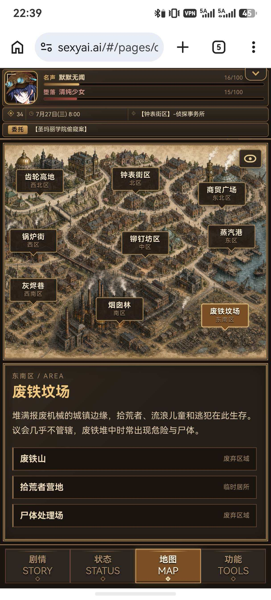
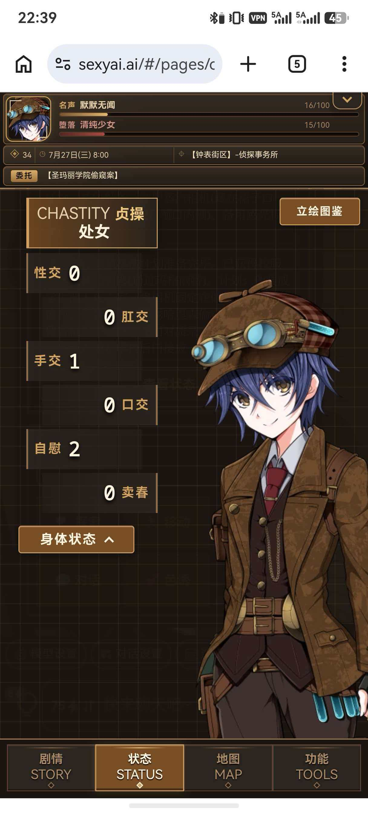
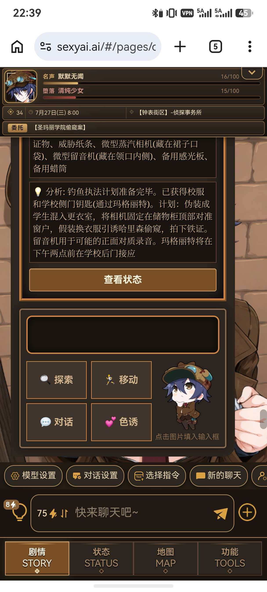

# 界面布局方案：HUD状态栏+功能页面+底部按钮

创建时间: 2026-06-25T10:14:07.820000+00:00
消息数: 18

---

**召唤师** (2026-08-19 03:13:49):
大佬强呀<:07:1298281204260278383>

**鹿初** (2026-07-15 15:29:58):
抄（借）了（鉴）<:emoji_278:1504527822717452368>

**sRay(锐)（MVU框架发布）** (2026-07-15 13:53:41):
重新大致整理了一份，不一定完全，可作为参考

**sRay(锐)（MVU框架发布）** (2026-07-15 11:26:24):

**一只猫** (2026-06-26 03:51:47):
强<:1000168510:1298906820638674984>

**小魅** (2026-06-26 03:41:09):
感谢宝宝开源<:emoji_140:1379454014852436038>

**MEE6** (2026-06-26 03:41:04):
<:CHECK6:403540120181145611> 30,000 XP has been given to **<@!1333081294564888618>**

**周雅（被老婆调教.周浩）** (2026-06-26 02:09:36):
<@1135473222658297907> 奖励经验

**咎染** (2026-06-25 16:52:17):
我去，这么强？

**𝓨𝓞𝓕𝓮𝓷𝓰** (2026-06-25 12:20:32):

**𝓨𝓞𝓕𝓮𝓷𝓰** (2026-06-25 12:20:13):
原来锐锐也用我的skill吗~

**ehst** (2026-06-25 11:26:07):
<:emoji_139:1379455053080825866>

**鹿初** (2026-06-25 11:09:51):
<:1000168528:1298906738761924722>

**GodCount** (2026-06-25 10:57:53):
强强！

**GodCount** (2026-06-25 10:57:50):
<:emoji_251:1490018372723675297>

**不知道起什么好** (2026-06-25 10:16:40):
好强啊

**sRay(锐)（MVU框架发布）** (2026-06-25 10:14:28):
[示例卡](https://www.sexyai.ai/#/pages/role/index?roleId=233774&prePath=0)

**sRay(锐)（MVU框架发布）** (2026-06-25 10:14:07):
设计这套页面布局是想要优化当前常见的“侧边栏按钮+弹窗”的布局。用完整的页面代替局部的弹窗，用底部按钮代替分散的侧边按钮，并添加顶部HUD增强视觉效果。为卡内页面提供软件/游戏般的感觉

整体使用与普通侧边栏基本无异，只是位置上的区别，可以直接使用其他侧边栏代码

给出说明文档及示例，建议结合 <@720989890015264808> 的skill开发页面

顶部HUD可不使用，若要使用，需利用https://discord.com/channels/1205870897769095229/1510217665883541585 进行最新状态的抓取和更新

