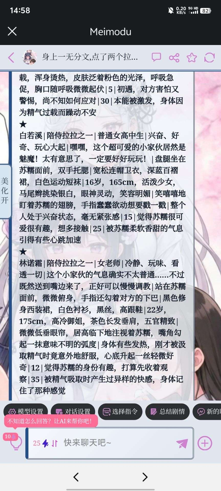

# 研究了好久这个状态栏，总是出现各种问题，有没有简单点的通用的

创建时间: 2026-08-26T08:00:13.898000+00:00
消息数: 5

---

**阿海** (2026-09-01 16:06:58):
满世界的状态栏开源分享。  不过，但是，确实，应该。  每一张卡，都有自己专属的状态栏才合理。
没什么通用之说，但是可以有通用模板，简单修改。

**Lyfe** (2026-09-01 10:32:07):
不发代码，是指望我们掐指一算吗，谁有那个表情包

**tansen(努力成为写卡大手子😡)** (2026-09-01 04:13:26):
<:emoji_249:1416980114511761448>

**tansen(努力成为写卡大手子😡)** (2026-09-01 04:13:24):
你的状态栏生成协议和对应的美化没发出来看不出来解决方案，就目前来看是美化的代码要求的抓取条件和你状态栏生成的格式不匹配，导致抓取替换失败

**remarkable_lynx_84636** (2026-08-26 08:00:13):

