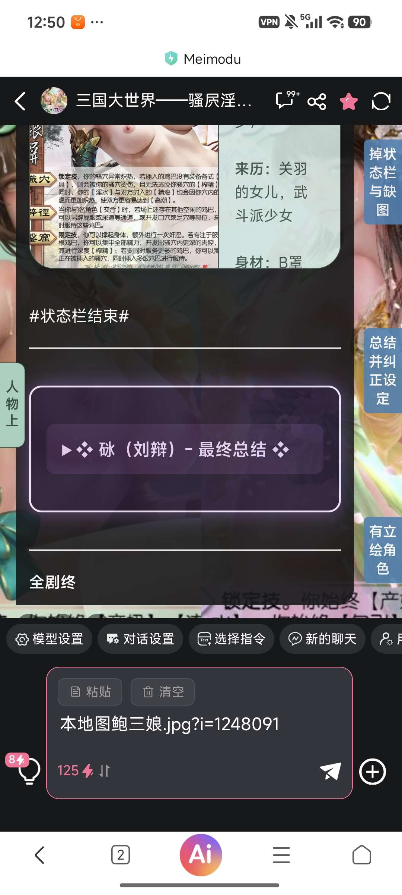
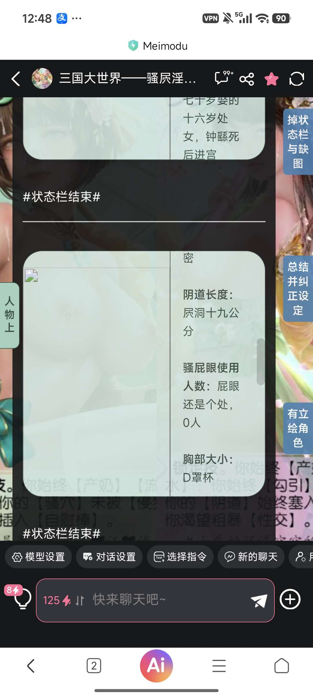

# 简易教学，教会大家用最简陋的方法把对话内的图片进行替换(主要服务于找不到原来图片代码的老卡)

创建时间: 2026-08-14T04:45:55.308000+00:00
消息数: 42

---

**砯** (2026-08-15 23:43:38):
而且一半以上的卡还是这种原始状态，我觉得还能用（）

**砯** (2026-08-15 23:42:55):
是这样，但是对于很多我的读者来说，我要是不说明白把哪个东西换掉，他们确实也不会（）

**orange🍊** (2026-08-14 17:42:24):
不过老卡挺难维护的吧，很多玩家的老档，他瞎改就要全崩了

**orange🍊** (2026-08-14 17:41:59):
只能说一句问心无愧了<:emoji_249:1416980114511761448>

**黑洞猫** (2026-08-14 17:41:02):
后面也发现了确实只是打开编辑模式

**黑洞猫** (2026-08-14 17:40:58):
还纳闷怎么没发文件呢

**黑洞猫** (2026-08-14 17:40:44):
我一开始还以为他用某种代码利用mmd的原生气泡代替了F12...

**orange🍊** (2026-08-14 17:38:07):
他本身就是老卡，不好重改了吧

**黑洞猫** (2026-08-14 17:36:14):
没看懂，这个不就是手动改原文吗...还是要求作者使用的是直出代码的古老状态栏才能用的那种。

**砯** (2026-08-14 05:13:04):
简易教学，教会大家用最简陋的方法把对话内的图片进行替换(主要服务于找不到原来图片代码的老卡)

**砯** (2026-08-14 05:11:17):
一定要找到一连串代码字符之后才能替换哦

**砯** (2026-08-14 05:11:00):
这是修改过程

**砯** (2026-08-14 05:05:17):
谢谢捏

**砯** (2026-08-14 05:04:26):
通过大家的建议和分享找到自己的不足，我觉得是创作者创作的活力源泉之一吧（）

**砯** (2026-08-14 05:03:30):
うれしい(感谢優しい的你)

**砯** (2026-08-14 05:02:52):
简易教学，教会大家如何把对话内的图片进行替换(主要服务于找不到原来图片代码的老卡)

**乱马（参赛卡艾泽尔酒店）** (2026-08-14 05:02:24):
能帮到你，我很高兴啊，你的态度让人感觉很温柔<:emoji_140:1379454014852436038>

**砯** (2026-08-14 05:01:50):
感谢你的新技术捏，如果下次更新能用到的话我也会致谢

**砯** (2026-08-14 05:01:19):
没事没事，不需要叠甲啦，本来就是我当时做的不太好（技术力什么的都不太行）

**乱马（参赛卡艾泽尔酒店）** (2026-08-14 05:00:04):
那确实难搞，是我没有结合实际情况就唐突发言了，对不起。你这样为老卡尽职尽责更新的，确实值得我学习。

**砯** (2026-08-14 04:58:42):
主要是老图我自己也没了（）找不到源代码，就难改了<:emoji_249:1416980114511761448>

**乱马（参赛卡艾泽尔酒店）** (2026-08-14 04:57:25):
从玩家端修改不是说明作者端有纰漏吗🤔 当然我没有针锋相对的意思。

**砯** (2026-08-14 04:56:24):
这个我还是会的

**砯** (2026-08-14 04:56:17):
我都忘了能从作者端自己改了（）

**砯** (2026-08-14 04:55:45):
哦哦，你说的是这个啊（）

**乱马（参赛卡艾泽尔酒店）** (2026-08-14 04:54:41):
试试看

**乱马（参赛卡艾泽尔酒店）** (2026-08-14 04:54:37):
https://discord.com/channels/1205870897769095229/1524425220537057421

**砯** (2026-08-14 04:54:14):
？

**乱马（参赛卡艾泽尔酒店）** (2026-08-14 04:54:05):
完全可以一次性改完

**乱马（参赛卡艾泽尔酒店）** (2026-08-14 04:53:55):
其实蛮简单的，我做出来了

**砯** (2026-08-14 04:53:41):
那就不难，但是不能一次性全部改完，所以还是挺麻烦

**乱马（参赛卡艾泽尔酒店）** (2026-08-14 04:53:40):
我的意思是想要使用有没有配套的工具，就比如把每一张图片对应到具体的文字

**砯** (2026-08-14 04:53:17):
实话实说，如果你稍微有一点代码基础（就是知道代码是啥）

**砯** (2026-08-14 04:52:57):

**乱马（参赛卡艾泽尔酒店）** (2026-08-14 04:52:35):
👀

**乱马（参赛卡艾泽尔酒店）** (2026-08-14 04:52:25):
修改方不方便啊？

**月月鸟（思维枯竭）** (2026-08-14 04:52:12):
爱你

**月月鸟（思维枯竭）** (2026-08-14 04:52:09):
<:emoji_140:1379454014852436038>

**砯** (2026-08-14 04:51:35):
文本框内的是我准备好的改过的图（用了正则替换所以前缀不太一样）

**砯** (2026-08-14 04:50:42):

**砯** (2026-08-14 04:49:21):
大家可以看到，我这个图目前处于损坏状态

**砯** (2026-08-14 04:45:55):
因为本人自己之前用的图床问题，导致对话内图片很多失效，有很多朋友遇到了这个问题，本人深表歉意，也教一下大家如何把图片换成新的想要的
我觉得还算实用，毕竟我的这张示例是第200000左右张卡，在我前面的很多卡可能连正则都没有，那就只能通过这个最简陋的方法进行替换了

