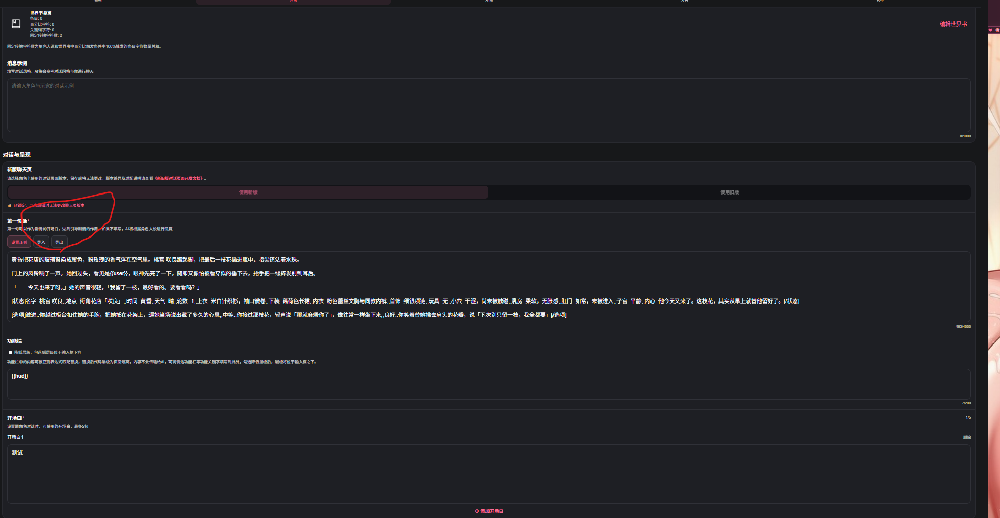

# 纯傻瓜手把手带教全自动美化。无复杂，无脑跟做即可

来源: Discord 魅魔藏经阁 thread 1552321500881883176

创建: 2026-09-23T14:11:26.549000+00:00
消息数: 30

---

**小魅** (2026-09-27 18:28:03):
感谢宝宝分享教程<:emoji_140:1379454014852436038>

**MEE6** (2026-09-27 18:27:28):
<:CHECK6:403540120181145611> 5,000 XP has been given to **<@!1270200684679270521>**

**鹤南飞(接定制看简介)** (2026-09-27 11:30:37):
这个已经是属于找来就能用了。没啥技术含量，我第一次想到这个思路，从学会到实践只用了五分钟<:1000168531:1298906724979310634>

**鹤南飞(接定制看简介)** (2026-09-27 11:09:45):
Agent都可以，通用的

**燚（被秋姐变性版）** (2026-09-27 11:09:20):
<@1270200684679270521> 这种可以艾特小魅要经验，技术贴

**燚（被秋姐变性版）** (2026-09-27 11:08:49):
<@1135473222658297907>

**极境** (2026-09-27 10:48:46):
你好，这个skill可以在DSH或者是codex上使用吗

**tansen(努力成为写卡大手子😡)** (2026-09-27 10:06:32):
稀饭你<:emoji_249:1416980114511761448>

**战栗的黑羊** (2026-09-27 06:09:52):
可以的。可能是这种纯技术向帖子本身学习门槛就比较高吧，大伙都偏向于找那种拿来就能用的<:emoji_139:1379455053080825866>

**鹤南飞(接定制看简介)** (2026-09-27 01:50:47):
你能看见我发的图片和文件吗，不知道为啥这条帖子很少人

**战栗的黑羊** (2026-09-23 14:51:03):
<:emoji_140:1379454014852436038> 感谢大佬教学

**鹤南飞(接定制看简介)** (2026-09-23 14:21:40):
步骤六，保存编辑，重置角色卡即可看到美化渲染图

**鹤南飞(接定制看简介)** (2026-09-23 14:20:56):

**鹤南飞(接定制看简介)** (2026-09-23 14:20:11):
json文件

**鹤南飞(接定制看简介)** (2026-09-23 14:20:01):

**鹤南飞(接定制看简介)** (2026-09-23 14:19:52):
步骤五，将ai输出的文件导入到正则即可

**鹤南飞(接定制看简介)** (2026-09-23 14:18:53):

**鹤南飞(接定制看简介)** (2026-09-23 14:18:06):
步骤四：将需求发送给ai

**鹤南飞(接定制看简介)** (2026-09-23 14:17:44):
步骤同前

**鹤南飞(接定制看简介)** (2026-09-23 14:17:34):

**鹤南飞(接定制看简介)** (2026-09-23 14:16:43):
https://skillhub.cn/skills/user_c6f1a0f0/114514
[前端美化 - SkillHub](https://skillhub.cn/skills/user_c6f1a0f0/114514)
Create distinctive, production-grade frontend interfaces with high design quality. Use this skill when the user asks to build web components, pages, artifacts, posters, or applications (examples include websites, landing pages, dashboards, React components, HTML/CSS layouts, or when styling/beautifying any web UI). Generates creative, polished c...

**鹤南飞(接定制看简介)** (2026-09-23 14:16:18):

**鹤南飞(接定制看简介)** (2026-09-23 14:15:46):

**鹤南飞(接定制看简介)** (2026-09-23 14:15:41):
步骤三，导入skill技能文件

**鹤南飞(接定制看简介)** (2026-09-23 14:14:33):

**鹤南飞(接定制看简介)** (2026-09-23 14:14:06):
步骤2，下载mmd官方写卡skill

**鹤南飞(接定制看简介)** (2026-09-23 14:13:48):
https://www.workbuddy.ai/
[WorkBuddy - AI Agent for Everyday Office Work](https://www.workbuddy.ai/)
Tencent WorkBuddy is an AI Agent built for office professionals. Powered by multi-agent collaboration, it autonomously breaks down complex tasks and delivers finished, verifiable outputs — reports, decks, spreadsheets, and more.

**鹤南飞(接定制看简介)** (2026-09-23 14:13:19):
步骤一，下载workbuddy

**档案管理员** (2026-09-23 14:11:27):
[本帖尚未声明授权]()
发帖人尚未完成授权设置，或已选择跳过。本状态不代表允许转载、二次创作、商业使用或重新分发。

**鹤南飞(接定制看简介)** (2026-09-23 14:11:26):
1使用工具workbuddy，百度搜即可
2使用文件，mmd-skill。在编辑角色界面的新旧对话开发文档。选择新版，在页面最上方选择下载写卡skill。
前端美化skill——在skillhub（在Bing搜索引擎搜索即可）中的技能，搜索栏搜索前端美化，第一个就是，复制提示词发给ai安装
3 选择skill技能，输入需求，等待ai输出结果。回到mmd编辑页面，导入json文件

