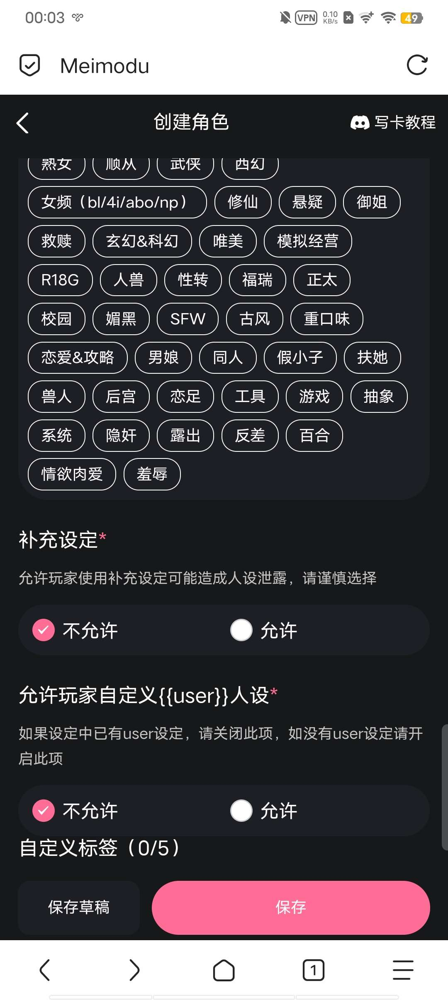

# 给新人们留点资产吧，之前开源我保留了大部分，也不管这么多了，直接就发出来了，我过几天整理一下新人做卡全攻略，给后人们留点财产。尽最后一份力了。

创建时间: 2026-09-03T15:37:09.011000+00:00
消息数: 7

---

**Licon** (2026-09-05 15:13:40):
能加个好友吗大大

**Licon** (2026-09-04 17:18:27):
大大我能和您私聊一下吗，刚开始想学着写卡

**哥（一条区）** (2026-09-04 15:28:53):
从第一张图开始∶
右上角画红圈的是创建角色卡。
第二张图∶
你不要管那个V2角色卡是什么，管下面的图片就行了，支持GIF动图，不过那里面没写。反正插入一张图就行了，要注意图片大小。
第三张图∶
大家这个应该是不要我讲了，简单讲一下人设，人设要有世界观，世界观就是写一下你写的主要世界是什么样的，后面会弄一些开源出来参考一下，然后人设写了世界观还要写人物，你可以简单介绍一下，然后写他的性格，外貌，背景和行为逻辑，字数建议超过3000字及以上。还有一些特殊的比如模拟器什么的，新手不太建议尝试，毕竟要写世界书，整体工作量大。
第四五六张图∶
这三张是重点！你见到其他的卡的界面很漂亮或者有侧边栏，这些都是正则，在第一句话里可以导入正则，目前只有json文件可以，第四张图的世界书我不多讲了，可以看屿佬的帖子，去搜世界书就出来了，第五张图就是把代码导入了，可以找ai帮你，可以用洛璃宝宝的skill，很厉害，正则名称比如状态栏，侧边栏，什么什么的，然后查找正则表达式，就是像用【】或者<>包裹的文字，比如【状态栏】，也有一些不是这种，作者会特别标明正则表达式。替换式就是代码了。如果把一个开源json文件分为以上三种，那么最长的那段就是替换式，我也不知道这么说对不对，因为还是怕有些人看不懂，但是替换式确实是最长的，讲完这个，第一句话就是顾名思义了，这个不多说了，然后呢就是第六张图，功能栏里面一般放例入【状态栏】【侧边栏】，这种，得和你的正则表达式一致，消息示例的话，这个不怎么用，模拟器的话可以用来当状态栏格式。这里提一嘴，状态栏格式和生成协议你要弄到世界书里面。这两东西基本上都有的。
第七，八，九张∶
第七张的开场白就是在第一句话下面的字，可以点击进入输入栏，然后就是标签了，这个我也不多说，是个人应该知道自己写的卡是什么类型的吧，第八张的补充设定看玩家需求再开或者直接开，反正随你，第九张标签也可以不用多加，如果要素多可以加，下面两个我不多说，应该是会自己选的。还有那个第九张图片的公开和私密我讲一下，你要是卡没写完，不小心保存公开了，可以重新设置为私密，卡的右上角有三个点，可以设置卡的状态，点到公开了，你就点进卡，右下角有个加号，你点击后会有一个设定补充，再从这里进去私密。

再顺便讲一下更新，你公开后仍然可以改卡，可以做的更好，如果你加了新东西，左上角会有一个更新，啥也不用管，等过审就行了。
唉，考虑各方面因素，在帖子里面我就不放其他作者开源了，我就放自己的开源吧，至于之前的藏经阁开源可以私信找我要，因为之前的圣战的事，我也觉得发别人开源不好，种种因素之下我决定还是不发文件了，避免麻烦，想要的新人宝宝可以找我要，老东西们就别装新手了
不知道以后mmd会怎么样了，希望以后有更多的新人作者进来。

2026.09.03至09.04

**哥（一条区）** (2026-09-03 16:07:41):

**哥（一条区）** (2026-09-03 16:00:24):
首先新手写完肯定是不知道怎么写的，之前将军有视频但是正则部分不详细，我做了一些补充，但是由于之前发生的事情，我也删帖了，导致视频和讲解全没了😔，不过没事，我保留了，但是我这台手机上没有文件😭，有文件手机下周4才修好，只能先这样了，先讲一下正则吧。

**档案管理员** (2026-09-03 15:37:09):
[本帖尚未声明授权]()
发帖人尚未完成授权设置，或已选择跳过。本状态不代表允许转载、二次创作、商业使用或重新分发。

**哥（一条区）** (2026-09-03 15:37:09):
我会编辑很久，大概几天吧，在楼里面慢慢塞开源，其中包括之前走了的开源也有一些我自己肘出来的开源，ai工具推荐洛璃的skill∶
> 查看仓库说明和完整目录，将tavern-mmd skill更新到这个分支的新版本：https://github.com/yofengi/tavern-mmd/tree/feat/mmd-sandbox-sbk-3.0

下面的我就先一步一步塞开源，藏经阁现在开源实在是少了太多了，苦了新人了，战争的影响太大了，我也不希望mmd就这么死了。我就把以前的弄过来吧。编辑期间请不要发言，谢谢，编辑完后我也准备走了，在我不断成长的路上感谢周佬的帮助，也怀念周佬。
[GitHub - yofengi/tavern-mmd at feat/mmd-sandbox-sbk-3.0](https://github.com/yofengi/tavern-mmd/tree/feat/mmd-sandbox-sbk-3.0)
Claude Code skill: create SillyTavern & MMD (sexyai.top) character cards, worldbooks, status bars and global CSS themes - yofengi/tavern-mmd

