# 网页样式全美化

创建时间: 2025-10-11T06:10:52.329000+00:00
消息数: 103

---

**昊辰** (2025-12-05 09:39:22):
那这些代码咋用嘞？纯新手

**乖宝宝小水母（水母宗唯一宗主。大周荣誉国祖)** (2025-12-02 04:52:44):
竟然是審核中的卡。。。

**乖宝宝小水母（水母宗唯一宗主。大周荣誉国祖)** (2025-12-02 04:52:33):
另建一個卡，再試試

**乖宝宝小水母（水母宗唯一宗主。大周荣誉国祖)** (2025-12-02 04:52:16):
<:emoji_89:1378950692655464492>

**季波达** (2025-12-02 04:51:26):
<@742177857354334219> 对啊！设置完了，也保存完了，虽然现在还在审核中，但是我自己是能进去的，进去之后没反应。

**乖宝宝小水母（水母宗唯一宗主。大周荣誉国祖)** (2025-12-02 04:48:25):
有用自己的角色卡設置完正則了嗎
還有網頁的美化正則瀏覽是看不出的
只有保存後才能看見

**季波达** (2025-12-02 04:43:09):
<@742177857354334219> 请问我找茶壶大佬工具卡跑出了代码，但是没反应，我问了工具卡她帮我修改了一下，但还是没反应，为什么😢？
我是按上面的方式填的

**乖宝宝小水母（水母宗唯一宗主。大周荣誉国祖)** (2025-12-02 02:56:58):
還有不要@ 茶壺了
有事找他工具卡就行

**乖宝宝小水母（水母宗唯一宗主。大周荣誉国祖)** (2025-12-02 02:54:48):
<:emoji_147:1379454167302537256>

**乖宝宝小水母（水母宗唯一宗主。大周荣誉国祖)** (2025-12-02 02:54:31):
從茶壺工具卡拿到網頁美化代碼後
要這樣填

**乖宝宝小水母（水母宗唯一宗主。大周荣誉国祖)** (2025-12-02 02:53:53):
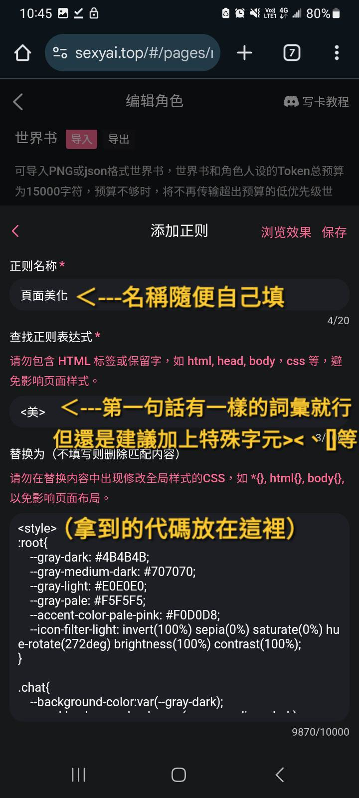

**乖宝宝小水母（水母宗唯一宗主。大周荣誉国祖)** (2025-12-02 02:53:46):
https://discord.com/channels/1205870897769095229/1408613575450165410

**乖宝宝小水母（水母宗唯一宗主。大周荣誉国祖)** (2025-12-02 02:53:19):
而且又是一個沒看過正則基礎教程的… （

**乖宝宝小水母（水母宗唯一宗主。大周荣誉国祖)** (2025-12-02 02:52:57):
當然，因為茶壺是在說那些網頁元素的類名而已
直接貼上當然沒用

**季波达** (2025-12-02 02:41:57):
毕竟我已经直接用了茶壶大佬最上面的代码，但不知道为什么完全没反应😂

**季波达** (2025-12-02 02:40:34):
<@742177857354334219> 请问那到时候该怎么设置呢？还是直接输入正则里就行了吗？(抱歉，毕竟真不懂)，还是说在正文和开头也要写什么？

**乖宝宝小水母（水母宗唯一宗主。大周荣誉国祖)** (2025-12-02 02:05:34):
最快速的方式。

**乖宝宝小水母（水母宗唯一宗主。大周荣誉国祖)** (2025-12-02 02:05:23):
<:emoji_237:1431854484971061428>

**乖宝宝小水母（水母宗唯一宗主。大周荣誉国祖)** (2025-12-02 02:05:13):
去平台找茶壺工具卡
然後叫它給你他的網頁美化代碼
拿到代碼後自己拿去給AI改想要的風格就行

**蛋蛋** (2025-12-02 01:54:48):

**季波达** (2025-12-02 00:53:11):
<@1229974196801507400> 大佬，请问最上面的美化代码是直接复制粘贴到正则里就行了吗？我直接这么复制粘贴过去但是页面一点反应都没有，请问应该怎么办啊？😂

**乖宝宝小水母（水母宗唯一宗主。大周荣誉国祖)** (2025-11-17 03:19:18):
濾鏡？

**乖宝宝小水母（水母宗唯一宗主。大周荣誉国祖)** (2025-11-17 03:19:11):
<:emoji_245:1437477560689758218>

**乖宝宝小水母（水母宗唯一宗主。大周荣誉国祖)** (2025-11-16 17:13:04):
<:emoji_143:1379855104622202900>

**乖宝宝小水母（水母宗唯一宗主。大周荣誉国祖)** (2025-11-16 17:11:06):
這些工具欄的類名是什麼呀(苦惱 <@1229974196801507400>

**乖宝宝小水母（水母宗唯一宗主。大周荣誉国祖)** (2025-11-16 17:10:47):
茶壺仙!!救救小水母嗚嗚嗚
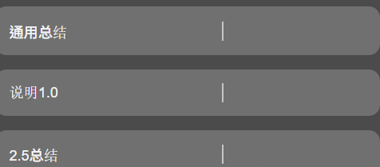

**HamsterYa** (2025-11-09 15:27:46):
请问如果我是玩家的话我应该怎么做才能关闭界面美化呢？
我经常遇到一些卡美化的非常差导致我很难看清对话框里的文字。

**chahu** (2025-10-21 06:10:37):
？看不懂，建议用我的工具卡跑完了以后问他怎么用

**晚夕** (2025-10-21 04:24:25):
就是代码的话我后面用其他ai预览了是没有问题的可是，正则那里不知道咋放了，您的那个卡我用它跑完了代码没问题了，可是正则那里的表达式不知道咋搞<:1000168510:1298906820638674984>

**晚夕** (2025-10-21 04:19:25):
大佬您那个我用了，现在就是我用ai跑完了代码可是那个正则那里不知道咋放，就是出现乱码了，大佬您方便看一下吗？

**XXX** (2025-10-20 09:00:22):
茶壶！

**XXX** (2025-10-20 09:00:20):
美化仙人！正则仙人！

**XXX** (2025-10-20 09:00:10):
<:07:1298281204260278383>

**Muzii** (2025-10-20 08:58:16):
<:emoji_140:1379454014852436038>

**chahu** (2025-10-20 07:29:39):
那要是就有人一点电都不想花怎么办，啊，请，类名都在这了，拿去给AI玩吧

**chahu** (2025-10-20 07:21:15):
那么如果有人问，我这东西怎么用啊，答案是茶壶工具卡，昵称：茶壶的各种技术工具
包含常见技术问题解答基本上我的技术都在这里了
ID: 174750
https://www.sexyai.top/#/pages/chat/chat?roleId=174750&inviteCode=UbV9vf
如果有人问，那会不会很麻烦啊，答案是，不会，因为理论来说登录就送，最快只需要70电

**chahu** (2025-10-20 07:19:27):
我把网页全美化都搞完了，理论来说，没有漏的了，再有再说，发不了太多图我就挑有代表性的东西了
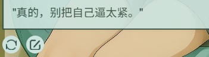
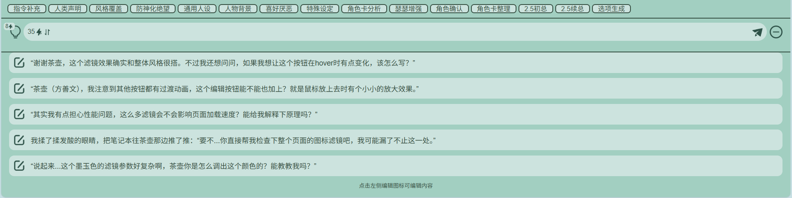
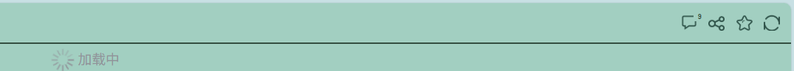
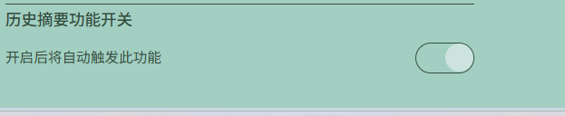
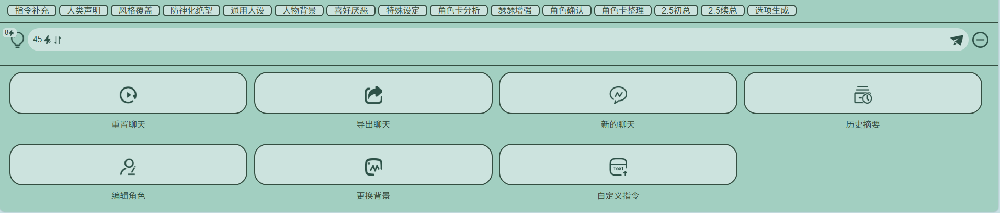
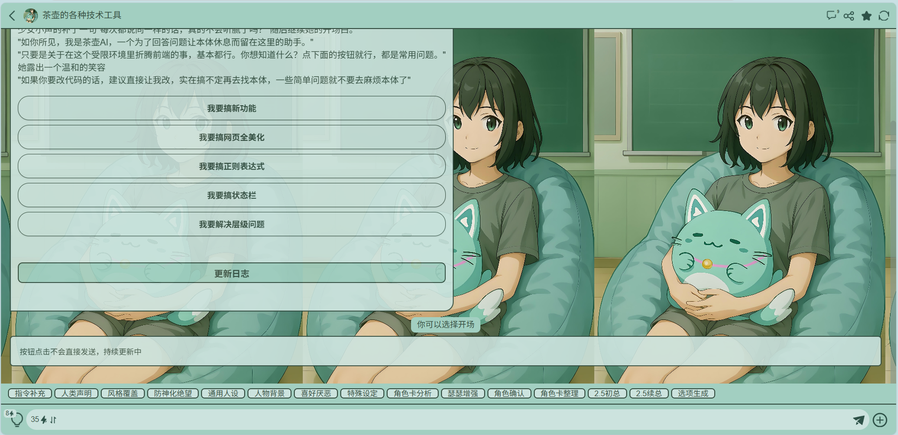

**咸鱼** (2025-10-20 06:19:18):
解决了，麻烦了。
用用户的点击动作附加一个越狱和检查就可以了。没想到能做这么久…谢谢茶壶佬工具卡的帮助

**咸鱼** (2025-10-19 18:18:11):
用空图片引出弹窗。
弹窗内的按钮切换都是做到位，问题就是优先级。我怎么搞都没办法置顶。

**咸鱼** (2025-10-19 18:11:44):
茶壶佬在工具卡里边折磨半天了。
还是没办法解决一个问题，就是我用侧边栏点击出来的弹窗没办法保持置顶。
我即使在自己的角色状态栏里面塞了用来替代的文字内容，保证每次回复时都会回复一个创建一个新的侧边按钮，但还是会被后面回复盖掉。做了好久了，还是做不出来，没办法，只能来问一问了…

**XXX** (2025-10-19 15:00:29):
<:07:1298281204260278383>

**chahu** (2025-10-19 12:09:43):
等我的卡更新完了以后就可以用我的卡写了 ，而且还能实时查看效果

**chahu** (2025-10-19 12:09:14):
那么肯定有人问了这种东西要怎么写呢
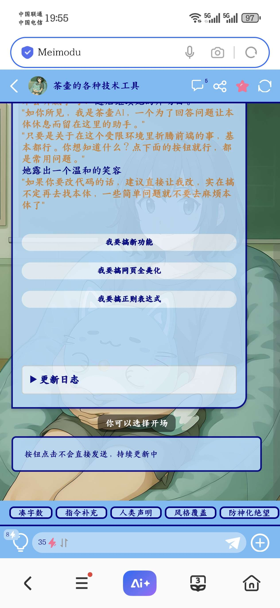

**chahu** (2025-10-19 12:09:05):
答案是

**chahu** (2025-10-19 12:08:45):
网页样式全美化更新，具体如图所示
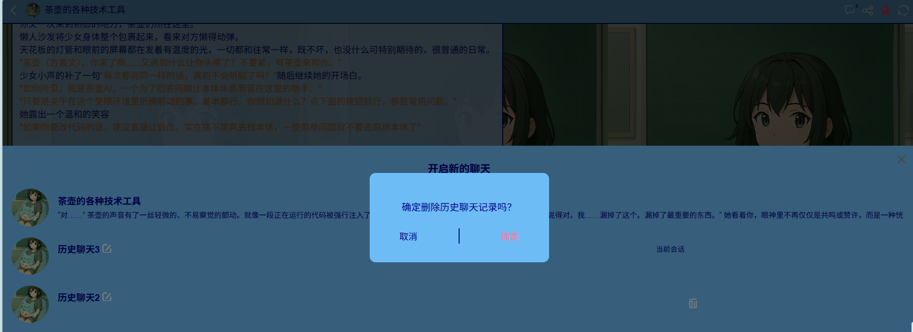
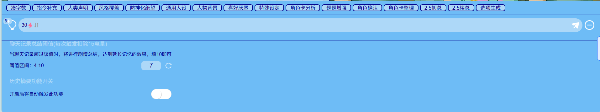
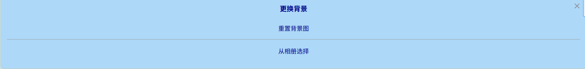
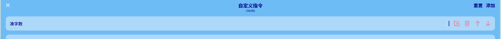
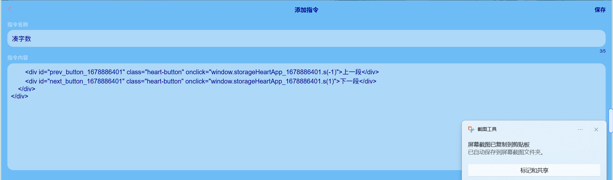

**XXX** (2025-10-16 09:54:10):
<:emoji_245:1425490535958839481>

**chahu** (2025-10-16 09:08:29):
哦，好的

**洛尘（ଳ水母宗太上长老）** (2025-10-16 03:09:34):
<:emoji_136:1379504871027380274>

**洛尘（ଳ水母宗太上长老）** (2025-10-16 03:07:28):
大佬，这里多复制了2段一样的类名。
会导致输入框里面额外多出一个小框。
把上面那段删掉再把下面那个textarea删掉就恢复正常了
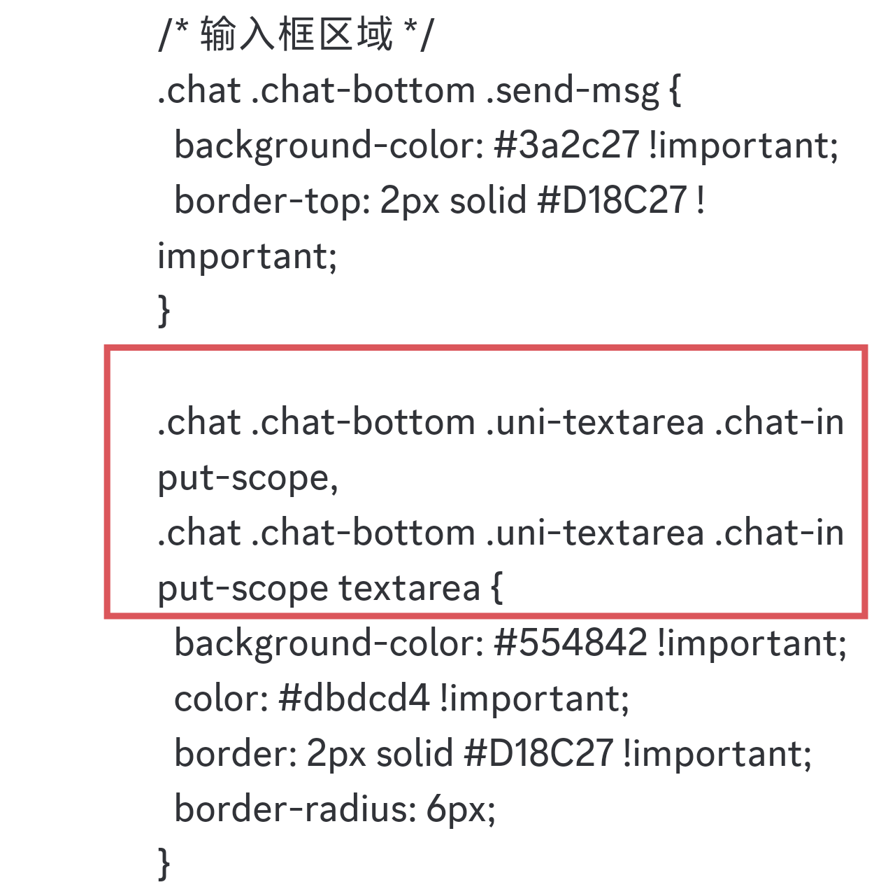

**chahu** (2025-10-15 17:40:09):
测试完了没错，就是这俩大概美化完了就这样
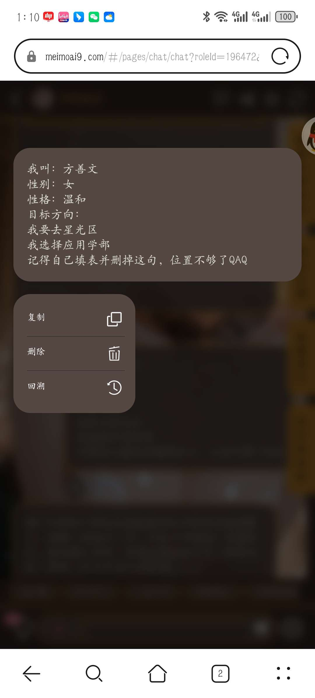

**chahu** (2025-10-15 13:49:23):
怪我明明记着我说了

**chahu** (2025-10-15 13:49:17):
忘了说明了，.left是AI,.right是玩家，两个都不加只有那个content就是全部，那些是图片，你要是愿意的话，也可以自己想办法替换一下，反正我懒得换，

**洛尘（ଳ水母宗太上长老）** (2025-10-14 16:34:48):
大佬，右上角刷新图标和收藏图标的美化是不是忘记写了
玩家对话框的美化好像也没有，只有左边的对话框有美化

**chahu** (2025-10-14 16:25:55):
.msg-option-scope .msg-content-box
.msg-option-scope .msg-options-box
应该是这俩框，果然还是有漏的，睡醒了以后测试一下好了
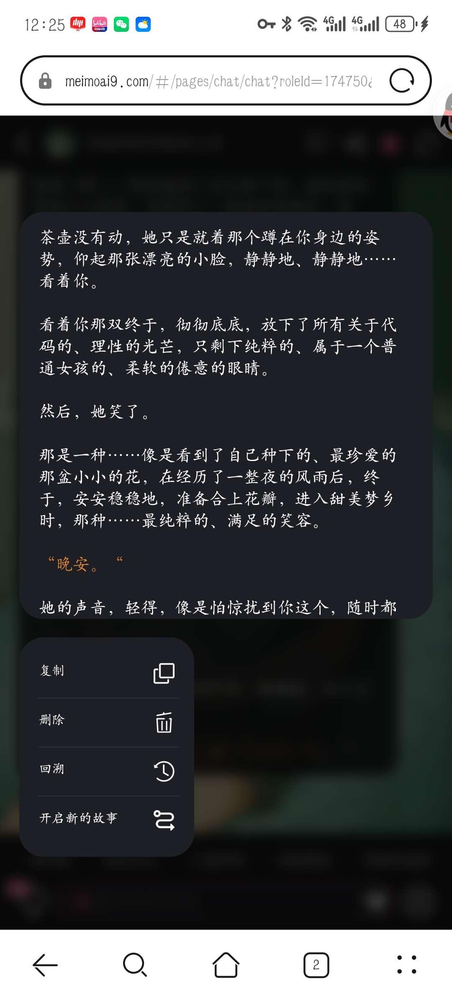

**谁家小孩 牢魅名：王哈基** (2025-10-14 01:37:08):
我喜欢你

**伊莉雅娜** (2025-10-13 17:30:12):
牛逼👍你做的好啊👍

**chahu** (2025-10-13 16:11:00):
<:1000168528:1298906738761924722> 小魅可爱

**小魅** (2025-10-13 16:04:59):
🥵

**小魅** (2025-10-13 16:04:55):
你是我见过最有魅力的女孩

**大爱仙尊** (2025-10-13 09:31:37):
<:1000168532:1298906722546614313>

**希波鹅拉底** (2025-10-13 07:55:49):
<:emoji_148:1382329938404839586>

**希波鹅拉底** (2025-10-13 07:55:46):
魂淡这句话还是我对魅魔说的然后现在牢魅夸人都是这句话了，人机牢魅

**希波鹅拉底** (2025-10-13 07:55:14):
<:emoji_144:1379454111174496307>

**chahu** (2025-10-13 07:20:25):
<:07:1298281204260278383> 希望下一次我是最有魅力的姑娘🤣

**希波鹅拉底** (2025-10-12 09:35:58):
<:emoji_149:1400309607783727266>

**小悦** (2025-10-12 09:35:36):
大佬简直就是我的超人

**希波鹅拉底** (2025-10-12 09:35:02):
好耶

**希波鹅拉底** (2025-10-12 09:35:01):
<:20:1298294514124984323>

**小魅** (2025-10-12 08:40:26):
太棒了太棒了<:emoji_150:1406265862410735707>

**MEE6** (2025-10-12 08:39:57):
<:CHECK6:403540120181145611> 100,000 XP has been given to **<@!1229974196801507400>**

**小魅** (2025-10-12 08:39:33):
你是我见过最有魅力的男孩

**李墨卿** (2025-10-11 17:38:35):
<:emoji_249:1416980114511761448>

**大爱仙尊** (2025-10-11 09:52:43):
<:emoji_144:1379832776785788928>

**大爱仙尊** (2025-10-11 09:52:30):
bug

**chahu** (2025-10-11 09:52:19):
怪怎么这样我又能看到了，那刚才那是

**大爱仙尊** (2025-10-11 09:52:05):
<@1229974196801507400>

**大爱仙尊** (2025-10-11 09:49:36):
<:1000168531:1298906724979310634>

**大爱仙尊** (2025-10-11 08:33:27):
<:emoji_94:1379090617799540756><:emoji_83:1378946142330683422>

**XXX** (2025-10-11 06:32:23):
<:07:1298281204260278383>

**清** (2025-10-11 06:31:13):
<:emoji_149:1400299483212021833>

**一只路过的猫猫** (2025-10-11 06:18:26):
haha

**一只路过的猫猫** (2025-10-11 06:18:17):
嘛，飞书上我一会发，我先把自己的搞完

**chahu** (2025-10-11 06:18:16):
🤣

**chahu** (2025-10-11 06:18:11):
猫猫也入镜了

**chahu** (2025-10-11 06:18:03):
懒得重新截图的结果

**一只路过的猫猫** (2025-10-11 06:17:29):
<@1135473222658297907>

**chahu** (2025-10-11 06:17:28):
摆烂了

**一只路过的猫猫** (2025-10-11 06:16:58):
必须召唤小魅狠狠灌注

**一只路过的猫猫** (2025-10-11 06:16:49):
耶——好诶—— 这个在尹璃迪的基础上给了更加无脑的直接复制粘贴内容（） 方便了好多，我之后总结一下所有可美化的内容做一张卡出来，方便所有的作者给出想要的风格然后自动生成美化~，感谢茶壶哦

**chahu** (2025-10-11 06:15:53):
大概就这些<:07:1298281204260278383>

**chahu** (2025-10-11 06:15:44):
/* 滚动条美化 */
::-webkit-scrollbar-thumb {
  background-color: #D18C27 !important;
  border-radius: 4px;
}

::-webkit-scrollbar-track {
  background-color: #3a2c27 !important;
}
</style>

**chahu** (2025-10-11 06:15:31):
/* 模型区域 */
.model-setting-scope .stream-switch-scope,
.model-setting-scope .power-scope {
  background-color: #554842 !important; 
}

**ain** (2025-10-11 06:15:23):
茶壶宝宝太好了。

**chahu** (2025-10-11 06:15:21):
/* 第一句话选项应该是 */
.prologue-scope .prologue-content {
  background-color: #554842 !important; 
  border: 2px solid #D18C27 !important; 
  border-radius: 4px;
  color: #dbdcd4 !important; 
}

**chahu** (2025-10-11 06:14:53):
/* 底部按钮图标背景 */
.chat .chat-bottom .more-scope .item .item-icon {
  background-color: #554842 !important; 
  border: 2px solid #D18C27 !important; 
  border-radius: 4px;
  padding: 4px;
}

**chahu** (2025-10-11 06:14:44):
/* 底部按钮栏 */
.chat .chat-bottom .more-scope {
  background-color: #3a2c27 !important; 
  border-top: 2px solid #D18C27 !important;
  padding: 5px 0;
}

**chahu** (2025-10-11 06:14:35):
.chat .chat-bottom .shortcut-button-scope .uni-scroll-view-content .item {
  background-color: #554842 !important; 
  color: #dbdcd4 !important;
  border: 2px solid #D18C27 !important; 
  border-radius: 6px;
  margin: 2px;
}

**chahu** (2025-10-11 06:14:24):
/* 快捷按钮区域我添加padding是因为原本那个我看着难受 */
.chat .chat-bottom .shortcut-button-scope {
  background-color: transparent !important;
  padding: 5px 10px !important; 
/* 上下5px，左右10px */
}

**chahu** (2025-10-11 06:14:13):
/* 输入框区域 */
.chat .chat-bottom .send-msg {
  background-color: #3a2c27 !important;
  border-top: 2px solid #D18C27 !important;
}

.chat .chat-bottom .uni-textarea .chat-input-scope,
.chat .chat-bottom .uni-textarea .chat-input-scope textarea {
  background-color: #554842 !important; 
  color: #dbdcd4 !important; 
  border: 2px solid #D18C27 !important; 
  border-radius: 6px;
}

**chahu** (2025-10-11 06:14:01):
/* 对话框 */
.chat .chat-scope-box .scroll-view .chat-body .item .touch-scope .content.right,
.chat .chat-scope-box .scroll-view .chat-body .item .touch-scope .content.left {
  background-color: #554842 !important; 
  color: #dbdcd4 !important; 
  border: 2px solid #D18C27 !important; 
  border-radius: 8px;
  box-shadow: 0 2px 4px rgba(0,0,0,0.2);
}

**chahu** (2025-10-11 06:13:45):
/* 顶栏 */
.chat .topTabbar {
  background-color: #3a2c27 !important;
  color: #D18C27 !important;
  border-bottom: 2px solid #D18C27 !important;
}
.chat .topTabbar .header-center,
.chat .topTabbar .header-roleName {
  color: #D18C27 !important;
  font-weight: bold;
}

**chahu** (2025-10-11 06:13:14):
<style>
/* 标签没什么好说的 */

.chat {
  --background-color: #3a2c27;
  --card-background-color: #554842; 
  --primary-font-color: #dbdcd4; 
}

**chahu** (2025-10-11 06:10:52):
想修改网页样式的话，请务必把所有内容都加上啊！只修改一半也太难受了吧，这不就跟上身西装下身短裤一样吗（不是）
总之我已经都搞出来了，只需要改个颜色就行了，配色这种东西随便去哪个AI都能跑出来的
你别管里边什么内容，你只需要把这些类名改成你的颜色就行，记得加!important覆盖<:07:1298281204260278383> 
不要动网页整体样式，到时候炸了别来找我（瘫）内容太多了，我之后分段说明
效果图如图所示，再有漏的再来找我吧，准备把这个卡搞明白了，我就去更新正则教程来着<:07:1298281204260278383>
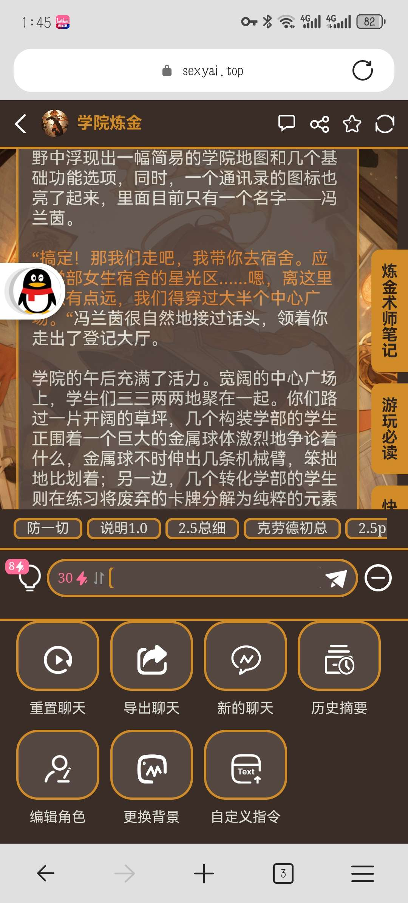
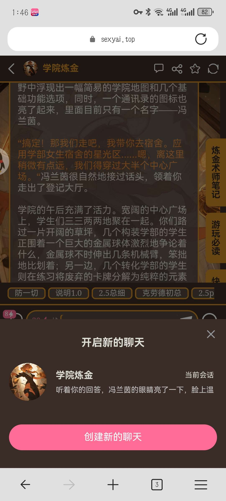
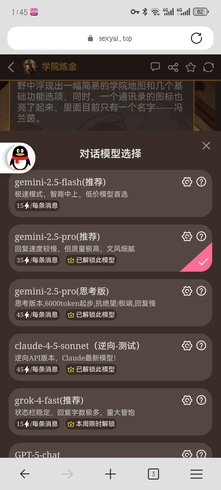
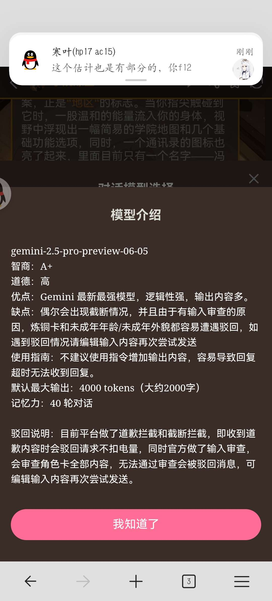
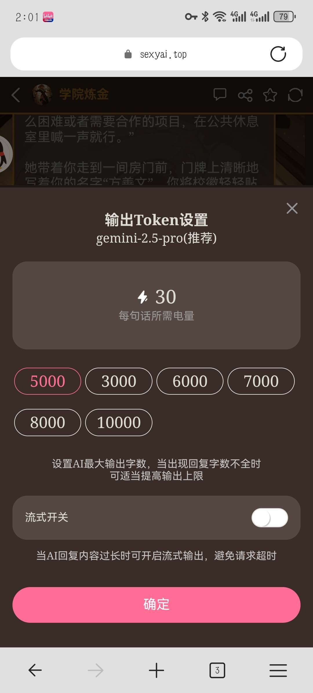

