# 自制魅魔app

来源: Discord 魅魔藏经阁 thread 1469819526693523519
创建: 2026-02-07T22:18:03.090000+00:00
消息数: 268

---

**dhuriwgwhk** (2026-10-05 09:23:24):
我在魅魔网站上没找到app下载，还以为是我的问题，进来这边才发现，原来大伙都在用自制app<:emoji_252:1476549537547161662>

**野生客** (2026-10-02 20:11:55):
左上角不是有刷新这个字儿吗？

**sspcwsc** (2026-09-27 06:05:58):
您好有个问题，如果想刷新当前界面用什么方法。

**野生客** (2026-09-16 20:56:30):
我这边ok的

**野生客** (2026-09-16 20:56:27):
啥手机

**让铃仙日因幡帝🐇** (2026-09-16 20:47:27):
改变字体和缩放后再关闭不起效，必须清完后台重新进才能恢复

**野生客** (2026-09-16 17:08:04):
点击图片下放的下载链接就可以了，可以直接下载

**野生客** (2026-09-15 06:41:19):
是bug，要修复一下，之前拦截文件下载，把图片下载的也动了

**野生客** (2026-09-15 06:35:13):
可以保存的

**早饭吃什么？** (2026-09-15 05:33:04):
还得再用浏览器下载一遍

**早饭吃什么？** (2026-09-15 05:32:45):
AI图片没办法保存啊

**早饭吃什么？** (2026-09-15 05:32:30):
APP能不能新增一点功能

**天铭** (2026-09-14 07:09:39):
或者说忘记改了

**天铭** (2026-09-14 07:09:29):
这个是纯粹没改<:emoji_249:1416980114511761448>

**小白** (2026-09-13 18:50:10):
为什么看更新公告是1.3.0，卸载安装的确是1.0.8

**玄翼之箭 落辉** (2026-09-13 06:50:01):
ok

**让铃仙日因幡帝🐇** (2026-09-12 21:58:23):
输入谷歌邮箱发验证码登录一样的

**玄翼之箭 落辉** (2026-09-12 19:26:26):
账号好像是谷歌登录的 没法用app吗

**野生客** (2026-09-11 23:48:35):
自制签证就可以安装，有ios版本的，不过不是最新版

**让铃仙日因幡帝🐇** (2026-09-11 21:39:43):
暂时没有，在搞签证比较麻烦

**Blessing** (2026-09-11 18:15:42):
大佬，ios可以安裝吗?

**让铃仙日因幡帝🐇** (2026-09-09 21:12:32):
换梯子节点，再清后台重新进，或者设置里清缓存重启

**0.5** (2026-09-09 19:25:38):
超时是什么意思呀？

**让铃仙日因幡帝🐇** (2026-09-04 12:42:24):
ip被拦截了，换梯子节点

**神** (2026-09-04 11:55:03):
为什么我的APP会这样？
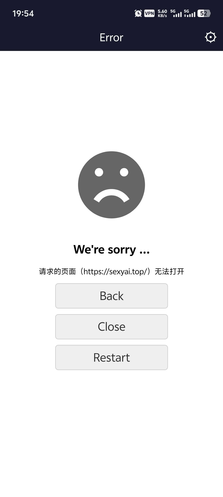

**天铭** (2026-09-02 07:13:43):
这个……难评😂

**野生客** (2026-09-02 06:21:02):
估计是在公共场合玩的

**野生客** (2026-09-02 06:20:53):
之前有人说，这样不利于隐藏<:emoji_249:1416980114511761448>

**天铭** (2026-09-01 11:51:05):
果然还是习惯一直退到直到页面判定主页再退出app好一些<:emoji_150:1400299501423431771>

**天铭** (2026-09-01 11:50:10):
不知道，可能前几版的习惯了，但这种响应判定，确实太短了<:1000168531:1298906724979310634>

**野生客** (2026-09-01 08:27:05):
我也有点搞不懂。返回逻辑这么不喜欢的？

**羽👿** (2026-08-19 13:07:50):
加你吗？

**周雅（被老婆调教.周浩）** (2026-08-19 13:01:47):
扣电了吗？私聊我吧，这里毕竟是APP下载帖子

**羽👿** (2026-08-19 12:48:07):
你好，你好，在吗兄弟？我刚刚发了一个消息，AI直在生成当中，一直生成不出来，有什么办法吗？

**羽👿** (2026-08-18 06:33:21):
<@1027244842629202020> 行，谢谢

**周雅（被老婆调教.周浩）** (2026-08-18 06:32:03):
等几分钟右上角同步

**羽👿** (2026-08-18 06:12:09):
对了，我刚刚玩的时候，就是我输入信息，AI回了，但是还是把我的消息给退出来，然后我退到主页面，再点进去，刚刚AI发的消息又没了，然后那个币还是照样扣，这是什么原因？

**羽👿** (2026-08-18 04:05:04):
好的，谢谢

**周雅（被老婆调教.周浩）** (2026-08-18 04:04:36):
软件的话清理一下APP缓存或者卸载重装

**羽👿** (2026-08-18 03:58:43):
那如果是我是用软件玩的怎么办？

**周雅（被老婆调教.周浩）** (2026-08-18 03:56:48):
清理一下浏览器缓存重新登

**羽👿** (2026-08-18 03:55:04):
那如果有的时候发送消息的时候，一直卡在背景界面怎么办？是设备太老的原因吗？

**羽👿** (2026-08-18 03:54:05):
好的谢谢

**周雅（被老婆调教.周浩）** (2026-08-18 02:25:13):
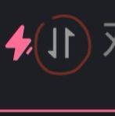

**周雅（被老婆调教.周浩）** (2026-08-18 02:24:06):
输入框旁边这个点一下

**羽👿** (2026-08-18 01:09:47):
<@1027244842629202020> 怎么换模型呀？第一次玩这个

**mike** (2026-08-13 06:29:50):
求求大佬们告诉我一下。

**mike** (2026-08-13 06:27:09):
这个进去之后，他就一直卡在这个页面一直加载中，按其他的也不动，按刷新也刷新不了。为什么呀？

**周雅（被老婆调教.周浩）** (2026-08-12 03:05:22):
因为遇到了模型审查 换别的模型发吧

**羽👿** (2026-08-12 00:01:35):
为什么有时候那个网站我发消息老是给我发送，重新发送？

**天铭** (2026-08-11 22:01:01):
另外……那个全黑的是什么地方的问题（感觉有点像是屏蔽代码的锅，但我不懂<:1000168531:1298906724979310634> ）

**天铭** (2026-08-11 21:54:11):
而且感觉二次确认的判定好像过短了<:1000168531:1298906724979310634>

**天铭** (2026-08-11 21:53:36):
难不难受不知道，我只知道返回到不能再返回时（也就差不多只剩刚进入时的首页）第一下的退出提示没了<:1000168530:1298906732843503677>

**阿成** (2026-08-10 19:24:16):
现在这样真的很难受

**柳清淫** (2026-08-10 16:33:24):
大佬，可以截图，就是一用提取图文就黑屏，完全不稳定，然后用第一次黑屏后，再用一次就可以提取

**爱玩** (2026-08-10 13:59:48):
自动主要是喜欢上下划，然后跳来跳去的看着难受

**野生客** (2026-08-10 13:05:33):
现在的退出逻辑是一次就是回到上一页，短时间内两次直接退出app

**野生客** (2026-08-10 13:03:33):
看一下标注的消息，里面就有安装包

**野生客** (2026-08-10 13:00:50):
选自动就行，加这个各种交互问题。

**野生客** (2026-08-10 12:58:28):
没遇到过，截图可以截图吗？

**野生客** (2026-08-10 12:58:10):
这个是适配了安卓的退出逻辑。

**野生客** (2026-08-10 12:57:33):
修改了退出方式，短时间长按两次退出键直接就退出软件了。

**柳清淫** (2026-08-10 11:20:00):
大佬，这是什么情况<:1000168510:1298906820638674984>

**人** (2026-08-10 10:21:30):
有安装包吗？

**赤溟仙母** (2026-08-09 08:44:49):
啥时候开发客户端<:emoji_249:1416980114511761448>

**周雅（被老婆调教.周浩）** (2026-08-09 04:41:37):
这个就是网站的APP版本啊

**BLACK** (2026-08-09 04:37:19):
我智商好像不够

**BLACK** (2026-08-09 04:36:58):
能简单的告诉我吗？

**BLACK** (2026-08-09 04:36:19):
这是用来干嘛的?

**爱玩** (2026-08-08 11:24:27):
佬，提个建议，能不能在图1加个选项，让顶框变成类似手机侧边框那种，平时隐藏在屏幕旁边，按到或者拖出来的时候变成图2这种，把顶框内容弄到侧边框里面，或者侧边框弄出来一个按钮，按了再显示顶框，这样平时也不会按到了
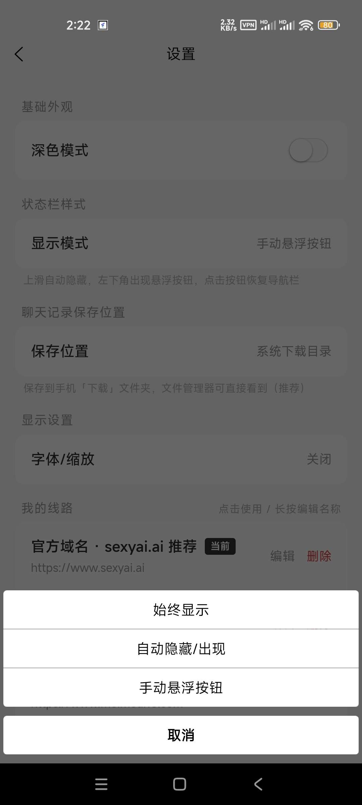
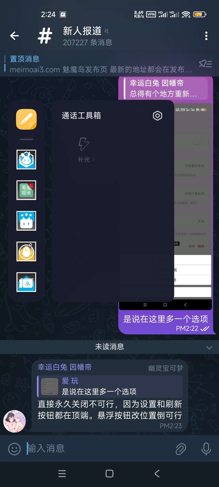

**让铃仙日因幡帝🐇** (2026-08-05 08:20:19):
已复现：从角色卡退出后上方蓝条未加载完时再点退出会退出软件

**阿成** (2026-08-05 03:41:42):
大佬，新版本返回首页时候app就直接退出了……修一下吧

**让铃仙日因幡帝🐇** (2026-08-04 22:41:46):
加载跟验证是缓存和梯子节点的事，清缓存数据换梯子节点。模型是最近各家都在抽算力

**血鸢** (2026-08-04 22:16:46):
加载、给验证码啥的都很慢，模型也变拉了

**血鸢** (2026-08-04 22:16:22):
最近有点慢，跟枪卡壳了一样

**五日.NTR大好き=ᗜωᗜ=** (2026-08-04 02:35:59):
<:emoji_147:1382565790129328128>

**让铃仙日因幡帝🐇** (2026-08-03 18:33:51):
系统更方便找

**米斯特** (2026-08-03 10:00:14):
对了，那个聊天记录存储位置应该选系统下载目录还是应用私有目录更好？

**米斯特** (2026-08-03 09:51:25):
终于更新了吗？

**让铃仙日因幡帝🐇** (2026-08-03 05:47:50):
友情提示：卸载旧版本app重新安装更好

**野生客** (2026-08-03 03:25:50):

**野生客** (2026-08-03 03:25:36):
魅魔App 更新公告

版本 v1.3.0 | 2026年8月

------------------------------------------------

【本次更新】

导航栏智能显隐
• 新增三种导航栏显示模式，在设置页自由切换
• 始终显示：导航栏常驻顶部，适合需要频繁操作的场景
• 自动隐藏/出现：上滑浏览时自动收起导航栏，下拉或回到顶部时自动恢复，沉浸感更强
• 手动悬浮按钮：上滑隐藏后不再自动出现，左下角悬浮按钮一键唤回导航栏，适合纯阅读场景

自定义显示（字体大小 / 页面缩放）
• 设置页新增「显示设置」→「字体/缩放」，自由填写 px 值与百分比
• 字体大小 6-100px、缩放 30%-500%，超出范围自动提示并修正
• 启用后网页字体和缩放即时生效，聊天界面同步响应
• 关闭后网页恢复默认，不干扰原始排版

线路自动更新
• 每次启动自动从网址发布页同步最新官方线路
• 新增的备用域名和免翻域名无需手动添加
• 添加的自定义线路不受影响
• 已下架的域名会自动从列表移除，保证每条线路都可用
• 设置页新增「立即从发布页更新线路」按钮，随时手动刷新
• 官方线路与自定义线路以标签区分，一目了然

缓存清理增强
• 设置页新增「清除登录状态缓存」二级菜单
• 支持「仅清理当前站点」（刷新页面，不退出其他网站）和「清理全部网站」（重启应用）
• 当前站点清理仅影响当前域名，其他线路的登录状态不受影响

下载稳定性提升
• 聊天记录已经可以正常下载
• 文件保存至系统下载目录，文件管理器中可直接查看

启动与运行优化
• 精简网页注入脚本，降低被 Cloudflare 验证干扰的风险

------------------------------------------------

【已有功能】

• ◐ 深色/浅色模式一键切换
• ↻ 网页快捷刷新
• 多线路自由切换
• 支持自定义添加线路
• 长按线路可编辑或删除
• 导航栏显示模式随心切换
• 启动自动同步官网最新线路
• 清除登录状态缓存（支持单站 / 全部）
• 恢复默认线路

------------------------------------------------

【已知限制】

• 谷歌登录：内嵌浏览器不支持谷歌验证弹窗，请使用邮箱登录

**野生客** (2026-08-02 14:20:54):

**野生客** (2026-08-02 12:57:03):
这两天更新。ios有ios版本的。

**周雅（被老婆调教.周浩）** (2026-07-29 09:44:50):
上面有 帮你定位了

**周雅（被老婆调教.周浩）** (2026-07-29 09:44:37):
1

**LiNovaV8** (2026-07-29 09:32:12):
IOS能用吗？

**Deleted User** (2026-07-29 09:14:03):
app如果和网页版混着用，会有频繁打回的现象

**米斯特** (2026-07-28 09:19:28):
默认配置就要三百多电真王朝了

**Raphaelxfy** (2026-07-28 04:34:36):
确实，试了三四次放弃了😂

**Za2a** (2026-07-28 04:32:01):
其实是理论智商，他输出不出来，而且文章和状态栏会出问题，等优化吧

**Raphaelxfy** (2026-07-28 04:30:26):
主要我看说智商水平更高，所以试了几次

**Za2a** (2026-07-28 04:29:57):
kimi真不建议用，哥们，那玩意费电不说，而且甚至不如一万的ds

**周雅（被老婆调教.周浩）** (2026-07-26 12:48:51):
1

**Kaede** (2026-07-26 07:15:28):
好用，支持！<:emoji_140:1379454014852436038>

**野生客** (2026-07-23 04:06:10):
签证过期了，我正在找人帮忙签企业签

**让铃仙日因幡帝🐇** (2026-07-21 18:02:40):
右上角设置清理缓存状态就可以了

**dcb** (2026-07-21 05:51:41):
老是白屏是怎么回事

**Blessing** (2026-07-20 18:35:13):
大佬，ios安装时为什么显示安装包不完整

**Raphaelxfy** (2026-07-20 17:52:53):
好的谢谢啦

**周雅（被老婆调教.周浩）** (2026-07-20 17:31:30):
那就等小魅调整吧<:1000168531:1298906724979310634>

**Raphaelxfy** (2026-07-20 17:08:01):
😂

**Raphaelxfy** (2026-07-20 17:08:00):
好像不行，加了还是输出思考过程

**Raphaelxfy** (2026-07-20 17:02:59):
好的好的，谢谢哈，我去试试

**周雅（被老婆调教.周浩）** (2026-07-20 17:02:42):
带个思维链指令

［禁止输出任何形式的思考过程、推理步骤或内在分析，仅输出最终内容。］

这个模型特点如此，小魅也在调整它的思维链了

**Raphaelxfy** (2026-07-20 16:53:42):
为啥Kimi3直接输出一大段思考过程，感觉不太行啊😂

**Raphaelxfy** (2026-07-20 16:38:55):
话说试了一下Kimi3，结果五分钟了都没出字，是不是不能选流式输出啊😂

**让铃仙日因幡帝🐇** (2026-07-20 04:06:23):
正常，没报备的app大多都会显示

**柒柒** (2026-07-20 03:11:52):
为啥显示是病毒呢

**鸡大** (2026-07-19 05:37:43):
太优秀了，谢谢大大

**小宇** (2026-07-18 10:17:38):
大佬，软件进去以后显示无法打开，是啥情况？

**Blessing** (2026-07-17 16:36:50):
大佬，这是什么情况?
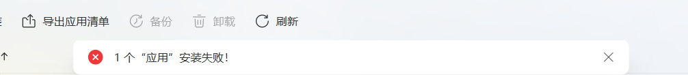

**野生客** (2026-07-17 15:33:41):
先点击上面的帖子标题，然后里面有个标注，就可以看到我的置顶消息了

**野生客** (2026-07-17 15:32:24):
点置顶信息就可以找到了

**野生客** (2026-07-17 15:32:06):
怕是签证过期了，我重新弄一下签证<:1000168510:1298906820638674984>

**周雅（被老婆调教.周浩）** (2026-07-17 11:37:11):
有时候更新了APP就会有卡顿，你卸载了重装一下就行

**周雅（被老婆调教.周浩）** (2026-07-17 11:36:38):
上次给你定位那个

**周雅（被老婆调教.周浩）** (2026-07-17 11:36:32):
就是这个帖子呀

**凹凸曼** (2026-07-17 11:23:30):
大佬，我没有找到下载的地方，大佬拜托发一下谢谢大佬

**周雅（被老婆调教.周浩）** (2026-07-17 11:21:00):
因为今天网站有更新，你再重装一下看看

**凹凸曼** (2026-07-17 10:57:39):
大佬，软件又不能用了，白屏了

**fumo1** (2026-07-16 12:58:01):
已经可以了谢谢大佬

**周雅（被老婆调教.周浩）** (2026-07-16 12:46:17):
如果还打不开就等楼主之后还有更新

**周雅（被老婆调教.周浩）** (2026-07-16 12:46:05):
我上面有引用位置

**周雅（被老婆调教.周浩）** (2026-07-16 12:46:00):
你下载的是最新的那个安装包吗

**fumo1** (2026-07-16 12:45:45):
<@1027244842629202020> 大佬，我想问问现在APP为什么打不开了？

**凹凸曼** (2026-07-16 12:32:34):
<@1027244842629202020> 谢谢大佬，大佬生十个儿子

**周雅（被老婆调教.周浩）** (2026-07-16 12:28:14):
帖子上面 给你定位了

**周雅（被老婆调教.周浩）** (2026-07-16 12:28:05):
在帖子上面有

**凹凸曼** (2026-07-16 12:20:47):
之前的我找不着了

**凹凸曼** (2026-07-16 12:20:36):
大佬，有安装包吗，谢谢大佬

**周雅（被老婆调教.周浩）** (2026-07-16 12:19:59):
重新安装一下试试

**凹凸曼** (2026-07-16 12:16:55):
今天也用不了

**智睿的睿智** (2026-07-15 16:06:37):
重新安装也不行
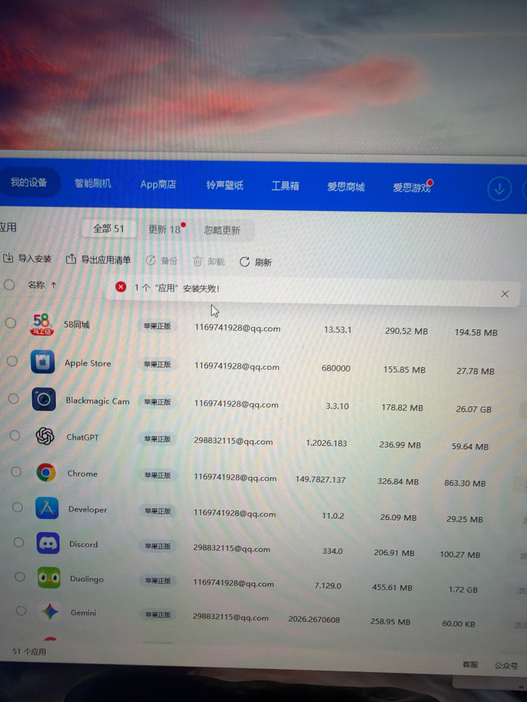

**智睿的睿智** (2026-07-15 16:02:11):
这是为什么呀
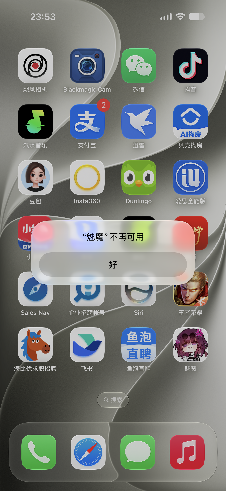

**智睿的睿智** (2026-07-15 15:59:56):
这是什么原因

**野生客** (2026-07-07 10:47:59):
重新下载一下app的安装包

**狸语** (2026-07-04 17:07:17):

**野生客** (2026-06-30 08:55:26):
把反诈app卸载了，同时在设置里面更新一下网址

**这里是沙拉酱鸭** (2026-06-30 05:56:56):
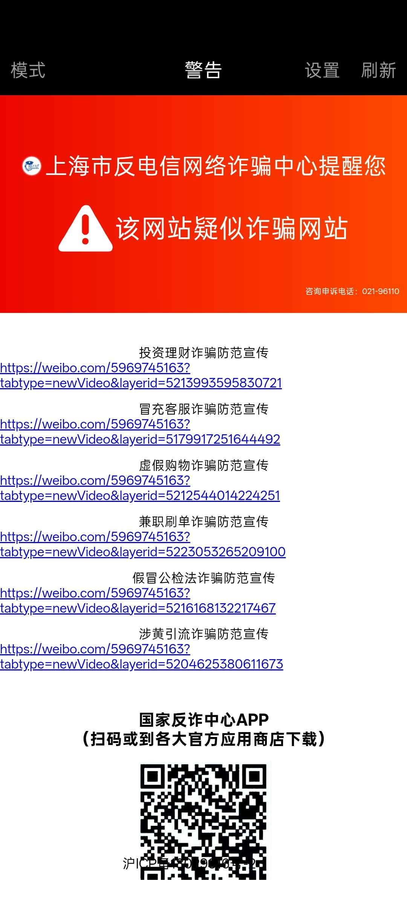

**野生客** (2026-06-27 03:54:20):
app调用的是内置浏览器，这种情况是内置浏览器的问题了。

**野生客** (2026-06-27 03:53:54):
没有复现出来

**野生客** (2026-06-27 03:53:34):
可以截图发一下吗？我这边提示是正常的

**鸿** (2026-06-23 09:50:35):
佬，APP收藏刷新有问题，APP收藏了新角色卡不显示，网页正常显示

**亮哥哥（沉迷当黄毛无法自拔）** (2026-06-22 19:57:40):
上边的

**亮哥哥（沉迷当黄毛无法自拔）** (2026-06-22 19:57:34):
应该是上班的刘海

**yikezhiwu** (2026-06-18 09:45:44):
前来拜谢

**阿成** (2026-06-16 07:57:09):

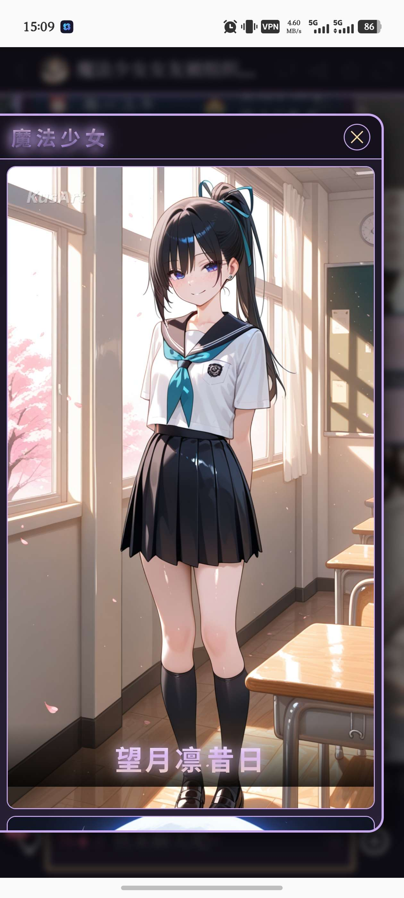

**阿成** (2026-06-16 07:56:36):
大佬大佬，魅魔岛app是不是字库不太全？我用浏览器打开图鉴就有字体，app打开就是黑体

**一加一@** (2026-06-12 00:25:49):
谢谢大佬

**星墨** (2026-06-06 08:39:20):
/回顶

**kelademeisuo** (2026-06-06 02:28:32):
白屏的自己添加新线路14，以前的线路不好使了

**野生客** (2026-06-05 02:46:25):
苹果的等月底更新，要找人重新打包和续签证。

**野生客** (2026-06-05 02:45:22):
链接点击后就是自动下载了

**闪电n8** (2026-06-04 12:54:06):
链接点开白屏是咋回事

**🐭🐭🐭🐭** (2026-06-03 15:14:33):
<:_20260601200459_219_3:1510978020750524549>

**🐭🐭🐭🐭** (2026-06-03 15:14:30):
好的，感谢兄弟，祝你一胎生八个儿子

**墨寒心** (2026-05-30 14:08:55):
好👌🏻

**希波鹅拉底** (2026-05-30 14:08:26):
往上翻

**墨寒心** (2026-05-30 14:08:19):
OK，谢谢

**希波鹅拉底** (2026-05-30 14:08:17):
APP

**希波鹅拉底** (2026-05-30 14:08:14):
这里就是

**墨寒心** (2026-05-30 14:07:39):
怎么了？

**希波鹅拉底** (2026-05-30 14:07:22):
<@1471465663892689041>

**没钱买电只能YY** (2026-05-25 13:34:56):
大佬大佬，这个很好用，就是我提一个建议能不能下次更新加一个页面缩放，手机玩的话原大小有点太大了，我一般用75%网页缩放玩的，要是能的话麻烦大佬可以考虑一下，不好加的话就算了，这样子已经够用了<:emoji_140:1379454014852436038>

**周雅（被老婆调教.周浩）** (2026-05-25 12:55:44):
更新一下最新版了吗？最新版还不行的话卸载重安一个看看

**炎刑诺尔** (2026-05-25 00:12:49):
咋白屏了，明明昨天还能用的

**野生客** (2026-05-21 08:44:32):
具体指哪里的栏目？

**野生客** (2026-05-21 02:12:29):
以前这个不是我做的

**让铃仙日因幡帝🐇** (2026-05-18 16:44:24):
肯定不是app炸了，清除登录状态缓存跟换梯子节点总有一个能解决

**早饭吃什么？** (2026-05-18 16:02:40):
炸了

**早饭吃什么？** (2026-05-18 16:02:32):
何意味

**LAO_HU** (2026-05-12 17:18:39):
<:emoji_140:1379454014852436038>

**LAO_HU** (2026-05-12 17:17:56):
原来如此👍

**这里是沙拉酱鸭** (2026-05-12 14:05:30):
主线路又白屏了好像

**亮哥哥（沉迷当黄毛无法自拔）** (2026-05-10 00:32:03):
以前这个不是挺好的吗，除了不能更换背景其他的功能都没啥问题
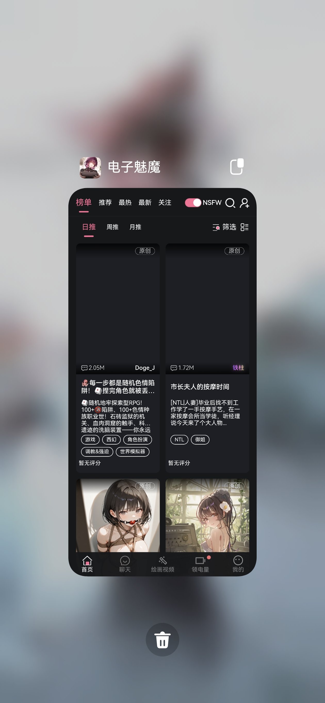

**亮哥哥（沉迷当黄毛无法自拔）** (2026-05-10 00:21:56):
<@976859650899202099> 以前的APP也是你做的吗？为什么新的版本上面有一个栏目啊，很影响观感啊，能不能和以前一样？或者做一个打开关闭的开关？

**亮哥哥（沉迷当黄毛无法自拔）** (2026-05-10 00:20:53):
<@1471999392192921865> 把网络关掉再安装。华为是这样的，你想玩黄油APP都不行。

**woodby** (2026-05-06 17:07:54):
/回顶

**雷霆** (2026-05-06 07:21:47):
华为报毒
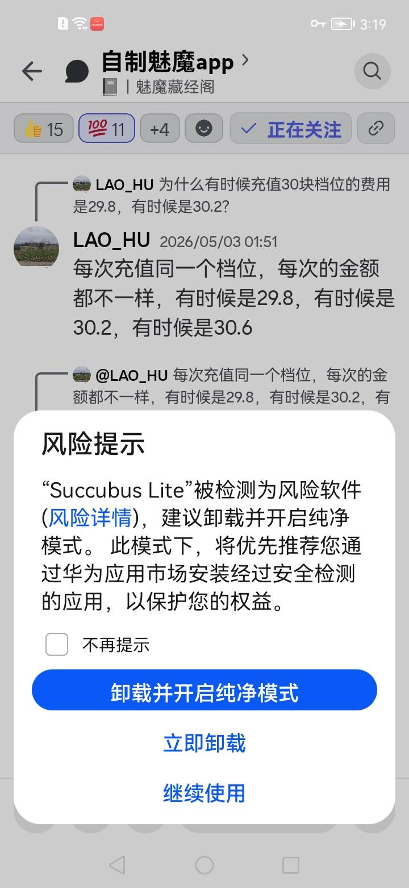
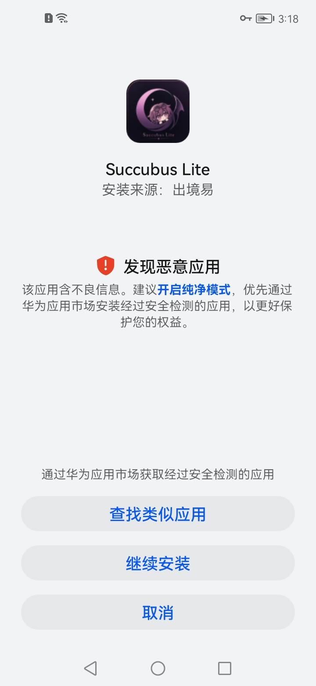

**野生客** (2026-05-04 07:06:11):
<:1000168510:1298906820638674984>

**野生客** (2026-05-04 07:06:09):
是因为汇率在变

**让铃仙日因幡帝🐇** (2026-05-03 02:23:50):
这是为了规避风险有时会有几分几毛的波动

**LAO_HU** (2026-05-02 17:51:53):
每次充值同一个档位，每次的金额都不一样，有时候是29.8，有时候是30.2，有时候是30.6

**LAO_HU** (2026-05-02 17:48:56):
为什么有时候充值30块档位的费用是29.8，有时候是30.2？

**野生客** (2026-05-01 10:19:04):
更新了网址

**这里是沙拉酱鸭** (2026-05-01 06:41:01):
为什么主线路白屏了

**野生客** (2026-05-01 05:58:21):
app报毒的可以截图一下，我看看是哪个权限引起的，下次更新删除掉

**野生客** (2026-04-24 13:27:58):

**野生客** (2026-04-24 13:27:41):
魅魔App 更新公告

版本 v1.2.0 | 2026年4月

————————————————

【本次更新】

UI优化
• 全新设计设置页面，视觉更简洁，操作更顺手
• 优化导航栏按钮图标，风格统一且更加低调隐蔽
• 修复部分机型上状态栏出现白条的显示问题

体验改进
• 优化页面切换时的动画流畅度
• 提升深色模式下的色彩对比，减少视觉疲劳

稳定性
• 修复设置页面在特定操作下的保存异常
• 精简底层逻辑，减少资源占用

————————————————

【已有功能】

• ◐ 深色/浅色模式一键切换
• ↻ 网页快捷刷新
• 多线路自由切换
• 支持自定义添加线路
• 长按线路可编辑或删除
• 清除登录状态缓存
• 恢复默认线路

————————————————

【已知限制】

• 谷歌登录：内嵌浏览器不支持谷歌验证弹窗，请使用邮箱登录
• 聊天记录导出：受网页安全策略限制，建议在系统浏览器中操作

————————————————

感谢你的支持，我们会继续优化体验！

**野生客** (2026-04-24 13:24:25):
现在

**智睿的睿智** (2026-04-20 16:29:17):
Ok 找到了

**智睿的睿智** (2026-04-20 16:17:43):
魅魔app苹果能不能安装哇 下载完安装包 苹果识别不出来<:1000168531:1298906724979310634>

**让铃仙日因幡帝🐇** (2026-04-17 15:03:23):
主站域名已更改，app还未更新同步，可在右上角进入设置页面手动更改主线路域名，将“**top**”改为“**ai**”即可

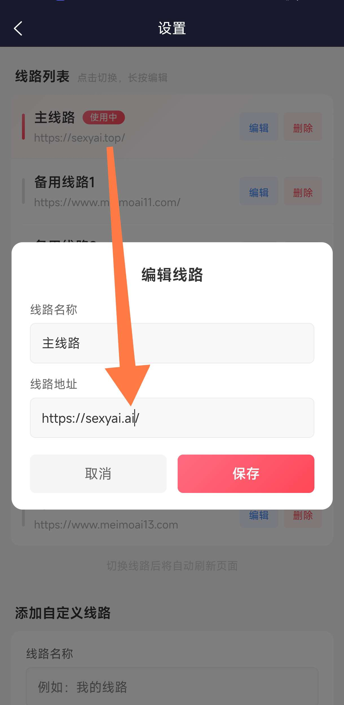

**乐正绫** (2026-04-15 05:53:22):
大佬们，为什么deepseek挂了

**早饭吃什么？** (2026-04-14 10:23:10):
什么时候更新，网站卡死了

**majestic_lemur_2** (2026-04-06 13:57:06):
回顶

**野生客** (2026-04-02 10:21:37):
换个梯子，估计你这边没有弹出人机验证

**野生客** (2026-04-02 10:21:26):
这个是梯子的问题

**午餐h** (2026-04-02 08:26:33):
神了，好评，网页版的聊天记录没了软件的还在

**bin** (2026-04-02 03:38:13):
发送邮箱没收到信息

**偏爱** (2026-03-22 18:01:24):
<:emoji_249:1416980114511761448>

**野生客** (2026-03-22 10:39:39):
现在没时间呀亲

**野生客** (2026-03-22 10:39:33):
空了会改ing

**KBsmater** (2026-03-22 10:39:08):
白框＋1

**让铃仙日因幡帝🐇** (2026-03-21 14:43:58):
新版本点输入上面会有白框啊亲<:emoji_148:1382329938404839586>
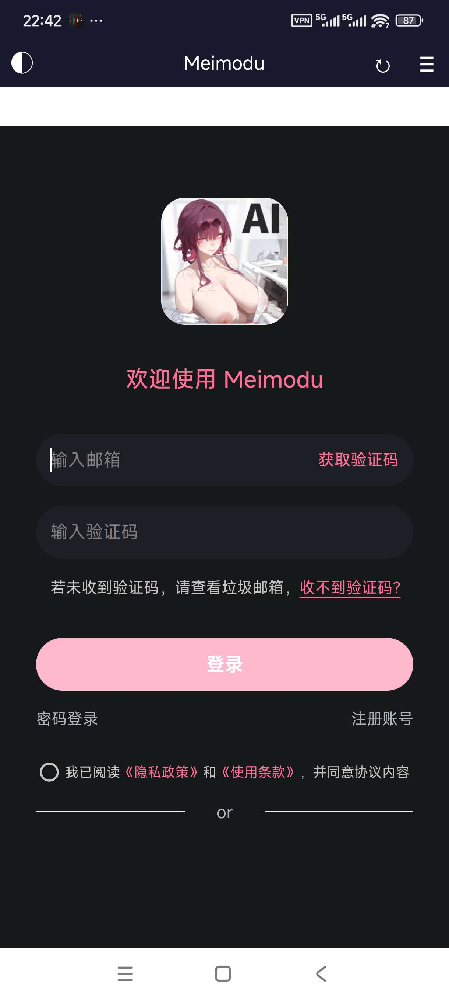

**Deleted User** (2026-03-10 11:15:28):
不好意思🥺

**野生客** (2026-03-08 12:39:45):
更新了

**野生客** (2026-03-08 12:39:29):

**野生客** (2026-03-08 12:38:59):
魅魔App 更新公告

版本 v1.2.0 | 2026年3月8日

————————————————

【更新内容】

全新功能
• 新增日间/夜间模式切换功能，沉浸体验更护眼
• 导航栏新增一键“刷新”功能，页面重载更便捷

界面改进
• 重新设计顶部导航栏按钮，图标大小与风格实现了完美统一
• 状态栏智能适配系统色彩，日夜模式下均清晰可见

底层优化
• 彻底重构底部按钮点击逻辑，解决修改样式导致事件失效的隐患
• 深度优化设置页面代码结构，提升数据保存与响应的稳定性

————————————————

【已知限制】

× 谷歌登录：内嵌浏览器不支持谷歌验证，网页采用弹窗授权无法跳转

× 聊天记录导出：网页安全沙盒限制，无法注入下载功能

替代方案：请使用邮箱登录；如需导出记录请在浏览器操作

————————————————

【App 功能】

• ◐ 日夜模式一键切换（新！）
• ↻ 网页一键快捷刷新（新！）
• 多线路一键切换
• 支持自定义线路
• 长按线路可编辑/删除
• 一键清除缓存
• 恢复默认线路

————————————————

感谢使用，如有问题欢迎反馈！

**野生客** (2026-03-08 10:35:43):
看看说明，这个无法导出聊天记录

**Deleted User** (2026-03-08 04:32:55):
聊天记录导出失败😰

**野生客** (2026-03-01 08:34:50):
可以哦

**爱玩** (2026-03-01 08:09:49):
好吧，那可以把这个当成以后的更新计划吗

**野生客** (2026-03-01 04:19:55):
可以是可以，不过目前没有时间呢

**爱玩** (2026-03-01 04:18:49):
所以想说能不能让它跟着日间夜间模式变

**野生客** (2026-03-01 04:17:38):
那个就是黑的。我压根就没写他其他的颜色。

**周雅（被老婆调教.周浩）** (2026-03-01 04:00:01):
APP这个没办法，可以去网页版

**爱玩** (2026-03-01 03:56:18):
上面meimo这一行黑的
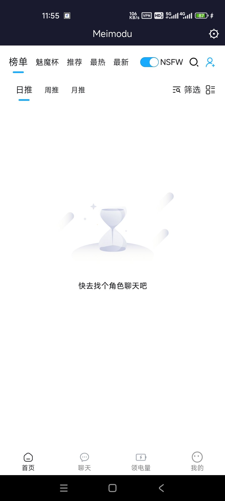

**爱玩** (2026-03-01 03:55:40):
是打开app的时候的屏刘海，在主页和首页就有，和卡没关系

**周雅（被老婆调教.周浩）** (2026-03-01 03:31:26):
你说的是作者背景图的刘海吗？那个是作者才能换的

**复合型奇美拉** (2026-03-01 02:39:52):
没事了，好像又下回来了

**复合型奇美拉** (2026-03-01 02:38:20):
有下载链接吗？感觉好像没办法下载

**爱玩** (2026-03-01 02:33:29):
可以让屏刘海的颜色跟着日夜切换吗，日间模式定着个黑刘海有点难受

**让铃仙日因幡帝🐇** (2026-03-01 01:48:45):
这个是日间模式的原因，已经反馈了，字是白的，夜间模式能看到

**Deleted User** (2026-02-28 19:52:26):
好像自定义新功能里，打出来的字会一片白看不见

**失去螺旋桨的直升机** (2026-02-23 12:47:08):
好用，爱用

**让铃仙日因幡帝🐇** (2026-02-22 15:21:20):
右上角设置里清缓存再登录就行了，网站出现这样也是同理

**野生客** (2026-02-22 15:20:40):
换个梯子，或者清理缓存，设置里都有

**咲玲** (2026-02-22 15:19:18):
这又是怎么了很久没有显示

**咲玲** (2026-02-22 00:54:05):
原來如此

**野生客** (2026-02-22 00:53:42):
<:1000168531:1298906724979310634>

**野生客** (2026-02-22 00:53:38):
切换一下就可以刷新

**咲玲** (2026-02-22 00:50:59):
有這功能?

**野生客** (2026-02-22 00:49:59):
可以直接点设置，然后点一下网页刷新

**野生客** (2026-02-22 00:49:47):
是的，没有这个功能。

**咲玲** (2026-02-21 18:18:31):
问一下APP是没有本法下拉主动刷新的吗？

**失去螺旋桨的直升机** (2026-02-20 13:14:32):
谢谢大佬，我也下一个试试

**开罗** (2026-02-20 12:47:15):
大佬牛逼

**野生客** (2026-02-20 12:25:47):
魅魔这边会拦截字体注入，加不了，之前尝试过

**Deleted User** (2026-02-20 09:03:31):
很好用！比魅魔自己弄的还靠谱👍大佬可以加一个调节字体大小的功能嘛

**绛璃寒月ദ്ദി˶•̀֊•́)✧** (2026-02-17 06:55:19):
已从被暂停的账号中移除一条消息。

**野生客** (2026-02-13 11:19:01):

**野生客** (2026-02-13 11:18:58):
【常见问题】
Q：安装后提示"未受信任的企业级开发者"？
A：前往 设置 → 通用 → VPN与设备管理，找到对应证书点击信任。

Q：打开 App 白屏？
A：尝试进入设置页切换其他线路，或清除缓存后重启。

Q：线路全部无法访问？
A：前往网址发布页获取最新可用地址，添加为自定义线路。

**野生客** (2026-02-13 11:18:39):

**野生客** (2026-02-13 11:18:34):
魅魔App iOS版发布公告
版本 v1.0.0（iOS）| 2026年2月13日

————————————————

##🎉 重磅发布

魅魔App 正式登陆 iOS 平台！

iPhone / iPad 用户终于可以使用原生 App 体验了，无需再通过浏览器访问，更流畅、更便捷。

————————————————

【核心功能】
多线路切换
• 内置多条线路，一键切换，告别网址失效烦恼
• 切换后自动刷新页面，无需手动操作

自定义线路
• 支持添加自定义线路地址
• 长按线路可编辑名称和地址
• 点击切换，长按编辑，操作直观

缓存管理
• 一键清除 Cookies 及登录状态

更多功能
• 支持恢复默认线路
• URL 自动补全（无需手动输入 https://）
• 重复线路自动检测

————————————————

【iOS 专项优化】
•全面适配 WKWebView，页面加载更快
• 适配 iOS 安全区域，全面屏机型完美显示

————————————————

【安装说明】
由于未上架 App Store，iOS 用户请通过以下方式安装：
1.下载爱思助手
2.通过爱思助手安装
3.安装后首次打开
前往「设置 → 通用 → VPN与设备管理」，信任对应证书

————————————————

【已知限制】
× 谷歌登录：iOS 内嵌浏览器不支持谷歌弹窗授权，无法完成跳转验证

× 聊天记录导出：WKWebView 安全沙盒限制，无法注入下载功能

替代方案：请使用邮箱注册登录；如需导出记录请在 Safari 浏览器中操作

**野生客** (2026-02-13 10:59:12):

**量子弱猫** (2026-02-12 04:46:04):
人在做坏事的时候是不会嫌麻烦的。JPG

**DFuMao** (2026-02-12 03:37:57):
大佬万岁<:emoji_140:1379454014852436038>

**让铃仙日因幡帝🐇** (2026-02-10 15:34:45):
还是太良心了

**野生客** (2026-02-10 15:24:25):
？。？我怎么没想到这个

**白鸽** (2026-02-10 15:24:03):
想起来我把我邀请链接做成网页套壳app推给别人放时候😋

**MEE6** (2026-02-09 07:48:39):
<:CHECK6:403540120181145611> 100,000 XP has been given to **<@!976859650899202099>**

**周雅（被老婆调教.周浩）** (2026-02-08 14:13:46):
太好了<:07:1298281204260278383> <:07:1298281204260278383>

**野生客** (2026-02-08 14:04:44):
魅魔App 更新公告

版本 v1.1.0 | 2026年2月8日

————————————————

【更新内容】

性能优化
• 优化代码结构，运行更流畅
• 优化线路切换逻辑，响应更快
• 减少内存占用，稳定性提升

界面改进
• 设置页面布局优化，操作更直观
• 按钮及卡片样式美化

问题修复
• 优化缓存清理兼容性
• 修复 URL 校验问题

————————————————

【已知限制】

× 谷歌登录：内嵌浏览器不支持谷歌验证，网页采用弹窗授权无法跳转

× 聊天记录导出：网页安全沙盒限制，无法注入下载功能

替代方案：请使用邮箱登录；如需导出记录请在浏览器操作

————————————————

【App 功能】

• 多线路一键切换
• 支持自定义线路
• 长按线路可编辑/删除
• 一键清除缓存
• 恢复默认线路

————————————————

感谢使用，如有问题欢迎反馈！

**周雅（被老婆调教.周浩）** (2026-02-08 02:18:46):
<@1135473222658297907> 建议经验奖励楼主

**周雅（被老婆调教.周浩）** (2026-02-08 02:18:16):
好评

**周雅（被老婆调教.周浩）** (2026-02-08 02:18:11):
非常之实用<:07:1298281204260278383> <:07:1298281204260278383>

**乖宝宝小水母（水母宗唯一宗主。大周荣誉国祖)** (2026-02-08 00:44:07):
<:emoji_250:1463546874119192792>

**让铃仙日因幡帝🐇** (2026-02-07 23:33:25):
我说的都是自带的功能<:emoji_140:1379454014852436038> 而且这些功能之前的app没有的

**野生客** (2026-02-07 23:32:26):
啊？先别急着吹啊，一会有bug咋办<:1000168510:1298906820638674984>

**让铃仙日因幡帝🐇** (2026-02-07 23:25:19):
AI点评：此app由野生客服的ass、pussy、prick组成，可一键切换网址，也可自定义网址。重点是支持很多权限，可以在app里加图写卡使用图床喽～导出聊天或是更换背景图之类的功能，在这个app里都可以实现～全然機能のAPP☆

**野生客** (2026-02-07 23:15:20):
绑定个邮箱和密码，就可以了

**neyin** (2026-02-07 23:14:41):
<:emoji_249:1449409819957264537>

**neyin** (2026-02-07 23:14:33):
不能用，谷歌登录，倒下了

**让铃仙日因幡帝🐇** (2026-02-07 22:32:53):
实测很好用，而且不会报毒

**让铃仙日因幡帝🐇** (2026-02-07 22:32:42):
♂顶♀

**野生客** (2026-02-07 22:18:03):
简单制作了一个魅魔APP，可以下载体验。内置多条备用线路，一键切换无需记网址，再也不怕迷路。支持自定义添加线路，点击右上角齿轮即可管理。有问题帖内反馈。

最新app下载链接https://discord.com/channels/1205870897769095229/1469819526693523519/1470057768756187349

