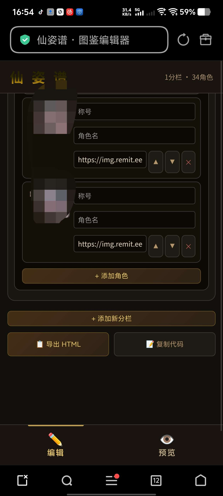

# 自定义侧边栏图鉴编辑器  by乱马

来源: Discord 魅魔藏经阁 thread 1517798332725198929

创建: 2026-06-20T07:48:41.851000+00:00
消息数: 12

---

**凛堂光** (2026-08-25 12:00:31):
人家开学了

**凛堂光** (2026-08-25 12:00:28):
等十二月吧

**乱马（参赛卡艾泽尔酒店）** (2026-08-03 11:15:41):
自定义侧边栏图鉴编辑器  by乱马

**空铃空空空** (2026-07-22 16:23:40):
为什么我预览什么都看不到

**沐若离（哈气猫猫）** (2026-07-22 09:37:09):
<:emoji_298:1526501201703600188> <:emoji_249:1416980114511761448>

**谷夕** (2026-07-10 08:56:17):
大佬，怎么把这个弄到里面啊，复制也复制不了啊<:1000168510:1298906820638674984>

**盖亚之血** (2026-06-22 11:32:56):
增加功能：1.切换竖排按钮位置处于左或右的功能
2.增加分栏中的增加子分栏功能
3.在图鉴中点击图片切换显示立绘与文字介绍的功能，并制作通过点击图片来进行仅显示图片（以及姓名、地位）和仅显示纯文字介绍的功能
4.可在图片介绍中增加、复制、删除、平移文字内容栏
5.调整图片显示大小（长宽与比例）的功能
6.侧边栏编辑可拖动边框或在“ 按钮 & 面板位置”中滑动调整放大与缩小的功能
7.增加子版块可以上移成主要板块与下移成为某个子版块的子版块，以及移为另外一个主版块的子版块的选项操作
8.每一行文字都能进行分别与全局的个性化自定义（暂时没做渐变），

**盖亚之血** (2026-06-22 11:31:49):
拿大D老师改了一下，增加了一部分功能，稍微测试了一下，不保证没有太多BUG（

**鹤南飞(接定制看简介)** (2026-06-20 11:57:03):
忠诚！！！！！！！！！！！！！！！

**小魅** (2026-06-20 11:19:57):
感谢宝宝的开源哦<:emoji_140:1379454014852436038>

**MEE6** (2026-06-20 11:19:48):
<:CHECK6:403540120181145611> 30,000 XP has been given to **<@!1512325841386864640>**

**周雅（被老婆调教.周浩）** (2026-06-20 09:59:16):
<@1135473222658297907> 奖励经验

