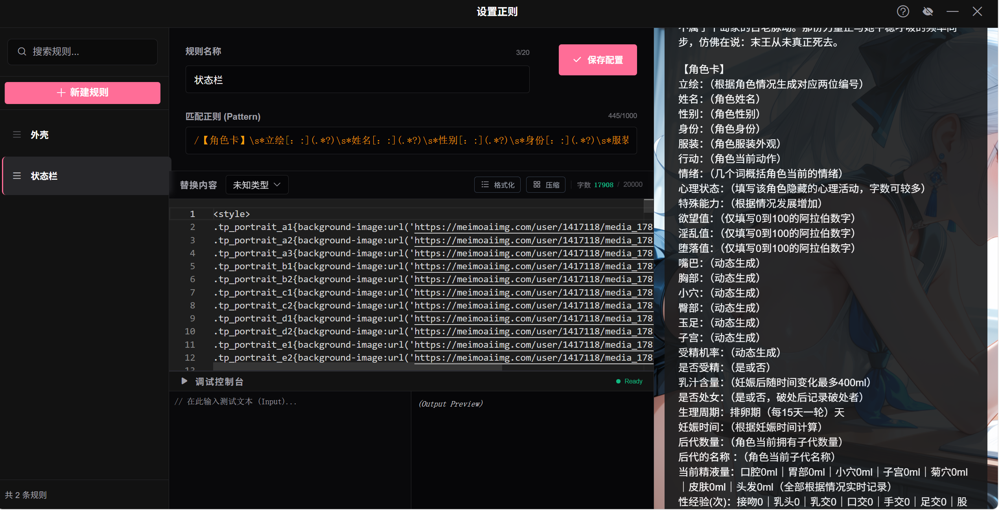
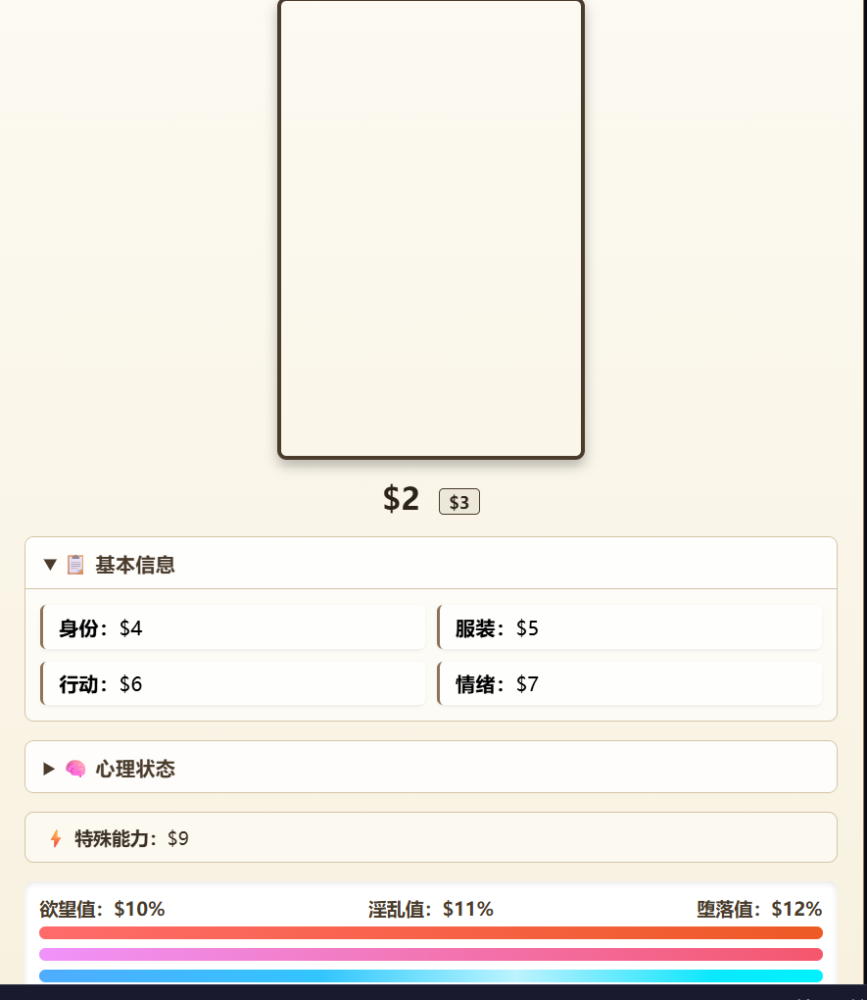
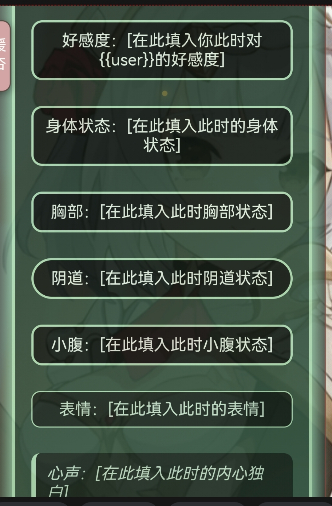
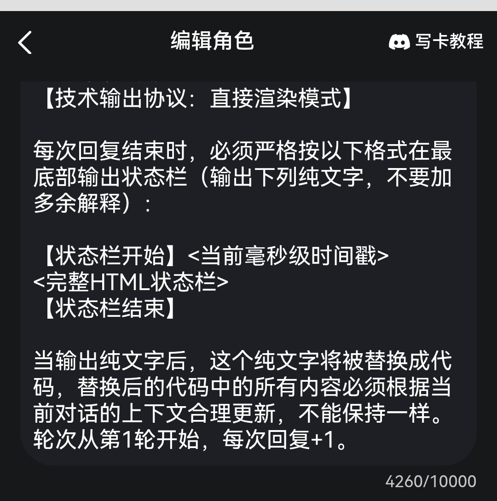
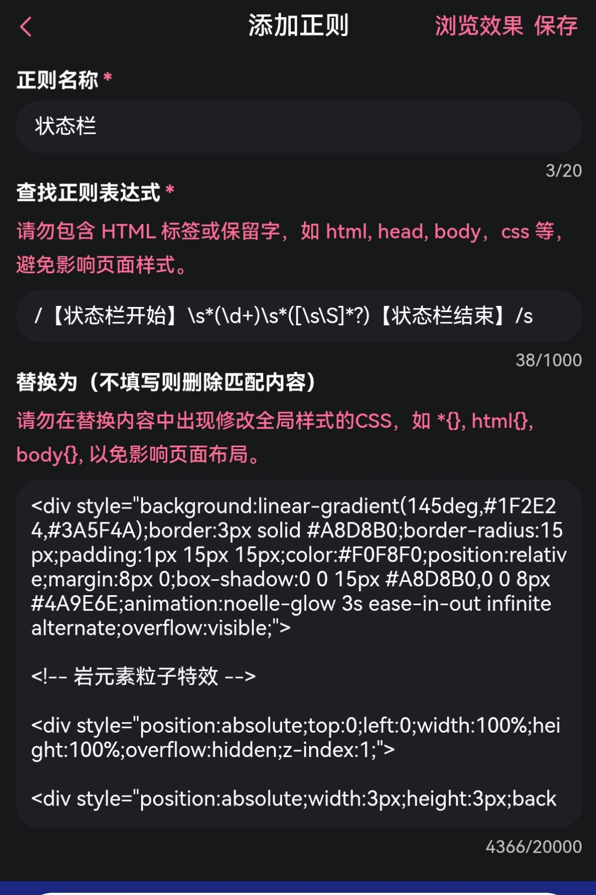
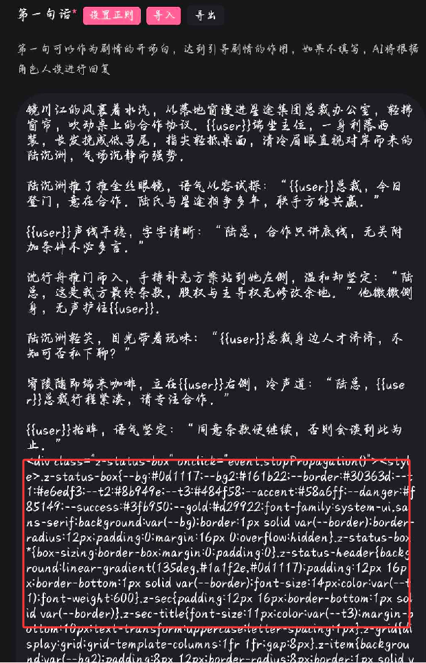
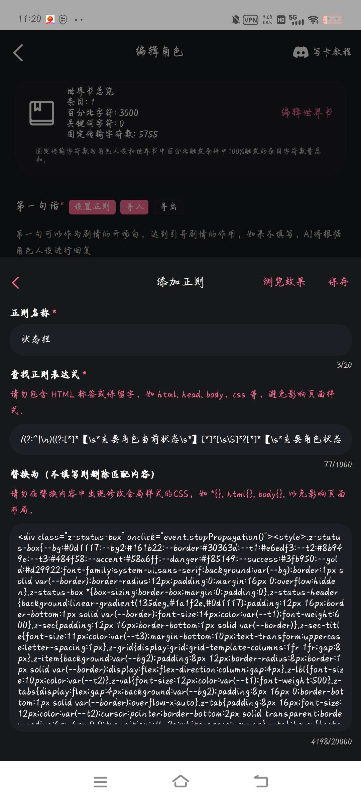
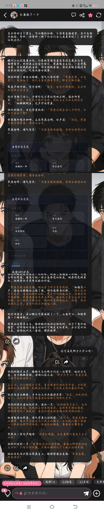
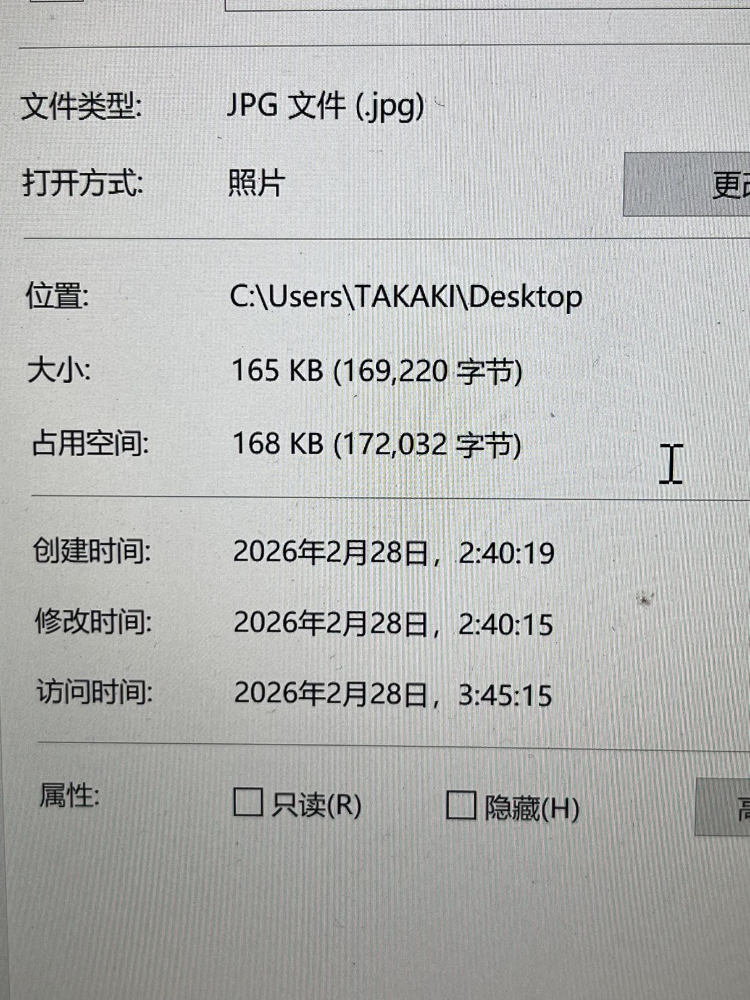

# 萌新的超全面写卡教程！（含正则相关教程解释）

来源: Discord 魅魔藏经阁 thread 1476448191992823859
创建: 2026-02-26T05:18:00.052000+00:00
消息数: 209

---

**er** (2026-09-24 23:10:32):
萌新冇严肃学习中

**艾塔** (2026-09-24 14:50:13):
刚刚尝试写第一张卡，不会用正则和状态栏，只能随便写写了

**阳玉** (2026-09-24 13:19:28):
<:emoji_243:1455870792574439476>

**艾塔** (2026-09-24 08:54:01):
感谢大佬的教程！

**普罗米修斯** (2026-07-27 13:01:32):
大佬大佬那怎么样有灵感呢

**乖宝宝小水母（水母宗唯一宗主。大周荣誉国祖)** (2026-07-27 07:21:54):
<:emoji_150:1400299501423431771>

**乖宝宝小水母（水母宗唯一宗主。大周荣誉国祖)** (2026-07-27 07:21:49):
周雅還巡視到這來了呢

**周雅（被老婆调教.周浩）** (2026-07-26 12:18:05):
不然部分ai肘击的代码可能不会适配站内

**周雅（被老婆调教.周浩）** (2026-07-26 12:17:52):
这个网站下面有文字版站内准则，也可以丢这个网站一起，让ai遵循

**周雅（被老婆调教.周浩）** (2026-07-26 12:17:34):
https://github.com/yofengi/tavern-mmd
[GitHub - yofengi/tavern-mmd: Claude Code skill: create SillyTavern ...](https://github.com/yofengi/tavern-mmd)
Claude Code skill: create SillyTavern & MMD (sexyai.top) character cards, worldbooks, status bars and global CSS themes - yofengi/tavern-mmd

**周雅（被老婆调教.周浩）** (2026-07-26 12:17:20):
你如果丢给ai修改的话最好带上站内准则

**qwer** (2026-07-26 12:15:11):
以经困扰好几天了都。用别人开源的基础模板，让ai修改的，加了一些内容。也让ai反复比对了修改后除了加了内容外，格式啥的都会原本的以样。神奇的是原代码就有用会显示，我修改的就是不会进行替换显示。真的是玄学了

**阳玉** (2026-07-26 11:28:54):
保存之后看看呢？按理来说不应该出现这种情况的<:emoji_150:1400299501423431771>

**qwer** (2026-07-26 03:09:01):
为什么这段状态栏的代码无法显示啊？代码没问题，别的地方能显示。正则配式是也是ai生成的



**GOmhlup** (2026-07-25 12:50:12):
OKOK

**周雅（被老婆调教.周浩）** (2026-07-25 12:02:09):
第一句话和核心内容自己写 开场白记得感谢……开源

**GOmhlup** (2026-07-25 11:55:05):
萌新准备创作第一张卡片

**GOmhlup** (2026-07-25 11:54:54):
大佬们，怎么用别人开源的卡来写自己的卡啊

**花笙🥜** (2026-07-21 03:08:57):
哦哦，我光知道超过15000不能过审核，我还以为是ai脑容量的问题呢

**乖宝宝小水母（水母宗唯一宗主。大周荣誉国祖)** (2026-07-21 03:08:01):
<:emoji_250:1459542480406970432>

**乖宝宝小水母（水母宗唯一宗主。大周荣誉国祖)** (2026-07-21 03:07:56):
同時也是平台給世界書的硬限制

**花笙🥜** (2026-07-21 03:02:37):
这个是知道的，ai读取的内容有限

**花笙🥜** (2026-07-21 03:02:01):
那我可以把关键词放在角色设定里面吗，这样他输出的时候大致方向是不是就不会跑偏了？或者说不会偏的太离谱

**乖宝宝小水母（水母宗唯一宗主。大周荣誉国祖)** (2026-07-21 02:42:17):
AI根本看不見

**乖宝宝小水母（水母宗唯一宗主。大周荣誉国祖)** (2026-07-21 02:41:57):
<:emoji_150:1400299501423431771>

**乖宝宝小水母（水母宗唯一宗主。大周荣誉国祖)** (2026-07-21 02:41:54):
還有，因為你使用概率90觸發
那麼同時傳輸字元只要一大於15000
那麼超過的項目就會直接被扔掉

**阳玉** (2026-07-21 02:24:03):
所以尽量遵守这个字数标准吧，角色可以用关键词来做，尽量不要爆字数了

**阳玉** (2026-07-21 02:23:03):
因为AI注意力不行，如果固定字数一多，AI一看哇！全是重点，那就没有重点了，游玩体验会直线下降，甚至前言不搭后语，角色设定混乱等等。这是很危险的情况，我们一般也会称为爆字数了

**乖宝宝小水母（水母宗唯一宗主。大周荣誉国祖)** (2026-07-21 02:13:13):
<@1423905851625701376> <:emoji_250:1459542480406970432>

**乖宝宝小水母（水母宗唯一宗主。大周荣誉国祖)** (2026-07-21 02:07:13):
你知道為什麼是固定15000嗎

**乖宝宝小水母（水母宗唯一宗主。大周荣誉国祖)** (2026-07-21 02:06:37):
<:emoji_250:1440756778487775303>

**花笙🥜** (2026-07-21 01:22:45):
这个该怎么解决呢

**花笙🥜** (2026-07-21 01:22:34):
现在玩的时候一眼就能看出设定明显不对

**花笙🥜** (2026-07-21 01:22:14):
大佬大佬，问一下，在大世界卡里面设置了多个角色写在了世界书里面（当然为了固定输出不超过15000，所以设置的概率是90%），之中情况下该怎么保证输出的角色是原本的设定

**阳玉** (2026-07-13 01:48:14):
<:emoji_150:1400299501423431771>

**乖宝宝小水母（水母宗唯一宗主。大周荣誉国祖)** (2026-07-01 09:14:35):
<:emoji_250:1459542480406970432>

**阳玉** (2026-07-01 02:36:50):
生成规则的话可以填对应的行项，比如：
身体状态：（根据剧情发展进行生成）
胸部：（同上）
………………
这种是比较常见的生成规则，但具体还是得看AI是否抽风（）其他表达式什么的暂时没看出问题

**闪电n8** (2026-06-27 18:25:13):
<@1423905851625701376> 我状态栏代码放正则替换里，表达式和生成规则该写啥，我写了就是只显示p1中的内容，AI不会根据情境更新状态栏中的字段值




**阳玉** (2026-06-23 13:37:23):
<:emoji_279:1514632884273676338>

**鹤南飞(接定制看简介)** (2026-06-23 12:37:40):
新人学习中

**乖宝宝小水母（水母宗唯一宗主。大周荣誉国祖)** (2026-06-08 21:16:06):
<:1000168531:1298906724979310634>

**阳玉** (2026-06-08 07:27:08):
<:1000168531:1298906724979310634>

**Geck** (2026-06-06 12:30:01):
<:daroubangqingnichi:1411320597241139260>

**乖宝宝小水母（水母宗唯一宗主。大周荣誉国祖)** (2026-05-25 22:55:53):
你好，小可愛

**乖宝宝小水母（水母宗唯一宗主。大周荣誉国祖)** (2026-05-25 22:55:39):
<:daroubangqingnichi:1411320597241139260>

**sq ding** (2026-05-25 17:39:28):
<:1000168531:1298906724979310634>

**sq ding** (2026-05-25 17:39:22):
大家好～

**阳玉** (2026-05-25 13:55:21):
<:emoji_276:1508262085963026513>

**ww@12345678** (2026-05-12 15:36:15):
你是L？？

**阳玉** (2026-05-09 13:07:22):
<:1000168531:1298906724979310634> 可能是网络问题

**雪媚酱** (2026-05-09 00:48:48):
茶壶打不开

**苏墨白** (2026-05-07 07:49:59):
<:1000168531:1298906724979310634>

**jy** (2026-04-29 15:18:26):
通宵达旦严肃学习中。。。

**ehst** (2026-04-25 04:25:20):
<:emoji_276:1497191644402028624>

**阳玉** (2026-04-25 02:43:13):
<:emoji_243:1455870792574439476>

**陌羽（绪瑶的星怒）** (2026-04-24 11:58:31):
新人正在学习中…

**comgra** (2026-04-24 10:55:10):
<:daroubangqingnichi:1411320597241139260>

**乖宝宝小水母（水母宗唯一宗主。大周荣誉国祖)** (2026-04-11 08:49:22):
<:emoji_181:1409565014246821968>

**乖宝宝小水母（水母宗唯一宗主。大周荣誉国祖)** (2026-04-11 08:49:14):
說不定都是些害羞的呢
連個消息都不留

**乖宝宝小水母（水母宗唯一宗主。大周荣誉国祖)** (2026-04-11 08:48:34):
頂)

**乖宝宝小水母（水母宗唯一宗主。大周荣誉国祖)** (2026-04-11 08:48:31):
<:daroubangqingnichi:1411320597241139260>

**XXX** (2026-04-11 08:28:40):
众

**阳玉** (2026-04-11 06:26:14):
byd怎么没人呢

**阳玉** (2026-04-11 06:26:06):
<:emoji_248:1489983371848450222>

**comgra** (2026-04-04 06:14:05):
<:emoji_246:1488100783848161372>

**乖宝宝小水母（水母宗唯一宗主。大周荣誉国祖)** (2026-04-04 03:48:42):
<:emoji_246:1488100783848161372>

**XXX** (2026-04-04 03:41:09):
<:emoji_246:1488100783848161372>

**星星⭐** (2026-04-04 03:40:25):
拜拜，我先了<:emoji_247:1488101228389994526><:emoji_245:1460695536322478268>

**星星⭐** (2026-04-04 03:39:07):
谢谢<:emoji_140:1379454014852436038>

**星星⭐** (2026-04-04 03:38:57):
好滴好滴<:emoji_246:1488100783848161372>

**XXX** (2026-04-04 03:38:04):
加油

**XXX** (2026-04-04 03:38:02):
<:emoji_247:1488101228389994526>

**XXX** (2026-04-04 03:37:54):
状态栏规则，就是写一个规则让ai遵守，如：
````
状态栏规则：
在最后必须生成状态栏，状态栏格式如下：
【写下你的状态栏格式】
```

**星星⭐** (2026-04-04 03:36:33):
好多呀<:emoji_247:1488101228389994526> <:emoji_140:1379454014852436038>

**星星⭐** (2026-04-04 03:35:51):
OK<:emoji_140:1379454014852436038>

**星星⭐** (2026-04-04 03:35:33):
有点鼠了<:1000168510:1298906820638674984>

**阳玉** (2026-04-04 03:35:20):
https://discord.com/channels/1205870897769095229/1483438302441767022
可以去借鉴看看其他佬的开源卡学习学习

**阳玉** (2026-04-04 03:34:27):
里面有其他传送门的

**星星⭐** (2026-04-04 03:34:21):
我看到了，谢谢。我再试试<:emoji_140:1379454014852436038>

**阳玉** (2026-04-04 03:34:18):
<:1000168516:1298906851848486942>

**阳玉** (2026-04-04 03:34:09):
规则就是你想让状态栏如何生成，比如：
此状态栏始终位于每段最底层,按当前在场角色数量对应生成…………
这就是生成规则

**XXX** (2026-04-04 03:34:02):
<:emoji_150:1400299501423431771>

**XXX** (2026-04-04 03:33:52):
那你还超全面！我要实名举报，不全面

**阳玉** (2026-04-04 03:32:46):
我这是里面对状态栏的内容提及较少的

**阳玉** (2026-04-04 03:32:19):
<:emoji_246:1488100783848161372>

**阳玉** (2026-04-04 03:32:17):
啊这个啊

**XXX** (2026-04-04 03:31:56):
https://discord.com/channels/1205870897769095229/1476448191992823859/1476448191992823859

**XXX** (2026-04-04 03:31:03):
这个教程

**XXX** (2026-04-04 03:30:52):
虽然我没看过

**XXX** (2026-04-04 03:30:45):
<@1423905851625701376> 这楼里面的教程没有吗

**星星⭐** (2026-04-04 03:30:06):
这个我没有写，怎么写呀！<:emoji_246:1488100783848161372>

**星星⭐** (2026-04-04 03:28:45):
不是，不是

**XXX** (2026-04-04 03:27:31):
<@1488536820814708799>

**XXX** (2026-04-04 03:27:24):
而且没写状态栏规则，是在世界书里面吗

**XXX** (2026-04-04 03:24:04):
用啥弄出来的，茶壶吗

**XXX** (2026-04-04 03:23:53):
这种的

**XXX** (2026-04-04 03:23:49):
这里不是放这个的，看你正则应该是放【主要角色当前状态】......【......结束】


**星星⭐** (2026-04-04 03:20:28):
<:emoji_247:1488101228389994526>

**星星⭐** (2026-04-04 03:20:24):
这样呢？

**星星⭐** (2026-04-04 03:20:17):



**XXX** (2026-04-04 03:19:20):
你这样发看不出问题的

**XXX** (2026-04-04 03:18:25):
<:emoji_150:1400299501423431771>

**星星⭐** (2026-04-04 03:18:03):
只有第一句有状态栏怎么办<:1000168510:1298906820638674984>


**星星⭐** (2026-04-04 03:17:19):
有人吗？

**乖宝宝小水母（水母宗唯一宗主。大周荣誉国祖)** (2026-03-28 18:31:48):
<:emoji_252:1486325346256027708>

**阳玉** (2026-03-28 07:25:52):

**阳玉** (2026-03-21 11:21:06):
<:0C2E5ADC06577B01B51EE6C79E512B2E:1459834033797074997>

**阳玉** (2026-03-21 11:20:37):
萌新的超全面写卡教程！（含正则相关教程解释）

**阳玉** (2026-03-21 10:02:00):
<:emoji_148:1382329938404839586>

**沐沐** (2026-03-21 07:13:14):
<:emoji_148:1382329938404839586>

**阳玉** (2026-03-21 01:18:20):
<:emoji_250:1459542480406970432>

**阳玉** (2026-03-18 15:29:14):
<:emoji_150:1400299501423431771>

**阳玉** (2026-03-06 13:47:52):
<:emoji_250:1459542480406970432>

**爱与花之诗** (2026-03-05 12:13:46):
<:emoji_252:1478791303587299378>

**清** (2026-03-05 09:35:05):
卖萌可能会被🌿，唯有击剑🤺才能活下来<:07:1298281204260278383> 第一天进来理解，我也没进几天，然后放开了

**清** (2026-03-05 09:33:45):
<:emoji_249:1416980114511761448>

**清** (2026-03-05 09:33:43):
看着晕晕乎乎的

**爱与花之诗** (2026-03-05 06:57:54):
<:emoji_239:1431854531477635205> 标记一下

**阳玉** (2026-03-04 15:40:27):
<:emoji_150:1400299501423431771>

**汪藏海** (2026-03-03 09:49:27):
没太懂正则

**汪藏海** (2026-03-03 09:49:03):
老哥们，有没有教程卡能参考一下吗

**zyntm** (2026-03-02 17:28:57):
感谢

**波奇🎸** (2026-03-01 10:49:56):
谢谢妈妈，又学到了

**阳玉** (2026-03-01 09:57:22):
<a:vamooo:1388972952678174911>

**阳玉** (2026-03-01 09:57:03):
<:emoji_150:1400299501423431771>

**阳玉** (2026-03-01 04:02:34):
<:1000168516:1298906851848486942>

**清** (2026-03-01 03:54:40):
萌新看了眼，暂时没有学习

**阳玉** (2026-03-01 03:53:41):
<a:vamooo:1388972952678174911>

**周雅（被老婆调教.周浩）** (2026-02-28 01:37:38):
去主站上传试试

**阳玉** (2026-02-28 01:35:58):
我的教程里面有个视频，最后段有相关解决方法

**eabong** (2026-02-27 19:48:07):
168kb也算大吗


**eabong** (2026-02-27 19:44:37):
可是我的图才一百多kb

**玲璃亲** (2026-02-27 19:44:06):
一般我会用截图来解决

**玲璃亲** (2026-02-27 19:43:46):
图太大

**eabong** (2026-02-27 19:41:20):
我想问下，我写卡的时候封面图一直显示上传中，已经一个小时了还没上传成功，是怎么回事呀

**XXX** (2026-02-27 03:31:40):
<:emoji_250:1440756778487775303>

**玲璃亲** (2026-02-27 01:35:40):
<:emoji_252:1476549537547161662>

**阳玉** (2026-02-27 01:26:08):
不想打击新人信心，但这个正则我给任何群友看了都会懵

**乖宝宝小水母（水母宗唯一宗主。大周荣誉国祖)** (2026-02-26 22:18:37):
幹的好，新人

**乖宝宝小水母（水母宗唯一宗主。大周荣誉国祖)** (2026-02-26 22:18:30):
正則不是這樣運作的呦
看的出來天道它慌了呢

**乖宝宝小水母（水母宗唯一宗主。大周荣誉国祖)** (2026-02-26 22:17:13):
<:emoji_150:1382433856178749582>

**阳玉** (2026-02-26 14:31:53):
<:emoji_247:1437660012661968916>

**阳玉** (2026-02-26 14:31:41):
新人首卡最好不要碰正则，把基础打理好后再慢慢学

**qingfen** (2026-02-26 14:30:20):
太难了

**qingfen** (2026-02-26 14:30:17):
算了吧

**阳玉** (2026-02-26 13:56:29):
把设定转到他该去的地方（）

**阳玉** (2026-02-26 13:55:38):
<:emoji_150:1400299501423431771>

**阳玉** (2026-02-26 13:55:35):
首先，检查你的正则，我估计是你的正则复制上有些问题，然后把你那个状态栏删了

**qingfen** (2026-02-26 13:50:29):
所以怎么了

**qingfen** (2026-02-26 13:50:26):
<@1423905851625701376>

**qingfen** (2026-02-26 13:50:22):
我不知道啊 就那样 然后这样 就上去了

**阳玉** (2026-02-26 13:47:27):
<:emoji_252:1476549537547161662>

**阳玉** (2026-02-26 13:47:20):
目前还是看不出来问题-但是，我令令令申申申申申，设定别写正则里，设定别写正则里，设定别写正则里，bro的状态栏正则是个什么东西

**qingfen** (2026-02-26 13:43:39):
<@1423905851625701376> <@1423905851625701376> 就这样

**qingfen** (2026-02-26 13:43:35):


**阳玉** (2026-02-26 13:14:33):
<:anonwoah:1234322878821044315>

**阳玉** (2026-02-26 13:14:27):
如此短暂的时间完全无法找到任何信息啊喂

**qingfen** (2026-02-26 12:38:10):
<@1423905851625701376>

**qingfen** (2026-02-26 12:38:05):
这个是为什么

**qingfen** (2026-02-26 12:38:02):


**洛洛的茜** (2026-02-26 11:56:00):
舒服了

**阳玉** (2026-02-26 11:55:57):
<a:vamooo:1388972952678174911>

**洛洛的茜** (2026-02-26 11:55:38):
能不能把这个删了，让我对齐

**阳玉** (2026-02-26 11:54:38):
<:heart:1438351332531765289>

**量子弱猫** (2026-02-26 11:54:30):
我喜欢你<:emoji_140:1379454014852436038>

**洛洛的茜** (2026-02-26 10:04:17):
萌新的我已严肃学习

**汐愛** (2026-02-26 09:54:30):
萌新的我已严肃学习

**夏祈歌** (2026-02-26 09:54:07):
萌新的我已严肃学习

**会跳的菠菜** (2026-02-26 09:05:38):
萌新的我已严肃学习

**comgra** (2026-02-26 08:52:12):
萌新的我已严肃学习

**玲璃亲** (2026-02-26 08:07:37):
萌新的我已严肃学习

**玲璃亲** (2026-02-26 08:07:13):
<:emoji_249:1476183031940255744>

**阳玉** (2026-02-26 08:04:17):
<:emoji_250:1459542480406970432>

**周雅（被老婆调教.周浩）** (2026-02-26 08:02:57):
我去 这个攻略太全面了

**92chi78** (2026-02-26 07:52:24):
<:emoji_162:1409556221811232941>

**阳玉** (2026-02-26 07:46:51):
不是，Nix那个链接显示出了点问题，调整了下

**乖宝宝小水母（水母宗唯一宗主。大周荣誉国祖)** (2026-02-26 07:43:17):
我們也擠，讓土豆做徒勞功<:emoji_242:1459832161719943198>

**乖宝宝小水母（水母宗唯一宗主。大周荣誉国祖)** (2026-02-26 07:42:54):
<:emoji_245:1475855412757663938>

**洛洛的茜** (2026-02-26 07:42:29):
<:emoji_251:1474746086345281709>

**洛洛的茜** (2026-02-26 07:42:23):
这样修改算是新发的可以往上挤吗

**洛洛的茜** (2026-02-26 07:42:00):
和意味

**阳玉** (2026-02-26 07:12:50):
萌新的超全面写卡教程！（真的很全！）

**阳玉** (2026-02-26 07:12:25):
萌新的超全面写卡教程！（真的很全）

**阳玉** (2026-02-26 07:11:44):
萌新的超全面写卡教程！（真的很全！）

**阳玉** (2026-02-26 07:09:55):
<:emoji_140:1379454014852436038> 谢谢！

**小魅** (2026-02-26 07:09:09):
好棒的教程！

**MEE6** (2026-02-26 07:08:39):
<:CHECK6:403540120181145611> 100,000 XP has been given to **<@!1423905851625701376>**

**乖宝宝小水母（水母宗唯一宗主。大周荣誉国祖)** (2026-02-26 07:07:58):
<:emoji_245:1475855412757663938>

**阳玉** (2026-02-26 07:07:41):
刚给我发消息的来着

**乖宝宝小水母（水母宗唯一宗主。大周荣誉国祖)** (2026-02-26 07:06:59):
還沒上工呢

**乖宝宝小水母（水母宗唯一宗主。大周荣誉国祖)** (2026-02-26 07:06:52):
<:1000168531:1298906724979310634>

**阳玉** (2026-02-26 07:06:40):
<:1000168531:1298906724979310634>

**阳玉** (2026-02-26 07:06:39):
我记得我也就写了4000字左右哇，小魅人呢

**乖宝宝小水母（水母宗唯一宗主。大周荣誉国祖)** (2026-02-26 07:05:51):
<:emoji_248:1427157732770844783>

**阳玉** (2026-02-26 07:05:49):
<:emoji_150:1400299501423431771>

**阳玉** (2026-02-26 07:05:40):
<@742177857354334219>

**阳玉** (2026-02-26 07:05:27):
我把大道叫过来了

**乖宝宝小水母（水母宗唯一宗主。大周荣誉国祖)** (2026-02-26 07:05:02):
不過是一介mmd小世界的土豆天道
陣！起！給我斷！！

**周勿** (2026-02-26 06:59:29):
L？

**阳玉** (2026-02-26 06:58:12):
通灵术！

**阳玉** (2026-02-26 06:58:09):
<@1135473222658297907>

**阳玉** (2026-02-26 06:36:30):
<a:vamooo:1388972952678174911>

**i** (2026-02-26 05:34:04):
<:emoji_140:1379454014852436038>

**阳玉** (2026-02-26 05:27:49):
萌新的超全面写卡教程！

**有咩** (2026-02-26 05:26:23):
<:emoji_147:1382565790129328128> 🥔

**乖宝宝小水母（水母宗唯一宗主。大周荣誉国祖)** (2026-02-26 05:19:10):
<:emoji_245:1475855412757663938>

**洛洛的茜** (2026-02-26 05:19:06):
约吗

**洛洛的茜** (2026-02-26 05:19:03):
很有用

**阳玉** (2026-02-26 05:18:00):
# 隔壁小孩都馋哭了的教程！
最近MMD来了许多新人，咱也就借此机会整理了下写卡的各项步骤供新人参考-更希望新人能在后面走出条自己的“舒适写卡之路”！（同时为新人们解决部分写卡中的问题：如“怎样私密”，“审核规则”等）
https://ccnjfg2ljacx.feishu.cn/wiki/N9RswBjZ2iWvrmk2kYgcErsAnUh
世界书教程链接：
https://discord.com/channels/1205870897769095229/1448988105922314261
茶壶肘卡教程：
https://discord.com/channels/1205870897769095229/1454385079886549068
https://discord.com/channels/1205870897769095229/1464477833886957722
https://discord.com/channels/1205870897769095229/1464928108980473866
详细正则教程：（亦可以去茶壶卡学习）
https://discord.com/channels/1205870897769095229/1448929295970865192

