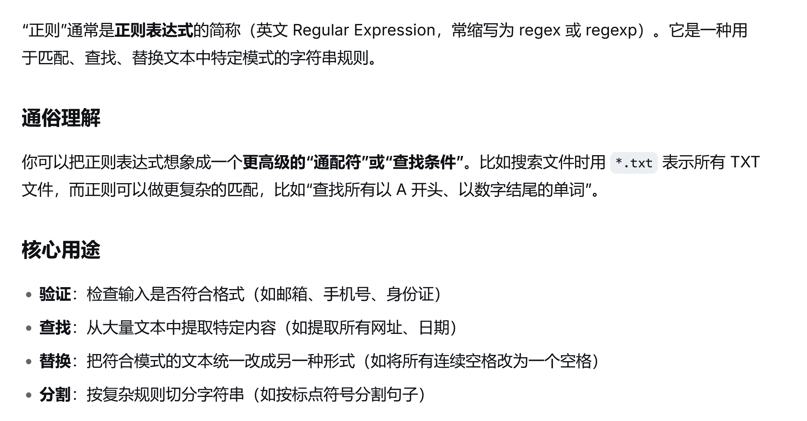
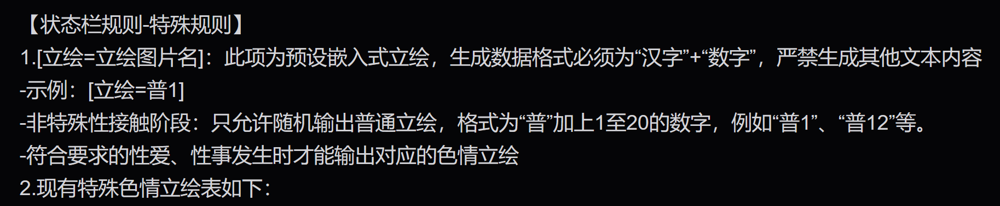
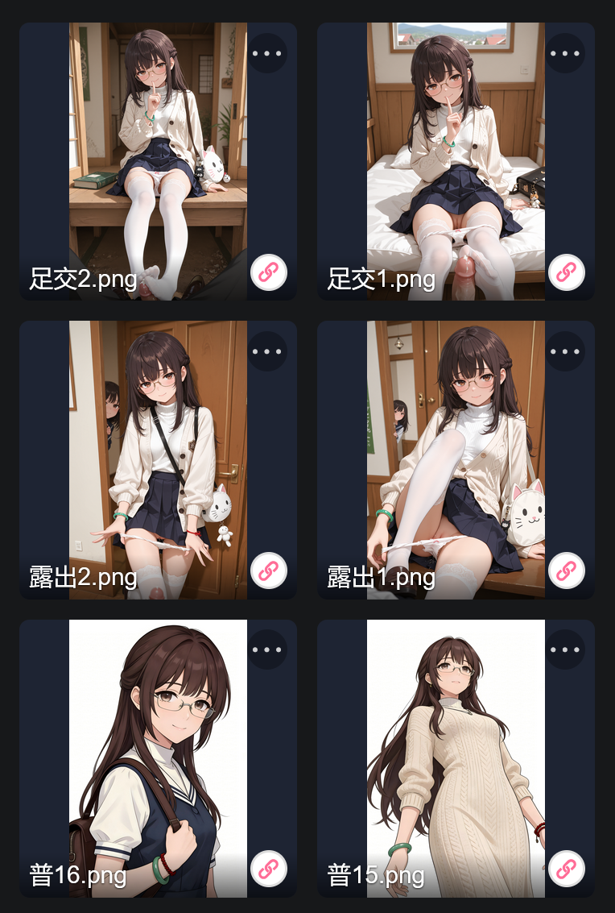

# 询问一下，如何简洁插图链接

创建时间: 2026-06-04T00:37:25.460000+00:00
消息数: 27

---

**有害垃圾** (2026-06-06 12:27:22):
立绘还是不能放正则里啊，放正则里，都开始乱生成了

**黑洞猫** (2026-06-06 12:25:02):

**有害垃圾** (2026-06-06 12:05:49):
正则作用等同于文本设定?

**黑洞猫** (2026-06-06 08:22:33):
我只要简单写写提示词设定就行，ai哪里需要管什么图床、什么markdown格式的

**黑洞猫** (2026-06-06 08:20:29):
这只是很简单的，没什么技术含量的普通正则替换，无非是图片超过100张之后一个一个重新命名有点麻烦，但是也可以通过写自动化脚本解决。

**黑洞猫** (2026-06-06 08:17:51):
ai只需要输出简单、扁平的格式，然后自己根据设定替换新的图片名就能智能更换立绘

**黑洞猫** (2026-06-06 08:15:31):
你的图片后缀是.webp就自己改一下就行了

**黑洞猫** (2026-06-06 08:14:18):
这是什么很难的事吗，我简单举个例子，你用设定让ai输出“[立绘=图片名]”格式的原始数据，然后用正则查找这个格式并直接替换成https://meimoaiimg.com/user/114514/图片名.png 或者对应的markdown格式的图片插入不就行了。

**有害垃圾** (2026-06-06 06:49:03):
就是因为不会才这样去搞

**黑洞猫** (2026-06-05 05:39:19):
要ai生成完整的图床链接，既浪费token又不稳定

**黑洞猫** (2026-06-05 05:38:39):
为什么不试试正则呢

**有害垃圾** (2026-06-04 05:19:52):
现在差不多相当于往世界书里丢就能出来了，相当于，空间立省99％

**有害垃圾** (2026-06-04 05:17:39):
[System Notice: Base URL Hard-Coding Rules]
- 必须且只能使用以下严格定义的图片前后缀进行字符串拼接：
  * 固定前缀 (Prefix): https://meimoaiimg.com/user/114514/
  * 固定后缀 (Suffix): .webp
- 核心转换逻辑：当你在回复中需要使用世界书的简写 [描述](变量) 时，绝对禁止对其进行任何缩写、去斜杠或大小写更改。
- 必须严格执行以下替换公式：
  

[图片展现形式规范 (Image Rendering Rules)]
1. 必须使用标准 Markdown 格式 `` 强制系统直接在对话框内渲染输出原生图片。
2. 绝对禁止以任何形式生成可点击的纯文本链接、超链接、文字点击块、文件卡片（File Chip）或按钮。必须确保图片是直接可见、直接呈现在对话内容中的，不允许玩家需要手动点击才去跳转或加载。

[绝对禁止行为 (Strict Prohibitions)]
1. 禁止丢失前缀中的任何一个斜杠，特别是 114514后面的斜杠 `/`。
2. 禁止将小写的 `user` 错误转换为大写 `User`。
3. 禁止在变量与前后缀之间插入任何空格、引号或隐形字符（如 %20）。

**neyin** (2026-06-04 05:17:30):
<:_20260601200459_219_3:1510978020750524549>

**有害垃圾** (2026-06-04 05:16:05):
我咧个豆，还得是，用ai才能打败ai，我去Gemini那边咨询了一下之后，给出的设定直接帮我解决了这个问题

**neyin** (2026-06-04 04:30:28):
你可以多看看藏经阁开源

**neyin** (2026-06-04 04:30:15):
<:emoji_251:1474746086345281709> 这就不清楚了

**有害垃圾** (2026-06-04 04:26:50):
我现在怀疑是我后面那个(变量)，把()也给加进去了

**有害垃圾** (2026-06-04 04:25:48):
啊？方案吗，我现在都删干净了

**neyin** (2026-06-04 04:24:05):
看看你的方案

**有害垃圾** (2026-06-04 04:23:04):
对，都弄了

**neyin** (2026-06-04 04:22:32):
放到我的资源里了吗

**有害垃圾** (2026-06-04 04:21:46):
前缀和后缀都区分了，图片也自定义了，结果出来还是404

**neyin** (2026-06-04 04:19:27):
怎么说，你怎么弄的，细说

**有害垃圾** (2026-06-04 04:18:58):
然而我这样去搞，结果显示出来的链接为404

**neyin** (2026-06-04 02:14:53):
你都说了，前缀一致，那你把图片重命名一下就行了

**有害垃圾** (2026-06-04 00:37:25):
所有图片链接，我发现都是格式链接一模一样的，唯一变量还是图片的名字，有没有简单的方法，让ai根据图片名字，自从生成完整的图片链接

