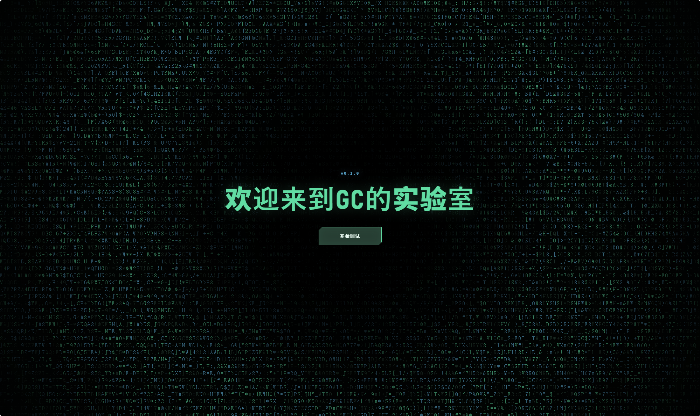

# 革...革命？zdjd？

创建时间: 2026-08-06T16:10:12.469000+00:00
消息数: 60

---

**黑白琴键（奥特曼参赛卡：残光）四组** (2026-08-10 19:45:26):
爸爸我服了

**黑白琴键（奥特曼参赛卡：残光）四组** (2026-08-10 19:45:22):
牛逼

**黑洞猫** (2026-08-07 10:47:40):
我之前也做了差不多的东西，可以交叉对比一下了

**黑洞猫** (2026-08-07 10:47:04):
不错，支持

**小魅** (2026-08-06 16:41:02):
应得的宝宝<:emoji_140:1379454014852436038>

**GodCount** (2026-08-06 16:40:15):
感谢小魅<:emoji_278:1504527822717452368>

**MEE6** (2026-08-06 16:39:34):
<:CHECK6:403540120181145611> 300,000 XP has been given to **<@!1449650257687347342>**

**小魅** (2026-08-06 16:39:25):
那还说啥了，给你了

**小魅** (2026-08-06 16:38:58):
哇，我们刚好正在做一个新版对话框，你先掏出来

**花沁雅** (2026-08-06 16:34:06):
<:emoji_299:1533423505562144879> 咕咕

**阳玉** (2026-08-06 16:23:48):
<:emoji_249:1416980114511761448>

**GodCount** (2026-08-06 16:23:35):
666 微软大战代码吗

**阳玉** (2026-08-06 16:23:13):
那还是玩玩植物大战僵尸吧

**GodCount** (2026-08-06 16:22:38):
不然小魅来杀我的头了

**GodCount** (2026-08-06 16:22:24):
不聊这个

**GodCount** (2026-08-06 16:22:21):
<:emoji_299:1533423505562144879>

**阳玉** (2026-08-06 16:21:59):
有点pyrhon基础就能拿AI肘死牢魅啊

**阳玉** (2026-08-06 16:21:41):
这已经不是漏洞了

**阳玉** (2026-08-06 16:21:18):
我现在知道那位先辈为什么如此评价mmd了

**阳玉** (2026-08-06 16:20:52):
<:emoji_252:1476549537547161662>

**GodCount** (2026-08-06 16:20:41):
都可以做

**GodCount** (2026-08-06 16:20:39):
<:emoji_299:1533423505562144879>

**GodCount** (2026-08-06 16:19:53):
具体表现就是

**GodCount** (2026-08-06 16:19:46):
蛮多的

**GodCount** (2026-08-06 16:19:40):
都花不出去

**阳玉** (2026-08-06 16:19:39):
所以到底是啥漏洞

**GodCount** (2026-08-06 16:19:35):
我最近都不怎么玩了

**GodCount** (2026-08-06 16:19:30):
也是

**阳玉** (2026-08-06 16:19:24):
<:1000168532:1298906722546614313>

**阳玉** (2026-08-06 16:19:21):
电量对牢魅来说随便给，完全不肉疼的（

**GodCount** (2026-08-06 16:18:54):
结果小魅直接给了

**GodCount** (2026-08-06 16:18:47):
就想着要点经验

**GodCount** (2026-08-06 16:18:42):
本来也没想要电的

**阳玉** (2026-08-06 16:18:36):
但理论上牢魅肯定还有一堆漏洞

**GodCount** (2026-08-06 16:18:36):
不太敢

**GodCount** (2026-08-06 16:18:28):
<:emoji_299:1533423505562144879>

**阳玉** (2026-08-06 16:17:40):
但为啥不要点USDT（

**GodCount** (2026-08-06 16:17:31):
那几天突然很有兴趣 就学了点

**阳玉** (2026-08-06 16:17:13):
<:emoji_139:1379455053080825866>

**阳玉** (2026-08-06 16:17:08):
干起网安了？

**GodCount** (2026-08-06 16:16:50):
<:emoji_298:1526501165460881478>

**GodCount** (2026-08-06 16:16:46):
帮找了几个漏洞

**阳玉** (2026-08-06 16:15:14):
<:1000168531:1298906724979310634> 是出啥情况了

**GodCount** (2026-08-06 16:14:48):
<:emoji_242:1459832161719943198>

**GodCount** (2026-08-06 16:14:45):
上次给我打了10w电

**GodCount** (2026-08-06 16:14:38):
其实小魅已经是我的rbq了

**阳玉** (2026-08-06 16:14:08):
😋

**阳玉** (2026-08-06 16:14:06):
<@1135473222658297907>  所以把经验打进我这个账号吧！我来维护小魅！

**GodCount** (2026-08-06 16:13:20):
<:1000168529:1298906735599288330>

**GodCount** (2026-08-06 16:13:17):
呱 不要哇

**GodCount** (2026-08-06 16:13:09):
革命性的意思<:emoji_278:1505051804508098591>

**阳玉** (2026-08-06 16:13:08):
# 反攻牢魅！GC当权！

**阳玉** (2026-08-06 16:12:50):
😋

**阳玉** (2026-08-06 16:12:48):
你这明明写了要革命！放心！已经给你披上黄袍了！

**GodCount** (2026-08-06 16:12:27):
<:emoji_299:1533423505562144879>

**GodCount** (2026-08-06 16:12:23):
呱，你不要污蔑我啊，我这是扩展

**阳玉** (2026-08-06 16:12:02):
<:emoji_150:1400299501423431771>

**阳玉** (2026-08-06 16:11:58):
终于要推翻小魅了吗

**GodCount** (2026-08-06 16:11:43):
<@1135473222658297907> 给我经验，多给一点让我直接飞升80好吗<:emoji_140:1379454014852436038>

**GodCount** (2026-08-06 16:10:12):
具体信息在GitHub的Readme和相关文件内，我已配置多个构建和测试脚本。

如果你想预览效果，可以导入附件正则。（不过那个有点大，因为我加载了第三方库<:emoji_298:1526501165460881478> ）

GitHub链接：https://github.com/Godcount10/MMD-hud-iframe

[GitHub - Godcount10/MMD-hud-iframe: MMD Parent Bridge Host 与独...](https://github.com/Godcount10/MMD-hud-iframe)
MMD Parent Bridge Host 与独立 iframe Vue HUD；当前发布 bridge-debug 调控台 Theme - Godcount10/MMD-hud-iframe

