# 鼓的跑图随记

创建时间: 2026-05-17T17:31:57.988000+00:00
消息数: 47

---

**鼓¯꒳¯** (2026-06-24 18:23:04):
<:emoji_661_:1467525717943255061>

**neyin** (2026-06-22 15:26:32):
明天再看看

**黑洞猫** (2026-06-22 15:26:09):
构图上问题挺大

**neyin** (2026-06-22 15:26:03):
<:emoji_279:1514632884273676338>

**黑洞猫** (2026-06-22 15:26:02):
确实

**neyin** (2026-06-22 15:26:01):
用上comfyui还是鼓鼓的钟教的

**neyin** (2026-06-22 15:25:39):
我这个有点怼脸了

**neyin** (2026-06-22 15:25:24):
<a:nailong_hang:1474088177110351982> 🥲

**黑洞猫** (2026-06-22 15:16:57):
<:emoji_249:1416980114511761448>

**黑洞猫** (2026-06-22 15:16:55):
你不如他

**neyin** (2026-06-22 04:47:46):
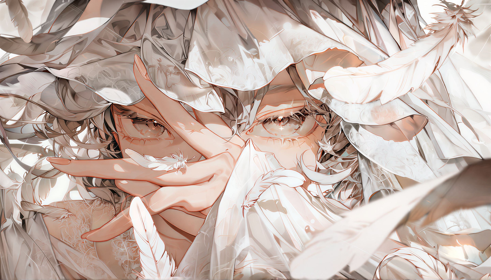

**neyin** (2026-06-22 04:01:33):
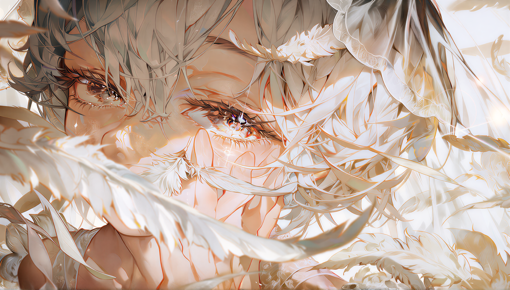

**neyin** (2026-06-21 05:07:28):
<:emoji_279:1515285028462919802>

**neyin** (2026-06-21 05:07:23):
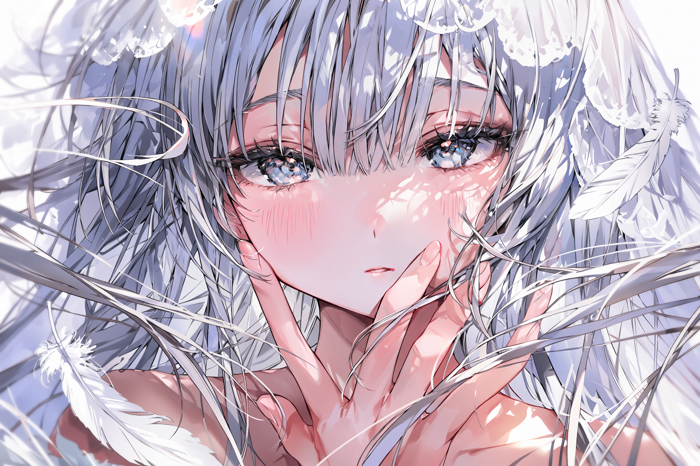

**neyin** (2026-06-20 05:01:31):
张力

**neyin** (2026-06-20 05:01:28):
<:emoji_278:1514115400571555910>

**黑洞猫** (2026-06-16 02:05:42):
感谢

**鼓¯꒳¯** (2026-06-16 00:38:04):
里面的内容分成三份<:emoji_118:1379226234168414289>

**鼓¯꒳¯** (2026-06-12 07:37:47):
我下班了找找预设发给你

**鼓¯꒳¯** (2026-06-12 07:37:29):
我用酒馆预设+Gemini直接出的诶<:1000168531:1298906724979310634>

**黑洞猫** (2026-06-10 15:56:41):
求提示词教学，大...大佬

**鼓¯꒳¯** (2026-06-10 05:46:12):
-# 是我喜欢的质感<:emoji_118:1379226234168414289>
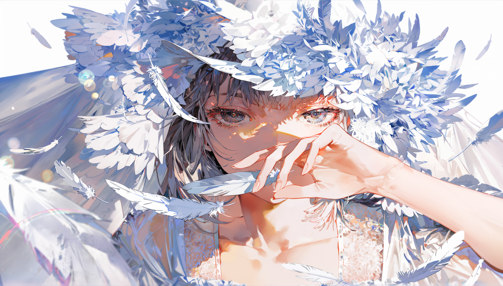
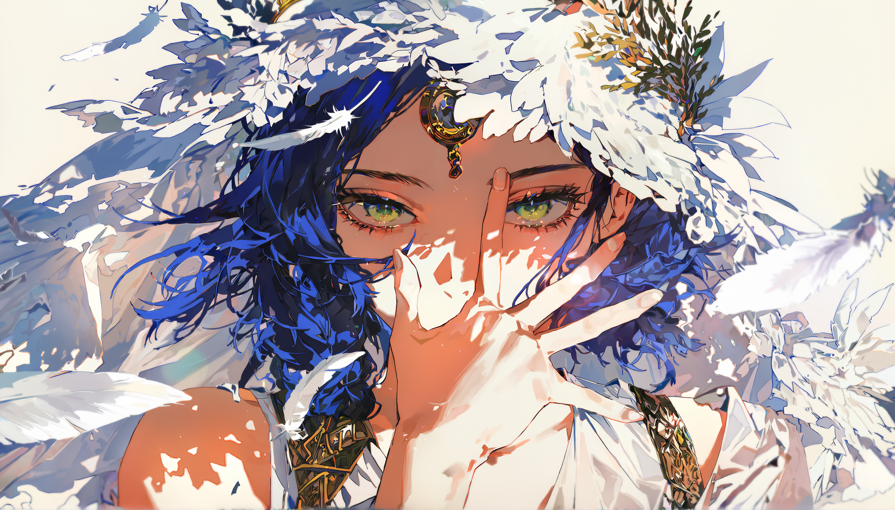
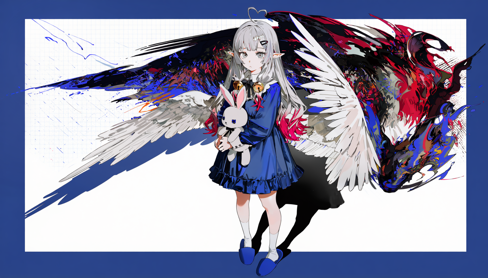

**鼓¯꒳¯** (2026-06-10 05:44:50):
调一调cfg？我不是很清楚欸<:1000168531:1298906724979310634>

**黑洞猫** (2026-06-07 12:28:18):
挺牛的，大佬

**moranzhi_** (2026-06-05 12:00:48):
佬 你知道衣服和手脏是什么原因吗？远看还好，一放大手和衣服是有点吓人

**moranzhi_** (2026-06-05 12:00:02):

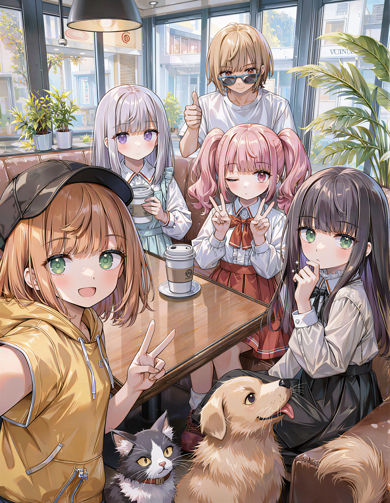

**moranzhi_** (2026-05-24 09:18:59):
豪德<:emoji_249:1416980114511761448>

**鼓¯꒳¯** (2026-05-24 02:17:51):
masterpiece、rl超级分辨率这两个Lora我是一直开着的，
photobackground就是你看到的真实系背景，但就算开很低权重也会很突出，可以视情况开

**鼓¯꒳¯** (2026-05-24 02:05:49):
有什么不懂的可以再来问

**鼓¯꒳¯** (2026-05-24 02:05:25):
按时间排序，后面发的图都是有元数据的底图，你可以导入工作流自己看看<:emoji_118:1379226234168414289>

**moranzhi_** (2026-05-22 03:03:45):
佬有没有anima焚诀 准备sdxl转anima了

**鼓¯꒳¯** (2026-05-21 16:42:27):
-# 带派...
-# -你是奥泽美咲吗？
-# -ai：我觉得我是
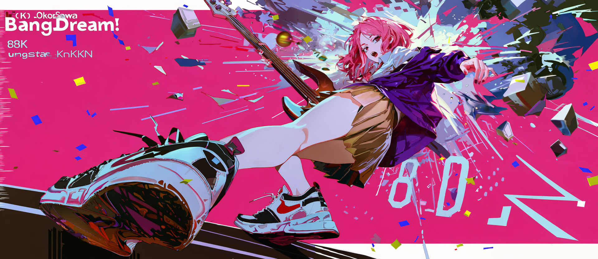

**鼓¯꒳¯** (2026-05-19 17:01:27):
-# 光晕（另一个画风
-# 其实也很好看，但跟历史画风不一样，所以被无情抛弃的版本😌
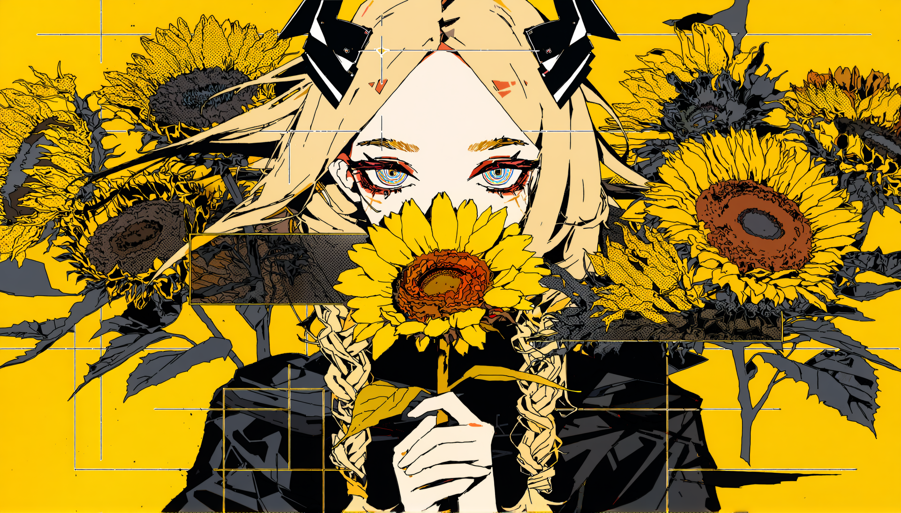

**鼓¯꒳¯** (2026-05-19 16:59:52):
# 光晕

-「被照得太亮的地方，其实什么都看不清呢」

**鼓¯꒳¯** (2026-05-18 09:28:04):
# 护心镜

-「可是我现在连能把它藏起来的口袋都没有……」
-# *是混进了贞德军队的提耶拉
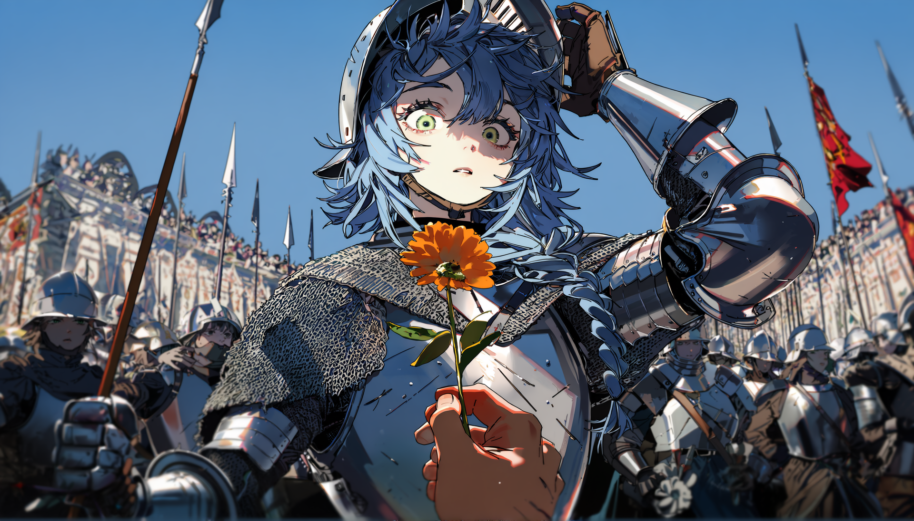

**鼓¯꒳¯** (2026-05-18 08:21:20):
-# OC大图
-# 是的孩子们这就是我<:emoji_118:1379226234168414289>
-# 我说罗马正统在男女通吃<:emoji_118:1379226234168414289>
-# 名字是提耶拉Tierra，总之是货真价实的女孩子，看上去冷淡但其实只是天然呆的Tomboy，身份是时间观念很差的罗马长生者，跟不上时代发展的笨蛋。人生的大部分时光在旷野里闲游，但开放的罗马人并不讨厌新鲜的东西：古代、现代、传统、叛逆、严肃、怪诞、异世界……总之是什么东西都想试一试的猫系。
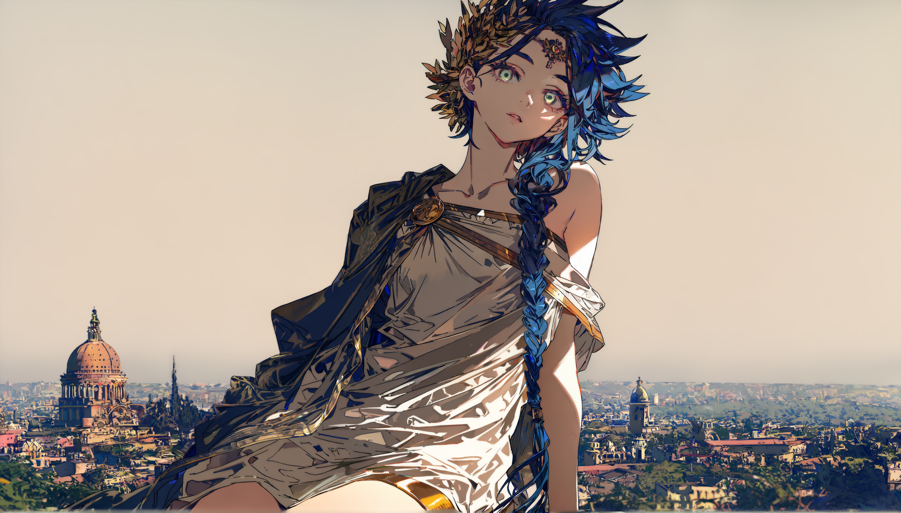

**鼓¯꒳¯** (2026-05-18 06:11:25):
# 自我

-「我为自己加冕，做风的君王」
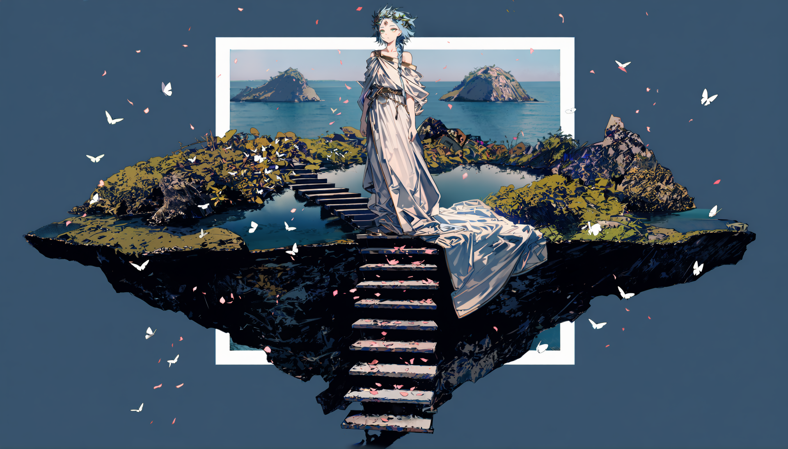

**鼓¯꒳¯** (2026-05-18 04:32:00):
-# 废案
-# 超级anima是投注，给我rupa画成啥了<:emoji_115:1379113943817257071>
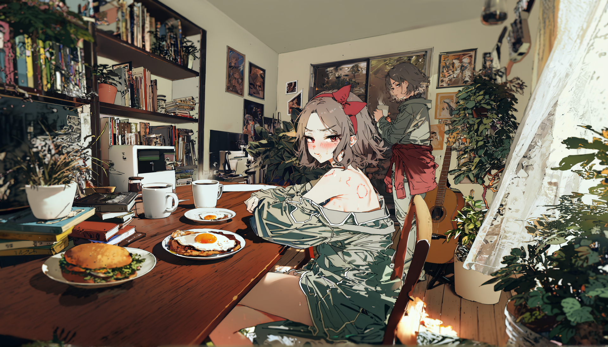

**鼓¯꒳¯** (2026-05-18 04:15:13):
花有重开日，人无再少年<:emoji_144:1380206684739338403>

**有咩** (2026-05-18 03:15:56):
<:emoji_140:1379454014852436038>

**有咩** (2026-05-18 03:15:53):
好清透又青春的感觉

**鼓¯꒳¯** (2026-05-17 17:50:37):
# 取景框

-「其实导游刚才说的话你一句都没听对吧」
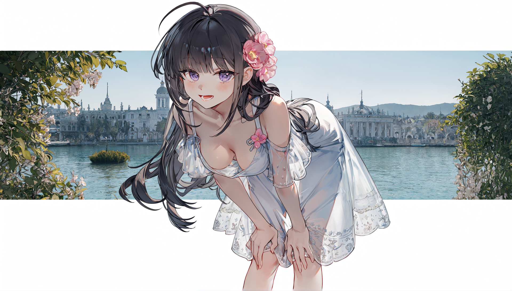

**鼓¯꒳¯** (2026-05-17 17:49:44):
# 脉搏

-「原来过了这么久还有东西在跳动」
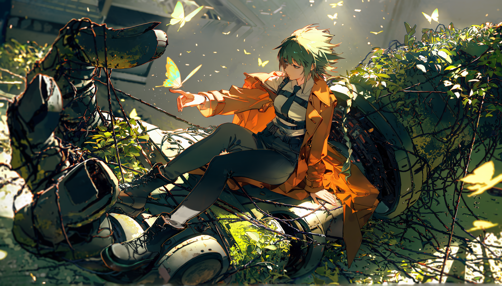

**鼓¯꒳¯** (2026-05-17 17:47:41):
# 主打歌

-「在下一首开始之前，只能看着我一个人」
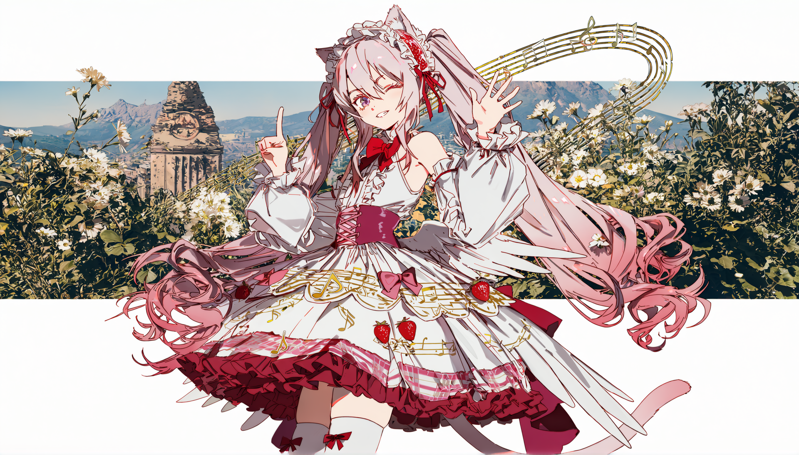

**鼓¯꒳¯** (2026-05-17 17:46:23):
# 花期

-「后来再路过这里的时候，它们已经不开了」
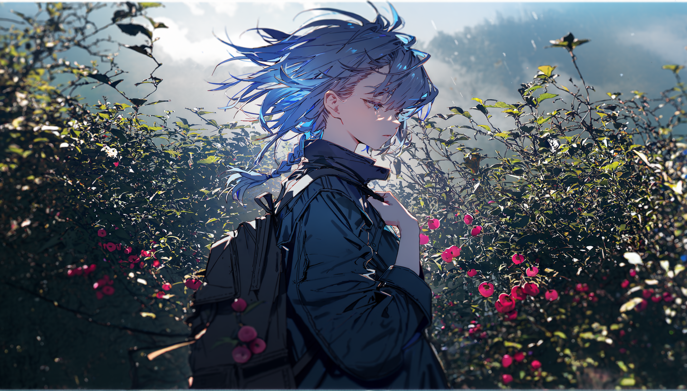

**鼓¯꒳¯** (2026-05-17 17:42:51):
# 水溶性

-「犯错了吗？」
-「没关系的，错误就像画错的颜色，很快就会被冲走」

**鼓¯꒳¯** (2026-05-17 17:31:57):
偶尔发一些感觉有意思的图图<:emoji_250:1426951835016761466> ，欢迎群友氵贴和提意见

使用B站秋叶老大的绘世启动器，checkpoint是我最爱的anima，lora堆是自制屎山杀人书。

OC镇楼：
https://img.bian666.cf/file/1779092403490_13-09-35-447651033327623_底图_00001_.webp
https://img.bian666.cf/file/1779092404125_13-09-35-447651033327623_底图_00002_.webp

