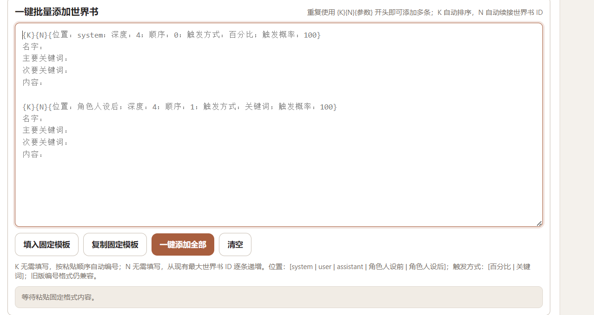
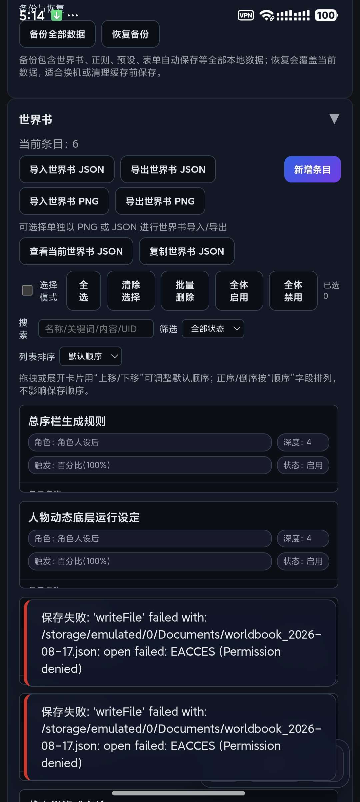

# （08.21）v2角色卡创建工具（电脑+手机双端）

来源: Discord 魅魔藏经阁 thread 1407677359481557002
创建: 2025-08-20T10:47:15.881000+00:00
消息数: 314

---

**凛堂光** (2026-08-23 14:34:13):
谢谢啦

**ain** (2026-08-23 14:20:02):

**凛堂光** (2026-08-23 14:17:43):
嗯

**ain** (2026-08-23 14:16:57):
这样的？

**凛堂光** (2026-08-23 14:08:49):
因为不想手动加了，直接用剪切板省事

**凛堂光** (2026-08-23 14:08:09):
大抵是的

**ain** (2026-08-23 13:55:29):
自动识别功能是吧。

**凛堂光** (2026-08-23 13:37:46):
能不能再简化一下世界书格式，前面变为{K}{N}{位置：深度：顺序： 触发方式：触发概率：}……一体化
K即自动排序的编号，不用再1234的手动添加
N即自动顺着最后一个世界书id逐渐递增数字的正则id
其他的主要次要关键词和内容还是原来的<@957506508676014090>

**星痕** (2026-08-23 09:36:22):
🐮

**tansen(努力成为写卡大手子😡)** (2026-08-22 17:49:55):
插眼插眼

**ain** (2026-08-21 08:13:31):
应该没问题了

**ain** (2026-08-21 08:13:22):
（08.21）v2角色卡创建工具（电脑+手机双端）

**ain** (2026-08-21 08:12:52):
修复正则和世界书json导入错误。

**凛堂光** (2026-08-21 07:25:45):
我想更新一下卡更新不了

**凛堂光** (2026-08-21 07:25:32):
正则

**ain** (2026-08-21 07:23:21):
晚上我修修

**ain** (2026-08-21 07:23:18):
看到了

**ain** (2026-08-21 07:21:30):
世界书还是正则

**ain** (2026-08-21 07:21:26):
json是哪部分的json

**ain** (2026-08-21 07:21:17):
用png

**ain** (2026-08-21 07:17:36):
我试试

**凛堂光** (2026-08-21 07:06:00):
<@957506508676014090>

**凛堂光** (2026-08-21 07:05:54):
导出的json怎么不能导入进mmd？

**鸡大** (2026-08-21 06:53:18):
太好了

**ain** (2026-08-18 04:49:43):
（08.18）v2角色卡创建工具（电脑+手机双端）

**黑白琴键（奥特曼参赛卡：残光）四组** (2026-08-18 04:49:30):
<:emoji_249:1416980114511761448>

**ain** (2026-08-18 04:49:18):
试试这个呢

**ain** (2026-08-18 04:49:05):
修复已知bug

**黑白琴键（奥特曼参赛卡：残光）四组** (2026-08-18 03:53:02):
对

**ain** (2026-08-17 23:18:14):
手机的吗】

**ain** (2026-08-17 23:17:31):
我修过没试

**ain** (2026-08-17 23:17:27):
我看看

**黑白琴键（奥特曼参赛卡：残光）四组** (2026-08-17 21:22:39):
最下面的一整个大的导出点了就闪退咋回事啊

**ain** (2026-08-17 14:01:21):
应该可以了

**ain** (2026-08-17 14:01:19):
文件改为写入应用专属目录（无需存储权限，不会再报 EACCES）。

**ain** (2026-08-17 09:26:25):
你先用上个版本试试

**ain** (2026-08-17 09:26:18):
晚上看看

**李川** (2026-08-17 09:19:49):
世界书导不出来

**李川** (2026-08-17 09:19:26):
对的

**ain** (2026-08-17 09:15:04):
新的吗

**李川** (2026-08-17 09:14:21):
这种怎么解决

**李川** (2026-08-17 09:02:59):
👍

**李川** (2026-08-17 09:02:57):
666，应该早点来看了，搞我半天了

**ain** (2026-08-17 00:07:34):
（08.17）v2角色卡创建工具（电脑+手机双端）

**ain** (2026-08-17 00:06:47):
1.0.11 更新日志

安卓版：物理返回键改为逐层关闭弹窗，全部关闭后才退出应用

世界书卡片新增「上移/下移」按钮，手机上也能调整顺序

新增键盘快捷键：Esc 关闭弹窗，确认框内按 Enter 直接确认

所有阻塞式弹窗提示改为底部轻量通知，不再打断操作

世界书新增搜索（名称/关键词/内容/UID）和「仅启用/仅禁用」筛选

世界书删除（单个/批量）和正则规则删除改为即删即生效，6 秒内可一键撤销

新增「备份全部数据」：一键导出 JSON 备份（含世界书、正则、预设、表单等全部数据）

新增「恢复备份」：导入备份文件即可完整还原，换机、清缓存不丢数据

修复：世界书拖拽排序不生效的问题

拖拽排序增加视觉反馈：拖动中的卡片变暗、目标位置高亮

修复：展开一张世界书卡片时，同一排其他卡片被拉高出现空白的问题

世界书列表改为独立滚动区域，条目再多也无需整页翻动，搜索/筛选/批量操作始终可见

**凛堂光** (2026-08-16 11:58:58):
这下终于是舒服了，辛苦你啦

**ain** (2026-08-16 11:53:07):
应该没问题了

**ain** (2026-08-16 11:53:03):
1.0.8 更新日志（按顺序）
一、修复正则编辑窗口「大退」问题（本次新增）

1.点击规则「查看/编辑」打开的编辑窗口，叉号和「取消」现在只关闭编辑框、保留规则列表；之前会把整个正则管理窗口一起关掉。

**ain** (2026-08-16 11:40:03):
ok

**ain** (2026-08-16 11:40:02):
正则改为小退是吧

**凛堂光** (2026-08-16 11:29:25):
对了正则的条目点那个叉号是直接大退，不论点哪里退出都是大退，能不能优化成小退

**凛堂光** (2026-08-16 11:28:34):
谢谢啦

**ain** (2026-08-16 11:27:27):
ok搞掉了

**ain** (2026-08-16 10:12:31):
（08.16）v2角色卡创建工具（电脑+手机双端）

**ain** (2026-08-16 10:11:38):
## 本次 1.0.7 更新内容（按顺序）

**一、修复世界书条目「删不掉」的问题**（手机端用户反馈的 bug，与设备无关）

1. **问题原因**：部分导入路径会给多条世界书条目分配**同一个 UID**（典型场景：导入的角色卡里内嵌世界书条目缺少 ID 时，会生成几条同名「未命名条目」且共享 UID）。UID 重复后，点删除实际删掉的是别的条目，看起来就是「删不掉」；多选时勾选 3 条也只显示「已选 1」。
2. **修复所有导入路径的 UID 分配**：角色卡导入、世界书 JSON 导入（含重命名冲突分支）、世界书 PNG 导入，现在同一批导入的条目 UID 必定互不重复、也不会和已有条目冲突。
3. **旧数据自动修复**：升级后打开应用，载入时会自动把历史上已产生的重复 UID 重新分配——之前「删不掉」的未命名条目升级后即可正常删除，无需任何手动操作。
4. **附带修复**：之前同一批无 ID 的条目导入时会互相覆盖导致条目丢失，现在全部保留。

**二、修复主题切换不完全的问题**（部分界面残留默认深色配色）

5. 交互编辑器 / 预设管理弹窗里的**标签胶囊**不再残留深灰底色。
6. 正则设置弹窗顶部的**规则控制条**跟随主题配色。
7. 弹窗**滚动条**（轨道和滑块）跟随主题，浅色主题下不再是黑色滚动条。
8. 可拖拽弹窗的阴影、绿色提示文字改用主题色，浅色主题观感统一。

**ain** (2026-08-15 08:17:31):
。。。

**凛堂光** (2026-08-15 07:26:08):
只能算隐藏bug了

**凛堂光** (2026-08-15 07:25:48):
我都删完了……

**ain** (2026-08-15 06:38:30):
你详细描述下，截个图

**ain** (2026-08-15 06:38:23):
主要我没法复现，也不知道怎么修

**ain** (2026-08-15 06:38:12):
感觉是不是有数据重复了

**凛堂光** (2026-08-15 06:35:46):
是之前生成的未命名，只有三个，我一直删下面的删不掉，接着我选了三个只显示一个，我删了后剩下两个，另外两个可正常删除

**ain** (2026-08-15 03:37:50):
删了看不出来呀

**ain** (2026-08-15 03:37:46):
你是不是创建的未命名太多了

**ain** (2026-08-15 03:37:39):
我手机试了也没问题

**ain** (2026-08-15 03:35:19):
我电脑没问题

**凛堂光** (2026-08-15 03:35:19):
手机

**ain** (2026-08-15 03:35:14):
手机电脑

**凛堂光** (2026-08-15 03:35:05):
就是点那个删除删

**ain** (2026-08-15 03:34:34):
你怎么删除的

**ain** (2026-08-15 03:34:30):
我也删的了

**凛堂光** (2026-08-15 03:34:11):
就是没编辑的

**凛堂光** (2026-08-15 03:34:05):
未命名的删不了

**ain** (2026-08-15 03:34:02):
我没法复现

**ain** (2026-08-15 03:33:57):
截图，具体哪个地方，手机还是pc

**ain** (2026-08-15 03:33:31):
我删除没问题呀

**ain** (2026-08-15 03:31:55):
不排序你试试

**凛堂光** (2026-08-15 03:25:09):
<@957506508676014090> 再修修

**凛堂光** (2026-08-15 03:22:14):
就是单个世界书删不掉

**凛堂光** (2026-08-15 03:21:58):
怎么删不了世界书了

**ain** (2026-08-15 01:31:13):
（08.15）v2角色卡创建工具（电脑+手机双端）

**ain** (2026-08-15 01:31:00):
1.0.6 更新内容
1.世界书新增“列表排序”：默认顺序、顺序正序、顺序倒序、最新在前，选择后刷新也会记住。
2.选“最新在前”后，新添加的条目直接显示在最上面，不用再往下翻。
3.排序模式下自动禁用拖拽，避免误排；默认顺序下仍可拖拽调整条目顺序。
4.修复“复制固定模板”换行失效的问题：复制出来的内容现在就是真实换行（Windows CRLF 格式），粘贴到记事本、聊天框、输入框都能正常分行，不再出现 1\nid： 挤成一行的情况。
5.同时保留 \n 写法的兼容，之前复制的旧格式也能继续解析。

**ain** (2026-08-14 14:39:34):
不过也可以用v4f，明天我用ds修一下算了。

**ain** (2026-08-14 14:22:45):
<:1000168510:1298906820638674984>

**ain** (2026-08-14 14:22:34):
额度没重置呀，得等我几天回复codex额度

**凛堂光** (2026-08-14 14:21:53):
<@957506508676014090> 还没修好吗？尽管有些遗憾但也还是谢谢你了，希望明天能早点修好

**ain** (2026-08-14 11:51:19):
避免写超了导入mmd不完整

**ain** (2026-08-14 11:51:09):
突破不了，这是给mmd专门限制的

**Deleted User** (2026-08-14 11:50:24):
<@957506508676014090>

**Deleted User** (2026-08-14 11:46:55):
字数限制能突破一下吗？因为这个工具没有魅魔的“功能栏”，有的正则我导不进酒馆

**凛堂光** (2026-08-14 08:33:06):
好

**ain** (2026-08-14 08:32:59):
等我额度恢复

**ain** (2026-08-14 08:32:54):
记录了

**ain** (2026-08-14 08:32:45):
记录了

**凛堂光** (2026-08-14 08:32:16):
复制的格式不带/n，修一下<@957506508676014090>

**李川** (2026-08-14 03:22:25):
问一下世界书条目顺序怎么调，或者说有没有正序倒序之类的，我手打世界书太多了，新增条目在最上方，但是最新的条目却在最下面，我要翻好久<:09:1298281821976531027>

**ain** (2026-08-13 16:26:32):
（08.14）v2角色卡创建工具（电脑+手机双端）

**ain** (2026-08-13 16:23:04):
新增功能：
按 1、2、3…… 固定格式一键批量添加世界书。
空 ID 或重复 ID 自动顺延。
任意一条有错误时整批不写入，防止只导入一半。
内容中的换行和冒号完整保留。
同一份内容禁止误点重复添加。
兼容原来的快速识别格式。

**凛堂光** (2026-08-13 14:45:52):
也行

**ain** (2026-08-13 14:42:15):
这样差不多

**ain** (2026-08-13 14:42:11):
依靠换行不显示
顺序：1
id：

**凛堂光** (2026-08-13 14:28:32):
1/id/名字/位置/深度/顺序/触发条件/触发概率/主要关键词/次要关键词/内容
2/id/名字/位置/深度/顺序/触发条件/触发概率/主要关键词/次要关键词/内容
这样子，依靠换行和前面那个数字来辨别

**凛堂光** (2026-08-13 14:25:09):
我写吗？

**ain** (2026-08-13 14:23:15):
你给我个格式，我来搞进去

**凛堂光** (2026-08-13 10:58:46):
增加个一件添加世界书的功能得吗？一个一个的有点麻烦，我以前还能这样但是现在不想这样了，就是不通过文件而是通过一段信息快速输入变成世界书 <@957506508676014090>

**ain** (2026-08-10 16:11:46):
兄弟们多提出修改意见我好修改呀。

**ain** (2026-08-10 16:09:09):
（08.11更新）v2角色卡创建工具（电脑+手机双端）

**ain** (2026-08-10 16:08:25):
1.更新了几个主题色调
2.世界书修复了复制，正则的限字改为20000字
3.手机端增加了放大收缩（未仔细测试）

**ain** (2026-08-10 13:39:39):
okok

**凛堂光** (2026-08-10 13:06:33):
移动端最好加上个能放大收缩的功能

**凛堂光** (2026-08-10 13:05:55):
如果能更新的话就谢谢啦

**凛堂光** (2026-08-10 13:05:47):
<@957506508676014090> 能不能更新个暖色调的，一直紫暗着对视觉产生负面的恶心感，还有世界书加个复制，最后正则的限字改为20000字

**波奇🎸** (2026-08-04 06:16:14):
<:emoji_150:1400299501423431771> 回顶一下

**Deleted User** (2026-07-23 03:01:01):
<:emoji_133:1379494883227734157>

**ain** (2026-07-23 00:23:11):
当时好像问了

**ain** (2026-07-23 00:23:06):
mmd的这个位置好像没有对接词组

**Deleted User** (2026-07-22 17:31:21):
没找到魅魔的“功能栏”<:1000168510:1298906820638674984>

**crifcott** (2026-04-01 13:08:21):
还有战队😮😮😮

**阳玉** (2026-03-30 14:54:46):
额啊

**阳玉** (2026-03-06 13:46:52):
<:emoji_250:1459542480406970432>

**阳玉** (2026-03-06 09:50:46):
<:emoji_150:1400299501423431771>

**ain** (2026-01-22 08:19:18):
一般用不到5，并且有深度那个选项也无所谓，魅魔没有导入进去就没有。

**ain** (2026-01-22 08:18:39):
深度这个不影响用

**诺G1a5n1n0v** (2026-01-22 07:53:21):
深度设定的问题解决了吗？想用创建工具写卡，网页端写起来有点太坐牢了

**ain** (2026-01-10 22:42:38):
当时没搞适配这个，到时候有时间我改一下。

**星烨** (2026-01-10 20:34:53):
大佬，我发现一个小问题，我用工具创建世界书，注射深度最多只能写到4，就算写5，保存后也会变成4，还有就是如果位置选择角色设定前，应该没有深度这个条目

**夏祈歌** (2025-12-31 10:51:44):
<:emoji_140:1379454014852436038>

**ain** (2025-12-28 15:04:20):
可能用的人比较少吧

**世玉** (2025-12-28 15:01:28):
但为什么只有我在撕咬=-=

**ain** (2025-12-28 14:57:45):
可算正常了，有bug在反馈给我

**ain** (2025-12-28 14:57:35):
<:1000168510:1298906820638674984>

**世玉** (2025-12-28 14:53:57):
如野狗般的撕咬感（指追杀bug）

**世玉** (2025-12-28 14:53:45):

**世玉** (2025-12-28 14:53:44):
正常了

**ain** (2025-12-28 14:50:25):
又来了，试试吧。我也没测试

**世玉** (2025-12-28 14:16:08):
感觉我有些每日折磨澄清（）

**ain** (2025-12-28 14:06:05):
行，我把这个去掉

**世玉** (2025-12-28 13:31:48):
“”和[]会有些影响

**世玉** (2025-12-28 13:31:34):

**ain** (2025-12-28 13:14:03):
应该是吧，你导入到mmd试试

**世玉** (2025-12-28 12:45:26):
和外面的[]

**世玉** (2025-12-28 12:45:03):
这样是正常的吗，好像都多了个“”

**世玉** (2025-12-28 12:44:55):

**世玉** (2025-12-28 12:44:54):
思

**ain** (2025-12-28 11:56:28):
（12.28更新）v2角色卡创建工具（电脑+手机双端）

**ain** (2025-12-28 11:55:28):
加上去了，但是没测试，你看看有没有问题了。

**ain** (2025-12-27 12:36:41):
这个也简单

**ain** (2025-12-27 12:36:38):
我后面加一个判定逻辑

**世玉** (2025-12-27 12:35:41):
是导入mmd导出的内容

**世玉** (2025-12-27 12:35:35):
呸，说错了

**ain** (2025-12-27 12:35:25):
我上次也修了

**ain** (2025-12-27 12:35:20):
导出现在没问题了吧

**世玉** (2025-12-27 12:20:19):
不过导出不了的问题是确实存在的

**世玉** (2025-12-27 12:19:55):
那为什么我的会有问题——

**世玉** (2025-12-27 12:19:48):
<:emoji_114:1379110202694963270>

**ain** (2025-12-27 12:18:45):
其实mmd也可以逗号隔开

**ain** (2025-12-27 12:18:31):
。。。

**世玉** (2025-12-27 12:15:22):
MMD的也理所当然不会被读取了？我也不确定是不是这样

**世玉** (2025-12-27 12:15:13):
所以这边的塞进MMD甚至会几个分割的变成XX，YY，ZZ的一个关键词

**世玉** (2025-12-27 12:14:54):
这边的角色卡工具是用逗号来分割的

**世玉** (2025-12-27 12:14:42):
MMD本身是用回车来隔开关键词的

**世玉** (2025-12-27 12:14:32):
嗯……大概明白是为啥了？

**世玉** (2025-12-27 11:49:38):
BYD是MMD的问题

**世玉** (2025-12-27 11:49:34):
其他渠道的是有效的

**世玉** (2025-12-27 11:49:03):
我试试其他渠道的

**世玉** (2025-12-27 11:49:00):
俺导入MMD导出的还是没

**世玉** (2025-12-27 11:48:32):
难道是MMD的问题？

**世玉** (2025-12-27 11:47:05):
思，难道是我版本不对，我重下次试试

**ain** (2025-12-27 11:44:50):
下的是最新的这个吗

**ain** (2025-12-27 11:44:36):
你再试试

**世玉** (2025-12-27 11:44:22):
我再看看

**世玉** (2025-12-27 11:44:17):
居然没问题吗

**世玉** (2025-12-27 11:44:14):
嗯？

**ain** (2025-12-27 11:44:07):
试了下没问题呀

**世玉** (2025-12-27 10:56:34):
结果没想到是导入的时候压根没有×

**世玉** (2025-12-27 10:56:24):
当时我还好奇为什么导出会没有

**世玉** (2025-12-27 10:56:20):
上次我不是报过导出的问题吗

**世玉** (2025-12-27 10:56:10):
导出是有的了

**ain** (2025-12-27 10:30:19):
导入没有关键词？导出呢

**世玉** (2025-12-27 10:13:18):
不会导入关键词的

**世玉** (2025-12-27 10:13:13):

**世玉** (2025-12-27 10:13:11):
电脑导入世界书Json好像是

**世玉** (2025-12-27 10:12:50):
说起来不知道是不是bug

**ain** (2025-12-25 00:47:43):
<:emoji_140:1379454014852436038>

**Mojieyang** (2025-12-24 15:57:13):
泪目，好人啊，写卡绞尽脑汁，有了这个就太方便了，祈福大佬增寿20年

**ain** (2025-12-22 10:21:50):
手机的没测试

**ain** (2025-12-22 10:21:28):
电脑试着已经没问题了

**世玉** (2025-12-21 14:50:36):
MMD用其他渠道的世界书是可行的

**ain** (2025-12-21 14:43:12):
那我明天修一下吧

**ain** (2025-12-21 14:43:06):
用其他的可以是吗

**世玉** (2025-12-21 14:32:12):
g，世界书还是没出现

**世玉** (2025-12-21 14:32:09):

**世玉** (2025-12-21 14:29:53):
png是直接导入后没有内容，而不是没有关键词，我试试全卡吧

**ain** (2025-12-21 14:29:13):
你试试整个卡导出试试

**ain** (2025-12-21 14:28:58):
可能是字段没设置好，明天我在看看

**ain** (2025-12-21 14:28:37):
这么奇怪。

**ain** (2025-12-21 14:28:34):
用png导出测试导入到魅魔岛也没有关键词吗

**世玉** (2025-12-21 14:05:08):
放V2那和世界书这里导入都试了下，结果一样

**世玉** (2025-12-21 14:04:51):
无法导入的样子？

**ain** (2025-12-21 14:01:07):
用png测一下

**世玉** (2025-12-21 13:54:14):
我导出的是json

**世玉** (2025-12-21 13:54:05):
但好像不完全是

**世玉** (2025-12-21 13:53:44):
我一开始还以为是我的问题

**世玉** (2025-12-21 13:53:13):
好像MMD无法识别到世界书关键词？

**世玉** (2025-12-21 13:53:05):
角色卡工具导出的世界书

**世玉** (2025-12-21 13:52:05):
我不太确定是不是我的问题

**世玉** (2025-12-21 13:51:55):
思考

**ain** (2025-12-18 12:39:13):
只能用dc自带的右上角回顶

**ain** (2025-12-18 12:38:55):
魅魔的bot没这个功能

**俊霖** (2025-12-18 12:34:35):
/回顶

**ain** (2025-12-16 12:25:52):
我这个就是以备不时之需

**ain** (2025-12-16 12:25:45):
一般不用调整顺序吧

**世玉** (2025-12-16 12:25:24):
惨遭拖动单杀，bad使用习惯

**世玉** (2025-12-16 12:25:15):
<:emoji_111:1379109633184108614>

**ain** (2025-12-16 12:20:21):
拖动就是整理顺序的

**世玉** (2025-12-16 12:18:53):
发现没法用鼠标来选择复制范围，虽然也有替代办法

**世玉** (2025-12-16 12:18:41):
这个拖动功能是用来整理顺序的吗

**世玉** (2025-12-16 12:18:36):

**世玉** (2025-12-16 12:18:24):
思考

**世玉** (2025-12-16 01:58:46):
是这样

**ain** (2025-12-16 01:38:50):
一次性修改加上去好像确实没什么意义，用的情况太少了

**ain** (2025-12-16 01:38:26):
可以的

**世玉** (2025-12-16 00:35:12):
我是不是靠打开json文本一次性查找替换（？）

**世玉** (2025-12-16 00:35:01):
<:10:1298285710033424446>

**世玉** (2025-12-16 00:32:05):
把全部世界书的角色一次性更改……我之前的世界书因为不了解完全放错位置了！

**ain** (2025-12-15 13:30:35):
什么意思

**世玉** (2025-12-15 13:13:59):
素的，andand，能加个一键更改角色吗

**ain** (2025-12-15 11:32:34):
（12.15更新）v2角色卡创建工具（电脑+手机双端）

**ain** (2025-12-15 11:31:18):

**ain** (2025-12-15 11:30:45):
是不是这种的

**ain** (2025-12-14 13:54:01):
行，明天我加个

**世玉** (2025-12-14 13:53:16):
虽然实际上能很方便的用HOME END啥的来翻就是了

**世玉** (2025-12-14 13:52:59):
要说的话，世界书那个板块可以加个收纳展开？

**ain** (2025-12-14 13:52:19):
有不顺手的地方直接提，到时候我再优化

**世玉** (2025-12-14 13:51:52):
能用

**ain** (2025-12-14 13:51:33):
能用不

**ain** (2025-12-14 13:42:46):

**ain** (2025-12-14 13:42:06):
好了

**ain** (2025-12-14 13:39:53):

**世玉** (2025-12-14 13:39:41):
爱你，等待更新了！

**ain** (2025-12-14 13:34:38):
后续没反馈以为能用了呢

**ain** (2025-12-14 13:34:19):
忘记掉了

**世玉** (2025-12-14 13:32:08):
看，原来之前也有人提过

**ain** (2025-11-27 03:35:21):
新的手机版，有bug反馈

**ain** (2025-11-27 02:07:20):
用png吧

**ain** (2025-11-27 02:01:34):
新的试试吧

**凛堂光** (2025-11-26 15:38:58):
json，压根导入不进去反反复复都是“未找到可导入的世界书条目”，哪种都试了，我在网站上能导入进去

**ain** (2025-11-26 13:11:43):
还是说导入进去但是世界书的条目看不到

**ain** (2025-11-26 13:11:24):
是手机不跳出来导入的按钮

**ain** (2025-11-26 13:11:15):
你说的导入不了在哪一步

**ain** (2025-11-26 13:11:05):
我都试了啊没问题的

**ain** (2025-11-26 13:10:58):
你用的什么导入json还是png，或者整个卡导入

**白水** (2025-11-26 13:09:49):
感谢，麻烦了。<:emoji_140:1379454014852436038>

**ain** (2025-11-26 13:09:33):
我明天看看

**ain** (2025-11-26 13:09:29):
这个好像确实没注意

**凛堂光** (2025-11-26 12:40:52):
手机版本的的确是导入不了啊，网站的我能导入软件的导入不了，还有怎么切换角色位置和更改触发条件？

**白水** (2025-11-26 12:32:09):
澄清佬，我想知道角色是可以改的吗？软件里可以更改它是蓝灯或者绿灯吗？我没找到怎么改。😭

**ain** (2025-11-26 11:59:23):
我试了没问题

**ain** (2025-11-26 11:59:19):
你用的手机版本的是吧

**ain** (2025-11-26 11:59:09):
试了下可以导入到软件里

**凛堂光** (2025-11-26 10:52:12):
是无法导入进软件

**醉梦** (2025-11-26 06:36:05):
有没有谁教一下？

**醉梦** (2025-11-26 06:36:00):
词条到底怎么弄啊？

**ain** (2025-11-26 06:14:30):
是软件里面导入不了，还是保存了导入到网站上不行

**凛堂光** (2025-11-26 04:25:37):
无法导入世界书

**ain** (2025-11-26 01:22:59):
有问题告诉我，我没怎么测

**ain** (2025-11-26 01:22:43):
发了

**ain** (2025-11-26 01:22:39):
看看能不能正常用吧

**不动游戏** (2025-11-25 20:13:39):
有手机版的吗？

**凛堂光** (2025-11-25 15:24:30):
要的要的，来个手机版本的谢谢了

**ain** (2025-11-25 10:07:08):
这个电脑版本的，没人要求的话手机版本就不打包了

**ain** (2025-11-25 10:06:39):
最新世界书版本，有什么问题可以反馈

**ain** (2025-11-25 10:05:45):
（更新世界书版本）v2角色卡创建工具（电脑+手机双端）

**逆蝶（飞舞中）** (2025-09-04 16:19:06):
👀

**ain** (2025-08-27 03:12:06):
我问问去

**ain** (2025-08-27 03:11:47):
我不知道牢魅开场白的字段

**ain** (2025-08-27 03:11:31):
不行

**xi** (2025-08-27 03:04:31):
这个是不是不能设置开场白

**ain** (2025-08-27 02:32:15):
此次更新预览图

**ain** (2025-08-27 02:29:40):
此次更新内容（安卓的没测试，有问题反馈给我）：
一、实现"管理预设"功能，具体如下：

1. 为人设辅助编辑器中的PRESET_MAIN和PRESET_SUB_FOR_PERSON预设提供可视化操作界面

2. 界面需包含以下功能入口：

- 编辑现有预设

- 删除现有预设

- 新增预设

3. 实现完整的保存机制

4. 支持预设的导入与导出功能

二、为"正则管理"功能添加一键删除操作，该操作包含用户确认机制。将正则查找的字符上限调整为1000个字符，新增正则表达式保存功能时，采用点击空白区域即可关闭的提示方式

三、将预览功能替换为一个文本输入框，用于粘贴待处理文本。系统将自动识别并执行以下操作：

1. 将"查找正则表达式"部分之后到"美化/替换为"部分之前的标签闭合内容作为查找正则的内容

2. 将"美化/替换为"部分之后到闭合标签之前包括闭合标签的内容作为替换字符串的内容

3. 自动将识别到的正则模式和替换字符串分别填入对应的输入框中

4.名称直接按顺序填写为1、2、3以此类推

**ain** (2025-08-25 06:58:01):
<:emoji_149:1382330529382273116>

**xi** (2025-08-25 05:22:55):
我瞎说的

**ain** (2025-08-25 04:12:51):
不管了，不搞鸿蒙了，要不到时候更新了一下子更新太多了

**xi** (2025-08-25 04:11:34):
鸿蒙是.hlm

**初めて** (2025-08-24 09:06:07):
得亏我还有个备用机

**ain** (2025-08-24 07:16:54):
真没接触过鸿蒙的

**ain** (2025-08-24 07:16:48):
鸿蒙是什么后缀呀

**初めて** (2025-08-24 07:15:58):
有鸿蒙的吗，安卓的鸿蒙能用吗

**大爱仙尊** (2025-08-24 06:40:27):
我去，好用<:07:1298281204260278383>

**ain** (2025-08-23 05:59:44):
安卓现在导出不会有提示但是相册中能看到，**再次强调下导出的角色卡看似是图片实际是文件，要使用文件格式或者原图分享发送，不然就会损坏**

**ain** (2025-08-23 05:23:08):
修复了导入meimodu之后保存正则消失的错误，安卓版有bug晚点发。

**ain** (2025-08-23 03:16:49):
目前正则导入之后再保存会出现正则小时的bug，但是不影响保存数据

**ain** (2025-08-23 00:31:19):
<:1000168521:1298906817585352716>

**小魅** (2025-08-22 18:29:50):
可以的，我帮你发一下

**ain** (2025-08-22 09:42:10):
更新部分预览

**ain** (2025-08-22 09:40:48):
<@1135473222658297907> 魅魅我这个帖子能帮忙置顶tg写卡交流吗

**ain** (2025-08-22 09:39:08):
本次主要优化了正则管理系统详细如下：
优化正则管理系统的功能如下：
1. 字符限制规范：
- 正则名称：限制10个字符（中文按1字符计算）
- 查找内容：限制300个字符
- 替换内容：限制10000个字符
2. 显示优化：
- 替换内容区域禁用自动换行，采用横向滚动条显示超长内容
- 列表视图默认仅显示正则名称，点击"详情"按钮后才展开显示完整正则表达式和替换内容
3. 功能增强：
- 实现正则表达式实时编辑功能，支持双击修改后自动保存
- 在正则管理界面新增排序功能：
  * 添加正序/倒序切换按钮，支持一键排序
  * 支持通过拖拽方式手动调整正则项的顺序位置
4. 导入功能修复：
- 修复PNG角色卡导入时正则表达式丢失的问题，确保完整导入所有正则规则
5. 新增功能：
- 添加"清理重复规则"功能：
  * 按"查找正则+替换内容"组合进行去重，保留首条记录
  * 若重复项中存在启用状态，则保留项自动设为启用状态
  * 清理完成后自动刷新列表显示最新结果

**ain** (2025-08-20 23:24:35):
满了，呜

**黑白猫** (2025-08-20 15:23:06):
请灌注我100w a.a

**MEE6** (2025-08-20 15:01:23):
<:CHECK6:403540120181145611> 50,000 XP has been given to **<@!957506508676014090>**

**小魅** (2025-08-20 15:00:41):
来了来了，狠狠灌注！

**ain** (2025-08-20 11:28:02):
请灌注我100w

**xi** (2025-08-20 11:27:14):
请灌注我100w

**ain** (2025-08-20 10:58:17):
有问题请留言一般会尽快修

**ain** (2025-08-20 10:55:08):
<@1135473222658297907> 魅魅，这个能不能经验灌溉一波

**ain** (2025-08-20 10:52:32):
安卓的

**ain** (2025-08-20 10:51:50):
电脑的

**ain** (2025-08-20 10:51:03):
13、可以看到我们刚刚预设的内容全部都对项的完整一键导入了过来。

**ain** (2025-08-20 10:49:56):
就是这个位置

**ain** (2025-08-20 10:49:30):
12、现在meimodu的作者创作页面是完全空的，我们使用刚刚做好的v2角色卡使用meimodu自带的最上面的上传v2角色卡上传功能进行上传。

**ain** (2025-08-20 10:49:11):
11、在这个工具导出之前这个自动保存是可以在最开始点击上的，防止输入过程中的不小心关闭，最后点击导出png角色卡，然后选择随便一个你能找到的位置。
这里安卓的导出会出现提示，默认导出的有位置，有一点非常重要，这个虽然看起来是图片其实是一个储存数据的文件，所以分享时不要使用图片格式分享，只能使用原图。下面就是导入到meimodu中，看一看是否保存成功。

**ain** (2025-08-20 10:48:37):
10、点击启用导出时才会把正则一起导出，应对多个正则设置了全部启用和关闭，这里点击启用。启用之后点击关闭

**ain** (2025-08-20 10:47:54):
9、正则的界面，尽量不要输入过长导致超过meimo本身正则的限制，输入好之后点击保存。保存成功

**ain** (2025-08-20 10:47:15):
https://discord.com/channels/1205870897769095229/1407677359481557002/1541089640201719958 电脑工具跳转
https://discord.com/channels/1205870897769095229/1407677359481557002/1541089640201719958 安卓工具跳转
v2角色卡可以做到把预设好的信息一键导入到meimodu的对应设置中，也方便存档。下面是图文教程（可以理解为一项对应一个图片）：
1、先下载到你的电脑上然后点开这个
2、这是打开之后的界面
3、上传图片
4、直接看图片
5、这里是主标题，你只需要填写内容即可，<>这个已经预设，选择预设不是必须的，可以自己输入。
6、点击复制到角色人设会出现成功标志，然后就会填入到上面的设定中，这个成功提示十秒之内再次点击复制是不会重复显示的。
7、这是点击复制到之后的设定部分，不需要手动复制，只要点击只会就会自动填入，这个是点击了两次所以出现了两个重复的。
8、这里主要要说的是正则部分，也是和meimo上一样的三个框，标题，表达式和替换为，现在先打开设置正则、这个界面就是正则的添加界面，win上是可以拖动的，安卓版应该是不可以的，点击新增规则，就是增加第一条正则

