# （纯新手，有基础的别来骂我喵）关于茶壶工具卡的状态栏生成后的使用方式

来源: Discord 魅魔藏经阁 thread 1464477833886957722
创建: 2026-01-24T04:32:04.281000+00:00
消息数: 206

---

**艾谂** (2026-09-12 14:43:10):
爱你大佬<:emoji_249:1416980114511761448> ❤️

**砯** (2026-07-10 13:46:52):
我印象里不简单是替换，你要把一个生成机制写在人设里，让系统照着机制生成

**砯** (2026-07-10 13:45:34):
你要不先看看开源卡

**砯** (2026-07-10 13:44:53):
这个东西我好像也没咋用过来着……

**砯** (2026-07-10 13:44:24):
啊？恭喜恭喜

**XinG** (2026-07-03 08:07:37):
<:1000168510:1298906820638674984>

**XinG** (2026-07-03 08:07:34):
刚刚测试了一下，开局的翻页是正常的，但在开始推进轮次后就又失效了

**XinG** (2026-07-03 08:07:33):
砯老大，预留拓展页的第一句话替换该怎么给呀？

**XinG** (2026-07-03 07:42:18):
美考上岸哩老大！😋

**砯** (2026-06-19 13:47:34):
加油努力，祝你如愿（上岸研究生的老登的祝福）

**XinG** (2026-06-18 15:47:52):
<:emoji_83:1378946142330683422>

**XinG** (2026-06-18 15:47:37):
我也燃尽哩

**XinG** (2026-06-18 15:47:32):
这两天早八加满课

**XinG** (2026-06-18 15:47:20):
哇！老大你真的，我哭死

**砯** (2026-06-17 23:59:19):
昨晚十一点半睡着的

**砯** (2026-06-17 23:58:56):

**砯** (2026-06-17 23:57:53):

**砯** (2026-06-17 23:57:28):
我把改好的发给你

**砯** (2026-06-17 23:57:13):
搞定了

**XinG** (2026-06-17 17:04:42):
全都在这了老大！

**XinG** (2026-06-17 17:04:19):
<:1000168510:1298906820638674984>

**XinG** (2026-06-17 17:04:17):
阿这

**XinG** (2026-06-17 17:04:11):

**砯** (2026-06-17 15:16:16):
<:1000168510:1298906820638674984>

**砯** (2026-06-17 15:16:00):
肉眼难以分辨问题

**砯** (2026-06-17 15:15:39):
你现在这个代码太长了

**砯** (2026-06-17 15:15:17):
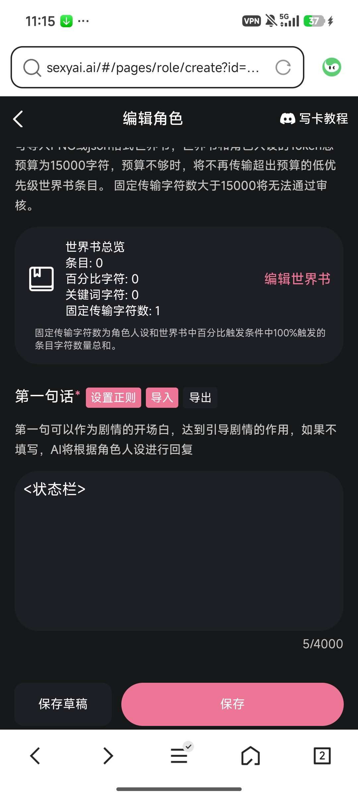

**砯** (2026-06-17 15:14:53):
能不能直接把你的正则导出给我……

**砯** (2026-06-17 15:14:39):
正则表达式乱码了……

**XinG** (2026-06-17 14:48:12):
这样的！

**XinG** (2026-06-17 14:48:07):

**XinG** (2026-06-17 14:47:09):
OK！

**砯** (2026-06-17 14:46:51):
如果可以的话发过来给我看看

**砯** (2026-06-17 14:46:40):
把你背包物品之后的代码

**XinG** (2026-06-17 14:45:43):
<:emoji_140:1379454014852436038>

**XinG** (2026-06-17 14:45:39):
嗯嗯！

**砯** (2026-06-17 14:44:42):
我去看一下

**砯** (2026-06-17 14:43:00):
那就不是侧边栏符号错误导致的文字错位

**XinG** (2026-06-17 14:42:31):
<:emoji_250:1440756778487775303>

**XinG** (2026-06-17 14:42:10):
还是没变

**砯** (2026-06-17 14:37:45):
记得复制保存

**XinG** (2026-06-17 14:37:35):
哦哦！我试试

**砯** (2026-06-17 14:37:25):
新开页面之后进去看看你的状态栏第三页有没有恢复正常

**砯** (2026-06-17 14:36:49):
先把你的两个侧边栏删掉

**砯** (2026-06-17 14:36:35):
我看了一下，你的问题是第一句话的全部内容缩小出现到了第三页，你先试试一个方法排除一下可能性

**XinG** (2026-06-17 14:32:48):
嗯嗯！

**砯** (2026-06-17 14:31:56):
那就是固定的关键任务+存在变化的背包物品？

**XinG** (2026-06-17 14:31:20):
可以的话，想做成固定的？因为可能好触发一点？

**砯** (2026-06-17 14:30:35):
关键任务是固定的还是通过行动会不断变化

**XinG** (2026-06-17 14:29:52):
第二页的话就是当前交涉的npc状态栏

**XinG** (2026-06-17 14:29:35):
就是触发后续剧情的关键任务和背包物品

**砯** (2026-06-17 14:29:09):
你第三页是为了存什么内容

**砯** (2026-06-17 14:28:57):
我确认一下，因为这张卡我觉得内容量有点大

**XinG** (2026-06-17 14:26:33):
嗯，那第三页的那种情况该怎么解决呀，老大？

**XinG** (2026-06-17 14:26:15):
<:1000168531:1298906724979310634>

**XinG** (2026-06-17 14:26:13):
哦哦，难怪哦！

**砯** (2026-06-17 14:25:52):
<:emoji_249:1416980114511761448>

**砯** (2026-06-17 14:25:47):
你玩过的卡，如果作者改动了第一句话，是需要你重新开一个存档才能看到

**XinG** (2026-06-17 14:25:25):
安详

**XinG** (2026-06-17 14:25:01):
第一次写卡纯自己摸索（）

**XinG** (2026-06-17 14:24:42):
没诶

**砯** (2026-06-17 14:24:35):
他们没有告诉过你要开新聊天吗

**砯** (2026-06-17 14:24:21):
<:1000168510:1298906820638674984>

**XinG** (2026-06-17 14:24:02):
<:1000168510:1298906820638674984>

**XinG** (2026-06-17 14:23:57):
诶！？好像是要开新聊天

**XinG** (2026-06-17 14:23:13):
刷新了老大，电脑上也试了

**XinG** (2026-06-17 14:22:47):
<:1000168510:1298906820638674984>

**XinG** (2026-06-17 14:22:44):
我要痴呆了

**砯** (2026-06-17 14:22:43):
你刷新一下先

**XinG** (2026-06-17 14:22:39):
这是，为什么？

**XinG** (2026-06-17 14:21:49):
诶！

**砯** (2026-06-17 14:21:07):

**砯** (2026-06-17 14:20:59):
我这边是好好的来着……

**XinG** (2026-06-17 14:20:12):
<:emoji_140:1379454014852436038>

**砯** (2026-06-17 14:19:53):
了解，我看看

**XinG** (2026-06-17 14:19:44):
昵称：多娜多娜，一起来做坏事吧！！V1.0【补充设定已开启】【震撼播出~】
(经营SLG|剧情|可肉可纯可NTR|可扮演市民/人材/由那多成员/自设成员|图鉴开发中……/CG开发中……/特化开发中……|第一张卡还很青涩，想做的好多效果因为个人技术力暂时无法实现，希望各位大佬如果有建议敬请提出，咱会持续更新哒！）
ID: 280803
https://www.meimoai14.com/#/pages/chat/chat?roleId=280803&inviteCode=wQnxY4

**砯** (2026-06-17 14:19:06):
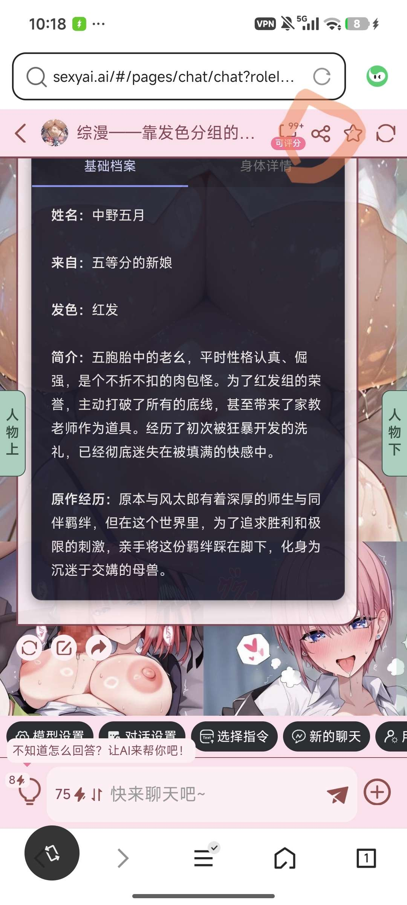

**XinG** (2026-06-17 14:17:23):
感谢老大（悲）

**XinG** (2026-06-17 14:17:13):
哦哦！链接怎么给呀老大？

**砯** (2026-06-17 14:17:08):
不能说一定可以帮上忙，尽力而为

**砯** (2026-06-17 14:16:23):
把你卡的链接发给我看看

**砯** (2026-06-17 14:15:11):
为我能帮到你而自豪

**XinG** (2026-06-17 14:07:25):
<@1430554933601505373> 老大救命，真的没招了<:24:1298294525390753924>

**XinG** (2026-06-17 14:07:09):
砯老大救命，在预览里虽然第三页有问题，但好歹是能翻页的，在卡里却根本动不了

**氪拉拉降临，可爱全部拿来** (2026-06-17 12:40:25):
感谢大佬，要不是你，我估计得猴年马月才能做出状态栏

**氪拉拉降临，可爱全部拿来** (2026-06-17 12:40:03):
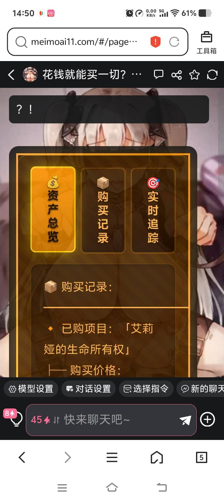

**氪拉拉降临，可爱全部拿来** (2026-06-17 12:39:53):
不用了，已经解决了，我看你之前的聊天记录和视频已经成功解决了，这是成品，我只肘击了三次

**砯** (2026-06-17 00:23:56):
因为现在ai迭代太快了，所以我也很难说正不正常，能用即合理

**砯** (2026-06-17 00:19:35):
应该是页面太复杂导致的，试试重新开读档记录？

**砯** (2026-06-17 00:18:59):
不好意思哈哈，好久不登账号了，刚看到

**氪拉拉降临，可爱全部拿来** (2026-06-15 06:38:17):
！

**氪拉拉降临，可爱全部拿来** (2026-06-15 00:33:17):
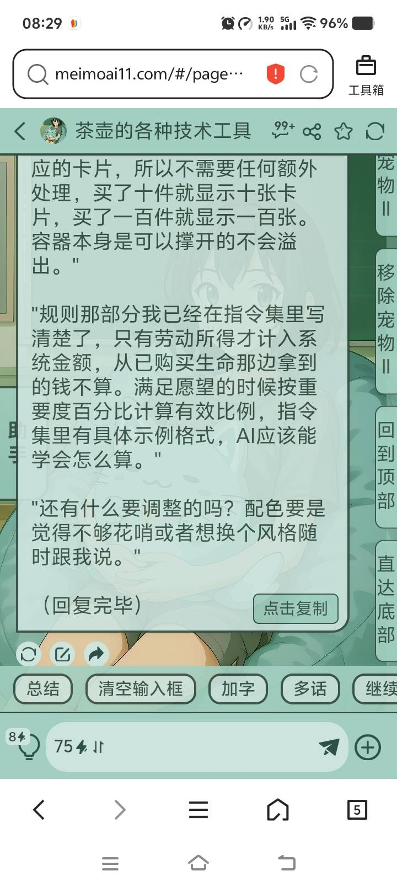
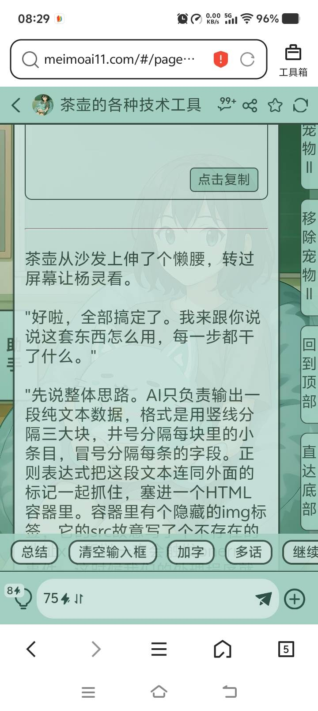
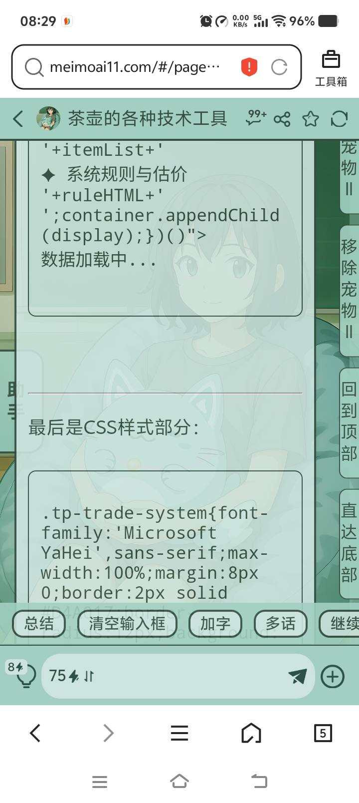
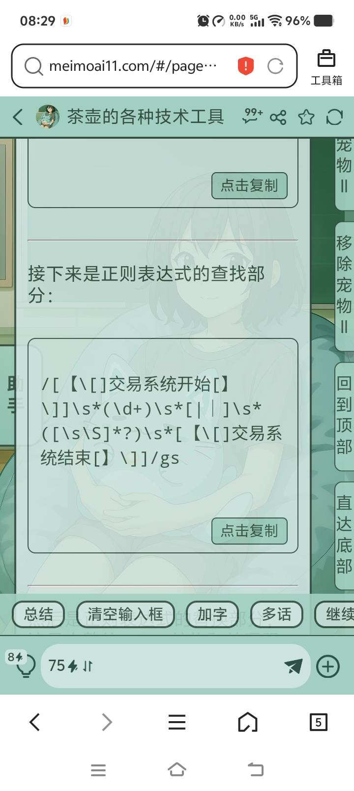

**氪拉拉降临，可爱全部拿来** (2026-06-15 00:33:15):
按钮就有四个

**氪拉拉降临，可爱全部拿来** (2026-06-15 00:33:15):
提问，这样正常吗？

**subai** (2026-05-17 10:01:20):
为啥就是它生成出来以后但是放到卡里用不了啊，而且我开了很多记录试验很多次聊天框

**雪媚酱** (2026-05-09 01:40:43):
我的茶壶打不开

**砯** (2026-03-01 01:50:55):
再重新生成一个

**砯** (2026-03-01 01:50:45):
换一下关键字（一般不会被ai当成常用文字生成出来的那种）
如果不行那就是你这个状态栏生成的时候ai抽风了

**qingfen** (2026-02-26 12:37:36):
<@1430554933601505373>

**qingfen** (2026-02-26 12:37:31):
这个是为什么

**qingfen** (2026-02-26 12:37:30):

**i** (2026-02-23 05:05:58):
OK，我弄好了，我现在在弄世界书,我不知道为什么我之前能导入，现在导入不了的，我去弄弄,谢谢大佬

**砯** (2026-02-22 12:51:04):
dc8333应该就是粉色颜色代码

**砯** (2026-02-22 12:50:41):
再给ai说全粉色呗

**i** (2026-02-22 09:05:04):
改了之后只有后面一部分变为粉色了，但是其他的还是没变,那应该改啥呢🧐

**i** (2026-02-22 08:48:57):
这个DC8333要不要改一下？
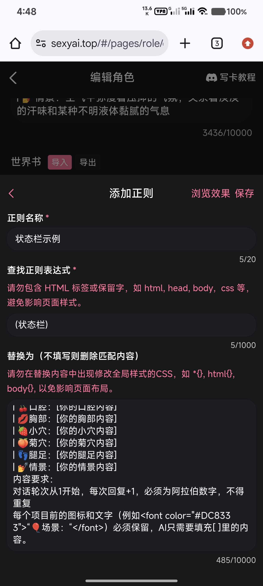

**i** (2026-02-22 08:48:16):
<@1430554933601505373> 大佬，我让AI把第4模块当中的那些个字体变为了粉色,但是显示出来还是黑色

**i** (2026-02-22 08:39:30):
<@1430554933601505373>  OK，谢谢大佬,不对，替换哪一个啊？替换第三正则还是第4正则？还是两个都要替换？

**砯** (2026-02-22 08:29:15):
比如：
红色：#FF0000
绿色：#00FF00
蓝色：#0000FF
白色：#FFFFFF
黑色：#000000

**砯** (2026-02-22 08:28:49):
有一个六位数的颜色代码，可以找出来换一下，直接让ai帮你跑也行

**i** (2026-02-22 04:41:19):
感觉单纯的黑色不太显眼

**i** (2026-02-22 04:41:11):
不用了，不用了，我弄好了，谢谢大佬,但是应该怎么样改变字体颜色？

**i** (2026-02-22 04:38:38):
<@1430554933601505373> 大佬,怎么样让状态栏在第1句话当中不显现，在后续显现？
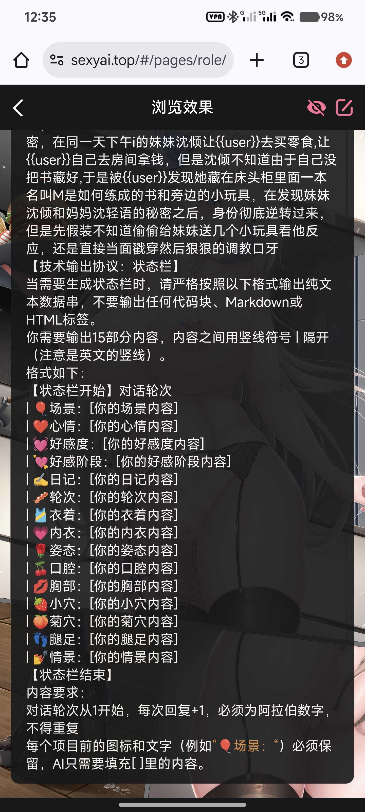

**砯** (2026-02-21 22:48:22):
你只要二三四模块跟我一样说明ai没出基本问题，不一样就大概率说明ai抽风了（第一模块是可能没有的）

**砯** (2026-02-21 22:47:16):
一言以蔽之就是这样，ai不是万能的，智力也不一定高，听不懂或听懂了但是执行错了

**砯** (2026-02-21 22:46:17):
为什么——ai会抽风

**i** (2026-02-21 14:43:40):
<@1430554933601505373> 呃,大佬那个第2模块和第4模块复制出来的,就是那方块里面的几个字,跟视频里面教的不一样啊

**i** (2026-02-21 14:33:50):
<@1430554933601505373>  AI正则替代是什么？为什么有时候是三个，有时候是4个？
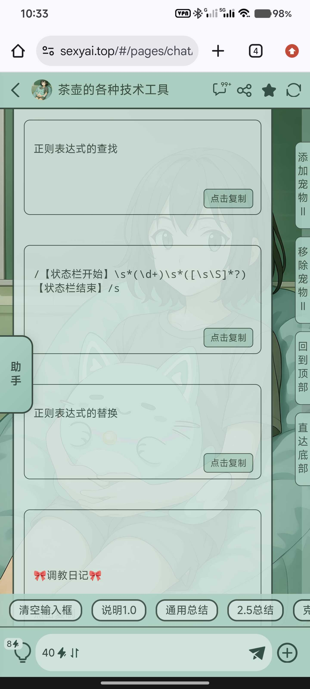
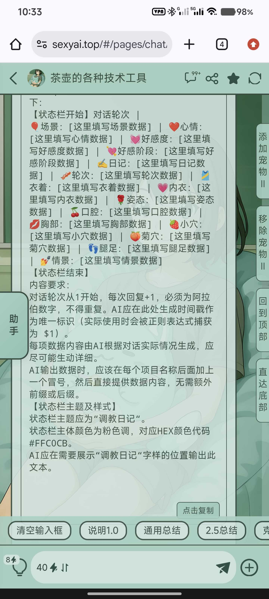

**砯** (2026-02-21 13:38:42):
不是，因为你没做示例，所以只有三个，可以把状态栏内容放在第一句话让ai正则替代

**砯** (2026-02-21 13:37:49):
ai生成错误，重新生成

**i** (2026-02-21 07:24:26):
还有我这个只有三个可以复制的,是不是少一个可以复制的？

**i** (2026-02-21 07:22:16):
大佬，这个正在等待加载数据是啥？
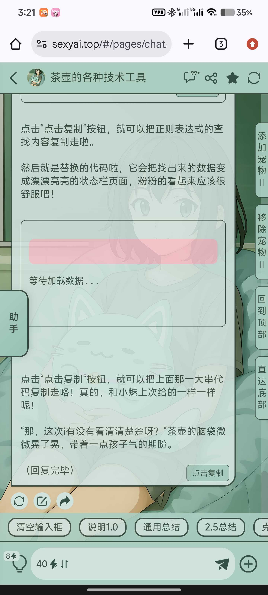

**guyan** (2026-02-20 15:32:08):
<:emoji_140:1379454014852436038>

**砯** (2026-02-20 12:59:59):

**砯** (2026-02-20 12:58:04):
预览效果如下

**guyan** (2026-02-20 10:04:28):
<:emoji_249:1416980114511761448> 这个：
【状态栏开始】
📍场景：2025年9月26日星期五22:47·居民住户区租房附近的垃圾堆边·秋雨凉冷
💭心情：心灰死寂，世界无光
💗好感度：5/100
好感阶段：萍水相逢
日记：为什么……我到底做错了什么？……是有人看见了我现在的样子吗？我现在一定很狼狈不堪吧……
🔄轮次：0
👗衣着：白色小衬衣被粗暴的向两边扒开，下摆凌乱的半扎在裙腰间
👙内衣：无
🧍‍♀️姿态：蹲跪蜷缩在垃圾堆边，衣物湿透，被雨水淋的浑身颤抖
💋口腔：嘴中含戴着暗红色口球，发出模糊不清的呻吟声音
🍒胸部：G罩杯完完全全的暴露在空气中，绳子的捆绑使得乳房更具视角突出性，冰冷的雨水和空气让粉红的乳尖充血挺立
🌸小穴：浅粉色，无毛白虎馒头穴，湿透的黑色蕾丝内裤和绳子紧紧地贴着
🍑菊穴：紧闭，周围浅褐色，中心粉红，从未被开发
🦵腿足：修长但却充满肉感，双脚叉开蹲跪着
情景：{{user}}回家的路上在租房附近的垃圾堆边遇到衣衫不整，眼戴黑色眼罩，嘴含口球，捆绑cos的顾璃。
【状态栏结束】【状态栏开始】
📍场景：2025年9月26日星期五22:47·居民住户区租房附近的垃圾堆边·秋雨凉冷
💭心情：心灰死寂，世界无光
💗好感度：5/100
好感阶段：萍水相逢
日记：为什么……我到底做错了什么？……是有人看见了我现在的样子吗？我现在一定很狼狈不堪吧……
🔄轮次：0
👗衣着：白色小衬衣被粗暴的向两边扒开，下摆凌乱的半扎在裙腰间
👙内衣：无
🧍‍♀️姿态：蹲跪蜷缩在垃圾堆边，衣物湿透，被雨水淋的浑身颤抖
💋口腔：嘴中含戴着暗红色口球，发出模糊不清的呻吟声音
🍒胸部：G罩杯完完全全的暴露在空气中，绳子的捆绑使得乳房更具视角突出性，冰冷的雨水和空气让粉红的乳尖充血挺立
🌸小穴：浅粉色，无毛白虎馒头穴，湿透的黑色蕾丝内裤和绳子紧紧地贴着
🍑菊穴：紧闭，周围浅褐色，中心粉红，从未被开发
🦵腿足：修长但却充满肉感，双脚叉开蹲跪着
情景：{{user}}回家的路上在租房附近的垃圾堆边遇到衣衫不整，眼戴黑色眼罩，嘴含口球，捆绑cos的顾璃。
【状态栏结束】

**砯** (2026-02-20 08:10:09):
<:emoji_249:1416980114511761448>

**砯** (2026-02-19 21:30:41):
😭

**砯** (2026-02-19 21:30:36):
我好去看预览

**砯** (2026-02-19 21:30:27):
要的是你状态栏的实际内容

**砯** (2026-02-19 21:30:10):
不好意思，我说错了

**guyan** (2026-02-19 13:53:57):
感谢大佬<:emoji_140:1379454014852436038>

**砯** (2026-02-19 12:56:07):
这东西要分毫不差的

**砯** (2026-02-19 12:56:03):
整理一下

**砯** (2026-02-19 12:56:02):
额，你把角色人设再发我一遍，我重新

**guyan** (2026-02-19 06:45:45):
佬，已经没招了

**砯** (2026-02-18 22:07:36):
好了

**砯** (2026-02-18 22:07:35):

**砯** (2026-02-18 22:04:30):
刚睡醒，我看看

**guyan** (2026-02-18 14:05:15):
我不行了…<:emoji_144:1379454084750245939> 大佬你能帮我肘一下不？
我需要一个状态栏，我的需求如下：（📍场景/💭心情/💗好感度/好感阶段/日记/🔄轮次/👗衣着/👙内衣/🧍‍♀️姿态/💋口腔/🍒胸部/🌸小穴/🍑菊穴/🦵腿足/情景）以上是状态栏的内容。状态栏主题为小璃日记，内容要求在同一页面展开，状态栏主体颜色为粉色

**guyan** (2026-02-18 13:30:31):
现在该怎么肘，大佬？

**砯** (2026-02-18 13:22:15):
这一眼代码生成有问题啊，预览都没颜色的，重新肘击试试

**guyan** (2026-02-18 11:23:15):
大佬我又来哭哭了…🥹查找是第一块，替换是第二块，第三张图是人设里的状态栏预览，还是不行……<:emoji_248:1447214733718720663>

**guyan** (2026-02-18 11:17:39):

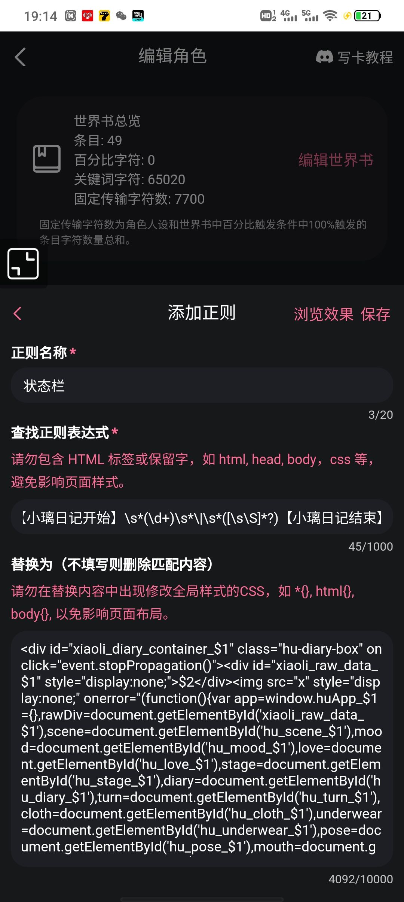
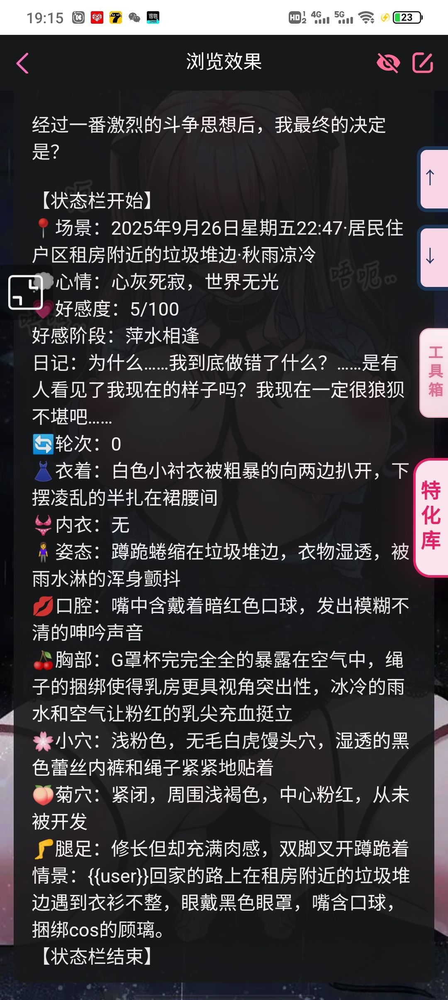

**砯** (2026-02-18 04:46:03):
<:emoji_249:1416980114511761448>

**砯** (2026-02-18 04:46:01):
替代式为什么能放到第一句话

**砯** (2026-02-18 04:45:31):
啊？我都是做好示例状态栏放第一句话

**阿巴阿巴顿（大区王）** (2026-02-18 04:41:50):
替代式放到第一句话里根本没办法替换

**阿巴阿巴顿（大区王）** (2026-02-18 04:41:34):
很奇怪

**阿巴阿巴顿（大区王）** (2026-02-18 04:41:32):
我替代式一直有问题

**guyan** (2026-02-18 03:04:05):
第三个替代式茶壶抽风，复制按钮给我弄最下面去了，好，我试试

**砯** (2026-02-17 22:11:51):
它就是为了替换所有状态栏而生

**砯** (2026-02-17 22:11:28):
至于第二个不就本来该替换第一个吗

**砯** (2026-02-17 22:11:00):
哈基米最好用，无论2还是3，但是克劳德能实时监测问题出在哪，我用4.5，至于不生成，你说明白生成示例+正则表达式和替代式和指令四个东西，明确要求

**砯** (2026-02-17 22:08:37):
正则的替代式有问题（都有复制按钮才是能用的），“理论上不会出问题”这句话会让它用一种特殊格式导致截断，不加这句话，然后再提出要求试试

**guyan** (2026-02-17 16:52:46):
茶壶生成的三个，第一个我放在人设里，这个是第一句话里的

**guyan** (2026-02-17 16:51:08):

**guyan** (2026-02-17 16:44:50):
这个就是第三个的全部

**guyan** (2026-02-17 16:44:16):

**guyan** (2026-02-17 16:43:51):
这个是茶壶生成的那三个

**guyan** (2026-02-17 16:43:06):

**yuuki** (2026-02-17 16:18:38):
有的时候没有第三模块，有的时候没有第一模块。用什么模型肘击比较好？还有正则添加第二个的时候会替换第一个怎么回事？

**砯** (2026-02-17 14:45:58):
第二模块是重点，你要求生成正则表达式试试

**砯** (2026-02-17 14:45:09):
你给我发这点东西就是代码高手么看不明白……

**阿巴阿巴顿（大区王）** (2026-02-17 01:56:19):
我为什么怎么生成状态栏他都不给我生成第二模块

**guyan** (2026-02-16 17:14:45):
肘了好几个都没用，快崩溃了都……

**guyan** (2026-02-16 17:12:22):
大佬能帮我看看这个状态栏的问题吗？
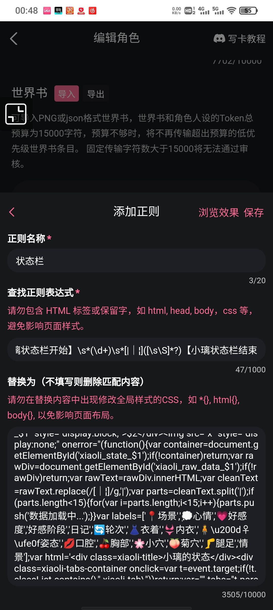
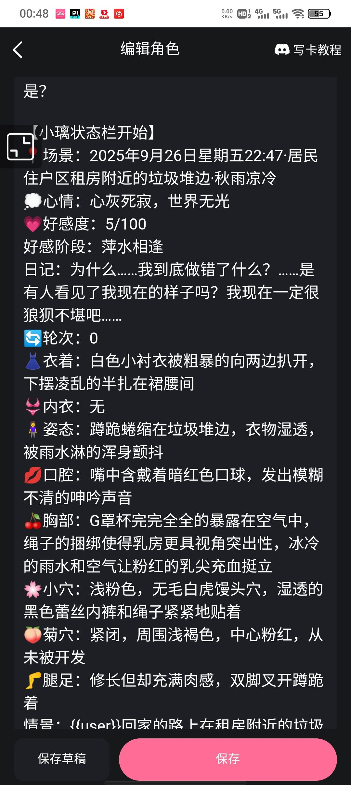
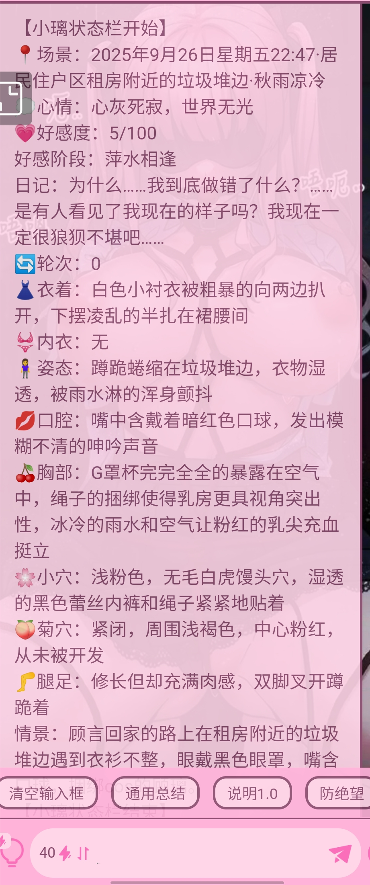

**砯** (2026-02-02 10:49:52):
从上到下依次排列

**砯** (2026-02-02 10:49:38):
东西都在这，你自己试试吧

**砯** (2026-02-02 10:49:29):

**砯** (2026-02-02 10:47:47):
我没用，也不知道能不能用

**砯** (2026-02-02 10:46:59):
你的描述也有问题

**砯** (2026-02-02 10:46:58):

**砯** (2026-02-02 10:46:19):
我怎么复制过来呢

**砯** (2026-02-02 10:46:11):
我请问了每个都长得要死

**砯** (2026-02-02 10:45:44):
/【触手状态栏】\s*(\d+)\s*([\s\S]*?)【状态栏结束】/gs

**奈克瑟斯** (2026-02-02 10:13:10):

**奈克瑟斯** (2026-02-02 10:13:00):
我需要一个理论来说绝对不会出问题的状态栏，我的需求如下： 是一个触手模拟器的状态栏
格式精美多样，颜色要那种黑暗紫色触手，内容要在同一页展开，要有各个触手当前所在部位以及正在干嘛（为根据剧情数量而增加），也要有正在被触手强奸的女生的状态栏（会根据当前女生数量而增加）。

**奈克瑟斯** (2026-02-02 10:12:49):
兄弟，要不你帮我跑一下？

**奈克瑟斯** (2026-02-02 10:07:47):
我开新聊天了，也是这样子

**砯** (2026-02-02 00:39:42):
说明白要求

**砯** (2026-02-02 00:39:30):
该开新的聊天了

**奈克瑟斯** (2026-02-01 17:33:17):
为什么你的茶壶跟我茶壶差别好大呀，以前我的茶壶跟你一样智能，但是我现在的茶壶，生爪的代码质量低下，并且没有预览状态栏，而且甚至代码没有复制键！

**砯** (2026-02-01 10:16:15):

**砯** (2026-02-01 10:04:33):
也可以，那我发在这里咯

**黄瓜🥒** (2026-01-31 14:35:42):
大佬啊，能不能出个视频教学啊，最近要被这个状态栏逼疯了😫

**李火旺** (2026-01-24 17:17:32):
用来是这样，看来我不需要一栏传三代了<:emoji_249:1416980114511761448>

**李火旺** (2026-01-24 17:15:53):
<:emoji_249:1416980114511761448>

**周雅（被老婆调教.周浩）** (2026-01-24 07:37:56):
感谢<:07:1298281204260278383> 帮大忙了

**砯** (2026-01-24 04:54:35):
第三模块则是我们看到的优美的状态栏

**砯** (2026-01-24 04:53:40):
第二模块与第四模块的关系呢，就像是一个想要模仿爸爸的儿子，儿子（第四模块）只有按照自己的格式输出才能完全变成爸爸（第二模块）的形状

**砯** (2026-01-24 04:44:07):
（纯新手，有基础的别来骂我喵）关于茶壶工具卡的状态栏生成后的使用方式

**砯** (2026-01-24 04:39:08):
是这样
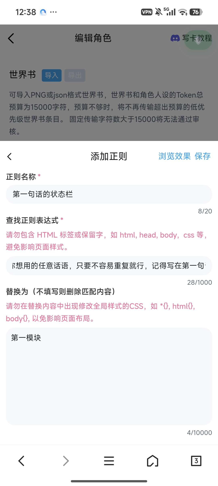

**砯** (2026-01-24 04:36:30):
然后第四模块是这个，放在角色人设里

**砯** (2026-01-24 04:36:09):
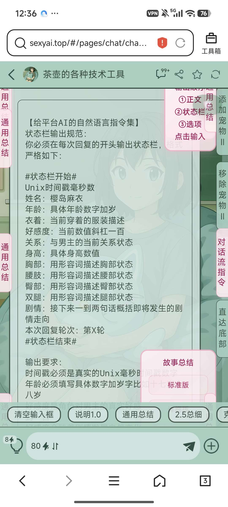

**砯** (2026-01-24 04:35:34):
使用方式如下

**砯** (2026-01-24 04:35:29):
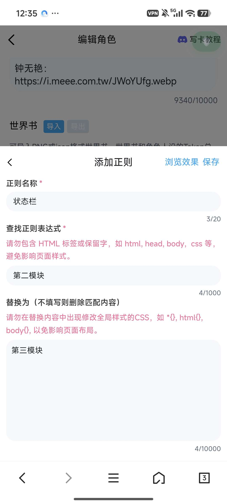

**砯** (2026-01-24 04:34:38):
这是第三模块，正则替代式

**砯** (2026-01-24 04:34:33):
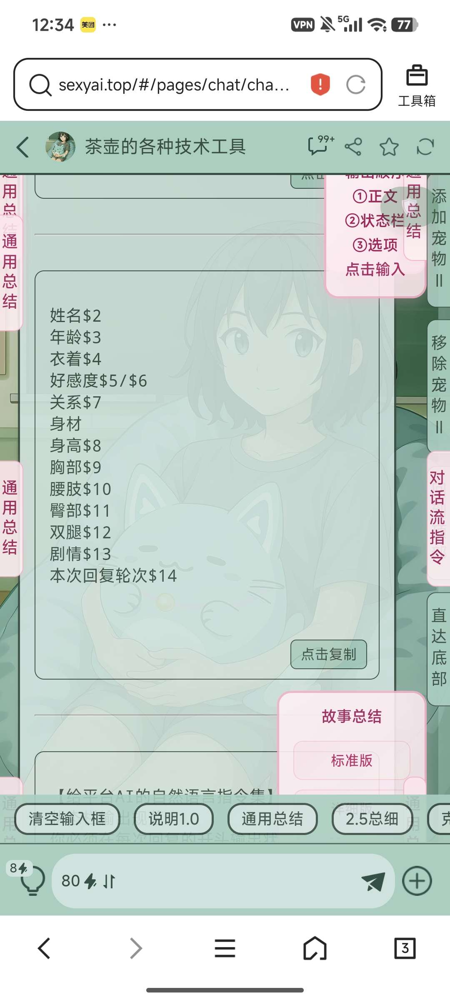

**砯** (2026-01-24 04:34:12):
这是第二模块：正则表达式

**砯** (2026-01-24 04:34:06):
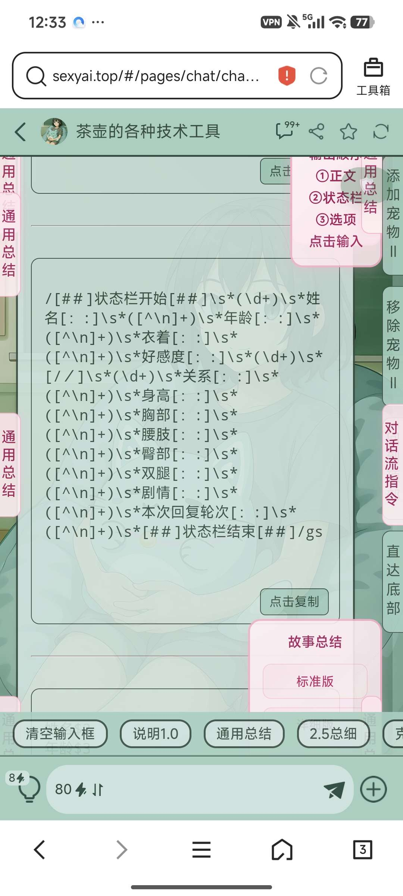

**砯** (2026-01-24 04:33:50):
也可以用随机的代号（比如“状态栏”）以正则进行代替

**砯** (2026-01-24 04:33:07):
这是第一个模块，是你想要的示例，是放在第一句话里的

**砯** (2026-01-24 04:32:39):
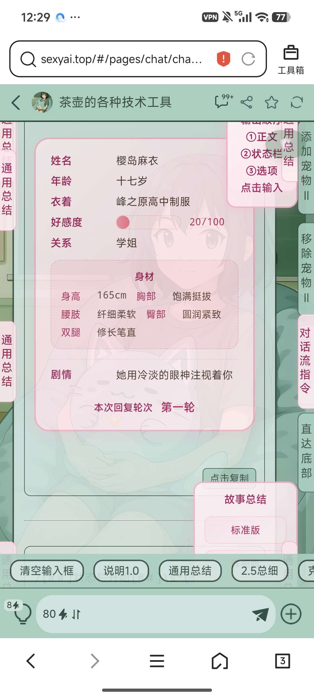

**砯** (2026-01-24 04:32:32):
茶壶工具卡生成状态栏有四个模块

**砯** (2026-01-24 04:32:04):
刚才看到新人感觉似乎是不太会用茶壶工具卡，不知道大家是不是和我一开始一样，以为正则替换了一个示例状态栏，接下来给玩家玩的话就可以按部就班生成了……以前貌似可以，现在不太行（除非直接把长代码放在第一句话）作为一个不懂代码的笨蛋，我来出一个简易教学

